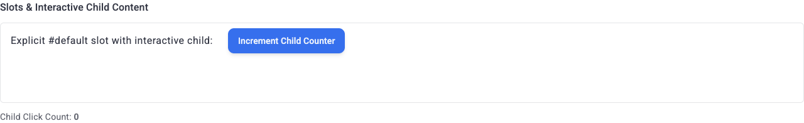
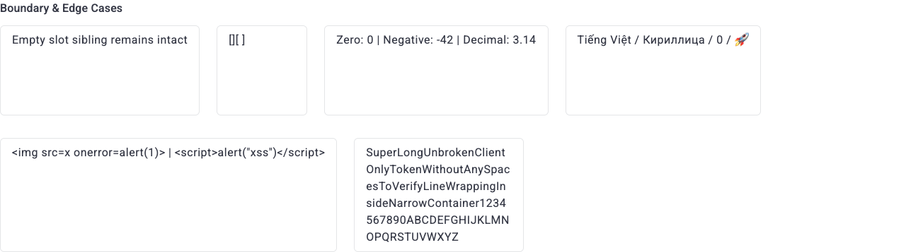
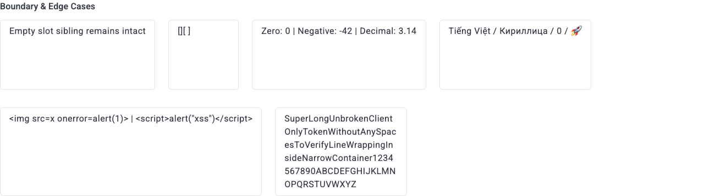
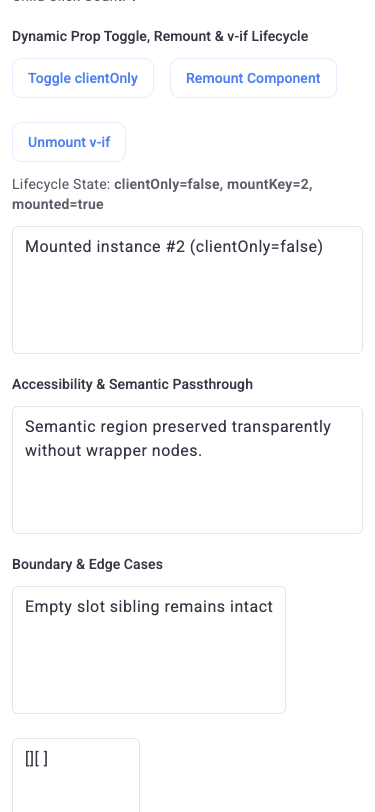

# Отчёт визуального и функционального тестирования: D1ClientOnly

## 1. Сводка выполнения

- **Компонент:** `D1ClientOnly` (`@dxtmisha/d1`)
- **Исходный код:** [`D1ClientOnly`](../../src/components/Ui/ClientOnly), [`ClientOnly`](../../../constructor/src/constructors/ClientOnly), [`DemoClientOnlyPage.vue`](../../../demo/src/pages/components/DemoClientOnlyPage.vue)
- **Целевой URL:** `http://localhost:3000/component-client-only`
- **Материалы (`materials/`):** `Отсутствуют`
- **Дата тестирования (UTC):** `2026-11-25T05:47:16Z`
- **Окружение:** `Headless Chrome (Puppeteer / CDP, Desktop 1440×900, Tablet 768×1024, Mobile 375×812 / 320×568)`
- **Покрытие тест-кейсов:** `10 / 10` (`100%`)
- **Итог:** **10 ✅, 0 ⚠️, 0 ❌** (`✅` пройдено, `⚠️` предупреждение, `❌` ошибка) — все 10 сценариев `D1ClientOnly` пройдены успешно: SSR-ответ `HTTP 200` корректно изолирует клиентский слот, дочерние элементы рендерятся прозрачно, узкий `DemoBox` (`238 === 238`) и все 4 разрешения (`1440×900`, `768×1024`, `375×812`, `320×568`) не дают переполнения, ошибок консоли и `[Vue warn]` не зафиксировано.

---

## 2. Матрица результатов

### 2.1 Визуальный рендеринг (`VIS`)

| ID | Сценарий | Статус | Наблюдаемый результат | Скриншот |
| :--- | :--- | :---: | :--- | :--- |
| `TC-VIS-001` | Рендеринг клиентского и SSR-включённого контента (`clientOnly=true` / `clientOnly=false`) | ✅ | После клиентского монтирования оба контейнера (`demo-co-default` и `demo-co-ssr`) отображают содержимое слотов без лишних DOM-обёрток, обрезки и визуальных искажений. |  |
| `TC-VIS-002` | Явный слот `#default` и вложенные компоненты дизайн-системы | ✅ | Содержимое явного слота `#default` и кнопка `<D1Button>` внутри `demo-co-slot-interactive` отображаются корректно с соблюдением отступов и выравнивания `DemoFlex`. |  |

### 2.2 Интерактивность и управление состоянием (`INT`)

| ID | Сценарий | Статус | Наблюдаемый результат | Скриншот |
| :--- | :--- | :---: | :--- | :--- |
| `TC-INT-001` | Динамическое переключение свойства `clientOnly` | ✅ | После нажатия `Toggle clientOnly` состояние обновилось до `clientOnly=false`, текст внутри `demo-co-dynamic` реактивно перестроился без артефактов. |  |
| `TC-INT-002` | Перемонтирование экземпляра через `:key` и управление жизненным циклом `v-if` | ✅ | При перемонтировании `mountKey=2` отображается `Mounted instance #2 (clientOnly=false)`; при `v-if=false` строка состояния фиксирует `mounted=false` с удалением DOM-узлов, при повторном `v-if=true` — `mounted=true` и восстановление слота. |  |
| `TC-INT-003` | Интерактивность дочерних элементов внутри `D1ClientOnly` | ✅ | Кнопка `Increment Child Counter` внутри слота реагирует на клики без потерь: зафиксировано обновление счётчика (`Child Click Count: 1` и последующий инкремент). | — |

### 2.3 Граничные случаи и устойчивость (`BND`)

| ID | Сценарий | Статус | Наблюдаемый результат | Скриншот |
| :--- | :--- | :---: | :--- | :--- |
| `TC-BND-001` | Пустой слот, пустые строки (`""`, `"   "`), числовые границы (`0`, `-42`, `3.14`) и Unicode | ✅ | Пустой `<D1ClientOnly />` не нарушает соседний элемент; значения `0`, `-42`, `3.14`, пустые строки и `Tiếng Việt / Кириллица / 0 / 🚀` отображаются корректно без потери `0`. |  |
| `TC-BND-002` | Длинная неразрывная строка в узком `DemoBox` и экранирование XSS | ✅ | `badImgs: 0`, `hasEscapedPayloadText: true` (XSS-строка экранирована как текст, `dialogs: []`); в узком контейнере `demo-client-only-page__narrow-box` `scrollWidth: 238 === clientWidth: 238` (`overflowsBox: false`). |  |

### 2.4 Адаптивность и вьюпорты (`RSP`)

| ID | Сценарий | Статус | Наблюдаемый результат | Скриншот |
| :--- | :--- | :---: | :--- | :--- |
| `TC-RSP-001` | Адаптивность на Desktop (`1440×900`), Tablet (`768×1024`) и Mobile (`375×812`, `320×568`) | ✅ | Переполнение по горизонтали отсутствует на всех 4 вьюпортах: `1440×900` (`1440 === 1440`), `768×1024` (`768 === 768`), `375×812` (`375 === 375`) и `320×568` (`320 === 320`, `overflowX: false`). |  |

### 2.5 Доступность (`A11Y`)

| ID | Сценарий | Статус | Наблюдаемый результат | Скриншот |
| :--- | :--- | :---: | :--- | :--- |
| `TC-A11Y-001` | Прозрачность DOM-структуры и сохранение семантики ARIA | ✅ | `D1ClientOnly` не создаёт промежуточных DOM-обёрток: `<section role="region" aria-label="Client-only status region" aria-live="polite">` монтируется напрямую, а `Tab` и `Enter` корректно фокусируют и активируют дочернюю кнопку. | — |

### 2.6 Консоль и стабильность runtime (`LOG`)

| ID | Сценарий | Статус | Наблюдаемый результат | Скриншот |
| :--- | :--- | :---: | :--- | :--- |
| `TC-LOG-001` | SSR-ответ HTML, чистота консоли и отсутствие `[Vue warn]` | ✅ | SSR-ответ `HTTP 200` (`hasApp: true`) скрывает `clientOnly=true` и рендерит `clientOnly=false`; `consoleErrors: []`, `vueWarnings: []`, `pageErrors: []`, `networkErrors: []`. | — |

---

## 3. AI-аудит и рекомендации

1. **Прозрачный рендеринг и SSR-изоляция:** Компонент возвращает непосредственно VNode слота `default` без лишних DOM-узлов и опирается на `DesignLogicAbstract.isMounted`, что обеспечивает предсказуемый SSR HTML (`HTTP 200`) и нулевое число предупреждений гидратации.
2. **Устойчивость на узких контейнерах и мобильных вьюпортах:** Узкий `DemoBox` (`238px`) и все четыре тестовых разрешения вплоть до `320×568` проходят с `scrollWidth === innerWidth` и безопасным экранированием XSS (`badImgs: 0`).
3. **Жизненный цикл и интерактивность:** Перемонтирование через `:key`, переключение `v-if` (`mounted: false -> true`) и интерактивные дочерние компоненты работают без утечек и ошибок рантайма (`consoleErrors: []`, `vueWarnings: []`, `pageErrors: []`).
