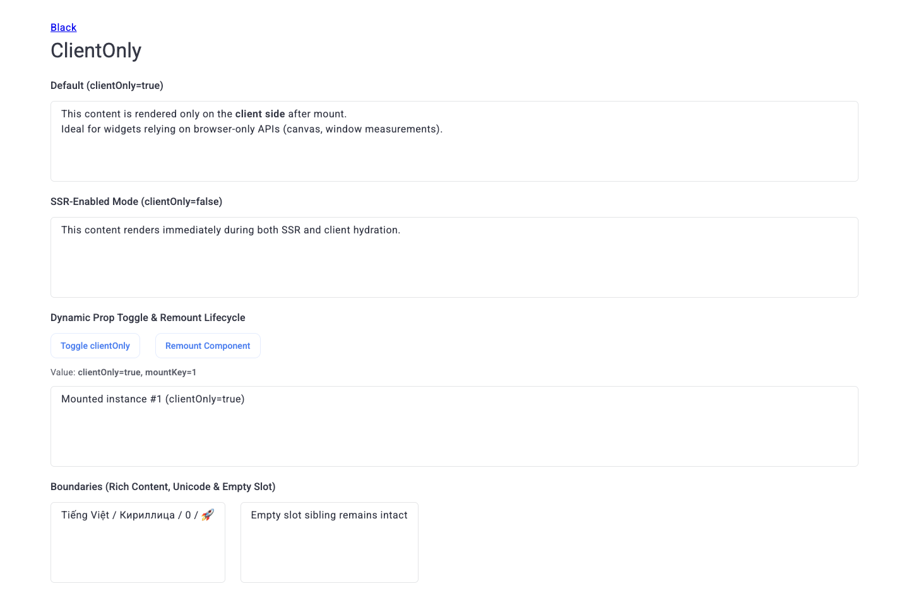
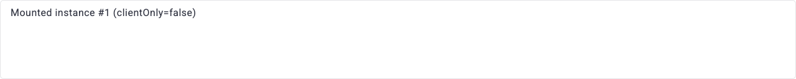
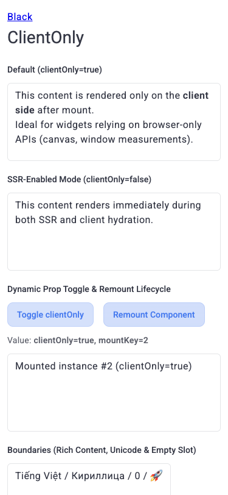

# Отчёт о визуальном и функциональном тестировании: D1ClientOnly

## 1. Итоговое резюме

- **Компонент:** `D1ClientOnly` (`@dxtmisha/d1`)
- **Исходный код:** [`D1ClientOnly`](../../src/components/Ui/ClientOnly) ([`ClientOnly`](../../../constructor/src/constructors/ClientOnly), [`DemoClientOnlyPage`](../../../demo/src/pages/components/DemoClientOnlyPage.vue))
- **Демо / целевой URL:** `http://localhost:3000/component-client-only`
- **Материалы:** `Нет`
- **Дата тестирования (UTC):** `2026-11-24T13:33:45Z`
- **Окружение:** `Headless Chrome (Puppeteer / CDP, Desktop 1440x900, Tablet 768x1024, Mobile 375x812) + SSR HTTP Check`
- **Покрытие тест-кейсов:** 8 / 8 (`100%`)
- **Итог:** **8 ✅, 0 ⚠️, 0 ❌** (`✅` пройдено, `⚠️` предупреждение, `❌` ошибка) — `D1ClientOnly` на базе нативного `DesignLogicAbstract.isMounted` корректно подавляет рендер клиентского слота в SSR HTML, немедленно рендерит `clientOnly=false` на сервере, гидратируется без единого `[Vue warn]` и чисто поддерживает динамическое переключение и перемонтирование.

---

## 2. Базовая матрица

### 2.1 Визуальное соответствие (`VIS`)

| ID | Сценарий | Статус | Фактический результат | Скриншот |
| :--- | :--- | :---: | :--- | :--- |
| `TC-VIS-001` | Рендеринг клиентского и SSR-включённого контента (`clientOnly=true` / `clientOnly=false`) | ✅ | `defaultRendered: true`, `ssrRendered: true` — оба блока отображаются прозрачно после клиентского монтирования. |  |

### 2.2 Интерактивность и управление состоянием (`INT`)

| ID | Сценарий | Статус | Фактический результат | Скриншот |
| :--- | :--- | :---: | :--- | :--- |
| `TC-INT-001` | Динамическое переключение свойства `clientOnly` | ✅ | `stateText: "Value: clientOnly=false, mountKey=1"`, `dynamicText: "Mounted instance #1 (clientOnly=false)"`. |  |
| `TC-INT-002` | Перемонтирование экземпляра через `:key` (`Remount Component`) | ✅ | `stateText: "Value: clientOnly=true, mountKey=2"`, `dynamicText: "Mounted instance #2 (clientOnly=true)"`. |  |

### 2.3 Границы и крайние случаи (`BND`)

| ID | Сценарий | Статус | Фактический результат | Скриншот |
| :--- | :--- | :---: | :--- | :--- |
| `TC-BND-001` | Unicode, число `0` и пустой слот | ✅ | `unicodeText: "Tiếng Việt / Кириллица / 0 / 🚀"`, `emptySiblingText: "Empty slot sibling remains intact"`. |  |

### 2.4 Адаптивность (`RSP`)

| ID | Сценарий | Статус | Фактический результат | Скриншот |
| :--- | :--- | :---: | :--- | :--- |
| `TC-RSP-001` | Планшетный вьюпорт (`768×1024`) | ✅ | `overflow768: false` — переполнение отсутствует. |  |
| `TC-RSP-002` | Мобильный вьюпорт (`375×812`) | ✅ | `overflow375: false` — контент корректно адаптируется под `375px`. |  |

### 2.5 Доступность (`A11Y`)

| ID | Сценарий | Статус | Фактический результат | Скриншот |
| :--- | :--- | :---: | :--- | :--- |
| `TC-A11Y-001` | Прозрачность DOM-структуры и сохранение семантики дочерних элементов | ✅ | `directParagraphs: 2` — `
` рендерятся напрямую в `DemoBox` без лишней DOM-обёртки от `D1ClientOnly`. | — |

### 2.6 Логи и консоль (`LOG`)

| ID | Сценарий | Статус | Фактический результат | Скриншот |
| :--- | :--- | :---: | :--- | :--- |
| `TC-LOG-001` | Чистота консоли браузера, SSR-ответ и отсутствие `[Vue warn]` | ✅ | SSR HTTP `200`: `hidesClientOnlyInSsr: true`, `rendersSsrEnabledInSsr: true`; `consoleErrors: []`, `vueWarnings: []`, `pageErrors: []`. | — |

---

## 3. AI-аудит и рекомендации

1. **Нативная SSR-изоляция без `ClientOnlyInclude`:** Переход на `DesignLogicAbstract.isMounted` полностью исключил риск регистрации `onMounted` вне активного `setup()` и подтверждён проверкой реального SSR HTML-ответа Nitro/Vite.
2. **Нулевой DOM-оверхед:** Компонент возвращает непосредственно VNode слота `default`, не создавая лишних wrapper-элементов в DOM-дереве.
3. **Чистота гидратации:** При реальном SSR -> клиентском переходе и при повторном перемонтировании через `:key` зафиксировано `0` предупреждений гидратации и `0` ошибок консоли.
