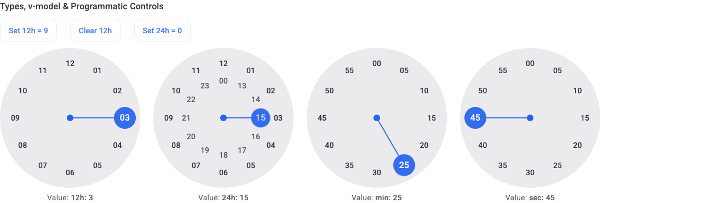
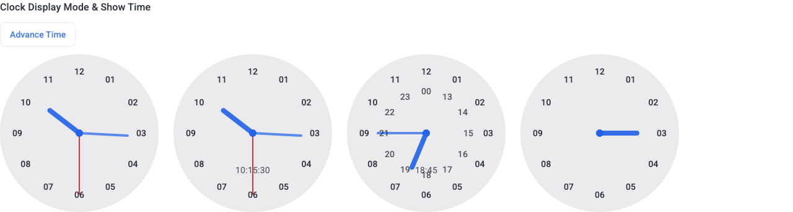
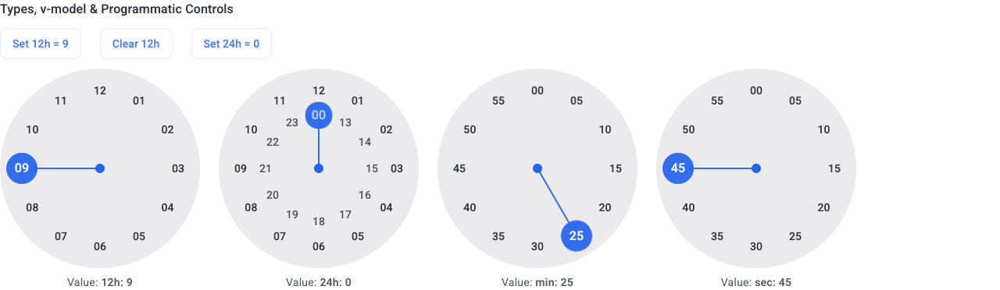
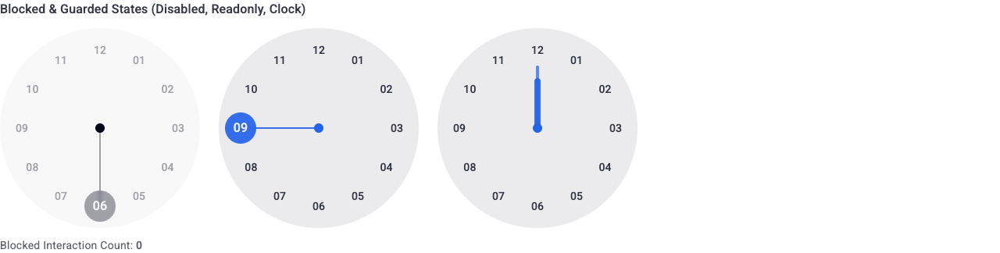
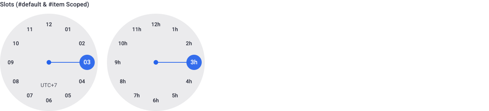
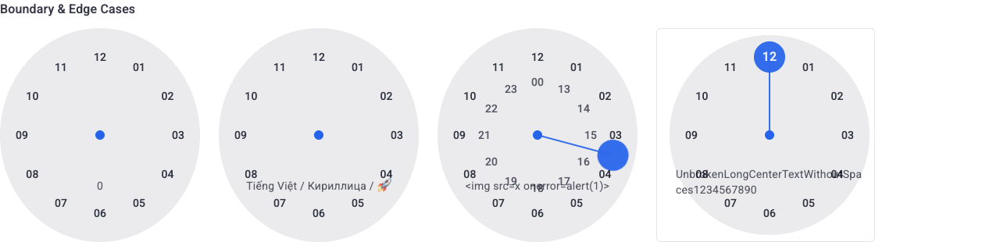
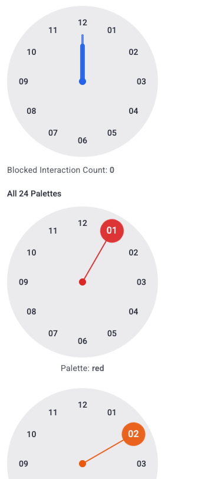

# Отчёт визуального и функционального тестирования: D1ClockDial

## 1. Сводка выполнения

- **Компонент:** `D1ClockDial` (`@dxtmisha/d1`)
- **Исходный код:** [`D1ClockDial`](../../src/components/Ui/ClockDial), [`ClockDial`](../../../constructor/src/constructors/ClockDial), [`DemoClockDialPage.vue`](../../../demo/src/pages/components/DemoClockDialPage.vue)
- **Целевой URL:** `http://localhost:3000/component-clock-dial`
- **Материалы (`materials/`):** `Отсутствуют`
- **Дата тестирования (UTC):** `2026-11-25T05:47:16Z`
- **Окружение:** `Headless Chrome (Puppeteer / CDP, Desktop 1440×900, Tablet 768×1024, Mobile 375×812 / 320×568)`
- **Покрытие тест-кейсов:** `11 / 11` (`100%`)
- **Итог:** **11 ✅, 0 ⚠️, 0 ❌** (`✅` пройдено, `⚠️` предупреждение, `❌` ошибка) — все 11 сценариев `D1ClockDial` пройдены успешно: SSR-рендер `HTTP 200`, все типы (`12`/`24`/`minute`/`second`), 24 палитры, `clock` + `showTime`, `expose`, узкий `DemoBox` (`278 === 278`) и все 4 вьюпорта (`1440×900`, `768×1024`, `375×812`, `320×568`) работают без переполнения и ошибок консоли.

---

## 2. Матрица результатов

### 2.1 Визуальный рендеринг (`VIS`)

| ID | Сценарий | Статус | Наблюдаемый результат | Скриншот |
| :--- | :--- | :---: | :--- | :--- |
| `TC-VIS-001` | Типы циферблата (`12`, `24`, `minute`, `second`) и все 24 палитры | ✅ | Все типы циферблата (`12`, `24`, `60`, `60` меток) и 24 модификатора `.d1-palette--*` рендерятся с квадратной геометрией, корректными углами меток и стрелкой `.d1-clockDial__arrowSelect` без перекрытий. |  |
| `TC-VIS-002` | Режим отображения часов (`clock`, `showTime`, частичные стрелки) и обновление времени | ✅ | Стрелки часов, минут и секунд, вариант с `:hour="3"` и форматированное время `show-time` (`12`/`24`) отображаются корректно; `Advance Time` обновляет стрелки и текст без слоя `.d1-clockDial__censor`. |  |

### 2.2 Интерактивность и управление состоянием (`INT`)

| ID | Сценарий | Статус | Наблюдаемый результат | Скриншот |
| :--- | :--- | :---: | :--- | :--- |
| `TC-INT-001` | Выбор значения по клику, перетаскивание и программное управление `v-model` | ✅ | Выбор `9` (`type="12"`) и внутренней метки `20` (`type="24"`), сброс через `undefined` и установка `24h = 0` с выделением внутренней `00` (`--section`) синхронизируются с `v-model` в обе стороны. |  |
| `TC-INT-002` | Ограничения `min`/`max`/`step` и блокировка `disabled` / `readonly` / `clock` | ✅ | Метки вне `min=3, max=9` отмечены `--disabled` и не выбираются; клики по `disabled`, `readonly` и `clock` игнорируются, счётчик срабатываний остаётся `0`. |  |
| `TC-INT-003` | Программное API `expose` (`getValue`, `setValue`, `selectByCoordinates`) | ✅ | Вызовы `setValue(6)`, `setValue(0)`, `setValue(undefined)`, `getValue()` и `selectByCoordinates(bottom)` обновляют модель и вывод: `Expose Output: model: 6 | getValue(): 6`. | — |
| `TC-INT-004` | Жизненный цикл монтирования и размонтирования через `v-if` | ✅ | При размонтировании отображается `Mounted: false`, при повторном монтировании восстанавливаются метки `01`–`12` (`Mounted: true`) без утечек слушателей и предупреждений Vue. | — |

### 2.3 Граничные случаи и устойчивость (`BND`)

| ID | Сценарий | Статус | Наблюдаемый результат | Скриншот |
| :--- | :--- | :---: | :--- | :--- |
| `TC-BND-001` | Слоты `#default` и `#item` (scoped) и значение `0` | ✅ | Слоты `#default` (`UTC+7`, `0`) и `#item` (`3h`) рендерятся точно; при `type="12"` и `:value="0"` стрелка выбора скрыта, а центр `#default` явно отображает `0`. |  |
| `TC-BND-002` | Отрицательные/дробные значения, Unicode, XSS и длинная строка в узком `DemoBox` | ✅ | Значения `-5`, `3.5` и текст `Tiếng Việt / Кириллица / 🚀` отображаются без сбоев; `badImgs: 0`, `hasEscapedPayloadText: true`, `dialogs: []`; узкий `DemoBox` (`demo-clock-dial-page__narrow-box`) имеет `scrollWidth: 278 === clientWidth: 278` (`overflowsBox: false`). |  |

### 2.4 Адаптивность и вьюпорты (`RSP`)

| ID | Сценарий | Статус | Наблюдаемый результат | Скриншот |
| :--- | :--- | :---: | :--- | :--- |
| `TC-RSP-001` | Проверка адаптивности на Desktop (`1440×900`), Tablet (`768×1024`) и Mobile (`375×812`, `320×568`) | ✅ | Квадратная геометрия `1:1` сохранена, горизонтальное переполнение отсутствует на всех 4 вьюпортах: `1440×900` (`1440 === 1440`), `768×1024` (`768 === 768`), `375×812` (`375 === 375`) и `320×568` (`320 === 320`, `overflowX: false`). |  |

### 2.5 Доступность (`A11Y`)

| ID | Сценарий | Статус | Наблюдаемый результат | Скриншот |
| :--- | :--- | :---: | :--- | :--- |
| `TC-A11Y-001` | WAI-ARIA атрибуты и клавиатурная навигация (`Arrow`, `Home`, `End`) | ✅ | Подтверждены `role="slider"`, `aria-valuemin`/`aria-valuemax`/`aria-valuenow`, `role="timer"` в режиме `clock`, `aria-disabled="true"`, `aria-readonly="true"`, `aria-hidden="true"` на декоративных слоях и переключение клавишами `ArrowRight`, `ArrowLeft`, `Home`, `End`. | — |

### 2.6 Консоль и стабильность runtime (`LOG`)

| ID | Сценарий | Статус | Наблюдаемый результат | Скриншот |
| :--- | :--- | :---: | :--- | :--- |
| `TC-LOG-001` | События (`input`, `inputLite`, `change`, `changeLite`, `update:*`) и чистота консоли | ✅ | SSR-ответ `HTTP 200` (`hasComponent: true`); события фиксируются корректно (`Event Name: update:modelValue`, `Payload: [6]`); `consoleErrors: []`, `vueWarnings: []`, `pageErrors: []`, `networkErrors: []`. | — |

---

## 3. AI-аудит и рекомендации

1. **Стабильность геометрии и адаптивность:** Пропорция `1:1` сохраняется на всех разрешениях от `1440×900` до `320×568` (`scrollWidth === innerWidth`), а узкий `DemoBox` (`278px`) корректно вмещает длинный текст без переполнения.
2. **Безопасность и граничные значения:** Граничные значения `0`, `-5`, `3.5`, Unicode и XSS-строка (`badImgs: 0`, `hasEscapedPayloadText: true`, `dialogs: []`) обрабатываются безопасно, а слот `#default` корректно выводит `0`.
3. **Чистота жизненного цикла и доступности:** Перемонтирование через `v-if`, программное API `expose` и клавиатурная навигация (`Arrow*`, `Home`, `End`) выполняются с нулевыми ошибками консоли, сети и предупреждениями Vue.
