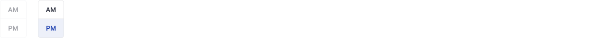
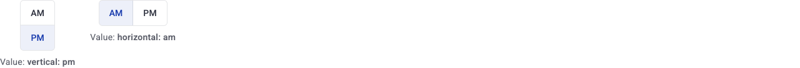
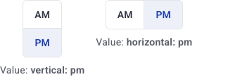

# Отчёт о визуальном и функциональном тестировании: D1ClockPeriod

## 1. Итоговое резюме

- **Компонент:** `D1ClockPeriod` (`@dxtmisha/d1`)
- **Исходный код:** [`D1ClockPeriod`](../../src/components/Ui/ClockPeriod) ([`ClockPeriod`](../../../constructor/src/constructors/ClockPeriod), [`DemoClockPeriodPage`](../../../demo/src/pages/components/DemoClockPeriodPage.vue))
- **Демо / целевой URL:** `http://localhost:3000/component-clock-period`
- **Материалы:** `Нет`
- **Дата тестирования (UTC):** `2026-11-24T14:52:25Z`
- **Окружение:** `Headless Chrome (Puppeteer / CDP, Desktop 1440x900, Tablet 768x1024, Mobile 375x812)`
- **Покрытие тест-кейсов:** 8 / 8 (`100%`)
- **Итог:** **8 ✅, 0 ⚠️, 0 ❌** (`✅` пройдено, `⚠️` предупреждение, `❌` ошибка) — `D1ClockPeriod` корректно отображает вертикальную и горизонтальную ориентации, палитры, `disabled`/`readonly`, пользовательские и многоязычные подписи, поддерживает WAI-ARIA `radiogroup`/`radio` и клавиатурную навигацию без ошибок консоли.

---

## 2. Базовая матрица

### 2.1 Визуальное соответствие (`VIS`)

| ID | Сценарий | Статус | Фактический результат | Скриншот |
| :--- | :--- | :---: | :--- | :--- |
| `TC-VIS-001` | Ориентации (`vertical`, `horizontal`), начальные значения и палитры | ✅ | `totalPeriods: 16`, `hasZeroSize: false`, `vertFlexDir: "column"`, `horizFlexDir: "row"`. |  |
| `TC-VIS-002` | Состояния `disabled` и `readonly` | ✅ | `disabledClass: true`, `disabledPointerEvents: "none"`, `readonlyClass: true`. |  |

### 2.2 Интерактивность и управление состоянием (`INT`)

| ID | Сценарий | Статус | Фактический результат | Скриншот |
| :--- | :--- | :---: | :--- | :--- |
| `TC-INT-001` | Переключение `am`/`pm` по клику и синхронизация `v-model` | ✅ | `vertVal: "Value: vertical: pm"`, `horizVal: "Value: horizontal: am"`, при `readonly` переключение заблокировано. |  |
| `TC-INT-002` | Программные методы `expose` (`set`, `setByHour`, `get`) | ✅ | `afterPm: "Value: model: pm | expose: pm"`, `afterHour9: "Value: model: am | expose: am"`, `afterHour21: "Value: model: pm | expose: pm"`. | — |

### 2.3 Граничные значения и крайние случаи (`BND`)

| ID | Сценарий | Статус | Фактический результат | Скриншот |
| :--- | :--- | :---: | :--- | :--- |
| `TC-BND-001` | Пользовательские подписи `textAm`/`textPm`, Unicode и экранирование XSS | ✅ | `unicodeAm: "Sáng / Утро ☀️"`, `unicodePm: "Tối / Вечер 🌙"`, `xssText: ""`, `xssImgCount: 0`. |  |

### 2.4 Адаптивность (`RSP`)

| ID | Сценарий | Статус | Фактический результат | Скриншот |
| :--- | :--- | :---: | :--- | :--- |
| `TC-RSP-001` | Адаптивность на Desktop (`1440px`), Tablet (`768px`) и Mobile (`375px`) | ✅ | `overflow: false` на всех трёх вьюпортах (`1440/1440`, `768/768`, `375/375`). |  |

### 2.5 Доступность (`A11Y`)

| ID | Сценарий | Статус | Фактический результат | Скриншот |
| :--- | :--- | :---: | :--- | :--- |
| `TC-A11Y-001` | WAI-ARIA атрибуты и клавиатурная навигация (`ArrowRight`) | ✅ | `role="radiogroup"`, `radioRole="radio"`, `aria-checked="true"`, `aria-disabled="true"`, `aria-readonly="true"`; `ArrowRight` переключил `am` -> `pm`. | — |

### 2.6 Консоль и среда выполнения (`LOG`)

| ID | Сценарий | Статус | Фактический результат | Скриншот |
| :--- | :--- | :---: | :--- | :--- |
| `TC-LOG-001` | События `click`/`clickLite` и чистота консоли | ✅ | `eventOutput: "Value: clickLite"`, `consoleErrors: []`, `vueWarnings: []`, `pageErrors: []`. | — |

---

## 3. ИИ-аудит и рекомендации

1. **Реактивность и ленивые обработчики:** Инстанции `ClockPeriodEvent`, `EventClickInclude` и `ModelInclude` не создаются до реального взаимодействия, а синхронизация внешнего `modelValue` происходит без лишних повторных эмитов.
2. **Доступность и безопасность:** Полная семантика `radiogroup`/`radio` с `aria-checked`/`aria-readonly`/`aria-disabled`, защита от `event.isComposing` и безопасное экранирование текста подтверждены в браузере.
3. **RTL (`P3` — исправлено):** В горизонтальном режиме `style.scss` переведён с физического `border-right-*` на логическое `border-inline-end-*`.
