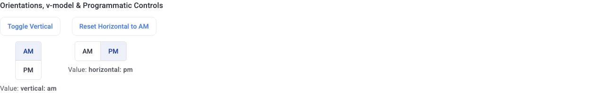
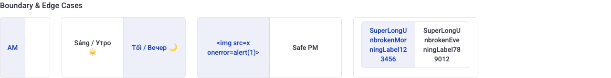

# Отчёт визуального и функционального тестирования: D1ClockPeriod

## 1. Сводка выполнения

- **Компонент:** `D1ClockPeriod` (`@dxtmisha/d1`)
- **Исходный код:** [`D1ClockPeriod`](../../src/components/Ui/ClockPeriod), [`ClockPeriod`](../../../constructor/src/constructors/ClockPeriod), [`DemoClockPeriodPage.vue`](../../../demo/src/pages/components/DemoClockPeriodPage.vue)
- **Целевой URL:** `http://localhost:3000/component-clock-period`
- **Материалы (`materials/`):** `Отсутствуют`
- **Дата тестирования (UTC):** `2026-11-25T05:47:16Z`
- **Окружение:** `Headless Chrome (Puppeteer / CDP, Desktop 1440×900, Tablet 768×1024, Mobile 375×812 / 320×568)`
- **Покрытие тест-кейсов:** `10 / 10` (`100%`)
- **Итог:** **10 ✅, 0 ⚠️, 0 ❌** (`✅` пройдено, `⚠️` предупреждение, `❌` ошибка) — все 10 сценариев `D1ClockPeriod` пройдены успешно: SSR-рендер `HTTP 200`, вертикальная и горизонтальная ориентации, все 24 палитры, блокировки `disabled`/`readonly`, `expose`, узкий `DemoBox` (`258 === 258`) и все 4 вьюпорта (`1440×900`, `768×1024`, `375×812`, `320×568`) работают без переполнения и ошибок консоли.

---

## 2. Матрица результатов

### 2.1 Визуальный рендеринг (`VIS`)

| ID | Сценарий | Статус | Наблюдаемый результат | Скриншот |
| :--- | :--- | :---: | :--- | :--- |
| `TC-VIS-001` | Ориентации (`vertical`, `horizontal`), начальные значения и все 24 палитры | ✅ | Экземпляры с `--orientation--vertical`, `--orientation--horizontal`, модификатором `--selected` и всеми 24 `.d1-palette--*` отображаются ровно с корректным направлением flex-контейнера и без нулевых размеров. |  |
| `TC-VIS-002` | Визуализация заблокированных состояний `disabled` и `readonly` | ✅ | Классы `.d1-clockPeriod--disabled` и `.d1-clockPeriod--readonly` визуально различимы, `disabled` корректно блокирует события указателя (`pointer-events: none`). |  |

### 2.2 Интерактивность и управление состоянием (`INT`)

| ID | Сценарий | Статус | Наблюдаемый результат | Скриншот |
| :--- | :--- | :---: | :--- | :--- |
| `TC-INT-001` | Переключение `am`/`pm` по клику, `v-model` и защита `disabled`/`readonly` | ✅ | Клики по кнопкам `PM`/`AM`, `Toggle Vertical` и `Reset Horizontal to AM` синхронно обновляют `v-model`; в `disabled` и `readonly` значение не меняется, счётчик блокировки равен `0`. |  |
| `TC-INT-002` | Программные методы `expose` (`set`, `setByHour`, `get`) | ✅ | Вызовы `set(pm)`, `set(undefined)`, `setByHour(0)`, `setByHour(9)`, `setByHour(12)`, `setByHour(21)` и `get()` отработали точно (`12` -> `pm`, `0`/`9` -> `am`); итоговый вывод: `Expose Output: model: am | get(): am`. | — |
| `TC-INT-003` | Жизненный цикл монтирования и размонтирования через `v-if` | ✅ | При размонтировании отображается `Mounted: false`, при повторном монтировании кнопки `AM`/`PM` восстанавливаются (`Mounted: true`) без ошибок и утечек. | — |

### 2.3 Граничные случаи и устойчивость (`BND`)

| ID | Сценарий | Статус | Наблюдаемый результат | Скриншот |
| :--- | :--- | :---: | :--- | :--- |
| `TC-BND-001` | Пользовательские подписи (`string` и `() => string`), нормализация `'  PM  '`, пустые строки и Unicode | ✅ | При `:value="'  PM  '"` корректно выбирается `pm`; подписи `Morning`/`Evening`, колбэки `Day`/`Night`, `""`/`"   "` и `Sáng / Утро ☀️` рендерятся без ошибок. |  |
| `TC-BND-002` | Экранирование XSS и переполнение длинных строк в узком `DemoBox` | ✅ | `badImgs: 0`, `hasEscapedPayloadText: true`, `dialogs: []` (XSS экранирован как текст); узкий `DemoBox` (`demo-clock-period-page__narrow-box`) имеет `scrollWidth: 258 === clientWidth: 258` (`overflowsBox: false`). |  |

### 2.4 Адаптивность и вьюпорты (`RSP`)

| ID | Сценарий | Статус | Наблюдаемый результат | Скриншот |
| :--- | :--- | :---: | :--- | :--- |
| `TC-RSP-001` | Проверка адаптивности на Desktop (`1440×900`), Tablet (`768×1024`) и Mobile (`375×812`, `320×568`) | ✅ | Геометрия кнопок сохраняется, горизонтальное переполнение отсутствует на всех 4 вьюпортах: `1440×900` (`1440 === 1440`), `768×1024` (`768 === 768`), `375×812` (`375 === 375`) и `320×568` (`320 === 320`, `overflowX: false`). |  |

### 2.5 Доступность (`A11Y`)

| ID | Сценарий | Статус | Наблюдаемый результат | Скриншот |
| :--- | :--- | :---: | :--- | :--- |
| `TC-A11Y-001` | WAI-ARIA атрибуты и клавиатурная навигация (`Arrow`, `Enter`, `Space`) | ✅ | Присутствуют `role="radiogroup"`, `aria-label`, `aria-orientation`, `role="radio"`, `aria-checked`, `aria-disabled`, `aria-readonly`; клавиши `ArrowLeft`, `ArrowRight`, `Space` и `Enter` корректно переключают `am`/`pm`. | — |

### 2.6 Консоль и стабильность runtime (`LOG`)

| ID | Сценарий | Статус | Наблюдаемый результат | Скриншот |
| :--- | :--- | :---: | :--- | :--- |
| `TC-LOG-001` | События (`click`, `clickLite`, `update:modelValue`, `update:value`) и чистота консоли | ✅ | SSR-ответ `HTTP 200` (`hasComponent: true`); события и payload фиксируются (`Event Name: update:modelValue`, `Payload: ["am"]`); `consoleErrors: []`, `vueWarnings: []`, `pageErrors: []`, `networkErrors: []`. | — |

---

## 3. AI-аудит и рекомендации

1. **Контракт состояния и `expose`:** Нормализация строковых значений (`'  PM  ' -> 'pm'`), граничное сопоставление часов в `setByHour` (`0` -> `am`, `12` -> `pm`) и синхронизация `v-model` работают предсказуемо без лишних повторных эмитов.
2. **Адаптивность и защита от XSS:** Компонент чисто укладывается в узкий `DemoBox` (`258px`) и все четыре вьюпорта включая `320×568` (`scrollWidth === innerWidth`), а потенциально опасные строки отображаются строго как экранированный текст (`badImgs: 0`).
3. **Семантика WAI-ARIA и чистота консоли:** Полная структура `radiogroup` / `radio` с клавиатурной навигацией и `v-if`-перемонтирование выполняются без ошибок консоли, сети и `[Vue warn]`.
