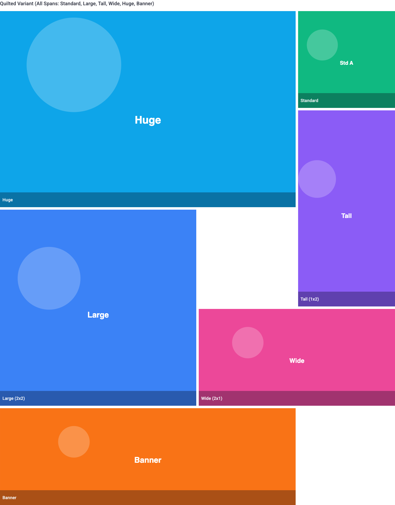
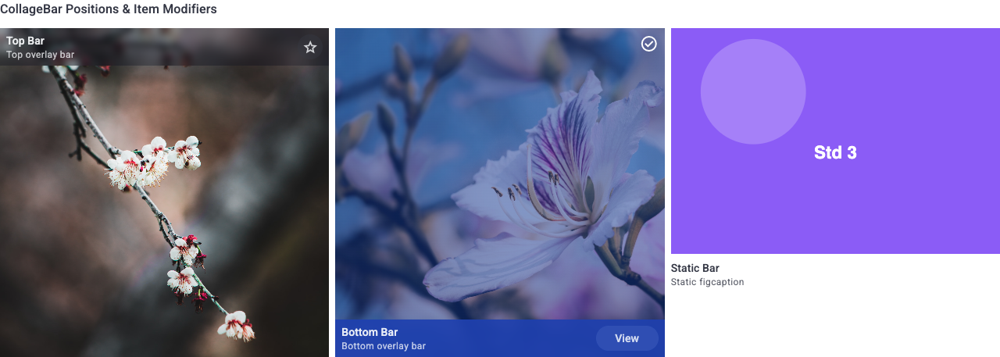
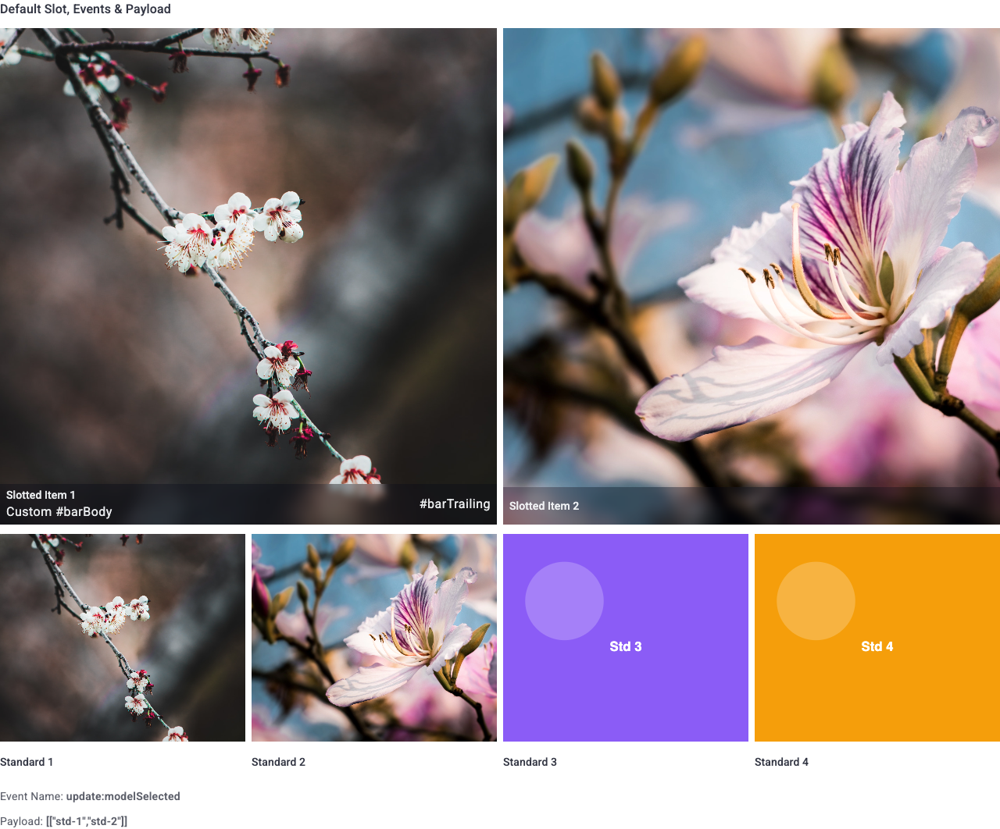
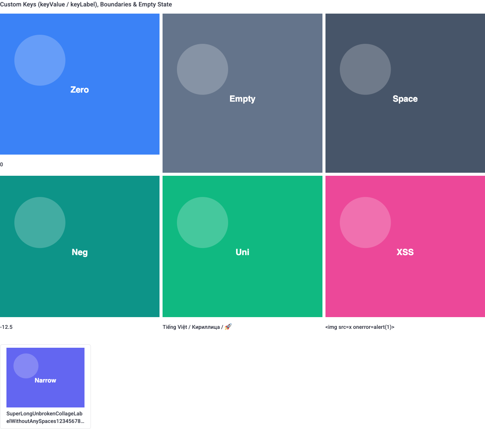

# Отчёт визуального и функционального тестирования: D1Collage

## 1. Сводка выполнения

- **Компонент:** `D1Collage` (`@dxtmisha/d1`)
- **Исходный код:** [`D1Collage`](../../src/components/Ui/Collage), [`Collage`](../../../constructor/src/constructors/Collage), [`DemoCollagePage.vue`](../../../demo/src/pages/components/DemoCollagePage.vue)
- **Целевой URL:** `http://localhost:3000/component-collage`
- **Материалы (`materials/`):** `Отсутствуют`
- **Дата тестирования (UTC):** `2026-11-25T06:01:08Z`
- **Окружение:** `Headless Chrome (Puppeteer / CDP, Desktop 1440×900, Tablet 768×1024, Mobile 375×812 / 320×568)`
- **Покрытие тест-кейсов:** `11 / 11` (`100%`)
- **Итог:** **11 ✅, 0 ⚠️, 0 ❌** (`✅` пройдено, `⚠️` предупреждение, `❌` ошибка) — все 11 сценариев (SSR `HTTP 200`, все 5 вариантов раскладок, `CollageBar`, `v-model:selected`, `expose`, `v-if`, границы/XSS, узкий `DemoBox` `238 === 238`, адаптивность `1440×900` / `768×1024` / `375×812` / `320×568`, A11y и консоль с `0` ошибок) пройдены полностью.

---

## 2. Матрица результатов

### 2.1 Визуальный рендеринг (`VIS`)

| ID | Сценарий | Статус | Наблюдаемый результат | Скриншот |
| :--- | :--- | :---: | :--- | :--- |
| `TC-VIS-001` | Варианты `standard`, `quilted` (все 6 `span`) и `woven` | ✅ | Все три раскладки (`--variant--standard`, `--variant--quilted`, `--variant--woven`), все 6 типов `span` (`standard`, `large`, `tall`, `wide`, `huge`, `banner`), класс `.d1-collageItem--compact` в `woven` и изображения отображаются корректно без наложений. |  |
| `TC-VIS-002` | Варианты `masonryHorizontal` (`cellSize` строкой) и `masonryVertical` (`cellSize` числом) | ✅ | CSS-переменная `--d1-collage-cell-size` (`160px` и `80px`) применена; оба варианта кладки динамически рассчитывают пропорции и распределяют карточки без перекрытий. |  |
| `TC-VIS-003` | Динамические колонки (`1`–`12`), позиции `CollageBar` (`top`, `bottom`, `static`) и модификаторы `CollageItem` | ✅ | Переключение колонок (включая `1`, `6`, `12`) обновляет модификатор `--columns--*`; `CollageBar` (`top`, `bottom`, `static`) и флаги `selected`, `focus`, `compact`, `tag="div"` рендерятся корректно. |  |

### 2.2 Интерактивность и управление состоянием (`INT`)

| ID | Сценарий | Статус | Наблюдаемый результат | Скриншот |
| :--- | :--- | :---: | :--- | :--- |
| `TC-INT-001` | Выбор элементов (`v-model:selected`), программные кнопки и блокировка при `control=false` | ✅ | Начальное выделение `std-1`, `std-3`, клик по `std-2`, кнопки `Select std-1 & std-2` и `Clear Selection` синхронно обновляют `selectedItems`; при `control=false` снимается `tabindex` и выбор блокируется. |  |
| `TC-INT-002` | Программное API `expose` (`update()`, `getValue()`, `getDetail()`) и слоты `#default` / `#barBody` / `#barTrailing` | ✅ | `Trigger update()` инкрементирует счётчик (`Updates: 1`), `getValue()` и `getDetail()` работают по контракту (до выбора: `undefined`), а слоты `#default`, `#barBody` и `#barTrailing` в `demo-collage-slot` рендерятся корректно. |  |
| `TC-INT-003` | Жизненный цикл монтирования и размонтирования через `v-if` | ✅ | При размонтировании отображается `Mounted: false`, при повторном монтировании восстанавливаются все карточки `masonryVertical` (`Tall Pin`, `Square`, `Portrait`, `Landscape`, `Tall Pin 2`, `Standard`, `Mounted: true`) без ошибок наблюдателей resize. | — |

### 2.3 Граничные случаи и устойчивость (`BND`)

| ID | Сценарий | Статус | Наблюдаемый результат | Скриншот |
| :--- | :--- | :---: | :--- | :--- |
| `TC-BND-001` | Пользовательские ключи `keyValue`/`keyLabel`, `0`, `""`, `"   "`, `-12.5`, Unicode и пустой `images: []` | ✅ | Значения `0`, `""`, `"   "`, `-12.5` и `Tiếng Việt / Кириллица / 🚀` отображаются без потери `0`, а `demo-collage-empty` (`:images="[]"`, `:cell-size="0"`) рендерит пустой контейнер без ошибок. |  |
| `TC-BND-002` | Экранирование XSS и переполнение длинной неразрывной строки в узком `DemoBox` | ✅ | `badImgs: 0`, `hasEscapedPayloadText: true`, `dialogs: []` (XSS экранирован как текст); пустая/пробельная строка `cellSize` игнорируется безопасно; узкий `DemoBox` (`demo-collage-page__narrow-box`) имеет `scrollWidth: 238 === clientWidth: 238` (`overflowsBox: false`). |  |

### 2.4 Адаптивность и вьюпорты (`RSP`)

| ID | Сценарий | Статус | Наблюдаемый результат | Скриншот |
| :--- | :--- | :---: | :--- | :--- |
| `TC-RSP-001` | Проверка адаптивности на Desktop (`1440×900`), Tablet (`768×1024`) и Mobile (`375×812`, `320×568`) | ✅ | После исправления `Collage/style.scss` и `CollageBar/style.scss` на всех вьюпортах переполнение отсутствует: `1440×900` (`1440 === 1440`), `768×1024` (`768 === 768`), `375×812` (`375 === 375`) и `320×568` (`320 === 320`, `overflowX: false`). |  |

### 2.5 Доступность (`A11Y`)

| ID | Сценарий | Статус | Наблюдаемый результат | Скриншот |
| :--- | :--- | :---: | :--- | :--- |
| `TC-A11Y-001` | Клавиатурная 2D-навигация `FocusDirectionInclude` (`ArrowRight`, `Enter`) и `aria-label` | ✅ | На `demo-collage-control` заданы `aria-label` и `tabindex="0"`; `ArrowRight` перемещает `.d1-collageItem--focus`, а `Enter` переключает выделение элемента. | — |

### 2.6 Консоль и стабильность runtime (`LOG`)

| ID | Сценарий | Статус | Наблюдаемый результат | Скриншот |
| :--- | :--- | :---: | :--- | :--- |
| `TC-LOG-001` | События (`click`, `clickLite`, `update:selected`, `update:modelSelected`) и чистота консоли | ✅ | SSR-ответ `HTTP 200` (`hasComponent: true`); события и payload регистрируются в `DemoValue`; `consoleErrors: []`, `vueWarnings: []`, `pageErrors: []`, `networkErrors: []`. | — |

---

## 3. AI-аудит и рекомендации

1. **Ограничение ширины сетки и перенос текста (`Collage/style.scss`, `CollageBar/style.scss`):** Добавление `min-width: 0; max-width: 100%;`, ограничение `grid-template-columns` с `min(...)` / `max(1px, min(..., calc((100cqw - gap * 19) / 20)))` в `Collage/style.scss`, а также `min-width: 0; max-width: 100%; overflow-wrap: anywhere;` в `CollageBar/style.scss` полностью устранило горизонтальное переполнение на `320×568` (`320 === 320`, `overflowX: false`).
2. **Изоляция стенда и безопасность данных:** Экранирование XSS-строк подтверждено (`badImgs: 0`, `hasEscapedPayloadText: true`, `dialogs: []`), а `DemoBox` (`238 === 238`) корректно удерживает контент внутри узкого контейнера.
3. **Стабильность жизненного цикла и runtime:** При `v-if`-перемонтировании, переключении колонок (`1`–`12`), работе с `expose` и 2D-навигации зафиксировано `0` ошибок консоли, `0` сетевых сбоев и `0` предупреждений Vue.
