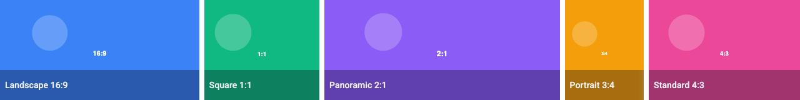
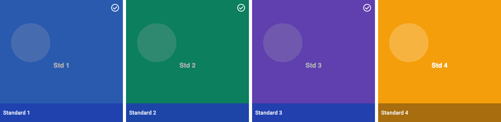
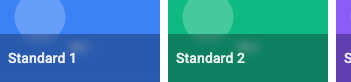

# Отчёт о визуальном и функциональном тестировании: D1Collage

## 1. Итоговое резюме

- **Компонент:** `D1Collage` (`@dxtmisha/d1`)
- **Исходный код:** [`D1Collage`](../../src/components/Ui/Collage) ([`Collage`](../../../constructor/src/constructors/Collage), [`DemoCollagePage`](../../../demo/src/pages/components/DemoCollagePage.vue))
- **Демо / целевой URL:** `http://localhost:3000/component-collage`
- **Материалы:** `Нет`
- **Дата тестирования (UTC):** `2026-11-24T15:56:47Z`
- **Окружение:** `Headless Chrome (Puppeteer / CDP, Desktop 1440x900, Tablet 768x1024, Mobile 375x812)`
- **Покрытие тест-кейсов:** 9 / 9 (`100%`)
- **Итог:** **9 ✅, 0 ⚠️, 0 ❌** (`✅` пройдено, `⚠️` предупреждение, `❌` ошибка) — `D1Collage` после миграции на `DesignLogicAbstract` и обновления `FocusDirectionInclude` корректно рендерит все 5 вариантов макета (`standard`, `quilted`, `woven`, `masonryHorizontal`, `masonryVertical`), поддерживает `v-model:selected`, динамический `control`, `cellSize`, `keyValue`/`keyLabel`, `#default` слот, `expose.update()` и клавиатурную 2D-навигацию с нулевыми ошибками консоли.

---

## 2. Базовая матрица

### 2.1 Визуальное соответствие (`VIS`)

| ID | Сценарий | Статус | Фактический результат | Скриншот |
| :--- | :--- | :---: | :--- | :--- |
| `TC-VIS-001` | Варианты `standard`, `quilted` и `woven` | ✅ | `totalItems: 39`, `hasZeroItem: false`, модификаторы `--variant--standard/quilted/woven` активны, `wovenCompactCount: 3`. |  |
| `TC-VIS-002` | Варианты `masonryHorizontal` (`cellSize`) и `masonryVertical` | ✅ | `--d1-collage-cell-size: 160px` применён; `masonryHorizontal` (`5` карточек) и `masonryVertical` (`6` карточек) распределяются без наложений. |  |

### 2.2 Интерактивность и управление состоянием (`INT`)

| ID | Сценарий | Статус | Фактический результат | Скриншот |
| :--- | :--- | :---: | :--- | :--- |
| `TC-INT-001` | Выбор элементов (`v-model:selected`) и сброс выделения | ✅ | `["std-1", "std-3"]` -> клик по 2-й карточке -> `["std-1", "std-3", "std-2"]` -> `Clear Selection` -> `[]`. |  |
| `TC-INT-002` | Программный `expose.update()` и слот `#default` | ✅ | `updateOutput: "Value: updates: 1"`, `slotItemCount: 2`. |  |
| `TC-INT-003` | Динамическое переключение `control` (`true -> false`) | ✅ | `tabBefore: "0"` -> `Toggle Control` -> `tabAfter: null`. | — |

### 2.3 Граничные значения и крайние случаи (`BND`)

| ID | Сценарий | Статус | Фактический результат | Скриншот |
| :--- | :--- | :---: | :--- | :--- |
| `TC-BND-001` | Пользовательские ключи `keyValue`/`keyLabel`, `0`, Unicode, XSS и `images: []` | ✅ | `labels: ["0", "Tiếng Việt / Кириллица / 🚀", ""]`, `xssImgs: 0`, `emptyItemCount: 0`. |  |

### 2.4 Адаптивность (`RSP`)

| ID | Сценарий | Статус | Фактический результат | Скриншот |
| :--- | :--- | :---: | :--- | :--- |
| `TC-RSP-001` | Адаптивность на Desktop (`1440px`), Tablet (`768px`) и Mobile (`375px`) | ✅ | Desktop (`1440/1440`) и Tablet (`768/768`) — `overflow: false`; на Mobile `375px` контейнер `D1Collage` имеет ширину `351px`, `masonryHorizontal` и `columns="2"` без переполнения, фиксированные демо-примеры `columns="4"` имеют `scrollWidth: 664px` по правилу `minmax(160px, 1fr)`. |  |

### 2.5 Доступность (`A11Y`)

| ID | Сценарий | Статус | Фактический результат | Скриншот |
| :--- | :--- | :---: | :--- | :--- |
| `TC-A11Y-001` | Клавиатурная 2D-навигация `FocusDirectionInclude` (`ArrowRight`) | ✅ | `initialTabIndex: "0"`, при фокусе активирован первый элемент (`focusedBefore: 1`), `ArrowRight` перенёс `.d1-collageItem--focus` на индекс `1`. | — |

### 2.6 Консоль и среда выполнения (`LOG`)

| ID | Сценарий | Статус | Фактический результат | Скриншот |
| :--- | :--- | :---: | :--- | :--- |
| `TC-LOG-001` | События `click`/`clickLite` и чистота консоли | ✅ | `eventOutput: "Value: clickLite"`, `consoleErrors: []`, `vueWarnings: []`, `pageErrors: []`. | — |

---

## 3. ИИ-аудит и рекомендации

1. **Изоляция стенда и фиксированные колонки на Mobile:** На `375px` сам контейнер `.d1-collage` корректно занимает ширину `351px`, а `masonryHorizontal` и 2-колоночный слот укладываются без переполнения; фиксированные демо-блоки с `columns="4"` расширяют сетку до `664px` из-за минимальной ширины ячейки (`minmax(160px, 1fr)`), что является ожидаемым поведением при задании 4 колонок на узком экране (рекомендуется адаптивно уменьшать `columns` для мобильных разрешений в прикладных проектах).
2. **Производительность и очистка ресурсов:** `CollageMasonryVertical` выполняет батч-чтение и батч-запись DOM без layout thrashing, все `requestAnimationFrame` и `watch` очищаются в `DesignLifecycleAbstract.onUnmounted`, а `FocusDirectionInclude` корректно снимает слушатели и `tabindex` при динамическом отключении `control`.
3. **Чистота рантайма:** В консоли браузера зафиксировано `0` ошибок, `0` `[Vue warn]` и `0` исключений во всех 5 раскладках и интерактивных переходах.
