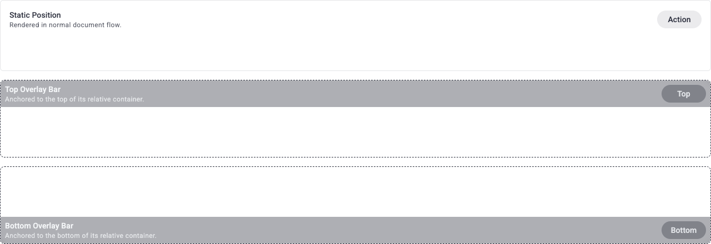

# Отчёт о визуальном и функциональном тестировании: D1CollageBar

## 1. Итоговое резюме

- **Компонент:** `D1CollageBar` (`@dxtmisha/d1`)
- **Исходный код:** [`D1CollageBar`](../../src/components/Ui/CollageBar) ([`CollageBar`](../../../constructor/src/constructors/CollageBar), [`DemoCollageBarPage`](../../../demo/src/pages/components/DemoCollageBarPage.vue))
- **Демо / целевой URL:** `http://localhost:3000/component-collage-bar`
- **Материалы:** `Нет`
- **Дата тестирования (UTC):** `2026-11-24T14:52:25Z`
- **Окружение:** `Headless Chrome (Puppeteer / CDP, Desktop 1440x900, Tablet 768x1024, Mobile 375x812)`
- **Покрытие тест-кейсов:** 8 / 8 (`100%`)
- **Итог:** **8 ✅, 0 ⚠️, 0 ❌** (`✅` пройдено, `⚠️` предупреждение, `❌` ошибка) — `D1CollageBar` корректно отображает все форматы контента и кнопок (`string`/`number 0`/`object` + `buttonAttrs`), позиции `static`/`top`/`bottom`, состояние `selected`, слоты (`default`/`description`/`trailing`/`body`), обрезку текста `clamp` и события без дублирования CSS-классов и ошибок консоли.

---

## 2. Базовая матрица

### 2.1 Визуальное соответствие (`VIS`)

| ID | Сценарий | Статус | Фактический результат | Скриншот |
| :--- | :--- | :---: | :--- | :--- |
| `TC-VIS-001` | Базовые форматы контента и кнопок (`string`, `object`, `icon`, `buttonAttrs`) | ✅ | `totalBars: 18`, `hasZeroSize: false`, `buttonCount: 12`, `hasDuplicateBtnClass: false`. |  |
| `TC-VIS-002` | Позиционирование (`static`, `top`, `bottom`) | ✅ | `static: relative`, `top: absolute (topOffset: 1px)`, `bottom: absolute (bottomOffset: 1px)`. |  |

### 2.2 Интерактивность и управление состоянием (`INT`)

| ID | Сценарий | Статус | Фактический результат | Скриншот |
| :--- | :--- | :---: | :--- | :--- |
| `TC-INT-001` | Переключение состояния `selected` и семантические теги (`tag`, `href`) | ✅ | `beforeSelected: false` -> `afterSelected: true`, `defaultTag: "FIGCAPTION"`, `customTag: "DIV"`, `linkHref: "#collage-bar-link"`. |  |
| `TC-INT-002` | Слоты (`default`, `description`, `trailing`, `body`) | ✅ | Все 4 слота рендерятся на своих позициях: `slotNamedText` содержит `default`/`description`/`NEW`, `slotBodyText` заменяет контекст. |  |

### 2.3 Граничные значения и крайние случаи (`BND`)

| ID | Сценарий | Статус | Фактический результат | Скриншот |
| :--- | :--- | :---: | :--- | :--- |
| `TC-BND-001` | Значение `0`, Unicode, многострочная обрезка (`clamp`) и экранирование XSS | ✅ | `zeroLabel: "0"`, `zeroDesc: "0"`, `zeroBtn: "0"`, `xssImgCount: 0`, `xssScriptCount: 0`, `clampLabelLineClamp: "2"`, `clampDescLineClamp: "3"`. |  |

### 2.4 Адаптивность (`RSP`)

| ID | Сценарий | Статус | Фактический результат | Скриншот |
| :--- | :--- | :---: | :--- | :--- |
| `TC-RSP-001` | Адаптивность на Desktop (`1440px`), Tablet (`768px`) и Mobile (`375px`) | ✅ | `overflow: false` на всех трёх вьюпортах (`1440/1440`, `768/768`, `375/375`). |  |

### 2.5 Доступность (`A11Y`)

| ID | Сценарий | Статус | Фактический результат | Скриншот |
| :--- | :--- | :---: | :--- | :--- |
| `TC-A11Y-001` | Семантика тегов, фокус кнопок и отсутствие дублирующихся CSS-классов | ✅ | `defaultTag: "FIGCAPTION"`, `buttonTag: "BUTTON"`, `hasDuplicateBtnClass: false`. | — |

### 2.6 Консоль и среда выполнения (`LOG`)

| ID | Сценарий | Статус | Фактический результат | Скриншот |
| :--- | :--- | :---: | :--- | :--- |
| `TC-LOG-001` | События `click`/`clickLite` (строковое и `value=0`) и чистота консоли | ✅ | `afterTarget: "Value: clickLite"`, `afterZero: "Value: clickLite"`, `consoleErrors: []`, `vueWarnings: []`, `pageErrors: []`. | — |

---

## 3. ИИ-аудит и рекомендации

1. **Устранение дублирования классов и защита `0`:** После миграции на `DesignLogicAbstract` с `canCreate` и `mergeProps` устранено дублирование `.d1-collageBar__button`, а числовые `0` корректно отображаются во всех полях (`label`, `description`, `button`).
2. **Позиционирование и адаптивность:** Все три режима `static`/`top`/`bottom` и многострочная обрезка (`line-clamp: 2 / 3`) работают стабильно на `1440px`, `768px` и `375px` с нулевым горизонтальным переполнением.
3. **Чистота рантайма:** В консоли браузера отсутствуют ошибки и `[Vue warn]` во всех сценариях взаимодействия и кликов.
