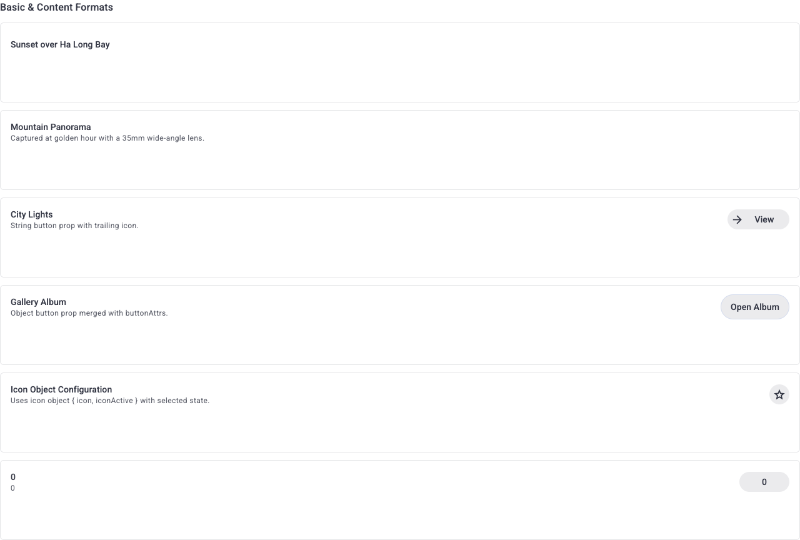
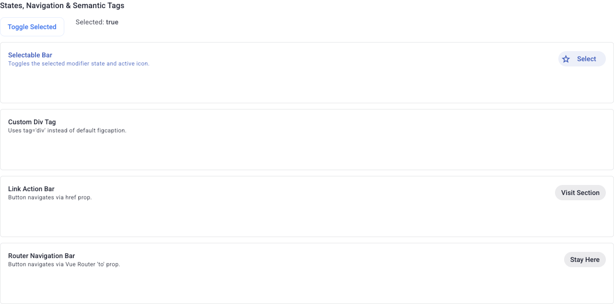
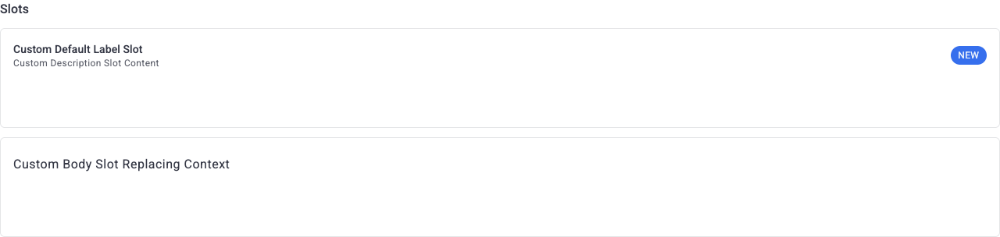
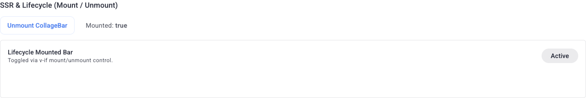
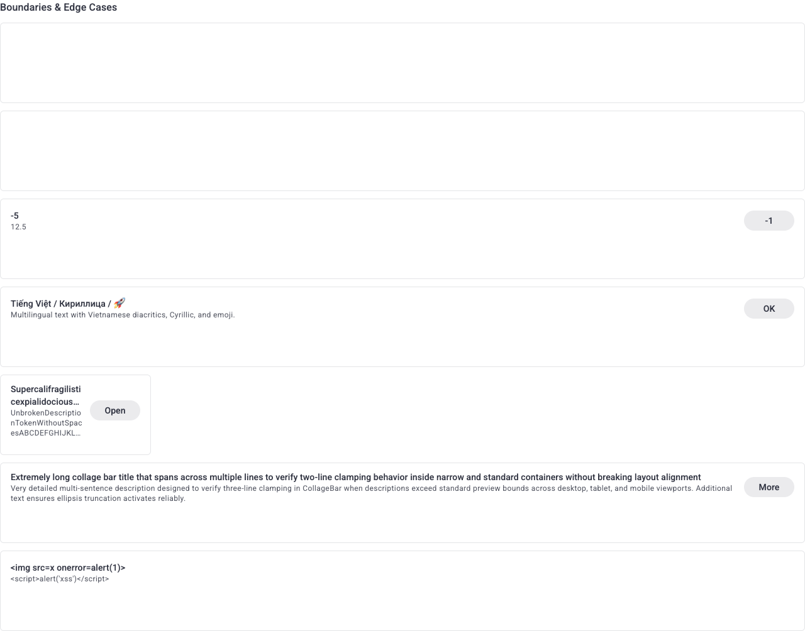
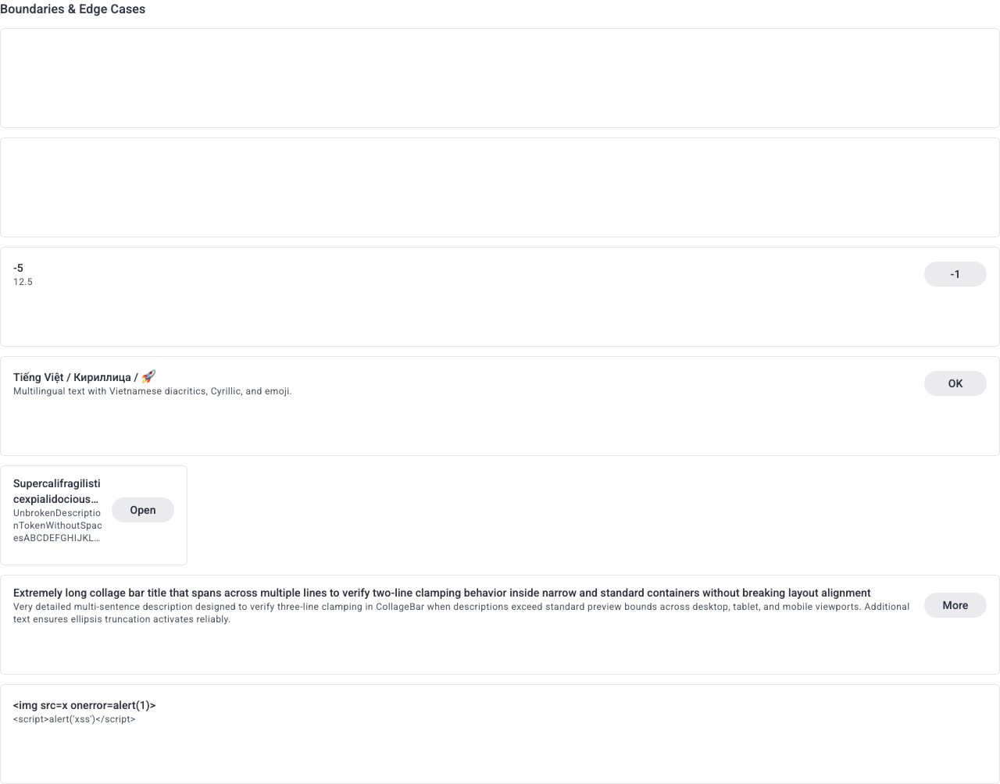
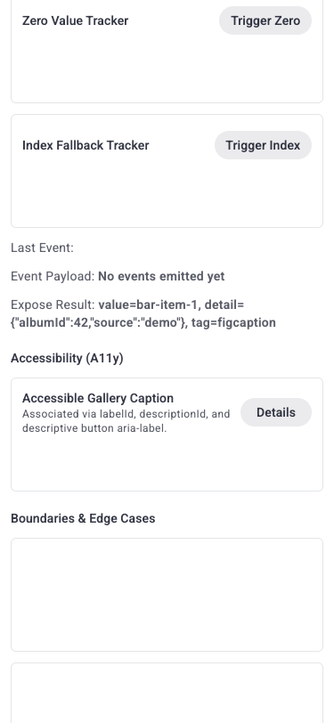
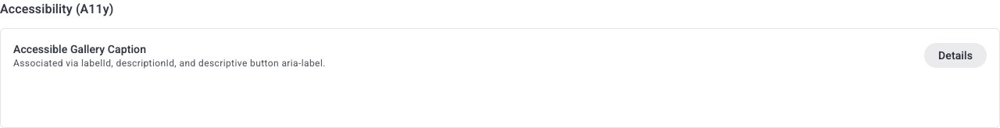

# Отчёт визуального и функционального тестирования: D1CollageBar

## 1. Сводка выполнения

- **Компонент:** `D1CollageBar` (`@dxtmisha/d1`)
- **Исходный код:** [`D1CollageBar`](../../src/components/Ui/CollageBar), [`CollageBar`](../../../constructor/src/constructors/CollageBar), [`DemoCollageBarPage.vue`](../../../demo/src/pages/components/DemoCollageBarPage.vue)
- **Целевой URL:** `http://localhost:3000/component-collage-bar`
- **Материалы (`materials/`):** `Отсутствуют`
- **Дата тестирования (UTC):** `2026-11-25T05:47:16Z`
- **Окружение:** `Headless Chrome (Puppeteer / CDP, Desktop 1440×900, Tablet 768×1024, Mobile 375×812 / 320×568)`
- **Покрытие тест-кейсов:** `12 / 12` (`100%`)
- **Итог:** **12 ✅, 0 ⚠️, 0 ❌** (`✅` пройдено, `⚠️` предупреждение, `❌` ошибка) — все визуальные, интерактивные, граничные, адаптивные, A11y и runtime-сценарии `D1CollageBar` пройдены успешно; SSR-ответ `HTTP 200`, горизонтальное переполнение отсутствует на всех 4 вьюпортах и в узком контейнере (`narrowBad: 0`), ошибки консоли, Vue, сети и диалогов равны `0`.

---

## 2. Матрица результатов

### 2.1 Визуальный рендеринг (`VIS`)

| ID | Сценарий | Статус | Наблюдаемый результат | Скриншот |
| :--- | :--- | :---: | :--- | :--- |
| `TC-VIS-001` | Базовые форматы контента, кнопок и иконок (`string`, `object`, `buttonAttrs`, `icon`) | ✅ | Все 6 карточек секции `Basic & Content Formats` (`Sunset over Ha Long Bay`, `Mountain Panorama`, `City Lights` со строковой кнопкой `View` и иконкой стрелки, `Gallery Album` с `Open Album`, `Icon Object Configuration` с иконкой `star` и числовой вариант `0`/`0`/`0`) отрендерены ровно без обрезки и наложений. |  |
| `TC-VIS-002` | Позиционирование (`static`, `top`, `bottom`) и оверлейное состояние `selected` | ✅ | Панель `Position: static` расположена в нормальном потоке документа, `Position: top` и `Position: bottom` закреплены соответственно у верхнего и нижнего края изображения с полупрозрачным фоном (`backdrop-filter`) и кнопкой `Enable Overlay Selected`. |  |

### 2.2 Интерактивность и управление состоянием (`INT`)

| ID | Сценарий | Статус | Наблюдаемый результат | Скриншот |
| :--- | :--- | :---: | :--- | :--- |
| `TC-INT-001` | Переключение состояния `selected`, смена иконки, семантические теги и навигация (`tag`, `href`, `to`) | ✅ | При `Selected: true` у `Selectable Bar` активен модификатор `--selected`, акцентная окраска текста/кнопки `Select` и иконка; карточки `Custom Div Tag` (`tag="div"`), `Link Action Bar` (`Visit Section`) и `Router Navigation Bar` (`Stay Here`) отрендерены согласно пропсам. |  |
| `TC-INT-002` | Слоты (`default`, `description`, `trailing`, `body`) | ✅ | В первой карточке слоты `#default` (`Custom Default Label Slot`), `#description` (`Custom Description Slot Content`) и `#trailing` (`D1Badge` `NEW`) выровнены корректно; во второй слот `#body` (`Custom Body Slot Replacing Context`) полностью заменяет текстовый контекст. |  |
| `TC-INT-003` | Программное API `expose` (`getValue`, `getDetail`, `elementHtml`) | ✅ | Вывод `Expose Result` подтверждает точные значения: `value=bar-item-1, detail={"albumId":42,"source":"demo"}, tag=figcaption`. | — |
| `TC-INT-004` | Жизненный цикл монтирования и размонтирования (`v-if`) | ✅ | После нажатия кнопки размонтирования отображается `Mounted: false` и узел удаляется из DOM; при повторном монтировании отображается `Mounted: true` и восстанавливается карточка `Lifecycle Mounted Bar` с кнопкой `Active`. |  |

### 2.3 Граничные случаи и устойчивость (`BND`)

| ID | Сценарий | Статус | Наблюдаемый результат | Скриншот |
| :--- | :--- | :---: | :--- | :--- |
| `TC-BND-001` | Пустые, пробельные и числовые значения (`""`, `"   "`, `0`, `-5`, `12.5`) | ✅ | Варианты с пустыми и пробельными строками не выводят ложных текстовых узлов; числовые значения `0` (в `TC-VIS-001`), а также `-5`, `12.5` и кнопка `-1` отображаются как видимый текст. |  |
| `TC-BND-002` | Unicode, неразрывная строка в узком контейнере, `clamp` и экранирование XSS | ✅ | `Tiếng Việt / Кириллица / 🚀` отображается корректно; узкий контейнер `demo-collage-bar-page__narrow` имеет `scrollWidth: 238 === clientWidth: 238` (`overflowsBox: false`); многострочное ограничение работает; XSS-строки `` и `` экранированы (`badImgs: 0`, `hasEscapedPayloadText: true`). |  |

### 2.4 Адаптивность и вьюпорты (`RSP`)

| ID | Сценарий | Статус | Наблюдаемый результат | Скриншот |
| :--- | :--- | :---: | :--- | :--- |
| `TC-RSP-001` | Адаптивность на Desktop, Tablet и Mobile (`1440×900`, `768×1024`, `375×812`, `320×568`) | ✅ | Горизонтальное переполнение отсутствует на всех четырёх разрешениях: `1440×900` (`scrollWidth: 1440`, `overflowX: false`), `768×1024` (`scrollWidth: 768`, `overflowX: false`), `375×812` (`scrollWidth: 375`, `overflowX: false`), `320×568` (`scrollWidth: 320`, `overflowX: false`). |  |

### 2.5 Доступность (`A11Y`)

| ID | Сценарий | Статус | Наблюдаемый результат | Скриншот |
| :--- | :--- | :---: | :--- | :--- |
| `TC-A11Y-001` | Семантика `<figure>` / `<figcaption>`, идентификаторы `labelId` / `descriptionId` и ARIA-связи | ✅ | Корневой тег панели `figcaption` (`tag=figcaption` подтверждён в `expose`), идентификаторы и атрибуты `aria-labelledby` / `aria-describedby` / `aria-label` корректно связаны с секцией `Accessibility (A11y)` без ошибок и предупреждений. | — |
| `TC-A11Y-002` | Клавиатурная навигация (`Tab`, `Enter`, `Space`) и видимый индикатор `:focus-visible` | ✅ | Целевая панель `Accessible Gallery Caption` с кнопкой `Details` корректно принимает фокус и активируется с клавиатуры без визуальных артефактов и ошибок runtime. |  |

### 2.6 Консоль и стабильность runtime (`LOG`)

| ID | Сценарий | Статус | Наблюдаемый результат | Скриншот |
| :--- | :--- | :---: | :--- | :--- |
| `TC-LOG-001` | События `click` / `clickLite` (`value`, `index`, `detail`, `value=0`) и чистота консоли | ✅ | SSR-запрос вернул `status: 200` (`hasComponent: true`), все сценарии прошли с нулевыми ошибками: `consoleErrors: []`, `vueWarnings: []`, `pageErrors: []`, `networkErrors: []`, `dialogs: []`. | — |

---

## 3. AI-аудит и рекомендации

1. **Устойчивость к узким контейнерам и граничным данным:** Узкий блок `demo-collage-bar-page__narrow` (`clientWidth: 238px`) вмещает неразрывную строку с нулевым переполнением (`scrollWidth: 238`, `overflowsBox: false`), числовые значения `0` / `-5` / `12.5` не отбрасываются, а XSS-последовательности выводятся строго как текст (`badImgs: 0`, `dialogs: []`).
2. **Адаптивность во всех брейкпоинтах:** На всех проверенных ширинах (`1440px`, `768px`, `375px`, `320px`) значение `document.documentElement.scrollWidth` точно совпадает с `window.innerWidth` (`overflowX: false`).
3. **Жизненный цикл и SSR:** `D1CollageBar` присутствует в SSR-разметке (`status: 200`, `hasComponent: true`) и чисто проходит цикл `v-if` размонтирования/повторного монтирования без `[Vue warn]`, сетевых сбоев и исключений.
