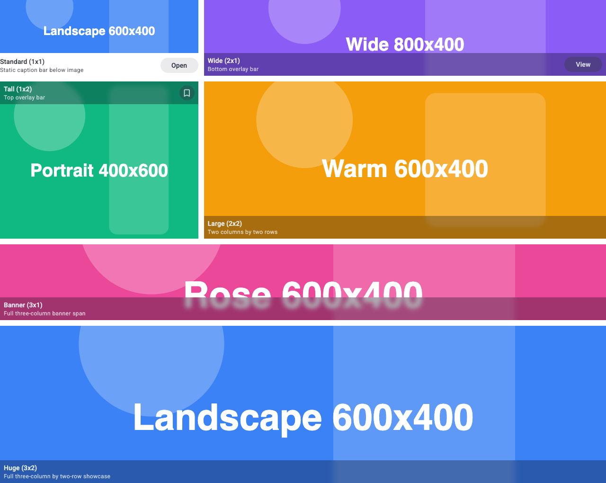
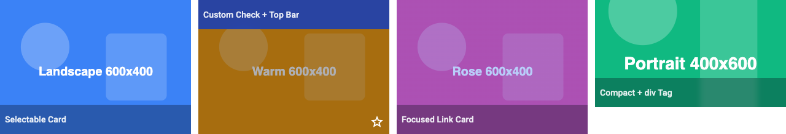
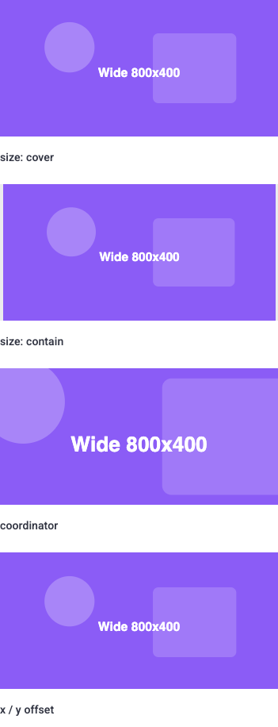

# Отчёт о визуальном и функциональном тестировании: D1CollageItem

## 1. Итоговое резюме

- **Компонент:** `D1CollageItem` (`@dxtmisha/d1`)
- **Исходный код:** [`D1CollageItem`](../../src/components/Ui/CollageItem) ([`CollageItem`](../../../constructor/src/constructors/CollageItem), [`DemoCollageItemPage`](../../../demo/src/pages/components/DemoCollageItemPage.vue))
- **Демо / целевой URL:** `http://localhost:3000/component-collage-item`
- **Материалы:** `Нет`
- **Дата тестирования (UTC):** `2026-11-24T15:26:28Z`
- **Окружение:** `Headless Chrome (Puppeteer / CDP, Desktop 1440x900, Tablet 768x1024, Mobile 375x812)`
- **Покрытие тест-кейсов:** 8 / 8 (`100%`)
- **Итог:** **8 ✅, 0 ⚠️, 0 ❌** (`✅` пройдено, `⚠️` предупреждение, `❌` ошибка) — `D1CollageItem` после миграции на `DesignLogicAbstract` корректно рендерит все 19 карточек стенда (Bento-пресеты `standard`–`huge`, позиции `CollageBar`, `size`/`coordinator`/`x`/`y`, `selected`/`focus`/`compact`/`iconCheck`, слоты `#barTrailing`/`#barBody`, события и `expose`) с нулевыми ошибками консоли.

---

## 2. Базовая матрица

### 2.1 Визуальное соответствие (`VIS`)

| ID | Сценарий | Статус | Фактический результат | Скриншот |
| :--- | :--- | :---: | :--- | :--- |
| `TC-VIS-001` | Bento-пресеты (`span`) и позиции панели (`collageBarPosition`) | ✅ | `totalItems: 19`, `hasZeroSize: false`, все 6 классов `--span--standard/wide/tall/large/banner/huge` активны, панели `static`/`top`/`bottom` выровнены корректно. |  |
| `TC-VIS-002` | Управление отображением изображения (`size`, `coordinator`, `x`, `y`) | ✅ | Все 4 карточки (`cover`, `contain`, `coordinator`, `offset`) имеют размеры `311×220` и видимые изображения `.d1-collageItem__image`. |  |

### 2.2 Интерактивность и управление состоянием (`INT`)

| ID | Сценарий | Статус | Фактический результат | Скриншот |
| :--- | :--- | :---: | :--- | :--- |
| `TC-INT-001` | Состояния `selected`, `focus`, `compact`, `iconCheck` и `tag` | ✅ | `beforeSelected: true` -> `afterSelected: false`, `hasTopBarClass: true`, `hasFocusClass: true`, `hasCompactClass: true`, `compactBodyTag: "DIV"`. |  |
| `TC-INT-002` | Слоты `#barTrailing`/`#barBody` и `expose` (`getValue`, `getWidth`, `getHeight`) | ✅ | Оба слота (`HD`, `Custom Bar Body Slot`) отображаются; `exposeOutput: "Value: loads=1 | value=collage-item-42, w=15, h=6"`. |  |

### 2.3 Граничные значения и крайние случаи (`BND`)

| ID | Сценарий | Статус | Фактический результат | Скриншот |
| :--- | :--- | :---: | :--- | :--- |
| `TC-BND-001` | Числовое значение `0`, Unicode и экранирование XSS | ✅ | `zeroLabel: "0"`, `zeroDesc: "0"`, `unicodeLabel: "Tiếng Việt / Кириллица / 🚀"`, `xssDescText: ""`, `xssImgCount: 0`. | — |

### 2.4 Адаптивность (`RSP`)

| ID | Сценарий | Статус | Фактический результат | Скриншот |
| :--- | :--- | :---: | :--- | :--- |
| `TC-RSP-001` | Адаптивность на Desktop (`1440px`), Tablet (`768px`) и Mobile (`375px`) | ✅ | `overflow: false` на всех трёх вьюпортах (`1440/1440`, `768/768`, `375/375`). |  |

### 2.5 Доступность (`A11Y`)

| ID | Сценарий | Статус | Фактический результат | Скриншот |
| :--- | :--- | :---: | :--- | :--- |
| `TC-A11Y-001` | Семантика `<figure>` / `<a>` / `<figcaption>` и `href` | ✅ | `rootTag: "FIGURE"`, `bodyTag: "A"`, `bodyHref: "#collage-item-anchor"`, `barTag: "FIGCAPTION"`. | — |

### 2.6 Консоль и среда выполнения (`LOG`)

| ID | Сценарий | Статус | Фактический результат | Скриншот |
| :--- | :--- | :---: | :--- | :--- |
| `TC-LOG-001` | События `click`/`clickLite`/`load` и чистота консоли | ✅ | `eventOutput: "Value: clickLite"`, `loads=1`, `consoleErrors: []`, `vueWarnings: []`, `pageErrors: []`. | — |

---

## 3. ИИ-аудит и рекомендации

1. **Ленивая инициализация и расчёт размеров:** `CollageItemDimensions` безопасно проверяет `hasInjectionContext()` при автономном использовании вне `Collage` и корректно рассчитывает коэффициенты (`w=15, h=6`) при событии `load`; `CollageBar` не создаётся при отсутствии заголовка, описания, кнопки и слотов.
2. **Семантика и слоты:** Корневой `<figure>`, интерактивное тело `<a>` (или настраиваемый `tag`) и `<figcaption>` (`CollageBar`) с пробросом `#barBody`/`#barTrailing` работают предсказуемо и не создают лишних обёрток.
3. **Адаптивность и консоль:** Все 6 Bento-пресетов и карточки отображения адаптируются без горизонтального переполнения и без ошибок консоли или предупреждений Vue.
