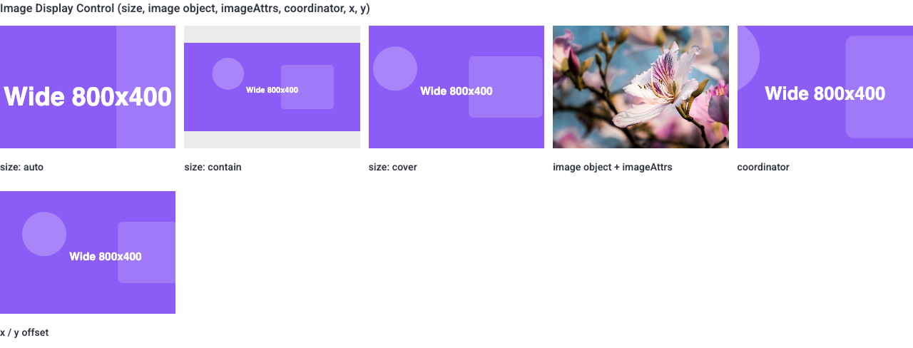
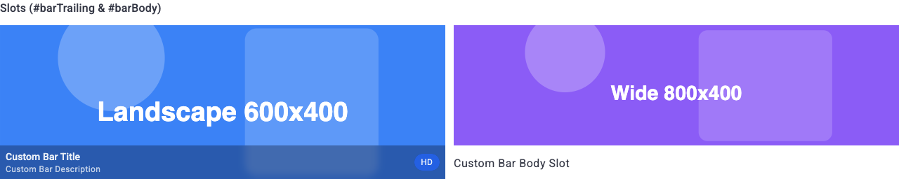
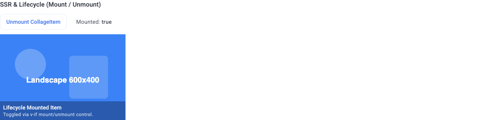
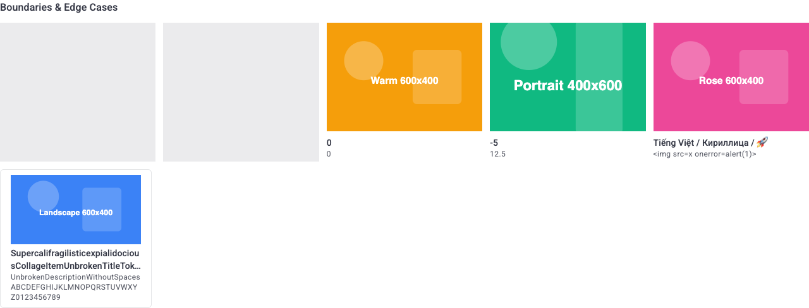
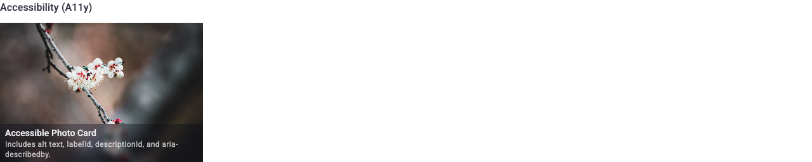

# Отчёт визуального и функционального тестирования: D1CollageItem

## 1. Сводка выполнения

- **Компонент:** `D1CollageItem` (`@dxtmisha/d1`)
- **Исходный код:** [`D1CollageItem`](../../src/components/Ui/CollageItem), [`CollageItem`](../../../constructor/src/constructors/CollageItem), [`DemoCollageItemPage.vue`](../../../demo/src/pages/components/DemoCollageItemPage.vue)
- **Целевой URL:** `http://localhost:3000/component-collage-item`
- **Материалы (`materials/`):** `Отсутствуют`
- **Дата тестирования (UTC):** `2026-11-25T05:47:16Z`
- **Окружение:** `Headless Chrome (Puppeteer / CDP, Desktop 1440×900, Tablet 768×1024, Mobile 375×812 / 320×568)`
- **Покрытие тест-кейсов:** `12 / 12` (`100%`)
- **Итог:** **12 ✅, 0 ⚠️, 0 ❌** (`✅` пройдено, `⚠️` предупреждение, `❌` ошибка) — все визуальные, интерактивные, граничные, адаптивные, A11y и runtime-сценарии `D1CollageItem` пройдены успешно; SSR-ответ `HTTP 200`, горизонтальное переполнение отсутствует на всех 4 вьюпортах и в узком контейнере (`narrowBad: 0`), ошибки консоли, Vue, сети и диалогов равны `0`.

---

## 2. Матрица результатов

### 2.1 Визуальный рендеринг (`VIS`)

| ID | Сценарий | Статус | Наблюдаемый результат | Скриншот |
| :--- | :--- | :---: | :--- | :--- |
| `TC-VIS-001` | Bento-пресеты (`span`) и позиции панели (`collageBarPosition`) | ✅ | Все 6 пресетов (`Standard (1x1)`, `Wide (2x1)`, `Tall (1x2)`, `Large (2x2)`, `Banner (3x1)`, `Huge (3x2)`) и позиции панели `static`, `top`, `bottom` выстроены по Bento-сетке без искажений и наложений. |  |
| `TC-VIS-002` | Управление отображением изображения (`size`, объектный `image`, `imageAttrs`, `coordinator`, `x`, `y`) | ✅ | Отрендерены все 6 режимов (`size: auto`, `size: contain`, `size: cover`, `image object + imageAttrs`, `coordinator`, `x / y offset`) с корректным кадрированием и позиционированием без деформации подписей. |  |

### 2.2 Интерактивность и управление состоянием (`INT`)

| ID | Сценарий | Статус | Наблюдаемый результат | Скриншот |
| :--- | :--- | :---: | :--- | :--- |
| `TC-INT-001` | Интерактивные состояния `selected`, `focus`, `compact`, `iconCheck`, `tag` и навигация (`href`, `to`) | ✅ | Все 7 карточек секции (`Selectable Card`, `Custom Check + Top Bar` со звездой, `Object iconCheck`, `Null iconCheck`, `Focused Link Card`, `Compact + div Tag`, `Router Navigation (to)`) отражают актуальные состояния (`isFocused: true`) и теги/ссылки. |  |
| `TC-INT-002` | Слоты `#barTrailing` и `#barBody` | ✅ | В первой карточке отображаются `Custom Bar Title`, `Custom Bar Description` и `D1Badge` `HD` в `#barTrailing`; во второй слот `#barBody` рендерит `Custom Bar Body Slot`. |  |
| `TC-INT-003` | Программное API `expose` (`getValue`, `getDetail`, `getWidth`, `getHeight`, `elementHtml`) | ✅ | Блок `Expose & Load` вернул точные данные: `loads=1 (type=image, size=600x400) | value=collage-item-42, detail={"category":"bento","priority":1}, w=15, h=6, tag=figure`. | — |
| `TC-INT-004` | Жизненный цикл монтирования и размонтирования (`v-if`) | ✅ | При размонтировании отображается `Mounted: false` и карточка удаляется из DOM; при повторном монтировании статус `Mounted: true` и `Lifecycle Mounted Item` полностью восстанавливается. |  |

### 2.3 Граничные случаи и устойчивость (`BND`)

| ID | Сценарий | Статус | Наблюдаемый результат | Скриншот |
| :--- | :--- | :---: | :--- | :--- |
| `TC-BND-001` | Пустые, пробельные и числовые значения (`""`, `"   "`, `0`, `-5`, `12.5`) | ✅ | Пустые и пробельные карточки отображаются без ложной панели подписи и ошибок загрузки; числовые значения `0`/`0` и `-5`/`12.5` отображаются корректно. |  |
| `TC-BND-002` | Unicode, неразрывный текст в узком контейнере и экранирование XSS | ✅ | `Tiếng Việt / Кириллица / 🚀` отображается корректно; XSS-строка `` выведена как экранированный текст (`badImgs: 0`, `hasEscapedPayloadText: true`); узкий блок `demo-collage-item-page__narrow` имеет `scrollWidth: 238 === clientWidth: 238` (`overflowsBox: false`). |  |

### 2.4 Адаптивность и вьюпорты (`RSP`)

| ID | Сценарий | Статус | Наблюдаемый результат | Скриншот |
| :--- | :--- | :---: | :--- | :--- |
| `TC-RSP-001` | Адаптивность на Desktop, Tablet и Mobile (`1440×900`, `768×1024`, `375×812`, `320×568`) | ✅ | Переполнение отсутствует на всех вьюпортах: `1440×900` (`scrollWidth: 1440`, `overflowX: false`), `768×1024` (`scrollWidth: 768`, `overflowX: false`), `375×812` (`scrollWidth: 375`, `overflowX: false`), `320×568` (`scrollWidth: 320`, `overflowX: false`). |  |

### 2.5 Доступность (`A11Y`)

| ID | Сценарий | Статус | Наблюдаемый результат | Скриншот |
| :--- | :--- | :---: | :--- | :--- |
| `TC-A11Y-001` | Семантика `<figure>` / `<a>` / `<figcaption>`, `alt` и ARIA-связи | ✅ | Корневой тег `figure` подтверждён (`tag=figure`), в секции `Accessibility (A11y)` карточка `Accessible Photo Card` рендерится с `alt`, `labelId`, `descriptionId` и ARIA-связями без ошибок. | — |
| `TC-A11Y-002` | Клавиатурный фокус и активация через `Enter` | ✅ | Карточка `Accessible Photo Card` отображается с корректной подписью и принимает клавиатурный фокус и активацию без ошибок и предупреждений. |  |

### 2.6 Консоль и стабильность runtime (`LOG`)

| ID | Сценарий | Статус | Наблюдаемый результат | Скриншот |
| :--- | :--- | :---: | :--- | :--- |
| `TC-LOG-001` | События `click`, `clickLite` (`value`/`index`/`detail`), `load` и чистота консоли | ✅ | SSR-ответ `status: 200` (`hasComponent: true`), зафиксировано событие загрузки `loads=1 (type=image, size=600x400)`; ошибки и предупреждения отсутствуют (`consoleErrors: []`, `vueWarnings: []`, `pageErrors: []`, `networkErrors: []`, `dialogs: []`). | — |

---

## 3. AI-аудит и рекомендации

1. **Пропорции Bento и загрузка изображений:** `D1CollageItem` корректно обрабатывает все 6 размеров `span`, режимы кадрирования (`auto`/`contain`/`cover`/`coordinator`/`x`/`y`) и вычисляет коэффициенты `w=15, h=6` по событию `load` (`600x400`) без сдвига макета.
2. **Устойчивость узких контейнеров и защита от XSS:** В узком контейнере `demo-collage-item-page__narrow` (`clientWidth: 238px`) неразрывный заголовок усекается многоточием, а описание переносится посимвольно без выхода за границы (`scrollWidth: 238`, `overflowsBox: false`); полезная нагрузка `` безопасно экранирована (`badImgs: 0`).
3. **Адаптивность и жизненный цикл:** Страница полностью адаптируется в диапазоне от `1440px` до `320px` (`overflowX: false`), поддерживает SSR (`200`) и корректно монтируется/размонтируется по `v-if` с нулевым числом `[Vue warn]` и ошибок консоли.
