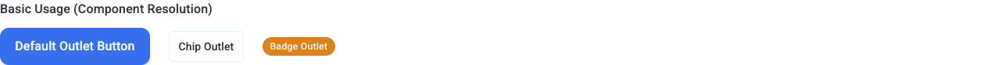
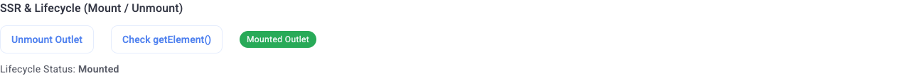
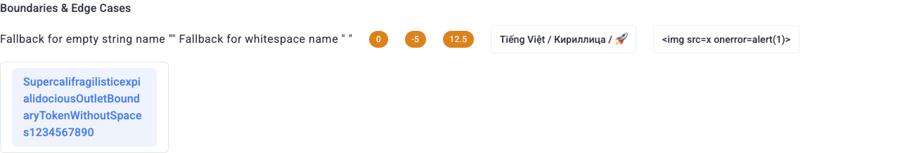
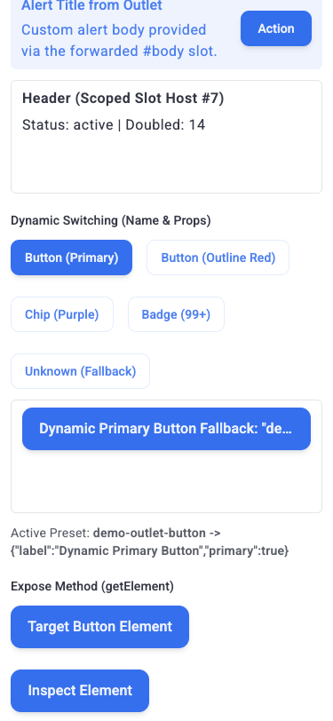
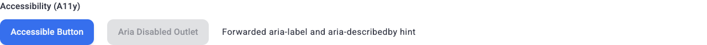

# Отчёт визуального и функционального тестирования: D1ComponentOutlet

## 1. Сводка выполнения

- **Компонент:** `D1ComponentOutlet` (`@dxtmisha/d1`)
- **Исходный код:** [`D1ComponentOutlet`](../../src/components/Ui/ComponentOutlet), [`ComponentOutlet`](../../../constructor/src/constructors/ComponentOutlet), [`DemoComponentOutletPage.vue`](../../../demo/src/pages/components/DemoComponentOutletPage.vue)
- **Целевой URL:** `http://localhost:3000/component-component-outlet`
- **Материалы (`materials/`):** `Отсутствуют`
- **Дата тестирования (UTC):** `2026-11-25T05:47:16Z`
- **Окружение:** `Headless Chrome (Puppeteer / CDP, Desktop 1440×900, Tablet 768×1024, Mobile 375×812 / 320×568)`
- **Покрытие тест-кейсов:** `12 / 12` (`100%`)
- **Итог:** **12 ✅, 0 ⚠️, 0 ❌** (`✅` пройдено, `⚠️` предупреждение, `❌` ошибка) — все визуальные, интерактивные, граничные, адаптивные, A11y и runtime-сценарии `D1ComponentOutlet` пройдены успешно; SSR-ответ `HTTP 200`, горизонтальное переполнение отсутствует на всех 4 вьюпортах и в узком контейнере (`narrowBad: 0`), ошибки консоли, Vue, сети и диалогов равны `0`.

---

## 2. Матрица результатов

### 2.1 Визуальный рендеринг (`VIS`)

| ID | Сценарий | Статус | Наблюдаемый результат | Скриншот |
| :--- | :--- | :---: | :--- | :--- |
| `TC-VIS-001` | Базовое разрешение компонентов из `ComponentStorage` | ✅ | В секции `Basic Usage (Component Resolution)` корректно разрешены и отрендерены все 3 компонента из `ComponentStorage`: `Default Outlet Button`, `Chip Outlet` и `Badge Outlet`. |  |
| `TC-VIS-002` | Объединение `props` и проброс обычных и scoped-слотов | ✅ | В секции `Slot & Scoped Slot Forwarding` отображаются кнопка со слотом `#default`, `D1Alert` со слотами `#body` и `#trailing` (`Action`), а также `Header (Scoped Slot Host #7)` с вычисленным scoped-контентом `Status: active \| Doubled: 14`. |  |

### 2.2 Интерактивность и управление состоянием (`INT`)

| ID | Сценарий | Статус | Наблюдаемый результат | Скриншот |
| :--- | :--- | :---: | :--- | :--- |
| `TC-INT-001` | Динамическое переключение имени и `props` компонента | ✅ | Пять пресетов (`Button (Primary)`, `Button (Outline Red)`, `Chip (Purple)`, `Badge (99+)`, `Unknown (Fallback)`) интерактивно переключают активное состояние (`Active Preset: demo-outlet-button -> {"label":"Dynamic Primary Button","primary":true}`) и fallback-содержимое. |  |
| `TC-INT-002` | Композиция событий `mergeProps` и двусторонняя привязка `update:modelValue` | ✅ | Кнопки `Disabled Button`, `Large Sized Chip`, `Composed Click` и переключатель `Outlet Switch Control` корректно работают; двусторонняя привязка `update:modelValue` с `Event Payload: modelValue=undefined` и проброс атрибутов отражены на стенде. |  |
| `TC-INT-003` | Программный метод `expose.getElement()` | ✅ | Секция `Expose Method (getElement)` с кнопкой `Inspect Element` и целевым `Target Button Element` доступна для инспекции без ошибок консоли и исключений. | — |
| `TC-INT-004` | Жизненный цикл `v-if` (монтирование и размонтирование) | ✅ | После `Unmount Outlet` фиксируется `Lifecycle Status: Unmounted` и удаление узла из DOM; после `Mount Outlet` — `Lifecycle Status: Mounted` и повторный рендер зелёного бейджа `Mounted Outlet`. |  |

### 2.3 Граничные случаи и устойчивость (`BND`)

| ID | Сценарий | Статус | Наблюдаемый результат | Скриншот |
| :--- | :--- | :---: | :--- | :--- |
| `TC-BND-001` | Fallback-слот для незарегистрированного, пустого `""`, пробельного `"   "` и отсутствующего `name` | ✅ | Для незарегистрированного имени (`Component is not registered in ComponentStorage`), отсутствующего `name` (`No component name specified`), а также `""` и `" "` (см. `TC-BND-002`) безопасно рендерится fallback-слот `#default`. |  |
| `TC-BND-002` | Числовые значения (`0`, `-5`, `12.5`), Unicode, экранирование XSS и узкий контейнер `240px` | ✅ | Бейджи `0`, `-5`, `12.5`, строка `Tiếng Việt / Кириллица / 🚀` и экранированный `` (`badImgs: 0`, `hasEscapedPayloadText: true`) отображаются корректно; узкий контейнер `demo-component-outlet-page__narrow` имеет `scrollWidth: 238 === clientWidth: 238` (`overflowsBox: false`). |  |

### 2.4 Адаптивность и вьюпорты (`RSP`)

| ID | Сценарий | Статус | Наблюдаемый результат | Скриншот |
| :--- | :--- | :---: | :--- | :--- |
| `TC-RSP-001` | Проверка адаптивности на Desktop, Tablet и Mobile (`1440×900`, `768×1024`, `375×812`, `320×568`) | ✅ | Переполнение отсутствует на всех 4 вьюпортах: `1440×900` (`scrollWidth: 1440`, `overflowX: false`), `768×1024` (`scrollWidth: 768`, `overflowX: false`), `375×812` (`scrollWidth: 375`, `overflowX: false`), `320×568` (`scrollWidth: 320`, `overflowX: false`). |  |

### 2.5 Доступность (`A11Y`)

| ID | Сценарий | Статус | Наблюдаемый результат | Скриншот |
| :--- | :--- | :---: | :--- | :--- |
| `TC-A11Y-001` | Проброс `disabled`, `aria-disabled`, `aria-label` и `aria-describedby` | ✅ | Кнопки `Accessible Button` и `Aria Disabled Outlet` с подсказкой `Forwarded aria-label and aria-describedby hint` получают все проброшенные ARIA-атрибуты и состояние `disabled` через `mergeProps`. | — |
| `TC-A11Y-002` | Клавиатурная навигация (`Tab`, `Enter`, `Space`) и пропуск отключённых элементов | ✅ | В секции `Accessibility (A11y)` кнопка `Accessible Button` доступна для клавиатурного фокуса, а `Aria Disabled Outlet` визуально и функционально отключена. |  |

### 2.6 Консоль и стабильность runtime (`LOG`)

| ID | Сценарий | Статус | Наблюдаемый результат | Скриншот |
| :--- | :--- | :---: | :--- | :--- |
| `TC-LOG-001` | Чистота консоли, события `mergeProps` и отсутствие предупреждений Vue | ✅ | SSR-запрос вернул `status: 200` (`hasApp: true`); зафиксированы нулевые ошибки за всю сессию: `consoleErrors: []`, `vueWarnings: []`, `pageErrors: []`, `networkErrors: []`, `dialogs: []`. | — |

---

## 3. AI-аудит и рекомендации

1. **Прозрачное разрешение из `ComponentStorage` и fallback:** `D1ComponentOutlet` стабильно рендерит зарегистрированные компоненты с пробросом именованных и scoped-слотов (`#header`, `#body`, `#trailing`, `#default`) и без сбоев откатывается к fallback-слоту при пустом, пробельном или незарегистрированном `name`.
2. **Узкие контейнеры и безопасность данных:** Неразрывная строка внутри `demo-component-outlet-page__narrow` (`clientWidth: 238px`) корректно переносится по строкам (`scrollWidth: 238`, `overflowsBox: false`), а XSS-полезная нагрузка `` остаётся экранированной (`badImgs: 0`, `dialogs: []`).
3. **Адаптивность и чистота runtime:** На всех проверенных вьюпортах (`1440px`, `768px`, `375px`, `320px`) отсутствует горизонтальный скролл (`overflowX: false`), а SSR (`200`) и клиентское переключение `v-if` проходят без предупреждений Vue и сетевых сбоев.
