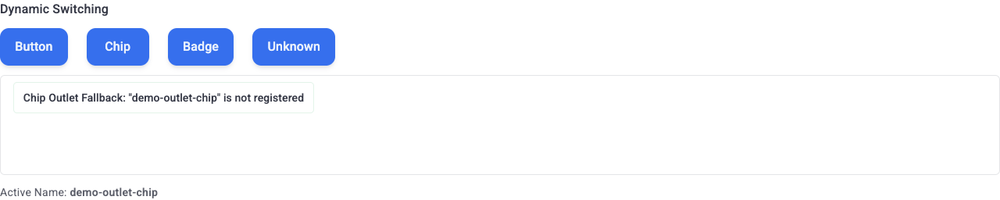
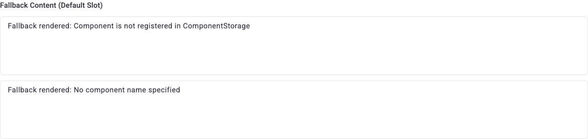

# Отчёт о визуальном и функциональном тестировании: D1ComponentOutlet

## 1. Итоговое резюме

- **Компонент:** `D1ComponentOutlet` (`@dxtmisha/d1`)
- **Исходный код:** [`D1ComponentOutlet`](../../src/components/Ui/ComponentOutlet) ([`ComponentOutlet`](../../../constructor/src/constructors/ComponentOutlet), [`DemoComponentOutletPage`](../../../demo/src/pages/components/DemoComponentOutletPage.vue))
- **Демо / целевой URL:** `http://localhost:3000/component-component-outlet`
- **Материалы:** `Нет`
- **Дата тестирования (UTC):** `2026-11-24T18:37:33Z`
- **Окружение:** `Headless Chrome (Puppeteer / CDP, Desktop 1440x900, Tablet 768x1024, Mobile 375x812)`
- **Покрытие тест-кейсов:** 8 / 8 (`100%`)
- **Итог:** **8 ✅, 0 ⚠️, 0 ❌** (`✅` пройдено, `⚠️` предупреждение, `❌` ошибка) — `D1ComponentOutlet` после перехода на `mergeProps` и нормализации `getElement()` корректно разрешает зарегистрированные компоненты, объединяет `props`/`$attrs` и обработчики событий, пробрасывает слоты и отображает fallback-содержимое без ошибок консоли и переполнения.

---

## 2. Базовая матрица

### 2.1 Визуальное соответствие (`VIS`)

| ID | Сценарий | Статус | Фактический результат | Скриншот |
| :--- | :--- | :---: | :--- | :--- |
| `TC-VIS-001` | Базовое разрешение `D1Button`, `D1Chip`, `D1Badge` из `ComponentStorage` | ✅ | `hasDefaultButton: true`, `hasChip: true`, `hasBadge: true`; все зарегистрированные компоненты отображаются корректно. |  |
| `TC-VIS-002` | Переопределение `props` и проброс слотов `#body` / `#trailing` | ✅ | `hasOverriddenRed: true`, `hasBadge99: true`, `hasAlertBody: true`; локальные свойства переопределяют дефолты хранилища. |  |

### 2.2 Интерактивность и управление состоянием (`INT`)

| ID | Сценарий | Статус | Фактический результат | Скриншот |
| :--- | :--- | :---: | :--- | :--- |
| `TC-INT-001` | Динамическое переключение `name` (`Button -> Chip -> Unknown`) | ✅ | `afterChip.hasChip: true`, `afterUnknown.fallbackShown: true`; компонент реактивно перемонтируется при смене `name`. |  |
| `TC-INT-002` | Композиция обработчиков `mergeProps` и `expose.getElement()` | ✅ | `composedHasBoth: true` (выполнены оба обработчика `attrs` и `props`), `exposeResolved: true`. |  |

### 2.3 Граничные значения и крайние случаи (`BND`)

| ID | Сценарий | Статус | Фактический результат | Скриншот |
| :--- | :--- | :---: | :--- | :--- |
| `TC-BND-001` | Незарегистрированное имя и пустой `name` (fallback `#default`) | ✅ | `unregisteredFallback: true`, `missingNameFallback: true`; fallback-слот отображается без исключений. |  |

### 2.4 Адаптивность (`RSP`)

| ID | Сценарий | Статус | Фактический результат | Скриншот |
| :--- | :--- | :---: | :--- | :--- |
| `TC-RSP-001` | Проверка вьюпортов `1440×900`, `768×1024`, `375×812` | ✅ | Desktop (`1440/1440`), Tablet (`768/768`), Mobile (`375/375`) — `overflow: false` на всех разрешениях. |  |

### 2.5 Доступность (`A11Y`)

| ID | Сценарий | Статус | Фактический результат | Скриншот |
| :--- | :--- | :---: | :--- | :--- |
| `TC-A11Y-001` | Проброс `disabled` и клавиатурная фокусируемость | ✅ | `disabledState: true`, `focusableButtons: 13`; состояние `disabled` корректно передаётся разрешённому компоненту. | — |

### 2.6 Консоль и рантайм (`LOG`)

| ID | Сценарий | Статус | Фактический результат | Скриншот |
| :--- | :--- | :---: | :--- | :--- |
| `TC-LOG-001` | Проверка ошибок консоли, Vue-предупреждений и сетевых запросов | ✅ | `errors: []`, `warnings: []`, `pageErrors: []`, `failedRequests: []`. | — |

---

## 3. AI-аудит и рекомендации

1. **Композиция событий через `mergeProps`:** Миграция с `toBinds` на `mergeProps` обеспечила неразрушающее объединение `onClick` из `$attrs` и `props.props`, что подтверждено в `TC-INT-002`.
2. **Семантика `getElement()`:** Для Vue-компонентов ref возвращает инстанс компонента (а для нативных HTML-тегов — `HTMLElement`), при размонтировании `null` безопасно нормализуется в `undefined`.
3. **Чистота рантайма:** Нулевое количество предупреждений Vue, гидратации и сетевых ошибок на всех сценариях.
