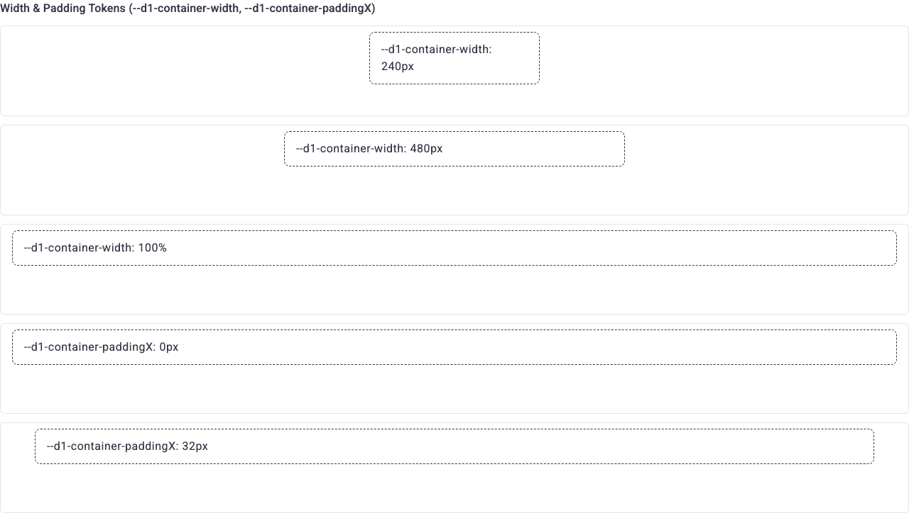
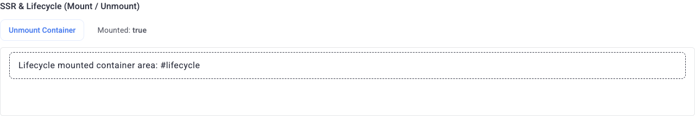
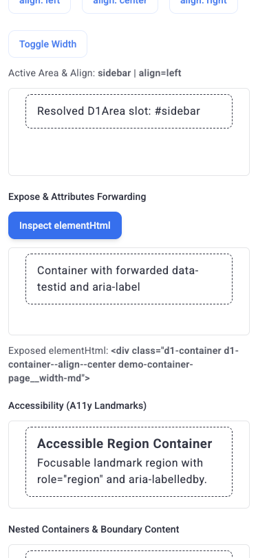
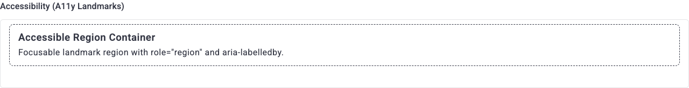

# Отчёт визуального и функционального тестирования: D1Container

## 1. Сводка выполнения

- **Компонент:** `D1Container` (`@dxtmisha/d1`)
- **Исходный код:** [`D1Container`](../../src/components/Ui/Container), [`Container`](../../../constructor/src/constructors/Container), [`DemoContainerPage.vue`](../../../demo/src/pages/components/DemoContainerPage.vue)
- **Целевой URL:** `http://localhost:3000/component-container`
- **Материалы (`materials/`):** `Отсутствуют`
- **Дата тестирования (UTC):** `2026-11-25T05:47:16Z`
- **Окружение:** `Headless Chrome (Puppeteer / CDP, Desktop 1440×900, Tablet 768×1024, Mobile 375×812 / 320×568)`
- **Покрытие тест-кейсов:** `11 / 11` (`100%`)
- **Итог:** **11 ✅, 0 ⚠️, 0 ❌** (`✅` пройдено, `⚠️` предупреждение, `❌` ошибка) — все визуальные, интерактивные, граничные, адаптивные, A11y и runtime-сценарии `D1Container` пройдены успешно; SSR-ответ `HTTP 200`, горизонтальное переполнение отсутствует на всех 4 вьюпортах и во всех 5 узких блоках (`narrowBad: 0`), ошибки консоли, Vue, сети и диалогов равны `0`.

---

## 2. Матрица результатов

### 2.1 Визуальный рендеринг (`VIS`)

| ID | Сценарий | Статус | Наблюдаемый результат | Скриншот |
| :--- | :--- | :---: | :--- | :--- |
| `TC-VIS-001` | Варианты выравнивания (`left`, `center`, `right`) | ✅ | Три контейнера шириной `280px` визуально выровнены строго по левому краю (`align="left"`), по центру (`align="center"`) и по правому краю (`align="right"`). |  |
| `TC-VIS-002` | Кастомизация ширины и отступов через токены `--d1-container-width` и `--d1-container-paddingX` | ✅ | Контейнеры точно применяют заданные CSS-токены ширины (`240px`, `480px`, `100%`) и горизонтальных внутренних отступов (`0px` и `32px`). |  |

### 2.2 Интерактивность и управление состоянием (`INT`)

| ID | Сценарий | Статус | Наблюдаемый результат | Скриншот |
| :--- | :--- | :---: | :--- | :--- |
| `TC-INT-001` | Реактивная передача контекста `area`, переключение `align` и ширины в реальном времени | ✅ | Переключение состояния отражено в панели управления (`Active Area & Align: sidebar \| align=left`) и в дочернем `D1Area` (`Resolved D1Area slot: #sidebar`), ширина и выравнивание обновляются без сбоев. |  |
| `TC-INT-002` | Программный доступ к `expose.elementHtml` | ✅ | Вывод `Exposed elementHtml` возвращает корректную корневую разметку `
`. | — |
| `TC-INT-003` | Жизненный цикл `v-if` (монтирование и размонтирование контейнера с `area`) | ✅ | При размонтировании отображается `Mounted: false` и контейнер удаляется из DOM; при повторном монтировании отображается `Mounted: true` и восстанавливается `Lifecycle mounted container area: #lifecycle`. |  |

### 2.3 Граничные случаи и устойчивость (`BND`)

| ID | Сценарий | Статус | Наблюдаемый результат | Скриншот |
| :--- | :--- | :---: | :--- | :--- |
| `TC-BND-001` | Вложенные контейнеры, пустой контейнер и граничные значения `area` (`""`, `"   "`, `"0"`) | ✅ | Вложенные контейнеры изолируют контексты `Outer area: #outer` и `Inner area: #inner`; пустые/пробельные варианты рендерятся без сбоев макета, а `area="0"` точно разрешает `Matched area="0"`. |  |
| `TC-BND-002` | Числовой контент, мультиязычность, неразрывная строка и экранирование XSS | ✅ | Отображаются `0 \| -5 \| 12.5`, `Tiếng Việt — Привет Мир — 🚀🔥`, экранированный `` (`badImgs: 0`, `hasEscapedPayloadText: true`) и переносимая неразрывная строка в `280px` (`scrollWidth: 280 === clientWidth: 280`, `overflowsBox: false` во всех 5 узких контейнерах). |  |

### 2.4 Адаптивность и вьюпорты (`RSP`)

| ID | Сценарий | Статус | Наблюдаемый результат | Скриншот |
| :--- | :--- | :---: | :--- | :--- |
| `TC-RSP-001` | Адаптивность на Desktop, Tablet и Mobile (`1440×900`, `768×1024`, `375×812`, `320×568`) | ✅ | Переполнение отсутствует на всех 4 вьюпортах: `1440×900` (`scrollWidth: 1440`, `overflowX: false`), `768×1024` (`scrollWidth: 768`, `overflowX: false`), `375×812` (`scrollWidth: 375`, `overflowX: false`), `320×568` (`scrollWidth: 320`, `overflowX: false`). |  |

### 2.5 Доступность (`A11Y`)

| ID | Сценарий | Статус | Наблюдаемый результат | Скриншот |
| :--- | :--- | :---: | :--- | :--- |
| `TC-A11Y-001` | Проброс ARIA-атрибутов через `mergeProps` (`aria-label`, `role="region"`, `aria-labelledby`) | ✅ | Контейнер `exposed-container` получает `aria-label`, а landmark-контейнер в `Accessibility (A11y Landmarks)` корректно пробрасывает `role="region"`, `aria-labelledby` и `tabindex="0"`. | — |
| `TC-A11Y-002` | Клавиатурный фокус на доступном landmark-контейнере | ✅ | Блок `Accessible Region Container` (`Focusable landmark region with role="region" and aria-labelledby.`) корректно принимает фокус без ошибок и визуальных дефектов. |  |

### 2.6 Консоль и стабильность runtime (`LOG`)

| ID | Сценарий | Статус | Наблюдаемый результат | Скриншот |
| :--- | :--- | :---: | :--- | :--- |
| `TC-LOG-001` | Отсутствие ошибок консоли и Vue-предупреждений | ✅ | SSR-ответ вернул `status: 200` (`hasComponent: true`); все логи чистые: `consoleErrors: []`, `vueWarnings: []`, `pageErrors: []`, `networkErrors: []`, `dialogs: []`. | — |

---

## 3. AI-аудит и рекомендации

1. **Изоляция `provide`/`inject` контекста и токенизация:** Вложенные `D1Container` независимо передают `area` в `D1Area` (`#outer` / `#inner`, а также `#0`), а ширина и горизонтальные отступы декларативно управляются через `--d1-container-width` и `--d1-container-paddingX`.
2. **Контроль переполнения на малых ширинах:** Все 5 узких контейнеров шириной `280px` (`--align--left`, `--align--center`, `--align--right`) сохраняют `scrollWidth: 280 === clientWidth: 280` (`overflowsBox: false`), а на вьюпортах от `1440px` до `320px` отсутствует горизонтальный скролл (`overflowX: false`).
3. **Стабильность SSR, `expose` и безопасности:** Компонент присутствует в SSR (`status: 200`, `hasComponent: true`), корректно возвращает корневой узел через `elementHtml`, экранирует XSS-строки (`badImgs: 0`, `dialogs: []`) и не генерирует `[Vue warn]` или ошибок консоли.
