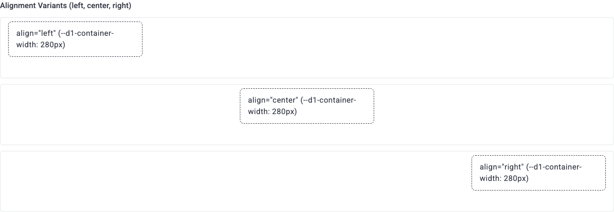
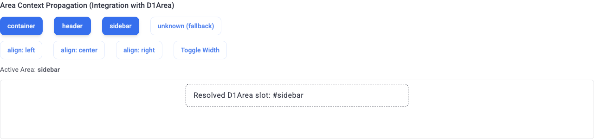
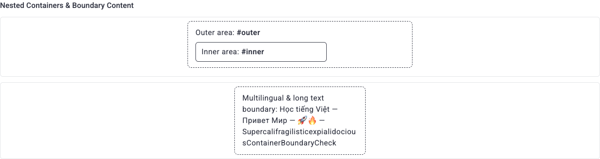

# Отчёт о визуальном и функциональном тестировании: D1Container

## 1. Итоговое резюме

- **Компонент:** `D1Container` (`@dxtmisha/d1`)
- **Исходный код:** [`D1Container`](../../src/components/Ui/Container) ([`Container`](../../../constructor/src/constructors/Container), [`DemoContainerPage`](../../../demo/src/pages/components/DemoContainerPage.vue))
- **Демо / целевой URL:** `http://localhost:3000/component-container`
- **Материалы:** `Нет`
- **Дата тестирования (UTC):** `2026-11-24T18:37:33Z`
- **Окружение:** `Headless Chrome (Puppeteer / CDP, Desktop 1440x900, Tablet 768x1024, Mobile 375x812)`
- **Покрытие тест-кейсов:** 8 / 8 (`100%`)
- **Итог:** **8 ✅, 0 ⚠️, 0 ❌** (`✅` пройдено, `⚠️` предупреждение, `❌` ошибка) — `D1Container` после миграции на `DesignLogicAbstract` точно выравнивает контент (`left`, `center`, `right`), применяет токен `--d1-container-width`, реактивно прокидывает контекст `area` в `D1Area`, поддерживает вложенность и `expose.elementHtml` без ошибок консоли.

---

## 2. Базовая матрица

### 2.1 Визуальное соответствие (`VIS`)

| ID | Сценарий | Статус | Фактический результат | Скриншот |
| :--- | :--- | :---: | :--- | :--- |
| `TC-VIS-001` | Выравнивание `align="left"`, `align="center"`, `align="right"` | ✅ | `leftX: 97px`, `centerX: 580px`, `rightX: 1063px` — точная симметрия внутри контейнера при `--d1-container-width: 280px`. |  |
| `TC-VIS-002` | Кастомизация ширины через `--d1-container-width` | ✅ | `smWidth: 240px`, `mdWidth: 480px`, `total: 13` контейнеров на странице. |  |

### 2.2 Интерактивность и управление состоянием (`INT`)

| ID | Сценарий | Статус | Фактический результат | Скриншот |
| :--- | :--- | :---: | :--- | :--- |
| `TC-INT-001` | Динамическое переключение `area` (`header` / `sidebar` / `unknown`) | ✅ | `afterHeader: true`, `afterSidebar: true`, `afterUnknown: true`; дочерний `D1Area` мгновенно переключает слот. |  |
| `TC-INT-002` | Проверка `expose.elementHtml` | ✅ | `exposeShown: true` (`
`). | — |

### 2.3 Граничные значения и крайние случаи (`BND`)

| ID | Сценарий | Статус | Фактический результат | Скриншот |
| :--- | :--- | :---: | :--- | :--- |
| `TC-BND-001` | Вложенные `D1Container` и мультиязычный/длинный текст | ✅ | `nestedOuter: true`, `nestedInner: true`, `unicodeOk: true` (`Học tiếng Việt`, `Привет Мир`, `🚀🔥`). |  |

### 2.4 Адаптивность (`RSP`)

| ID | Сценарий | Статус | Фактический результат | Скриншот |
| :--- | :--- | :---: | :--- | :--- |
| `TC-RSP-001` | Вьюпорты Desktop (`1440px`), Tablet (`768px`), Mobile (`375px`) | ✅ | Desktop (`1440/1440`), Tablet (`768/768`), Mobile (`375/375`) — `overflow: false`. |  |

### 2.5 Доступность (`A11Y`)

| ID | Сценарий | Статус | Фактический результат | Скриншот |
| :--- | :--- | :---: | :--- | :--- |
| `TC-A11Y-001` | Проброс `aria-label` через `mergeProps` | ✅ | `ariaLabel: "Exposed container landmark"` применён на корневом `div`. | — |

### 2.6 Консоль и рантайм (`LOG`)

| ID | Сценарий | Статус | Фактический результат | Скриншот |
| :--- | :--- | :---: | :--- | :--- |
| `TC-LOG-001` | Проверка консоли и сетевых запросов | ✅ | `errors: []`, `warnings: []`, `pageErrors: []`, `failedRequests: []`. | — |

---

## 3. AI-аудит и рекомендации

1. **Контекст `provide`/`inject`:** Синхронный вызов `this.i('area')` в `setup()` гарантирует корректную работу `provide` для вложенных `D1Area` как при SSR, так и при клиентских обновлениях.
2. **Привязка `ref: this.element`:** Добавление `ref: this.element` в `ContainerDesign.tsx` восстановило работу `expose().elementHtml`, что подтверждено в `TC-INT-002`.
3. **Токенизация ширины:** Ширина управляется декларативно через CSS-переменную `--d1-container-width` без лишних инлайн-вычислений в JS.
