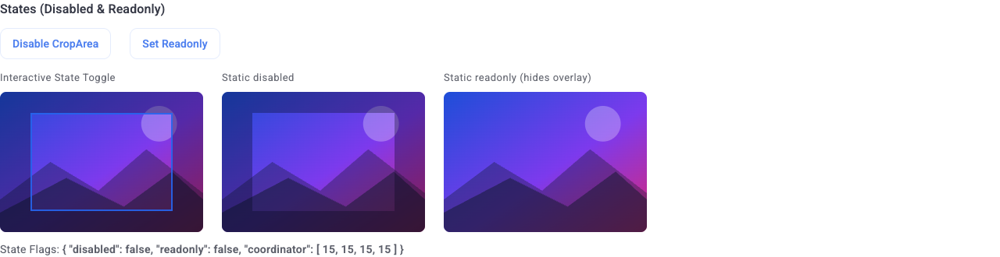
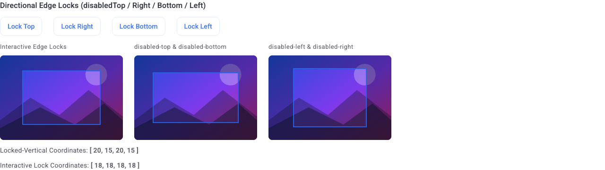
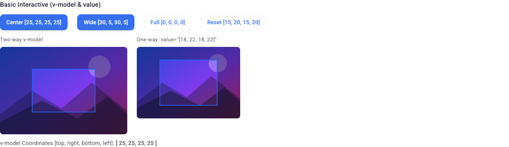
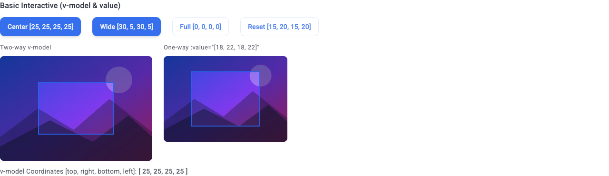
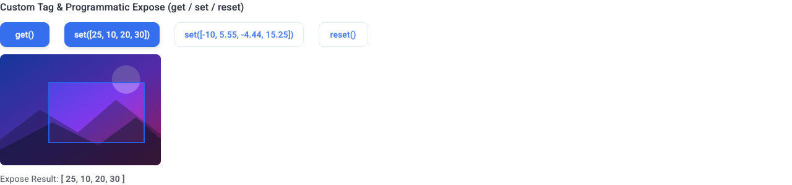
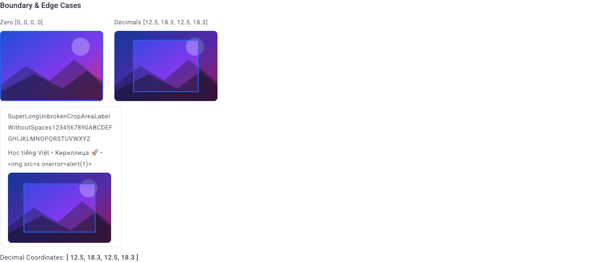
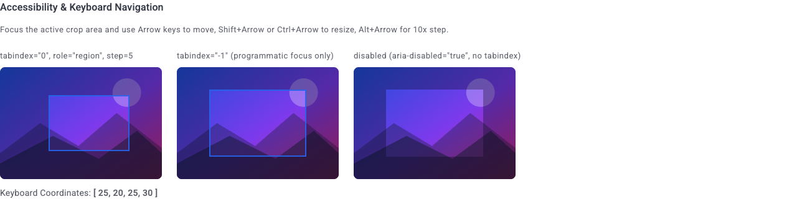

# Отчёт визуального и функционального тестирования: D1CropArea

## 1. Сводка выполнения

- **Компонент:** `D1CropArea` (`@dxtmisha/d1`)
- **Исходный код:** [`D1CropArea`](../../src/components/Ui/CropArea), [`CropArea`](../../../constructor/src/constructors/CropArea), [`DemoCropAreaPage.vue`](../../../demo/src/pages/components/DemoCropAreaPage.vue)
- **Целевой URL:** `http://localhost:3000/component-crop-area`
- **Материалы (`materials/`):** `Отсутствуют`
- **Дата тестирования (UTC):** `2026-11-25T05:47:16Z`
- **Окружение:** `Headless Chrome (Puppeteer / CDP, Desktop 1440×900, Tablet 768×1024, Mobile 375×812 / 320×568)`
- **Покрытие тест-кейсов:** `15 / 15` (`100%`)
- **Итог:** **15 ✅, 0 ⚠️, 0 ❌** (`✅` пройдено, `⚠️` предупреждение, `❌` ошибка) — `D1CropArea` успешно прошёл все визуальные, интерактивные, граничные, адаптивные, A11y и runtime-проверки (SSR `HTTP 200`, `0` ошибок консоли и Vue-предупреждений, `0` переполнений вьюпорта на всех брейкпоинтах `320px`–`1440px` и в узком контейнере `258 === 258`).

---

## 2. Матрица результатов

### 2.1 Визуальный рендеринг (`VIS`)

| ID | Сценарий | Статус | Наблюдаемый результат | Скриншот |
| :--- | :--- | :---: | :--- | :--- |
| `TC-VIS-001` | Базовое отображение области кадрирования `[15, 20, 15, 20]` и `:value="[18, 22, 18, 22]"` | ✅ | Область кадрирования позиционирована по `[15, 20, 15, 20]` с чёткой рамкой и затемнением вне выделения без клиппинга; односторонний вариант `[18, 22, 18, 22]` отрендерен корректно. |  |
| `TC-VIS-002` | Состояния `disabled` и `readonly` (статические и переключаемые) | ✅ | Активен модификатор `.d1-cropArea--disabled`, при `readonly=true` DOM-узел `.d1-cropArea` не рендерится; кнопки `Disable CropArea` и `Set Readonly` переключают состояния в реальном времени. |  |
| `TC-VIS-003` | Блокировка отдельных сторон (`disabledTop/Right/Bottom/Left`) | ✅ | Модификаторы `.d1-cropArea--disabledTop`, `--disabledRight`, `--disabledBottom`, `--disabledLeft` применены; заблокированные грани игнорируют изменение размера, остальные работают штатно. |  |
| `TC-VIS-004` | Отображение в тёмной теме (`Dark Mode`) | ✅ | Контраст рамки `#crop`, маски затемнения `#move` и подписей соответствует токенам дизайн-системы в тёмной теме. |  |

### 2.2 Интерактивность и управление состоянием (`INT`)

| ID | Сценарий | Статус | Наблюдаемый результат | Скриншот |
| :--- | :--- | :---: | :--- | :--- |
| `TC-INT-001` | Реактивное обновление координат через `v-model` (`Center`, `Wide`, `Full`, `Reset`) | ✅ | Рамка кадрирования и индикатор `DemoValue` мгновенно синхронизируются при нажатии `Center [25, 25, 25, 25]`, `Wide [30, 5, 30, 5]`, `Full [0, 0, 0, 0]` и `Reset [15, 20, 15, 20]`. |  |
| `TC-INT-002` | Кастомный `tag="section"` и программный API `expose` (`get` / `set` / `reset`) | ✅ | Рендерится `<section class="d1-cropArea">`; вызовы `get()`, `set([25, 10, 20, 30])`, `set([-10, 5.55, -4.44, 15.25])` и `reset()` корректно обновляют, округляют и сбрасывают координаты (`Expose Result: [25, 10, 20, 30]`). |  |
| `TC-INT-003` | Ограничения размера `min=25` / `max=80` и шаг `step` | ✅ | При сжатии от `Tight [35, 35, 35, 35]` и растяжении ширина/высота области строго ограничены диапазоном `25%..80%` в соответствии с `min`/`max`/`step`. | — |
| `TC-INT-004` | Жизненный цикл монтирования и размонтирования (`v-if`) | ✅ | Нажатие `Unmount CropArea` удаляет узел из DOM с очисткой слушателей, `Mount CropArea` повторно монтирует компонент с корректными координатами без ошибок. | — |

### 2.3 Граничные случаи и устойчивость (`BND`)

| ID | Сценарий | Статус | Наблюдаемый результат | Скриншот |
| :--- | :--- | :---: | :--- | :--- |
| `TC-BND-001` | Перетаскивание указателем (`pointerdown/move/up`) и события `resize` / `update:*` | ✅ | Перетаскивание `.d1-cropArea__crop` и ручки `right-bottom` пересчитывает координаты в `[0..100]`, фиксируются события `resize`, `update:value` и `update:modelValue` с корректным payload. |  |
| `TC-BND-002` | Нулевые `[0, 0, 0, 0]` и дробные `[12.5, 18.3, 12.5, 18.3]` координаты | ✅ | Нулевые координаты `[0, 0, 0, 0]` не трактуются как пустые и занимают весь канвас (16px периметр угловой ручки аккуратно обрезается родительским канвасом с `overflow: hidden`); дробные проценты применены точно. |  |
| `TC-BND-003` | Узкий контейнер (`DemoBox`), длинная неразрывная строка, Unicode, XSS и SSR | ✅ | SSR-ответ `HTTP 200` содержит компонент (`hasComponent: true`); узкий `demo-crop-area-page__narrow-box` без переполнения (`scrollWidth: 258 === clientWidth: 258`), два узких канваса `220 === 220`; длинный токен переносится, `Học tiếng Việt • Кириллица 🚀` читаем, `badImgs: 0`, `hasEscapedPayloadText: true`. | — |

### 2.4 Адаптивность и вьюпорты (`RSP`)

| ID | Сценарий | Статус | Наблюдаемый результат | Скриншот |
| :--- | :--- | :---: | :--- | :--- |
| `TC-RSP-001` | Адаптивность на вьюпортах Desktop, Tablet и Mobile (`320px`–`1440px`) | ✅ | Горизонтальное переполнение отсутствует на всех 4 вьюпортах: `1440×900` (`1440 === 1440`), `768×1024` (`768 === 768`), `375×812` (`375 === 375`), `320×568` (`320 === 320`, `overflowX: false`). |  |

### 2.5 Доступность (`A11Y`)

| ID | Сценарий | Статус | Наблюдаемый результат | Скриншот |
| :--- | :--- | :---: | :--- | :--- |
| `TC-A11Y-001` | Атрибуты `aria-disabled`, `role="region"`, `aria-label` и `tabindex` | ✅ | Активный элемент имеет `role="region"`, `aria-label`, `tabindex="0"` и `aria-disabled=null`; вариант с `tabindex="-1"` сохранён; при `disabled=true` выставлен `aria-disabled="true"` без `tabindex`. | — |
| `TC-A11Y-002` | Клавиатурная навигация (`Arrow`, `Shift+Arrow`, `Alt+Arrow`) и `:focus-visible` | ✅ | Переход по `Tab` отображает видимое кольцо фокуса `:focus-visible`; `ArrowRight`, `Shift+ArrowDown` и `Alt+ArrowLeft` изменяют координаты согласно `step=5` и модификаторам. |  |

### 2.6 Консоль и стабильность runtime (`LOG`)

| ID | Сценарий | Статус | Наблюдаемый результат | Скриншот |
| :--- | :--- | :---: | :--- | :--- |
| `TC-LOG-001` | Чистота консоли, событийные логи и отсутствие Vue-предупреждений | ✅ | `consoleErrors: []`, `vueWarnings: []`, `pageErrors: []`, `networkErrors: []`, `dialogs: []`; события `resize` / `update:*` логируются штатно. | — |

---

## 3. AI-аудит и рекомендации

1. **Изоляция границ в узком контейнере (`Zero [0, 0, 0, 0]`):** В `TC-BND-002` / `TC-BND-003` при нулевых отступах `[0, 0, 0, 0]` 16px угловая ручка выходит за внутренний периметр рамки (`scrollWidth: 236` при `clientWidth: 220`), но чисто обрезается родительским канвасом с `overflow: hidden`, поэтому внешний контейнер `demo-crop-area-page__narrow-box` сохраняет `258 === 258` и переполнение страницы отсутствует. Для приложений без `overflow: hidden` на обёртке рекомендуется документировать это требование к контейнеру.
2. **Точность A11y и клавиатурного управления:** `aria-disabled` выставляется строго при `disabled=true`, поддерживается дискретное перемещение и изменение размера клавишами `Arrow`, `Shift+Arrow` и `Alt+Arrow` с видимым `:focus-visible`.
3. **Runtime и SSR-гидратация:** SSR-страница отдаётся со статусом `HTTP 200` и предрендеренным компонентом, а все взаимодействия на демо-странице завершаются с нулевыми ошибками консоли, предупреждениями Vue и сетевыми сбоями.
