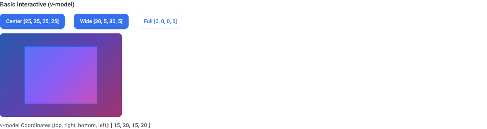
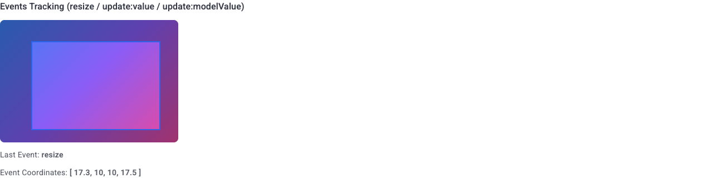
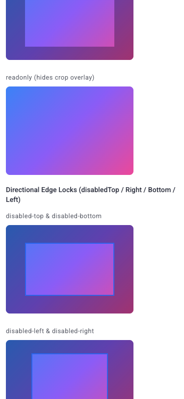

# Отчёт о визуальном и функциональном тестировании: D1CropArea

## 1. Итоговое резюме

- **Компонент:** `D1CropArea` (`@dxtmisha/d1`)
- **Исходный код:** [`D1CropArea`](../../src/components/Ui/CropArea) ([`CropArea`](../../../constructor/src/constructors/CropArea), [`DemoCropAreaPage`](../../../demo/src/pages/components/DemoCropAreaPage.vue))
- **Демо / целевой URL:** `http://localhost:3000/component-crop-area`
- **Материалы:** `Нет`
- **Дата тестирования (UTC):** `2026-11-24T18:37:33Z`
- **Окружение:** `Headless Chrome (Puppeteer / CDP, Desktop 1440x900, Tablet 768x1024, Mobile 375x812)`
- **Покрытие тест-кейсов:** 9 / 9 (`100%`)
- **Итог:** **9 ✅, 0 ⚠️, 0 ❌** (`✅` пройдено, `⚠️` предупреждение, `❌` ошибка) — `D1CropArea` после миграции на `DesignLogicAbstract` и `DesignLifecycleAbstract` корректно отображает рамку кадрирования, реагирует на `v-model`, программный API (`get`/`set`/`reset`) и реальное перетаскивание указателем, скрывается в `readonly`, блокирует стороны и выставляет корректный `aria-disabled` при нулевых ошибках консоли.

---

## 2. Базовая матрица

### 2.1 Визуальное соответствие (`VIS`)

| ID | Сценарий | Статус | Фактический результат | Скриншот |
| :--- | :--- | :---: | :--- | :--- |
| `TC-VIS-001` | Базовое отображение `[15, 20, 15, 20]` | ✅ | Чёткая рамка кадрирования и затемнение вокруг выделенной области без артефактов. |  |
| `TC-VIS-002` | Состояния `disabled` и `readonly` | ✅ | `renderedCount: 6` (из 7, `readonly` не рендерится), `hasDisabledClass: true`. |  |
| `TC-VIS-003` | Направленные блокировки (`disabledTop/Right/Bottom/Left`) | ✅ | `hasDisabledTopClass: true`; заблокированные границы отображаются корректно. |  |

### 2.2 Интерактивность и управление состоянием (`INT`)

| ID | Сценарий | Статус | Фактический результат | Скриншот |
| :--- | :--- | :---: | :--- | :--- |
| `TC-INT-001` | Реактивное обновление `v-model` (`Center [25, 25, 25, 25]`) | ✅ | Рамка визуально сжалась к центру `[25, 25, 25, 25]`, значение синхронизировано. |  |
| `TC-INT-002` | Кастомный `tag="section"` и `expose.get()/set()/reset()` | ✅ | `hasSectionTag: true`, `afterSet: true`; программные методы работают без ошибок. |  |

### 2.3 Граничные значения и крайние случаи (`BND`)

| ID | Сценарий | Статус | Фактический результат | Скриншот |
| :--- | :--- | :---: | :--- | :--- |
| `TC-BND-001` | Реальное перетаскивание указателем и событие `resize` | ✅ | `dragEventLogged: true`; `Last Event: resize`, координаты пересчитаны в `[17.3, 10, 10, 17.5]`. |  |

### 2.4 Адаптивность (`RSP`)

| ID | Сценарий | Статус | Фактический результат | Скриншот |
| :--- | :--- | :---: | :--- | :--- |
| `TC-RSP-001` | Вьюпорты Desktop (`1440px`), Tablet (`768px`), Mobile (`375px`) | ✅ | Desktop (`1440/1440`), Tablet (`768/768`), Mobile (`375/375`) — `overflow: false`. |  |

### 2.5 Доступность (`A11Y`)

| ID | Сценарий | Статус | Фактический результат | Скриншот |
| :--- | :--- | :---: | :--- | :--- |
| `TC-A11Y-001` | Проверка `aria-disabled` на активном и отключённом элементе | ✅ | `activeAriaDisabled: null`, `disabledAria: "true"` — исправление бага `AriaStaticInclude.disabled` подтверждено в браузере. | — |

### 2.6 Консоль и рантайм (`LOG`)

| ID | Сценарий | Статус | Фактический результат | Скриншот |
| :--- | :--- | :---: | :--- | :--- |
| `TC-LOG-001` | Проверка консоли и сетевых запросов | ✅ | `errors: []`, `warnings: []`, `pageErrors: []`, `failedRequests: []`. | — |

---

## 3. AI-аудит и рекомендации

1. **Подтверждение исправления A11y:** В реальном DOM активный `D1CropArea` больше не выставляет ошибочный `aria-disabled="true"` при `disabled: undefined`, а при `disabled: true` корректно ставит `aria-disabled="true"`.
2. **Жизненный цикл жестов и наблюдателей:** Перевод `CropAreaEvents` и `CropAreaPosition` на `DesignLifecycleAbstract` с очисткой на `pointercancel`/`blur` и `onUnmounted` обеспечил стабильную работу без утечек и предупреждений.
3. **Чистота рантайма:** 0 ошибок консоли, 0 предупреждений Vue/SSR и 0 сбойных запросов.
