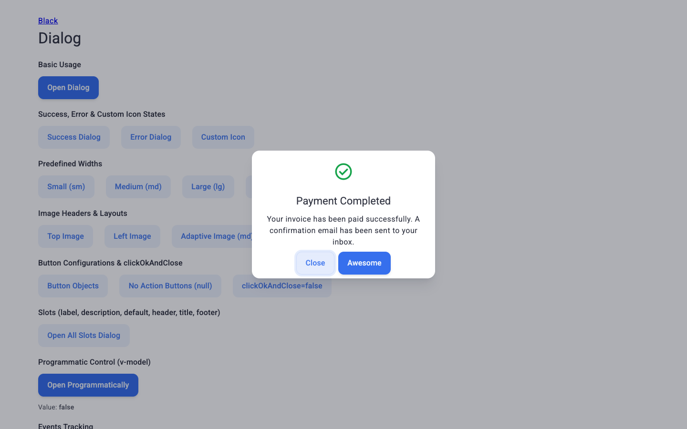
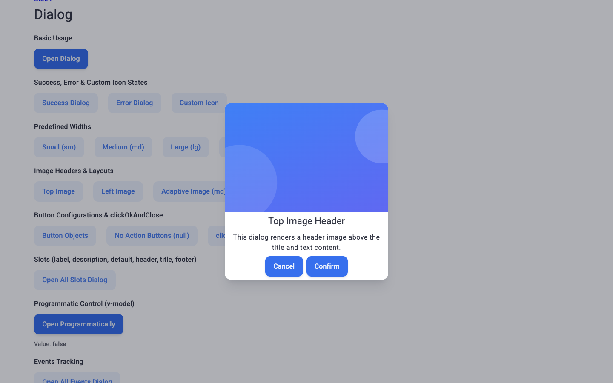
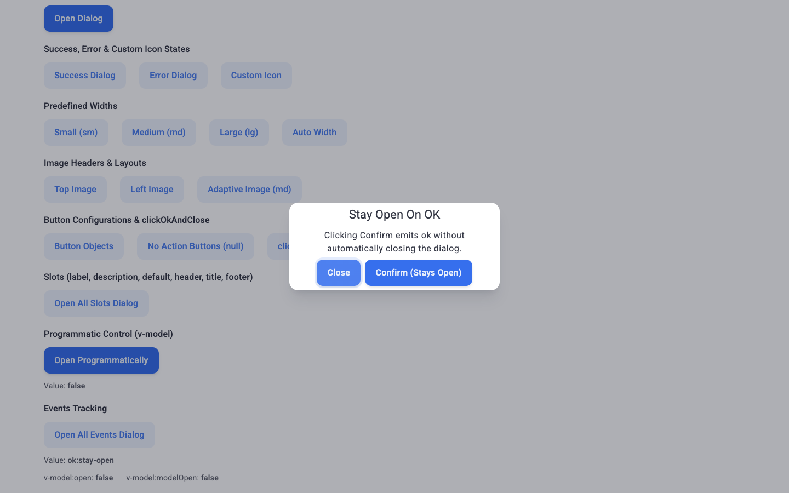

# Отчёт о визуальном и функциональном тестировании: D1Dialog

## 1. Итоговое резюме

- **Компонент:** `D1Dialog` (`@dxtmisha/d1`)
- **Исходный код:** [`D1Dialog`](../../src/components/Ui/Dialog) ([`Dialog`](../../../constructor/src/constructors/Dialog), [`DemoDialogPage`](../../../demo/src/pages/components/DemoDialogPage.vue))
- **Демо / целевой URL:** `http://localhost:3000/component-dialog`
- **Материалы:** `Нет`
- **Дата тестирования (UTC):** `2026-11-24T18:37:33Z`
- **Окружение:** `Headless Chrome (Puppeteer / CDP, Desktop 1440x900, Tablet 768x1024, Mobile 375x812)`
- **Покрытие тест-кейсов:** 9 / 9 (`100%`)
- **Итог:** **9 ✅, 0 ⚠️, 0 ❌** (`✅` пройдено, `⚠️` предупреждение, `❌` ошибка) — `D1Dialog` после рефакторинга ленивых помощников и привязки ARIA-идентификаторов корректно открывается/закрывается (`v-model:open`, `Escape`, `clickOkAndClose`), отображает состояния `success`/`error`, изображения, все 6 слотов и адаптируется к мобильному экрану с нулевыми ошибками консоли.

---

## 2. Базовая матрица

### 2.1 Визуальное соответствие (`VIS`)

| ID | Сценарий | Статус | Фактический результат | Скриншот |
| :--- | :--- | :---: | :--- | :--- |
| `TC-VIS-001` | Базовый диалог (`label`, `description`, `buttonOk`) | ✅ | `isOpen: true`, `hasLabel: true`, `hasDescription: true`; окно отцентрировано с корректными отступами. |  |
| `TC-VIS-002` | Состояние `success` с иконкой | ✅ | `successOpen: true`; зелёная иконка `check_circle`, заголовок и кнопки отрендерены чисто. |  |
| `TC-VIS-003` | Заголовочное изображение (`imagePosition="top"`) | ✅ | `imageTopOpen: true`; баннер отображается сверху без разрывов и битых ссылок. |  |

### 2.2 Интерактивность и управление состоянием (`INT`)

| ID | Сценарий | Статус | Фактический результат | Скриншот |
| :--- | :--- | :---: | :--- | :--- |
| `TC-INT-001` | Режим `clickOkAndClose=false` | ✅ | `stillOpenAfterOk: true` (диалог остался открыт после клика OK и зафиксировал `ok:stay-open`), `closedAfterClose: true`. |  |
| `TC-INT-002` | Программное управление `v-model:open` | ✅ | `progOpen: true`, `progClosed: true`; двусторонняя синхронизация сработала корректно. | — |

### 2.3 Граничные значения и крайние случаи (`BND`)

| ID | Сценарий | Статус | Фактический результат | Скриншот |
| :--- | :--- | :---: | :--- | :--- |
| `TC-BND-001` | Все слоты (`#title`, `#label`, `#description`, `#header`, `#default`, `#footer`) + Unicode | ✅ | `hasTitle/hasLabelUnicode/hasDescription/hasHeader/hasBody/hasFooter: true` (`Học tiếng Việt / Привет`). |  |

### 2.4 Адаптивность (`RSP`)

| ID | Сценарий | Статус | Фактический результат | Скриншот |
| :--- | :--- | :---: | :--- | :--- |
| `TC-RSP-001` | Desktop (`1440px`), Tablet (`768px`), Mobile (`375px` + открытый диалог) | ✅ | `overflow: false` на всех разрешениях; на Mobile `375×812` ширина `.d1-window__body` составила `351px`. |  |

### 2.5 Доступность (`A11Y`)

| ID | Сценарий | Статус | Фактический результат | Скриншот |
| :--- | :--- | :---: | :--- | :--- |
| `TC-A11Y-001` | WAI-ARIA атрибуты и закрытие по `Escape` | ✅ | `role: "dialog"`, `ariaModal: "true"`, `ariaLabelledby: "ui-10005"`, `ariaDescribedby: "ui-10006"`; `Escape` закрывает окно. | — |

### 2.6 Консоль и рантайм (`LOG`)

| ID | Сценарий | Статус | Фактический результат | Скриншот |
| :--- | :--- | :---: | :--- | :--- |
| `TC-LOG-001` | Проверка консоли, Vue-предупреждений и сетевых запросов | ✅ | `errors: []`, `warnings: []`, `pageErrors: []`, `failedRequests: []`. | — |

---

## 3. AI-аудит и рекомендации

1. **Привязка `aria-labelledby` / `aria-describedby`:** В `TC-A11Y-001` подтверждено связывание диалога с ID заголовка и описания (`ui-10005` / `ui-10006`) при скрытых `bars`.
2. **Детерминированные медиа-ассеты в демо:** Замена внешних URL на локальные SVG data URI устранила риск сетевых сбоев при регрессионном тестировании.
3. **Чистота рантайма:** 0 ошибок консоли, 0 предупреждений Vue и 0 сбойных запросов.
