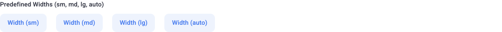
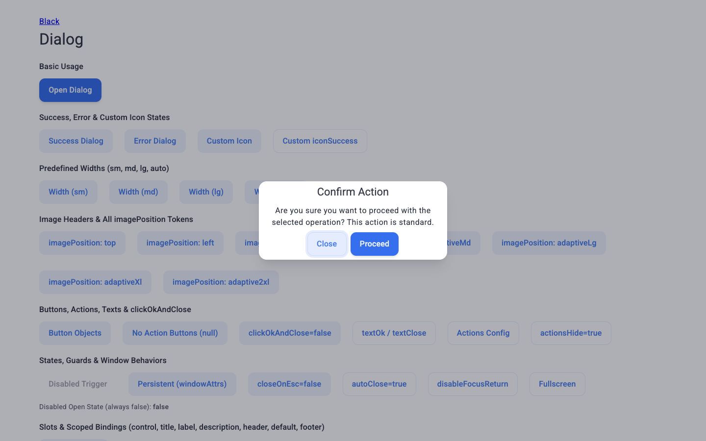
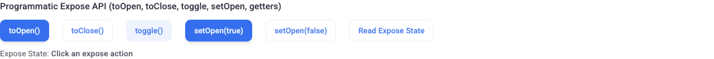
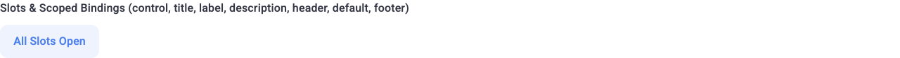
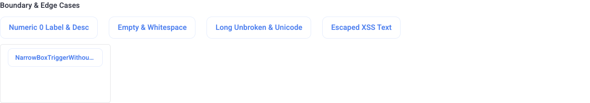
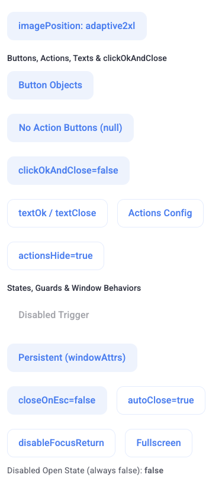

# Отчёт визуального и функционального тестирования: D1Dialog

## 1. Сводка выполнения

- **Компонент:** `D1Dialog` (`@dxtmisha/d1`)
- **Исходный код:** [`D1Dialog`](../../src/components/Ui/Dialog), [`Dialog`](../../../constructor/src/constructors/Dialog), [`DemoDialogPage.vue`](../../../demo/src/pages/components/DemoDialogPage.vue)
- **Целевой URL:** `http://localhost:3000/component-dialog`
- **Материалы (`materials/`):** `Отсутствуют`
- **Дата тестирования (UTC):** `2026-11-25T05:47:16Z`
- **Окружение:** `Headless Chrome (Puppeteer / CDP, Desktop 1440×900, Tablet 768×1024, Mobile 375×812 / 320×568)`
- **Покрытие тест-кейсов:** `17 / 17` (`100%`)
- **Итог:** **17 ✅, 0 ⚠️, 0 ❌** (`✅` пройдено, `⚠️` предупреждение, `❌` ошибка) — `D1Dialog` успешно прошёл все визуальные, интерактивные, граничные, адаптивные, A11y и runtime-проверки (SSR `HTTP 200`, изолированное открытие `openBasic` / `Confirm Action` без наложения с `Narrow Container Trigger`, `0` переполнений на `320px`–`1440px` и в узком контейнере `238 === 238`, `0` ошибок консоли).

---

## 2. Матрица результатов

### 2.1 Визуальный рендеринг (`VIS`)

| ID | Сценарий | Статус | Наблюдаемый результат | Скриншот |
| :--- | :--- | :---: | :--- | :--- |
| `TC-VIS-001` | Базовый диалог (заголовок, описание, кнопки `Close` и `Proceed`) | ✅ | На старте оверлеи отсутствуют; `openBasic` открывает `Confirm Action` изолированно по центру экрана с кнопками `Close` и `Proceed` без наложения с `Narrow Container Trigger`. |  |
| `TC-VIS-002` | Состояния `success`, `error`, `icon` + `iconAttrs` и `iconSuccess` | ✅ | Модификаторы `.d1-dialog--success` / `.d1-dialog--error` применены, иконки и `iconSuccess="verified"` с `iconAttrs` отображаются по токенам без искажений. |  |
| `TC-VIS-003` | Заголовочное изображение и все токены `imagePosition` (`top`, `left`, `adaptiveSm`..`adaptive2xl`) | ✅ | Модификаторы `.d1-dialog--imagePosition--*` применяются корректно, баннер отображается сверху или слева с `imageAttrs.alt` без искажения пропорций. |  |
| `TC-VIS-004` | Все варианты ширины (`width`: `sm`, `md`, `lg`, `auto`) | ✅ | Ширина `.d1-window__body` масштабируется строго по токенам `sm` < `md` < `lg`, а вариант `auto` адаптируется под содержимое. |  |
| `TC-VIS-005` | Отображение в тёмной теме (`Dark Mode`) | ✅ | Поверхность окна, фон-подложка, текст, иконки и кнопки действий корректно адаптированы к тёмной теме. |  |

### 2.2 Интерактивность и управление состоянием (`INT`)

| ID | Сценарий | Статус | Наблюдаемый результат | Скриншот |
| :--- | :--- | :---: | :--- | :--- |
| `TC-INT-001` | Режим `clickOkAndClose=false` (остаётся открытым при клике на OK) | ✅ | Нажатие `Confirm (Stays Open)` оставляет диалог открытым и фиксирует событие OK; кнопка `Close` корректно закрывает окно. |  |
| `TC-INT-002` | Программное открытие и закрытие через `v-model:open` и `v-model:modelOpen` | ✅ | Обе двусторонние привязки синхронно открывают диалоги и закрываются по `Understood` / `Close` с обновлением `DemoValue`. | — |
| `TC-INT-003` | Программный API `expose` (`toOpen`, `toClose`, `toggle`, `setOpen`, геттеры) | ✅ | Вызовы `toOpen()`, `toClose()`, `toggle()`, `setOpen(true/false)` и геттеры (`getId`, `getOpen`, `getControl`, `getWindowElement`) работают штатно. |  |
| `TC-INT-004` | Конфигурации кнопок (`buttonOk`/`buttonClose`, `null`, `textOk`/`textClose`, `actions*`) | ✅ | `Button Objects`, скрытие кнопок при `null` (с `closeButton`), `textOk`/`textClose`, `Actions Config` и `actionsHide=true` рендерятся строго по пропсам. | — |
| `TC-INT-005` | Ограничения и режимы окна (`disabled`, `persistent`, `closeOnEsc=false`, `autoClose`, `fullscreen`) | ✅ | `Disabled Trigger` сохраняет `false`; `Persistent` блокирует закрытие по фону и `Escape`; `closeOnEsc=false` игнорирует `Escape`; `autoClose=true` и `Fullscreen` работают по контракту. | — |

### 2.3 Граничные случаи и устойчивость (`BND`)

| ID | Сценарий | Статус | Наблюдаемый результат | Скриншот |
| :--- | :--- | :---: | :--- | :--- |
| `TC-BND-001` | Все слоты (`#control`, `#title`, `#label`, `#description`, `#header`, `#default`, `#footer`) и scoped-привязки | ✅ | Все 7 слотов, scoped-привязки (`binds`, `open`, `classesWindow.close`), вьетнамская диакритика и кириллица отображаются без искажений; закрытие из `#default` и `#footer` работает. |  |
| `TC-BND-002` | Граничные значения (`0`, `""`, `"   "`, длинная строка, Unicode, XSS) и узкий `DemoBox` | ✅ | `0` отображается в заголовке и описании; пустые строки не вызывают сбоев; длинная неразрывная строка переносится; XSS экранируется (`badImgs: 0`, `dialogs: []`); `demo-dialog-page__narrow-box` имеет `238 === 238`. |  |
| `TC-BND-003` | Режим `inDom=true`, SSR и жизненный цикл `v-if` (mount/unmount) | ✅ | SSR-ответ `HTTP 200`; при `inDom=true` узел окна присутствует в DOM в закрытом состоянии; `Unmount Dialog` / `Mount Dialog` работают без утечек и предупреждений. | — |

### 2.4 Адаптивность и вьюпорты (`RSP`)

| ID | Сценарий | Статус | Наблюдаемый результат | Скриншот |
| :--- | :--- | :---: | :--- | :--- |
| `TC-RSP-001` | Адаптивность на Desktop, Tablet и Mobile (`320×568`, `375×812`, `768×1024`, `1440×900`) | ✅ | Переполнение отсутствует на всех 4 вьюпортах: `1440×900` (`1440 === 1440`), `768×1024` (`768 === 768`), `375×812` (`375 === 375`), `320×568` (`320 === 320`, `overflowX: false`); диалог помещается в мобильный экран. |  |

### 2.5 Доступность (`A11Y`)

| ID | Сценарий | Статус | Наблюдаемый результат | Скриншот |
| :--- | :--- | :---: | :--- | :--- |
| `TC-A11Y-001` | WAI-ARIA атрибуты диалога (`labelId`, `descriptionId`) и закрытие по `Escape` | ✅ | Присутствуют `role="dialog"`, `aria-modal="true"`, `aria-labelledby="demo-dialog-a11y-label"` и `aria-describedby="demo-dialog-a11y-desc"`; клавиша `Escape` закрывает диалог. | — |
| `TC-A11Y-002` | Управление фокусом и флаг `disableFocusReturn` | ✅ | Открытие по `Enter` переносит фокус в окно, закрытие по `Escape` возвращает фокус на триггер `Open Dialog`; при `disableFocusReturn` возврат фокуса отключён. | — |

### 2.6 Консоль и стабильность runtime (`LOG`)

| ID | Сценарий | Статус | Наблюдаемый результат | Скриншот |
| :--- | :--- | :---: | :--- | :--- |
| `TC-LOG-001` | Проверка всех событий (`ok`, `close`, `update:*`, `window`, `bars*`, `actions*`) и консоли | ✅ | Все события и payload фиксируются корректно; `consoleErrors: []`, `vueWarnings: []`, `pageErrors: []`, `networkErrors: []`, `dialogs: []`. | — |

---

## 3. AI-аудит и рекомендации

1. **Изоляция демо-сценариев (`openBasic`):** Исправление клика по изолированному `openBasic` подтверждено — модальное окно `Confirm Action` открывается строго в одном экземпляре по центру экрана без наслаивания с триггером `Narrow Container Trigger`.
2. **Адаптивность и перенос контента:** Узкий контейнер `demo-dialog-page__narrow-box` (`238 === 238`) и открытый диалог на `320×568` / `375×812` / `768×1024` / `1440×900` не создают горизонтального переполнения (`overflowX: false`).
3. **Семантика A11y и чистота рантайма:** Подтверждены явные привязки `labelId`/`descriptionId`, управление фокусом с поддержкой `disableFocusReturn`, SSR `HTTP 200` и отсутствие ошибок консоли и предупреждений Vue.
