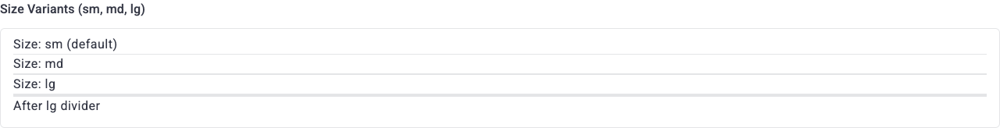
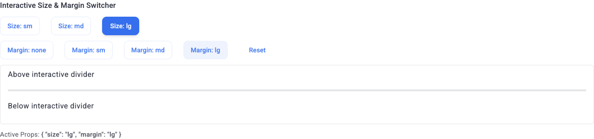
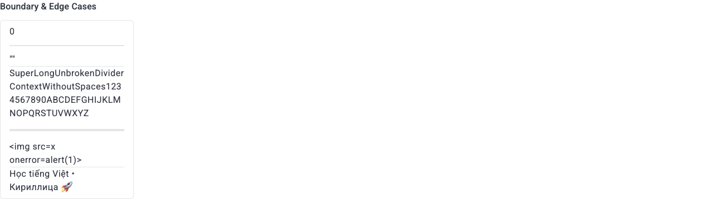
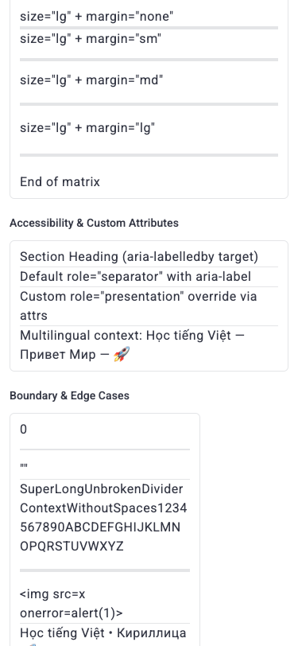

# Отчёт визуального и функционального тестирования: D1Divider

## 1. Сводка выполнения

- **Компонент:** `D1Divider` (`@dxtmisha/d1`)
- **Исходный код:** [`D1Divider`](../../src/components/Ui/Divider), [`Divider`](../../../constructor/src/constructors/Divider), [`DemoDividerPage.vue`](../../../demo/src/pages/components/DemoDividerPage.vue)
- **Целевой URL:** `http://localhost:3000/component-divider`
- **Материалы (`materials/`):** `Отсутствуют`
- **Дата тестирования (UTC):** `2026-11-25T05:47:16Z`
- **Окружение:** `Headless Chrome (Puppeteer / CDP, Desktop 1440×900, Tablet 768×1024, Mobile 375×812 / 320×568)`
- **Покрытие тест-кейсов:** `10 / 10` (`100%`)
- **Итог:** **10 ✅, 0 ⚠️, 0 ❌** (`✅` пройдено, `⚠️` предупреждение, `❌` ошибка) — `D1Divider` успешно прошёл все визуальные, интерактивные, граничные, адаптивные, A11y и runtime-проверки (SSR `HTTP 200`, `0` переполнений на всех 4 вьюпортах `320px`–`1440px` и в узком контейнере `238 === 238`, `0` ошибок консоли и Vue-предупреждений).

---

## 2. Матрица результатов

### 2.1 Визуальный рендеринг (`VIS`)

| ID | Сценарий | Статус | Наблюдаемый результат | Скриншот |
| :--- | :--- | :---: | :--- | :--- |
| `TC-VIS-001` | Варианты толщины (`sm`, `md`, `lg`) | ✅ | Толщина границы монотонно растёт по шкале токенов (`1px`, `2px`, `4px`), ширина занимает 100% контейнера без нулевых размеров. |  |
| `TC-VIS-002` | Варианты вертикальных отступов (`none`, `sm`, `md`, `lg`) | ✅ | Вертикальные отступы `marginTop` / `marginBottom` соответствуют токенам (от `0px` для `none` до `20px` для `lg`). |  |
| `TC-VIS-003` | Отображение разделителя в тёмной теме (`Dark Mode`) | ✅ | Цвет линии адаптируется через токен `sys.palette.outline` с корректной прозрачностью и контрастом на тёмном фоне. |  |

### 2.2 Интерактивность и управление состоянием (`INT`)

| ID | Сценарий | Статус | Наблюдаемый результат | Скриншот |
| :--- | :--- | :---: | :--- | :--- |
| `TC-INT-001` | Полная комбинированная матрица `size × margin` (12 комбинаций) | ✅ | Все 12 комбинаций модификаторов `.d1-divider--size--*` и `.d1-divider--margin--*` применяются без конфликтов и разрывов ширины. |  |
| `TC-INT-002` | Динамическое переключение `size` и `margin` и сброс | ✅ | Кнопки `Size: lg`, `Margin: lg` и `Reset` мгновенно обновляют классы `[data-testid="interactive-divider"]` и индикатор `DemoValue`, возвращая `size: sm`, `margin: none`. |  |
| `TC-INT-003` | Жизненный цикл монтирования и размонтирования (`v-if`) | ✅ | `Unmount Divider` удаляет `[data-testid="lifecycle-divider"]` (`Mounted: false`), `Mount Divider` повторно монтирует разделитель (`Mounted: true`) между текстом без ошибок. | — |

### 2.3 Граничные случаи и устойчивость (`BND`)

| ID | Сценарий | Статус | Наблюдаемый результат | Скриншот |
| :--- | :--- | :---: | :--- | :--- |
| `TC-BND-001` | Узкий контейнер (`238px`), граничные строки (`0`, `""`, длинный текст, Unicode, XSS), SSR и проброс атрибутов | ✅ | SSR `HTTP 200` (`hasComponent: true`); в узком `demo-divider-page__narrow-box` переполнения нет (`scrollWidth: 238 === clientWidth: 238`); длинный текст переносится, `0` и `Học tiếng Việt • Кириллица 🚀` читаемы, `badImgs: 0`, `hasEscapedPayloadText: true`, `data-testid="decorative-divider"` сохранён. |  |

### 2.4 Адаптивность и вьюпорты (`RSP`)

| ID | Сценарий | Статус | Наблюдаемый результат | Скриншот |
| :--- | :--- | :---: | :--- | :--- |
| `TC-RSP-001` | Вьюпорты Desktop, Tablet и Mobile (`320×568`, `375×812`, `768×1024`, `1440×900`) | ✅ | Горизонтальное переполнение отсутствует на всех 4 вьюпортах: `1440×900` (`1440 === 1440`), `768×1024` (`768 === 768`), `375×812` (`375 === 375`), `320×568` (`320 === 320`, `overflowX: false`). |  |

### 2.5 Доступность (`A11Y`)

| ID | Сценарий | Статус | Наблюдаемый результат | Скриншот |
| :--- | :--- | :---: | :--- | :--- |
| `TC-A11Y-001` | Семантика `role="separator"`, `aria-label`, `aria-labelledby` и переопределение `role="presentation"` | ✅ | Базовый разделитель имеет `role="separator"`, привязки `aria-labelledby="demo-divider-heading"` и `aria-label="Section separator"` сохранены; `[data-testid="decorative-divider"]` переопределён на `role="presentation"` и `aria-hidden="true"`. | — |

### 2.6 Консоль и стабильность runtime (`LOG`)

| ID | Сценарий | Статус | Наблюдаемый результат | Скриншот |
| :--- | :--- | :---: | :--- | :--- |
| `TC-LOG-001` | Чистота консоли и отсутствие Vue-предупреждений | ✅ | `consoleErrors: []`, `vueWarnings: []`, `pageErrors: []`, `networkErrors: []`, `dialogs: []`. | — |

---

## 3. AI-аудит и рекомендации

1. **Устойчивость в узких контейнерах:** В `demo-divider-page__narrow-box` (`238 === 238`) и на всех брейкпоинтах от `320×568` до `1440×900` разделитель строго следует ширине родителя и не провоцирует горизонтальный скролл (`overflowX: false`).
2. **Семантика A11y и плоский DOM:** Компонент рендерит один плоский элемент с дефолтным `role="separator"` и корректным приоритетом пользовательских атрибутов (`role="presentation"`, `aria-hidden="true"`, `aria-labelledby`).
3. **SSR и чистота рантайма:** SSR отдаёт `HTTP 200` с предрендеренным компонентом, а цикл `v-if` монтирования/размонтирования выполняется без предупреждений Vue и ошибок консоли.
