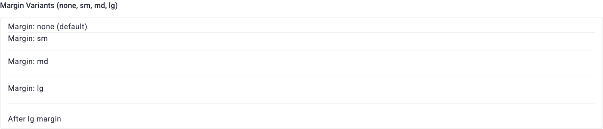
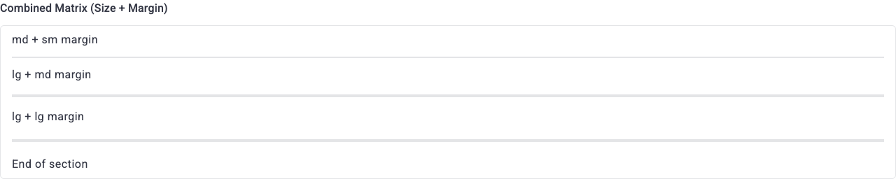

# Отчёт о визуальном и функциональном тестировании: D1Divider

## 1. Итоговое резюме

- **Компонент:** `D1Divider` (`@dxtmisha/d1`)
- **Исходный код:** [`D1Divider`](../../src/components/Ui/Divider) ([`Divider`](../../../constructor/src/constructors/Divider), [`DemoDividerPage`](../../../demo/src/pages/components/DemoDividerPage.vue))
- **Демо / целевой URL:** `http://localhost:3000/component-divider`
- **Материалы:** `Нет`
- **Дата тестирования (UTC):** `2026-11-24T18:37:33Z`
- **Окружение:** `Headless Chrome (Puppeteer / CDP, Desktop 1440x900, Tablet 768x1024, Mobile 375x812)`
- **Покрытие тест-кейсов:** 7 / 7 (`100%`)
- **Итог:** **7 ✅, 0 ⚠️, 0 ❌** (`✅` пройдено, `⚠️` предупреждение, `❌` ошибка) — `D1Divider` после миграции на `DesignLogicAbstract` и добавления `role="separator"` точно отображает все размеры (`sm`/`md`/`lg`), отступы (`none`/`sm`/`md`/`lg`), комбинации и пользовательские ARIA-переопределения с нулевыми ошибками консоли.

---

## 2. Базовая матрица

### 2.1 Визуальное соответствие (`VIS`)

| ID | Сценарий | Статус | Фактический результат | Скриншот |
| :--- | :--- | :---: | :--- | :--- |
| `TC-VIS-001` | Шкала толщины (`sm`, `md`, `lg`) | ✅ | `smHeight: "1px"`, `mdHeight: "2px"`, `lgHeight: "4px"`, `allNonZeroWidth: true` (`total: 13`). |  |
| `TC-VIS-002` | Шкала отступов (`none`, `sm`, `md`, `lg`) | ✅ | `marginLgTop: "20px"`; отступы плавно масштабируются по токенам. |  |

### 2.2 Интерактивность и управление состоянием (`INT`)

| ID | Сценарий | Статус | Фактический результат | Скриншот |
| :--- | :--- | :---: | :--- | :--- |
| `TC-INT-001` | Комбинированная матрица `size + margin` | ✅ | Все комбинации (`md+sm`, `lg+md`, `lg+lg`) отображаются без конфликтов классов и разрывов ширины. |  |

### 2.3 Граничные значения и крайние случаи (`BND`)

| ID | Сценарий | Статус | Фактический результат | Скриншот |
| :--- | :--- | :---: | :--- | :--- |
| `TC-BND-001` | Проброс `aria-label`, `data-testid` и `role="presentation"` | ✅ | Пользовательские атрибуты применены без потери базового класса `.d1-divider`. |  |

### 2.4 Адаптивность (`RSP`)

| ID | Сценарий | Статус | Фактический результат | Скриншот |
| :--- | :--- | :---: | :--- | :--- |
| `TC-RSP-001` | Вьюпорты Desktop (`1440px`), Tablet (`768px`), Mobile (`375px`) | ✅ | Desktop (`1440/1440`), Tablet (`768/768`), Mobile (`375/375`) — `overflow: false`. |  |

### 2.5 Доступность (`A11Y`)

| ID | Сценарий | Статус | Фактический результат | Скриншот |
| :--- | :--- | :---: | :--- | :--- |
| `TC-A11Y-001` | Семантика `role="separator"` и переопределение `role="presentation"` | ✅ | `defaultRole: "separator"`, `decorativeRole: "presentation"`. | — |

### 2.6 Консоль и рантайм (`LOG`)

| ID | Сценарий | Статус | Фактический результат | Скриншот |
| :--- | :--- | :---: | :--- | :--- |
| `TC-LOG-001` | Проверка консоли и сетевых запросов | ✅ | `errors: []`, `warnings: []`, `pageErrors: []`, `failedRequests: []`. | — |

---

## 3. AI-аудит и рекомендации

1. **Улучшение семантики (A11y):** Добавление `AriaStaticInclude.role('separator')` в `Divider.ts` с правильным порядком `mergeProps(this.item.aria, this.getAttrs(), ...)` даёт корректную роль по умолчанию и сохраняет возможность переопределения (`role="presentation"`).
2. **Нулевой оверхед:** Компонент рендерит один плоский `div` без лишних обёрток и инлайн-вычислений.
3. **Чистота рантайма:** 0 ошибок консоли, 0 предупреждений Vue и 0 сбойных запросов.
