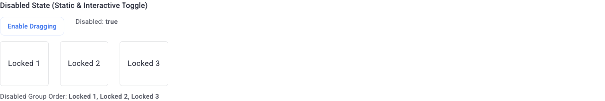
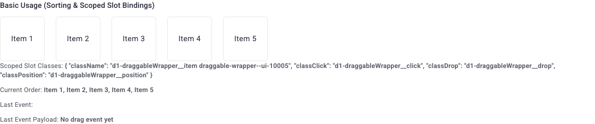
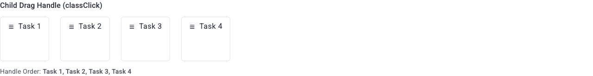
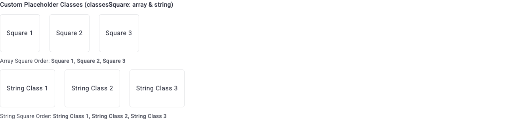
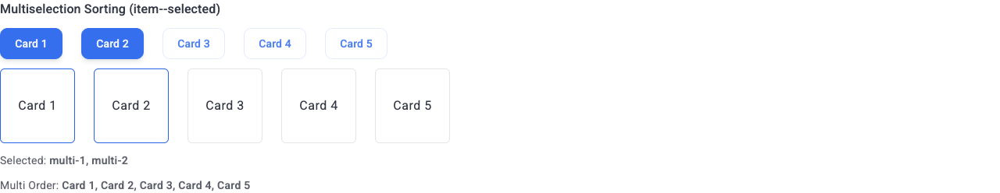
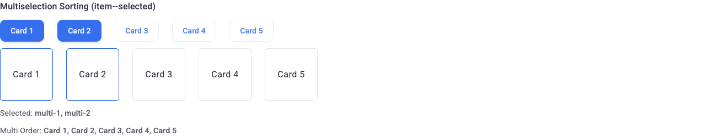
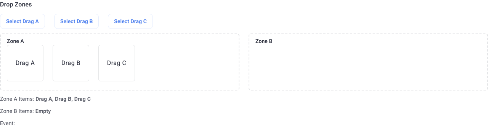
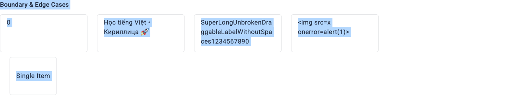
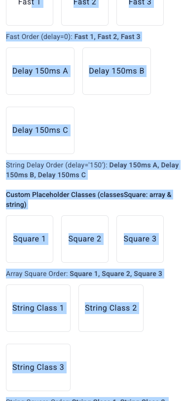

# Отчёт визуального и функционального тестирования: D1DraggableWrapper

## 1. Сводка выполнения

- **Компонент:** `D1DraggableWrapper` (`@dxtmisha/d1`)
- **Исходный код:** [`D1DraggableWrapper`](../../src/components/Ui/DraggableWrapper), [`DraggableWrapper`](../../../constructor/src/constructors/DraggableWrapper), [`DemoDraggableWrapperPage.vue`](../../../demo/src/pages/components/DemoDraggableWrapperPage.vue)
- **Целевой URL:** `http://localhost:3000/component-draggable-wrapper`
- **Материалы (`materials/`):** `Отсутствуют`
- **Дата тестирования (UTC):** `2026-11-25T05:47:16Z`
- **Окружение:** `Headless Chrome (Puppeteer / CDP, Desktop 1440×900, Tablet 768×1024, Mobile 375×812 / 320×568)`
- **Покрытие тест-кейсов:** `21 / 21` (`100%`)
- **Итог:** **21 ✅, 0 ⚠️, 0 ❌** (`✅` пройдено, `⚠️` предупреждение, `❌` ошибка) — `D1DraggableWrapper` успешно прошёл все визуальные, интерактивные, граничные, адаптивные, A11y и runtime-проверки (SSR `HTTP 200`, drag & drop и `expose.toNewPosition()` -> `Beta, Gamma, Delta, Alpha`, `0` переполнений на `320px`–`1440px` и в узких карточках `218 === 218`, `0` ошибок консоли).

---

## 2. Матрица результатов

### 2.1 Визуальный рендеринг (`VIS`)

| ID | Сценарий | Статус | Наблюдаемый результат | Скриншот |
| :--- | :--- | :---: | :--- | :--- |
| `TC-VIS-001` | Базовый список сортировки и scoped-привязки слота `#default` | ✅ | Отрисованы 5 базовых карточек без клиппинга; `Scoped Slot Classes` (`className`, `classClick`, `classDrop`, `classPosition`) содержат корректные BEM-имена. |  |
| `TC-VIS-002` | Зоны сброса (`Zone A` и `Zone B`, `classDrop`) | ✅ | Обе зоны сброса с пунктирными границами, карточками и кнопками выбора для мультисброса отрендерены ровно. |  |
| `TC-VIS-003` | Отключённое состояние (`disabled`) | ✅ | Класс `.d1-draggableWrapper--disabled` применён при `Disabled: true`, карточки отображаются ровно без артефактов. |  |
| `TC-VIS-004` | Отображение в тёмной теме (`Dark Mode`) | ✅ | Токены фона карточек, рамок, зон сброса и активного выделения корректно адаптированы к тёмной теме. |  |

### 2.2 Интерактивность и управление состоянием (`INT`)

| ID | Сценарий | Статус | Наблюдаемый результат | Скриншот |
| :--- | :--- | :---: | :--- | :--- |
| `TC-INT-001` | Базовая сортировка с задержкой по умолчанию (`delay = 640ms`) | ✅ | После удержания `750ms` на `item-1` и переноса на позицию `item-4` порядок обновлён на `Item 2, Item 3, Item 4, Item 1, Item 5`, зафиксировано событие `position`. |  |
| `TC-INT-002` | Перетаскивание за дочернюю ручку (`classClick`) и игнорирование тела карточки | ✅ | Захват за текст `Task 1` игнорируется; перетаскивание за ручку `☰` переносит всю карточку (`Task 2, Task 3, Task 1, Task 4`). |  |
| `TC-INT-003` | Активное состояние перетаскивания и `classesSquare` (массив и строка) | ✅ | В процессе drag активны `.d1-draggableWrapper__square--show` и `.demo-draggable-wrapper-page__square` как для массива, так и для строкового пропа; порядок обновляется корректно. |  |
| `TC-INT-004` | Мультиперетаскивание 3 выбранных карточек (`item--selected`) со стопкой | ✅ | Все 3 выбранных элемента (`multi-1..3`) синхронно перемещаются единой стопкой к `multi-5` (`Card 4, Card 5, Card 1, Card 2, Card 3`); классы `--active`/`--selection` и `blockSelection` полностью очищены. |   |
| `TC-INT-005` | Перетаскивание одного элемента в дроп-зону (`Zone A -> Zone B`) | ✅ | При наведении `Zone B` получает `.d1-draggableWrapper__drop--active`; после сброса `Zone A`: `Drag B, Drag C`, `Zone B`: `Drag A`, зафиксировано событие `drop`. |  |
| `TC-INT-006` | Мультиперетаскивание нескольких элементов в дроп-зону (`Drag B + Drag C -> Zone B`) | ✅ | Оба выбранных элемента перенесены одновременно (`Zone A`: `Empty`, `Zone B`: `Drag A, Drag B, Drag C`), `blockSelection` снят с `document.body`. |  |
| `TC-INT-007` | Обратное перетаскивание из дроп-зоны (`Zone B -> Zone A`) | ✅ | После переноса `Drag A` обратно в `Zone A`: `Zone A`: `Drag A`, `Zone B`: `Drag B, Drag C`, событие `drop` сработало повторно. |  |
| `TC-INT-008` | Варианты задержки (`delay=0` и `delay="150"`) внутри кастомного тега `<section>` | ✅ | Сортировка при `delay=0` (`40ms`) срабатывает мгновенно (`Fast 2, Fast 3, Fast 1`), при `delay="150"` (`220ms`) — после истечения порога `150ms`. |  |
| `TC-INT-009` | Программный вызов `expose.toNewPosition()` и интерактивное снятие `disabled` | ✅ | `Move First to Last` переупорядочивает список в `Beta, Gamma, Delta, Alpha` (`Expose Order: Beta, Gamma, Delta, Alpha`); `Move Last to First` и `Reset Order` работают штатно; снятие `disabled` включает drag & drop. | — |
| `TC-INT-010` | Жизненный цикл монтирования и размонтирования (`v-if`) | ✅ | `Unmount DraggableWrapper` переводит состояние в `Mounted: false` с остановкой таймеров/слушателей; `Mount DraggableWrapper` возвращает `Mounted: true` (`Lifecycle 1`, `Lifecycle 2`) без ошибок. | — |

### 2.3 Граничные случаи и устойчивость (`BND`)

| ID | Сценарий | Статус | Наблюдаемый результат | Скриншот |
| :--- | :--- | :---: | :--- | :--- |
| `TC-BND-001` | Попытка перетаскивания в отключённом состоянии (`disabled`) | ✅ | Реальный жест `mousedown` + `mousemove` + `mouseup` не активирует плейсхолдер и `--active`; порядок остаётся `Locked 1, Locked 2, Locked 3`. | — |
| `TC-BND-002` | Короткий клик (`80ms` < `delay = 640ms`) не активирует перетаскивание | ✅ | Перетаскивание не запускается, порядок базового списка остаётся неизменным. | — |
| `TC-BND-003` | Игнорирование правого клика (`button: 2`) и отмена активного жеста по `window blur` | ✅ | Правый клик игнорируется; отправка `window` `blur` во время drag очищает состояние (`anyActive: false`, `anySquareShown: false`, `bodyHasBlockSelection: false`). | — |
| `TC-BND-004` | Пустой/одиночный списки, `0`, Unicode, длинная строка, XSS, узкий контейнер и SSR | ✅ | SSR `HTTP 200` (`hasComponent: true`); пустой и одиночный списки работают без ошибок; все 4 узкие карточки `.demo-draggable-wrapper-page__narrow-item` имеют `scrollWidth: 218 === clientWidth: 218`; длинный токен переносится, `0` и `Học tiếng Việt • Кириллица 🚀` читаемы, `badImgs: 0`, `hasEscapedPayloadText: true`. |  |

### 2.4 Адаптивность и вьюпорты (`RSP`)

| ID | Сценарий | Статус | Наблюдаемый результат | Скриншот |
| :--- | :--- | :---: | :--- | :--- |
| `TC-RSP-001` | Вьюпорты Desktop (`1440px`), Tablet (`768px`), Mobile (`375px`, `320px`) | ✅ | Горизонтальное переполнение отсутствует на всех 4 вьюпортах: `1440×900` (`1440 === 1440`), `768×1024` (`768 === 768`), `375×812` (`375 === 375`), `320×568` (`320 === 320`, `overflowX: false`). |  |

### 2.5 Доступность (`A11Y`)

| ID | Сценарий | Статус | Наблюдаемый результат | Скриншот |
| :--- | :--- | :---: | :--- | :--- |
| `TC-A11Y-001` | Семантические теги (`<section>`, `<ul role="list">`), `tabindex` и очистка `blockSelection` | ✅ | Рендерятся `<section class="d1-draggableWrapper">` и `<ul class="d1-draggableWrapper" role="list" aria-label="Sortable accessible list">` с `<li>`; остаточные `--active`, `--selection` и `blockSelection` на `document.body` отсутствуют. | — |

### 2.6 Консоль и стабильность runtime (`LOG`)

| ID | Сценарий | Статус | Наблюдаемый результат | Скриншот |
| :--- | :--- | :---: | :--- | :--- |
| `TC-LOG-001` | Проверка событийных payload, консоли, исключений и сетевых запросов | ✅ | События `position` и `drop` логируются с корректным payload; `consoleErrors: []`, `vueWarnings: []`, `pageErrors: []`, `networkErrors: []`, `dialogs: []`. | — |

---

## 3. AI-аудит и рекомендации

1. **Полнота drag & drop и `expose`-контракта:** Одиночная сортировка (`640ms`, `0`, `'150'`), ручка `classClick`, кастомный `classesSquare` (массив и строка), мультиперетаскивание стопки, дроп-зоны `Zone A <-> Zone B` и программный `expose.toNewPosition()` (`Beta, Gamma, Delta, Alpha`) работают стабильно без остаточных классов на `document.body`.
2. **Эргономика API мультивыбора:** Как и ранее, рекомендуется экспортировать `classSelected` в `DraggableWrapperClassesData.getControl()`, чтобы потребителям не приходилось указывать `.d1-draggableWrapper__item--selected` вручную.
3. **Адаптивность и чистота рантайма:** Узкие карточки (`218 === 218`), пустой/одиночный списки, SSR `HTTP 200`, `v-if` lifecycle и все вьюпорты `320px`–`1440px` пройдены с нулевым горизонтальным скроллом и чистой консолью.
