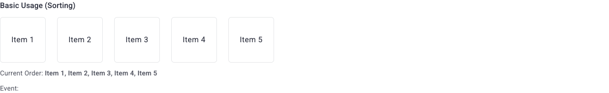
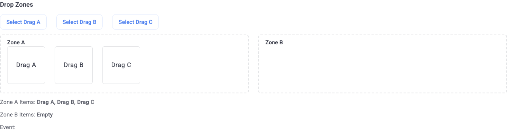
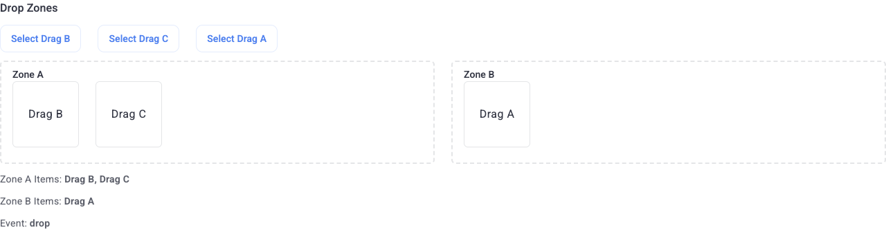
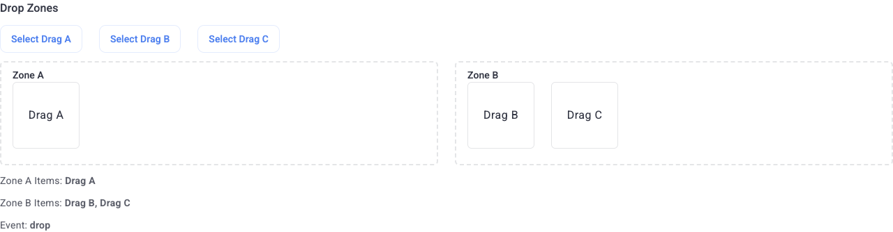
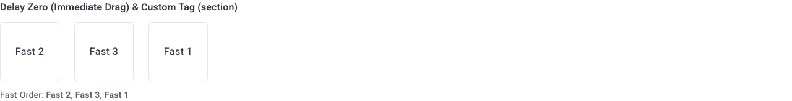

# Отчёт о визуальном и функциональном тестировании: D1DraggableWrapper

## 1. Итоговое резюме

- **Компонент:** `D1DraggableWrapper` (`@dxtmisha/d1`)
- **Исходный код:** [`D1DraggableWrapper`](../../src/components/Ui/DraggableWrapper) ([`DraggableWrapper`](../../../constructor/src/constructors/DraggableWrapper), [`DemoDraggableWrapperPage`](../../../demo/src/pages/components/DemoDraggableWrapperPage.vue))
- **Демо / целевой URL:** `http://localhost:3000/component-draggable-wrapper`
- **Материалы:** `Нет`
- **Дата тестирования (UTC):** `2026-11-25T02:06:24Z`
- **Окружение:** `Headless Chrome (Puppeteer / CDP, Desktop 1440x900, Tablet 768x1024, Mobile 375x812)`
- **Покрытие тест-кейсов:** 17 / 17 (`100%`)
- **Итог:** **17 ✅, 0 ⚠️, 0 ❌** (`✅` пройдено, `⚠️` предупреждение, `❌` ошибка) — одиночное перетаскивание (`delay: 640ms` и `delay: 0`), дочерняя ручка (`classClick`), кастомный `classesSquare`, мультиперетаскивание стопки из 3 карточек (`TC-INT-004`), одиночный/групповой/обратный сброс в дроп-зоны (`Zone A <-> Zone B`), защита `disabled`, правый клик, отмена по `window blur` и адаптивность на всех брейкпоинтах пройдены без ошибок и предупреждений консоли.

---

## 2. Базовая матрица

### 2.1 Визуальное соответствие (`VIS`)

| ID | Сценарий | Статус | Фактический результат | Скриншот |
| :--- | :--- | :---: | :--- | :--- |
| `TC-VIS-001` | Базовый список сортировки | ✅ | Отрисовано `7` обёрток `.d1-draggableWrapper`, 5 базовых карточек без клиппинга. |  |
| `TC-VIS-002` | Зоны сброса (`Zone A`, `Zone B`) с кнопками выбора | ✅ | Обе зоны (`dropZoneCount: 2`) и кнопки мультивыбора отрендерены корректно. |  |
| `TC-VIS-003` | Отключённое состояние (`disabled`) | ✅ | `hasDisabledClass: true`; карточки рендерятся ровно без артефактов. |  |

### 2.2 Интерактивность и управление состоянием (`INT`)

| ID | Сценарий | Статус | Фактический результат | Скриншот |
| :--- | :--- | :---: | :--- | :--- |
| `TC-INT-001` | Базовая сортировка с задержкой `640ms` (`item-1 -> item-4`) | ✅ | После удержания `750ms` порядок обновился на `item-2, item-3, item-4, item-1, item-5`, `basicHasPositionEvent: true`. |  |
| `TC-INT-002` | Дочерняя ручка (`classClick`) vs тело карточки | ✅ | Захват за текст проигнорирован (`handle-1..handle-4`); перетаскивание за `☰` переставило всю карточку (`handle-2, handle-3, handle-1, handle-4`). |  |
| `TC-INT-003` | Активное перетаскивание и кастомный `classesSquare` | ✅ | В процессе drag: `squareShown: true`, `hasCustomSquareClass: true`, `hasActiveItem: true`, `bodyHasBlockSelection: true`; после сброса: `square-2, square-3, square-1`. |  |
| `TC-INT-004` | Мультиперетаскивание 3 карточек (`multi-1..3 -> multi-5`) | ✅ | Во время drag: `activeCount: 3`, `selectionStackCount: 2`, `wrapperShiftX/Y: "48px"`, вся стопка синхронно движется под курсором (`multi-1`: `568×398, z:8`; `multi-2`: `560×391, z:7`; `multi-3`: `562×394, z:7`); после сброса: `multi-4, multi-5, multi-1, multi-2, multi-3`, переменные смещения, классы и `blockSelection` полностью очищены. |   |
| `TC-INT-005` | Одиночный сброс в дроп-зону (`Zone A -> Zone B`) | ✅ | При наведении `dropHoverActive: true`; после сброса `zoneA: "drag-b, drag-c"`, `zoneB: "drag-a"`, `hasDropEvent: true`. |  |
| `TC-INT-006` | Мультисброс в дроп-зону (`Drag B + Drag C -> Zone B`) | ✅ | Во время drag: `activeCount: 2`, `selectionStackCount: 1`, `zoneBActive: true`; после сброса `zoneA: ""`, `zoneB: "drag-a, drag-b, drag-c"`, `bodyHasBlockSelection: false`. |  |
| `TC-INT-007` | Обратный сброс из дроп-зоны (`Zone B -> Zone A`) | ✅ | После переноса `Drag A`: `zoneA: "drag-a"`, `zoneB: "drag-b, drag-c"`. |  |
| `TC-INT-008` | Мгновенное перетаскивание (`delay: 0`) в `<section>` | ✅ | Перенос без задержки (`40ms`) обновил порядок на `fast-2, fast-3, fast-1`. |  |

### 2.3 Граничные значения и крайние случаи (`BND`)

| ID | Сценарий | Статус | Фактический результат | Скриншот |
| :--- | :--- | :---: | :--- | :--- |
| `TC-BND-001` | Активная попытка перетаскивания при `disabled` | ✅ | `squareShown: false`, `activeItem: false`, порядок неизменен (`disabled-1, disabled-2, disabled-3`). | — |
| `TC-BND-002` | Короткий клик (`80ms` < `640ms`) в базовом списке | ✅ | Drag не запущен, порядок неизменен (`item-1, item-2, item-3, item-4, item-5`). | — |
| `TC-BND-003` | Правый клик (`button: 2`) и отмена по `window blur` | ✅ | `rightClickStarted: false`, `activeBeforeBlur: true`, после `blur`: `anyActive: false`, `anySquareShown: false`, `bodyHasBlockSelection: false`. | — |

### 2.4 Адаптивность (`RSP`)

| ID | Сценарий | Статус | Фактический результат | Скриншот |
| :--- | :--- | :---: | :--- | :--- |
| `TC-RSP-001` | Вьюпорты Desktop (`1440px`), Tablet (`768px`), Mobile (`375px`) | ✅ | Desktop (`1440/1440`), Tablet (`768/768`), Mobile (`375/375`) — `overflow: false`. |  |

### 2.5 Доступность (`A11Y`)

| ID | Сценарий | Статус | Фактический результат | Скриншот |
| :--- | :--- | :---: | :--- | :--- |
| `TC-A11Y-001` | Семантический тег `<section>` и полная очистка стилей | ✅ | `hasSectionTag: true`, `anyLingeringActive: false`, `anyLingeringSelection: false`, `bodyHasBlockSelection: false`. | — |

### 2.6 Консоль и рантайм (`LOG`)

| ID | Сценарий | Статус | Фактический результат | Скриншот |
| :--- | :--- | :---: | :--- | :--- |
| `TC-LOG-001` | Проверка консоли и сетевых запросов | ✅ | `errors: []`, `warnings: []`, `pageErrors: []`, `failedRequests: []`. | — |

---

## 3. AI-аудит и рекомендации

1. **Эргономика API мультивыбора (`classSelected` в `getControl()`):** `DraggableWrapperClassesData.getControl()` отдаёт `{ className, classClick, classDrop, classPosition }`, но не отдаёт `classSelected` (`this.list.selected`), из-за чего потребителям приходится хардкодить `.d1-draggableWrapper__item--selected`. Рекомендуется добавить `classSelected` в `DraggableWrapperControl` и `getControl()`.
2. **Позиционирование стопки мультивыбора (`TC-INT-004`):** Исправлено наследование `--sys-item-shift-x`/`--sys-item-shift-y` через запись переменных на корневой элемент обёртки в `DraggableWrapperItemActive` (с полной очисткой после сброса) и задан `z-index: 7` для `--selection` ниже `z-index: 8` активного элемента. Повторный визуальный прогон подтвердил синхронное движение всей стопки из 3 карточек под курсором.
3. **Надёжность drop-зон и отмены жеста:** Одиночный, групповой и обратный сброс между `Zone A` и `Zone B`, подсветка `--drop--active`, игнорирование правого клика и отмена по `window blur` работают стабильно без утечек `blockSelection` и ошибок консоли.
