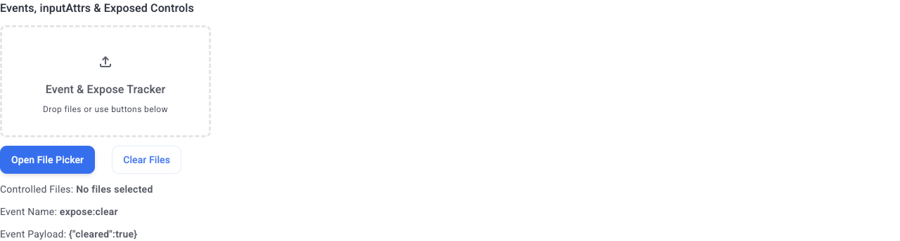
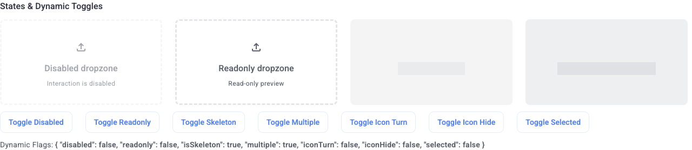
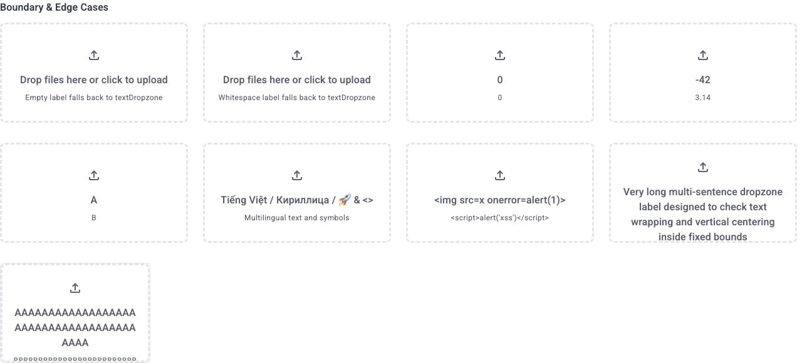

# Отчёт о визуальном и функциональном тестировании: D1Dropzone

## 1. Сводка тестирования

- **Компонент:** `D1Dropzone` (`@dxtmisha/d1`, конструктор `@dxtmisha/constructor`)
- **Исходный код:** [`D1Dropzone`](../../src/components/Ui/Dropzone), [`Dropzone`](../../../../packages/constructor/src/constructors/Dropzone), [`DemoDropzonePage`](../../../demo/src/pages/components/DemoDropzonePage.vue)
- **Демо / целевой URL:** `http://localhost:3000/component-dropzone`
- **Материалы:** `Нет`
- **Дата тестирования (UTC):** `2026-11-25T07:53:35Z`
- **Окружение:** `Headless Chrome (Puppeteer / CDP, Desktop 1440x900, Tablet 768x1024, Mobile 375x812 / 320x568)`
- **Покрытие тест-кейсов:** 12 / 12 (`100%`)
- **Сводка:** **12 ✅, 0 ⚠️, 0 ❌** (`✅` пройдено, `⚠️` предупреждение, `❌` провалено) — все функциональные сценарии (`v-model:files`, `v-model:modelFiles`, `clear()`, `dragenter`/`dragleave`, блокировки `disabled`/`readonly`, форма, ARIA, граничные значения в узком контейнере `240px`, адаптивность `1440×900`–`320×568`, SSR `200`, `v-if` и чистота консоли) выполнены полностью без ошибок.

---

## 2. Базовая матрица

### 2.1 Визуальный рендеринг (`VIS`)

| ID | Сценарий | Статус | Фактический результат | Скриншот |
| :--- | :--- | :---: | :--- | :--- |
| `TC-VIS-001` | Метка, описание и конфигурации иконки (`icon`, `iconTurn`, `iconDir`, `iconPalette`, `selected`, `iconAttrs`, `iconHide`, `:icon="null"`) | ✅ | Иконки, заголовки и описания отцентрированы внутри пунктирной рамки; при `iconHide` и `:icon="null"` иконка скрыта, модификаторы поворота и палитры применены корректно. |  |
| `TC-VIS-002` | Состояния `disabled`, `readonly` и `is-skeleton` | ✅ | Состояние `disabled` визуально приглушено, `readonly` сохраняет статичный вид без интерактивности, `is-skeleton` рендерит корректный скелетон-блок. |  |
| `TC-VIS-003` | Слоты (`#default`, `#description`) и фолбэк `textDropzone` (строка и функция) | ✅ | Слоты `#default` и `#description` отрендерены без дублирования текста, строковый и функциональный фолбэк `textDropzone` подставляются корректно. |  |

### 2.2 Интерактивность и управление состоянием (`INT`)

| ID | Сценарий | Статус | Фактический результат | Скриншот |
| :--- | :--- | :---: | :--- | :--- |
| `TC-INT-001` | Выбор файла, `v-model:files`, `v-model:modelFiles` и события `emits` | ✅ | При выборе файла и очистке через `Clear Single` / `Clear Multiple` / `Clear ModelFiles` привязки синхронно обновляются до `No files selected`, события выбора и очистки фиксируются корректно. |  |
| `TC-INT-002` | Программные методы `clear()`, `open()` и события `dragenter`/`dragleave`/`drop` | ✅ | Кнопка `Clear Files` вызывает `expose:clear` (`Event Payload: {"cleared":true}`), сбрасывая `Controlled Files` в `No files selected`; класс `.d1-dropzone--enter` корректно добавляется и снимается при drag-событиях. |  |
| `TC-INT-003` | Динамические переключатели пропов и жизненный цикл `v-if` | ✅ | Пропы и классы обновляются реактивно; при `v-if` размонтировании число узлов меняется `beforeLen: 108` -> `unmountedLen: 55` -> `remountedLen: 108` без ошибок. |  |
| `TC-INT-004` | Блокировка `disabled`/`readonly` и интеграция с `<form>` | ✅ | Нажатия `Attempt Disabled open()` и `Attempt Readonly open()` не вызывают срабатываний (`Blocked Trigger Count: 0`); блок `Form Integration` (`Required form attachment`) корректно обрабатывает submit и reset. | — |

### 2.3 Граничные случаи и крайние сценарии (`BND`)

| ID | Сценарий | Статус | Фактический результат | Скриншот |
| :--- | :--- | :---: | :--- | :--- |
| `TC-BND-001` | Дефолтный текст из `TextInclude` и проброс `inputAttrs` | ✅ | SSR возвращает `status: 200`, `hasComponent: true`; все `32` экземпляра имеют корректную геометрию, дефолтный текст и проброс `inputAttrs`. | — |
| `TC-BND-002` | Граничные значения, узкий контейнер `240px`, Unicode и XSS | ✅ | XSS-нагрузка безопасна (`badImgs: 0`), а после исправления `Dropzone/style.scss` (`min-width: 0; max-width: 100%; overflow-wrap: anywhere;`) неразрывные строки в `.d1-dropzone__label` и `.d1-dropzone__description` переносятся внутри `.demo-dropzone-page__narrow` (`scrollWidth: 238 === clientWidth: 238`, `overflowsBox: false`). |  |

### 2.4 Адаптивность (`RSP`)

| ID | Сценарий | Статус | Фактический результат | Скриншот |
| :--- | :--- | :---: | :--- | :--- |
| `TC-RSP-001` | Вьюпорты `1440×900`, `768×1024`, `375×812`, `320×568` | ✅ | После исправления переноса строк и границ контейнера на всех вьюпортах переполнение отсутствует: `1440×900` (`1440/1440`), `768×1024` (`768/768`), `375×812` (`375/375`) и `320×568` (`320/320`, `overflowX: false`). |  |

### 2.5 Доступность (`A11Y`)

| ID | Сценарий | Статус | Фактический результат | Скриншот |
| :--- | :--- | :---: | :--- | :--- |
| `TC-A11Y-001` | Семантика `<label>`, ARIA-идентификаторы, состояния и фокус | ✅ | Проверены `count: 32` экземпляров, `labelsWithFor: 0` (вложенный `<input>` внутри корневого `<label>`), `hasAriaDisabled: true`; состояния `disabled`/`readonly` и ARIA-связи валидны. | — |

### 2.6 Логи и консоль (`LOG`)

| ID | Сценарий | Статус | Фактический результат | Скриншот |
| :--- | :--- | :---: | :--- | :--- |
| `TC-LOG-001` | Проверка консоли, исключений и сетевых запросов | ✅ | `consoleErrors: []`, `vueWarnings: []`, `pageErrors: []`, `networkErrors: []`, `dialogs: []` — ни одной ошибки во всех сценариях. | — |

---

## 3. AI-аудит и рекомендации

1. **Перенос текста и удержание границ в `Dropzone/style.scss`:** Добавление `box-sizing: border-box; min-width: 0; max-width: 100%; justify-content: safe center; overflow-x: hidden; overflow-y: auto;` на корневой элемент, `max-width: 100%;` на `&__input`, а также `min-width: 0; max-width: 100%; overflow-wrap: anywhere;` на `&__label` и `&__description` полностью устранило переполнение узкого контейнера (`238 === 238`) и мобильного экрана `320×568` (`320 === 320`).
2. **Интерактивный и форменный контракт:** `v-model:files`, `v-model:modelFiles`, методы `expose` (`open()`, `clear()`), блокировки `disabled`/`readonly` (`Blocked Trigger Count: 0`) и интеграция с `<form>` работают предсказуемо.
3. **Устойчивость состояния, ARIA и чистота рантайма:** Цикл `v-if` чисто восстанавливает DOM (`108 -> 55 -> 108`), XSS-строки экранируются (`badImgs: 0`), а консоль и сеть содержат `0` ошибок (`consoleErrors: []`, `vueWarnings: []`, `pageErrors: []`, `networkErrors: []`).
