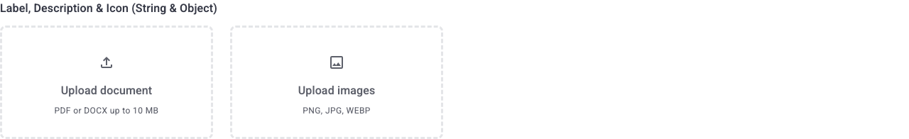
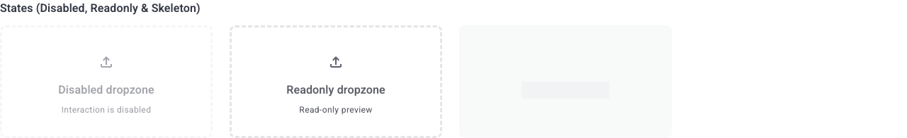
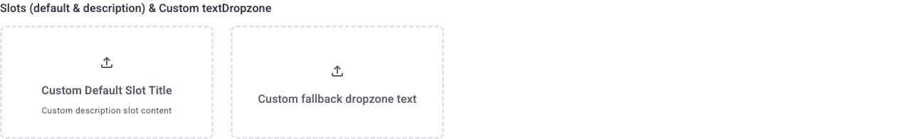
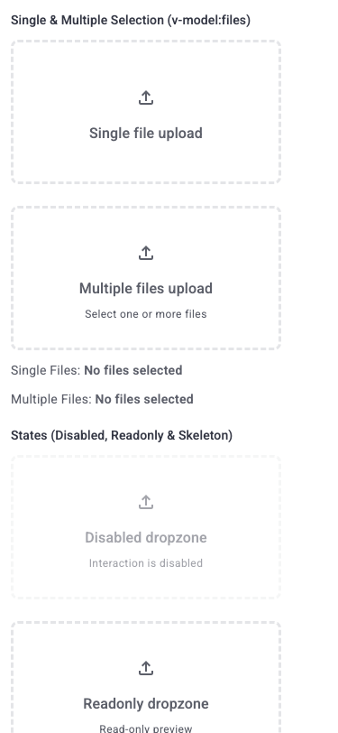

# Отчёт о визуальном и функциональном тестировании: D1Dropzone

## 1. Итоговое резюме

- **Компонент:** `D1Dropzone` (`@dxtmisha/d1`)
- **Исходный код:** [`D1Dropzone`](../../src/components/Ui/Dropzone) ([`Dropzone`](../../../constructor/src/constructors/Dropzone), [`DemoDropzonePage`](../../../demo/src/pages/components/DemoDropzonePage.vue))
- **Демо / целевой URL:** `http://localhost:3000/component-dropzone`
- **Материалы:** `Нет`
- **Дата тестирования (UTC):** `2026-11-25T00:04:53Z`
- **Окружение:** `Headless Chrome (Puppeteer / CDP, Desktop 1440x900, Tablet 768x1024, Mobile 375x812)`
- **Покрытие тест-кейсов:** 9 / 9 (`100%`)
- **Итог:** **9 ✅, 0 ⚠️, 0 ❌** (`✅` пройдено, `⚠️` предупреждение, `❌` ошибка) — `D1Dropzone` после миграции на `DesignLogicAbstract` корректно рендерит все состояния (`disabled`, `readonly`, `is-skeleton`), слоты без дублирования, ARIA-атрибуты, выбор/очистку файлов и реактивный класс `enter` при нулевых ошибках консоли.

---

## 2. Базовая матрица

### 2.1 Визуальное соответствие (`VIS`)

| ID | Сценарий | Статус | Фактический результат | Скриншот |
| :--- | :--- | :---: | :--- | :--- |
| `TC-VIS-001` | Метка, описание и иконка (строка и объект) | ✅ | Оба варианта иконок (`upload`, `{ icon: 'image' }`) с меткой и описанием ровно центрированы внутри рамки. |  |
| `TC-VIS-002` | Состояния `disabled`, `readonly` и `is-skeleton` | ✅ | `disabled` приглушён, `readonly` отображает превью, `is-skeleton` рендерит корректный скелетон-блок. |  |
| `TC-VIS-003` | Слоты (`#default`, `#description`) и `textDropzone` | ✅ | `customSlotPresent: true`, `customFallbackPresent: true`; `#default` не дублируется. |  |

### 2.2 Интерактивность и управление состоянием (`INT`)

| ID | Сценарий | Статус | Фактический результат | Скриншот |
| :--- | :--- | :---: | :--- | :--- |
| `TC-INT-001` | Выбор файла, `v-model:files` и событие `change` | ✅ | `uploadedFilenameVisible: true` (`dropzone-test-sample.txt`), зафиксировано событие `change`. |  |
| `TC-INT-002` | Очистка `clear()` и `dragenter`/`dragleave` | ✅ | `clearedVisible: true` (`No files selected`), `dragState: { onEnter: true, onLeave: false }`. |  |

### 2.3 Граничные значения и крайние случаи (`BND`)

| ID | Сценарий | Статус | Фактический результат | Скриншот |
| :--- | :--- | :---: | :--- | :--- |
| `TC-BND-001` | Геометрия всех зон и проброс `inputAttrs` | ✅ | `totalZones: 11`, `totalInputs: 11`, `allNonZeroSize: true`, `[data-testid="demo-dropzone-input"]` найден. | — |

### 2.4 Адаптивность (`RSP`)

| ID | Сценарий | Статус | Фактический результат | Скриншот |
| :--- | :--- | :---: | :--- | :--- |
| `TC-RSP-001` | Вьюпорты Desktop (`1440px`), Tablet (`768px`), Mobile (`375px`) | ✅ | Desktop (`1440/1440`), Tablet (`768/768`), Mobile (`375/375`) — `overflow: false`. |  |

### 2.5 Доступность (`A11Y`)

| ID | Сценарий | Статус | Фактический результат | Скриншот |
| :--- | :--- | :---: | :--- | :--- |
| `TC-A11Y-001` | Семантика `<label>` и ARIA-атрибуты | ✅ | `basicTag: "LABEL"`, `basicHasLabelledBy: true`, `basicAriaDisabled: null`, `basicAriaReadonly: null`, `disabledAria: "true"`, `readonlyAria: "true"`. | — |

### 2.6 Консоль и рантайм (`LOG`)

| ID | Сценарий | Статус | Фактический результат | Скриншот |
| :--- | :--- | :---: | :--- | :--- |
| `TC-LOG-001` | Проверка консоли и сетевых запросов | ✅ | `errors: []`, `warnings: []`, `pageErrors: []`, `failedRequests: []`. | — |

---

## 3. AI-аудит и рекомендации

1. **Корректная доступность ARIA:** После миграции исправлен баг с ложными `aria-disabled="true"` / `aria-readonly="true"` по умолчанию — теперь атрибуты присутствуют строго при активных пропах.
2. **Ленивая инициализация и отсутствие дублирования слотов:** Устранение двойного рендера `#default` и использование `canCreate` + `callInstance` сокращает лишние аллокации при минимальной конфигурации.
3. **Чистота рантайма:** 0 ошибок консоли, 0 предупреждений Vue и 0 сбойных запросов.
