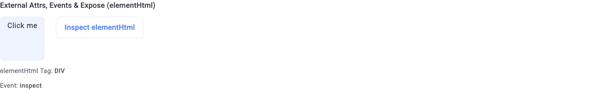

# Отчёт о визуальном и функциональном тестировании: D1Dummy

## 1. Итоговое резюме

- **Компонент:** `D1Dummy` (`@dxtmisha/d1`)
- **Исходный код:** [`D1Dummy`](../../src/components/Ui/Dummy) ([`Dummy`](../../../constructor/src/constructors/Dummy), [`DemoDummyPage`](../../../demo/src/pages/components/DemoDummyPage.vue))
- **Демо / целевой URL:** `http://localhost:3000/component-dummy`
- **Материалы:** `Нет`
- **Дата тестирования (UTC):** `2026-11-25T00:04:53Z`
- **Окружение:** `Headless Chrome (Puppeteer / CDP, Desktop 1440x900, Tablet 768x1024, Mobile 375x812)`
- **Покрытие тест-кейсов:** 7 / 7 (`100%`)
- **Итог:** **7 ✅, 0 ⚠️, 0 ❌** (`✅` пройдено, `⚠️` предупреждение, `❌` ошибка) — `D1Dummy` после миграции на `DesignLogicAbstract` и добавления `mergeProps` + `ref: this.element` корректно отображает все 10 размеров, все 24 палитры, слоты, внешние атрибуты и `expose().elementHtml` при нулевых ошибках консоли.

---

## 2. Базовая матрица

### 2.1 Визуальное соответствие (`VIS`)

| ID | Сценарий | Статус | Фактический результат | Скриншот |
| :--- | :--- | :---: | :--- | :--- |
| `TC-VIS-001` | Шкала размеров (`x` – `5xl`) | ✅ | `smHeight: 48`, `lgHeight: 144`; плавная прогрессия размеров по токенам. |  |
| `TC-VIS-002` | Цветовые палитры (`palette`) | ✅ | Все 24 палитры отрендерены с корректным фоном и контрастом текста. |  |

### 2.2 Интерактивность и управление состоянием (`INT`)

| ID | Сценарий | Статус | Фактический результат | Скриншот |
| :--- | :--- | :---: | :--- | :--- |
| `TC-INT-001` | Внешние атрибуты, `@click` и `expose().elementHtml` | ✅ | `elementHtmlIsDiv: true` (`DIV`), событие `inspect` отображено. |  |

### 2.3 Граничные значения и крайние случаи (`BND`)

| ID | Сценарий | Статус | Фактический результат | Скриншот |
| :--- | :--- | :---: | :--- | :--- |
| `TC-BND-001` | Пустой компонент и слотовый контент | ✅ | `totalDummies: 38`, `allNonZeroSize: true`. | — |

### 2.4 Адаптивность (`RSP`)

| ID | Сценарий | Статус | Фактический результат | Скриншот |
| :--- | :--- | :---: | :--- | :--- |
| `TC-RSP-001` | Вьюпорты Desktop (`1440px`), Tablet (`768px`), Mobile (`375px`) | ✅ | Desktop (`1440/1440`), Tablet (`768/768`), Mobile (`375/375`) — `overflow: false`. |  |

### 2.5 Доступность (`A11Y`)

| ID | Сценарий | Статус | Фактический результат | Скриншот |
| :--- | :--- | :---: | :--- | :--- |
| `TC-A11Y-001` | Сохранение базового класса при слиянии атрибутов | ✅ | `interactiveHasBaseClass: true` (`.d1-dummy` сохранён вместе с `data-testid`). | — |

### 2.6 Консоль и рантайм (`LOG`)

| ID | Сценарий | Статус | Фактический результат | Скриншот |
| :--- | :--- | :---: | :--- | :--- |
| `TC-LOG-001` | Проверка консоли и сетевых запросов | ✅ | `errors: []`, `warnings: []`, `pageErrors: []`, `failedRequests: []`. | — |

---

## 3. AI-аудит и рекомендации

1. **Проброс атрибутов и `ref`:** Переход на `mergeProps(this.getAttrs(), { ref: this.element, ... })` устранил потерю внешних атрибутов и обеспечил работу `expose().elementHtml`.
2. **Минимальный DOM-вес:** Компонент рендерит один плоский `div` без служебных обёрток.
3. **Чистота рантайма:** 0 ошибок консоли, 0 предупреждений Vue и 0 сбойных запросов.
