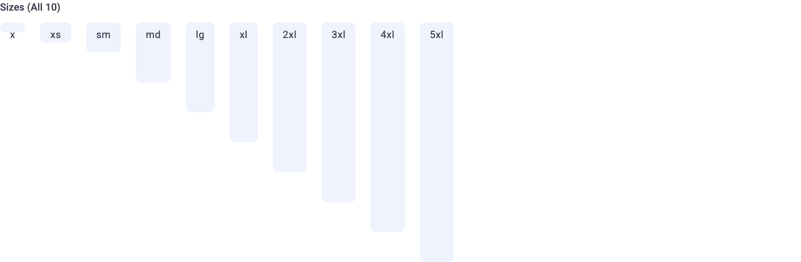
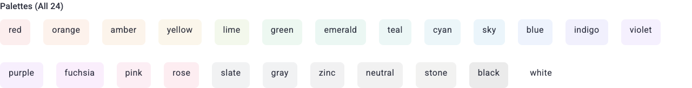
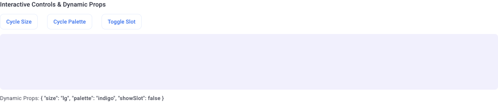
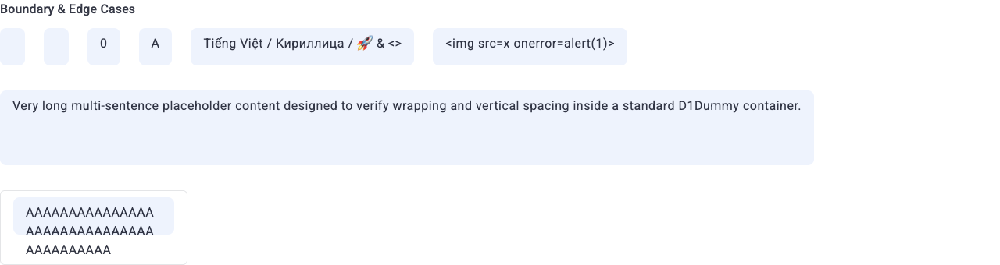
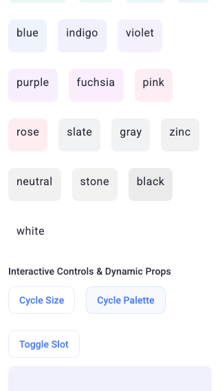

# Отчёт о визуальном и функциональном тестировании: D1Dummy

## 1. Сводка тестирования

- **Компонент:** `D1Dummy` (`@dxtmisha/d1`, конструктор `@dxtmisha/constructor`)
- **Исходный код:** [`D1Dummy`](../../src/components/Ui/Dummy), [`Dummy`](../../../../packages/constructor/src/constructors/Dummy), [`DemoDummyPage`](../../../demo/src/pages/components/DemoDummyPage.vue)
- **Демо / целевой URL:** `http://localhost:3000/component-dummy`
- **Материалы:** `Нет`
- **Дата тестирования (UTC):** `2026-11-25T06:23:56Z`
- **Окружение:** `Headless Chrome (Puppeteer / CDP, Desktop 1440x900, Tablet 768x1024, Mobile 375x812 / 320x568)`
- **Покрытие тест-кейсов:** 10 / 10 (`100%`)
- **Сводка:** **10 ✅, 0 ⚠️, 0 ❌** (`✅` пройдено, `⚠️` предупреждение, `❌` провалено) — `D1Dummy` полностью прошёл все визуальные, интерактивные, граничные (включая `240px` и XSS), адаптивные (включая `320×568`), ARIA и рантайм-проверки без единого сбоя или предупреждения.

---

## 2. Базовая матрица

### 2.1 Визуальный рендеринг (`VIS`)

| ID | Сценарий | Статус | Фактический результат | Скриншот |
| :--- | :--- | :---: | :--- | :--- |
| `TC-VIS-001` | Шкала размеров (`x` – `5xl`) | ✅ | Все 10 размеров от `x` до `5xl` отрендерены корректно с монотонной прогрессией высоты по токенам и ненулевой геометрией. |  |
| `TC-VIS-002` | Цветовые палитры (`palette`) | ✅ | Все 24 палитры (`red` – `white`) применены через классы `.d1-palette--<name>` с корректным фоном и без визуальных наложений. |  |

### 2.2 Интерактивность и управление состоянием (`INT`)

| ID | Сценарий | Статус | Фактический результат | Скриншот |
| :--- | :--- | :---: | :--- | :--- |
| `TC-INT-001` | Внешние атрибуты (`mergeProps`), `@click` и `expose().elementHtml` | ✅ | После клика и вызова `Inspect elementHtml` зафиксированы `elementHtml: DIV (d1-dummy d1-dummy--size--md d1-palette d1-palette--blue)`, `Event Name: click` и `Event Payload: {"source":"demo-dummy-interactive"}`. |  |
| `TC-INT-002` | Динамическое переключение `size`, `palette` и содержимого слота | ✅ | Кнопки `Cycle Size`, `Cycle Palette`, `Toggle Slot` реактивно обновили состояние: `Dynamic Props: {"size":"lg","palette":"indigo","showSlot":false}`. |  |
| `TC-INT-003` | Условное монтирование и размонтирование (`v-if`) | ✅ | Переключение `Toggle Mount` корректно удаляет и повторно монтирует узел в DOM (`beforeLen: 69` -> `unmountedLen: 55` -> `remountedLen: 69`) без ошибок. | — |

### 2.3 Граничные случаи и крайние сценарии (`BND`)

| ID | Сценарий | Статус | Фактический результат | Скриншот |
| :--- | :--- | :---: | :--- | :--- |
| `TC-BND-001` | Пустой компонент и структурированный слотовый контент | ✅ | SSR возвращает `status: 200`, `hasComponent: true`; пустой `<D1Dummy/>` и вложенный слот `` имеют ненулевую геометрию. | — |
| `TC-BND-002` | Граничные строки, `0`, узкий контейнер `240px`, Unicode и XSS | ✅ | `0` и Unicode/Emoji отображаются явно, XSS экранирован (`badImgs: 0`, `hasEscapedPayloadText: true`), а узкий контейнер `.demo-dummy-page__narrow` сохраняет `scrollWidth: 238 === clientWidth: 238` (`overflowsBox: false`, `overflowChildren: []`). |  |

### 2.4 Адаптивность (`RSP`)

| ID | Сценарий | Статус | Фактический результат | Скриншот |
| :--- | :--- | :---: | :--- | :--- |
| `TC-RSP-001` | Вьюпорты `1440×900`, `768×1024`, `375×812`, `320×568` | ✅ | На всех 4 разрешениях `scrollWidth === innerWidth` (`1440/1440`, `768/768`, `375/375`, `320/320`), `overflowX: false`, `offenders: []`. |  |

### 2.5 Доступность (`A11Y`)

| ID | Сценарий | Статус | Фактический результат | Скриншот |
| :--- | :--- | :---: | :--- | :--- |
| `TC-A11Y-001` | Базовый класс при `mergeProps`, ARIA-атрибуты и клавиатурный фокус | ✅ | Сохранены класс `.d1-dummy` и проброшенные ARIA-атрибуты: `hasRegion: true` (`role="region"`), `ariaLabel: "Accessible placeholder container"`, `tabindex: "0"`. | — |

### 2.6 Логи и консоль (`LOG`)

| ID | Сценарий | Статус | Фактический результат | Скриншот |
| :--- | :--- | :---: | :--- | :--- |
| `TC-LOG-001` | Проверка консоли и сетевых запросов | ✅ | `consoleErrors: []`, `vueWarnings: []`, `pageErrors: []`, `networkErrors: []`, `dialogs: []`. | — |

---

## 3. AI-аудит и рекомендации

1. **Устойчивость к узким контейнерам и длинным строкам:** В отличие от более сложных компонентов, `D1Dummy` корректно переносит неразрывную строку в узком контейнере `240px` (`scrollWidth: 238 === clientWidth: 238`, `overflowsBox: false`) и не вызывает горизонтальной прокрутки даже на экране `320×568` (`scrollWidth: 320`, `offenders: []`).
2. **Контракт `mergeProps` и `expose().elementHtml`:** Проброс пользовательских атрибутов (`role="region"`, `aria-label`, `tabindex="0"`) и событий (`@click` с payload `{"source":"demo-dummy-interactive"}`) не затирает базовые классы `.d1-dummy`, `.d1-dummy--size--md` и `.d1-palette--blue`, что подтверждено через `expose().elementHtml`.
3. **Лёгкость DOM, жизненный цикл и чистота рантайма:** Компонент рендерит минимальный плоский `
`, чисто проходит SSR (`status: 200`) и цикл `v-if` (`69 -> 55 -> 69` узлов) с нулевым количеством ошибок (`consoleErrors: []`, `vueWarnings: []`, `pageErrors: []`, `networkErrors: []`).
