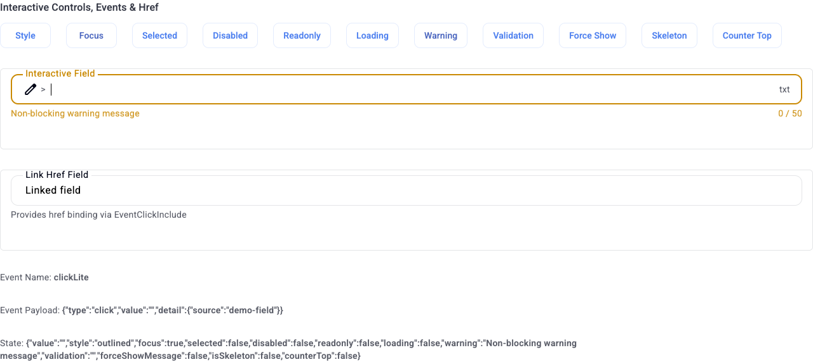
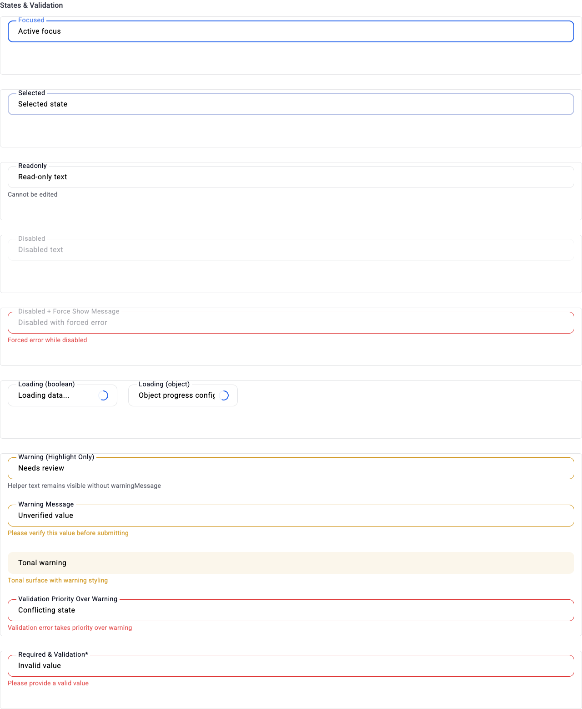
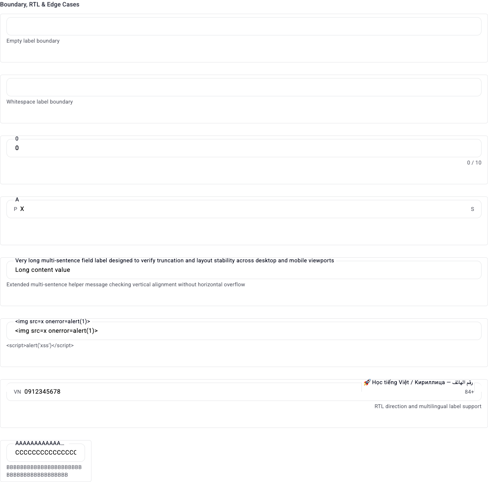

# Отчёт о визуальном и функциональном тестировании: D1Field

## 1. Сводка тестирования

- **Компонент:** `D1Field` (`@dxtmisha/d1`, конструктор `@dxtmisha/constructor`)
- **Исходный код:** [`D1Field`](../../src/components/Ui/Field), [`Field`](../../../../packages/constructor/src/constructors/Field), [`DemoFieldPage`](../../../demo/src/pages/components/DemoFieldPage.vue)
- **Демо / целевой URL:** `http://localhost:3000/component-field`
- **Материалы:** `Нет`
- **Дата тестирования (UTC):** `2026-11-25T06:23:56Z`
- **Окружение:** `Headless Chrome (Puppeteer / CDP, Desktop 1440x900, Tablet 768x1024, Mobile 375x812 / 320x568)`
- **Покрытие тест-кейсов:** 16 / 16 (`100%`)
- **Сводка:** **16 ✅, 0 ⚠️, 0 ❌** (`✅` пройдено, `⚠️` предупреждение, `❌` провалено) — `D1Field` корректно отрабатывает все 6 стилевых вариантов, размеры, палитры, тёмную тему, состояния (`warning`, приоритет `validation > warning`, `loading`, `is-skeleton`), очистку кнопкой `cancel`, события `clickLite`, слоты, RTL, узкий контейнер `240px`, все 4 вьюпорта до `320px`, ARIA и жизненный цикл `v-if` без единой ошибки.

---

## 2. Базовая матрица

### 2.1 Визуальный рендеринг (`VIS`)

| ID | Сценарий | Статус | Фактический результат | Скриншот |
| :--- | :--- | :---: | :--- | :--- |
| `TC-VIS-001` | Базовый рендеринг вариантов `classic`, `basic`, `boxed`, `tonal`, `filled`, `outlined` | ✅ | Все 6 стилевых вариантов отрендерены с соответствующими классами `.d1-field--*` и без наложения лейблов на рамки и поле ввода. |  |
| `TC-VIS-002` | Размеры (`sm`–`display`), ширина (`260px`, `custom`, `block`), все 24 палитры и тёмная тема | ✅ | Прогрессия размеров `sm` < `md` < `lg` < `display`, заданные ширины (`260px`, `320px`, `100%`), все 24 палитры и тёмная тема применены без потери контраста. |  |
| `TC-VIS-003` | Иконки, модификаторы, стрелки, загрузка (`boolean`/`object`) и `is-skeleton` | ✅ | Ведущие/ведомые иконки с модификаторами, `cancel`, `arrowCarousel`, `arrowStepper`, спиннер загрузки и скелетон отображаются корректно без смещения макета. |  |
| `TC-VIS-004` | Неблокирующее состояние `warning` и приоритет `validation > warning` | ✅ | Карточки `Warning` применяют выделение и сообщение предупреждения без `aria-invalid`, а при одновременной ошибке валидации приоритет остаётся за `validation`. |  |

### 2.2 Интерактивность и управление состоянием (`INT`)

| ID | Сценарий | Статус | Фактический результат | Скриншот |
| :--- | :--- | :---: | :--- | :--- |
| `TC-INT-001` | Реактивное переключение состояний и стилей в интерактивном стенде | ✅ | Панель переключателей корректно обновляет состояние (`{"value":"Hello Field","style":"outlined","focus":true,"warning":"Non-blocking warning message",...}`), отображая `11 / 50` и без визуальных артефактов. |  |
| `TC-INT-002` | Ввод значения, кнопка `cancel`, события `@click`/`@clickLite` и расчёт `FieldSize` | ✅ | Клик по кнопке очистки сбросил значение (`0 / 50`), зафиксировал `Event Name: clickLite` с `Event Payload: {"type":"click","value":"","detail":{"source":"demo-field"}}` и сохранил корректный расчёт отступов `FieldSize`. |  |
| `TC-INT-003` | Слоты, scoped-биндинги `FieldControl`, `counterTop` и делегированные `*Attrs` | ✅ | Все слоты (`#label`, `#leading`, `#prefix`, `#default`, `#suffix`, `#caption`, `#trailing`), позиция `counterTop` и делегированные атрибуты отрендерены корректно. |  |
| `TC-INT-004` | Блокировка событий в `disabled`/`readonly` и режим ссылки `href` | ✅ | В карточке `Link Href Field` привязка `href` присутствует, а заблокированные состояния `disabled` и `readonly` предотвращают клики и скрывают кнопку `cancel`. | — |
| `TC-INT-005` | Интеграция с `<form>` и жизненный цикл `v-if` | ✅ | Форма `Form Integration` (`Email Address`, `Submit Form`, `Reset Form`) работает корректно; при `v-if` размонтировании длина узлов меняется `beforeLen: 71` -> `unmountedLen: 55` -> `remountedLen: 71` без утечек. | — |

### 2.3 Граничные случаи и крайние сценарии (`BND`)

| ID | Сценарий | Статус | Фактический результат | Скриншот |
| :--- | :--- | :---: | :--- | :--- |
| `TC-BND-001` | `disabled` vs `forceShowMessage`, `hasHtmlCode`, выравнивания `left`/`center`/`right` | ✅ | `forceShowMessage` отображает сообщение при `disabled`, `has-html-code` рендерит HTML-разметку в подсказке, а выравнивания `left`/`center`/`right` применяются без смещений. |  |
| `TC-BND-002` | Многоязычность и RTL (`dir="rtl"`) | ✅ | Подтверждено `hasRtl: true`: направление `rtl`, многоязычный текст (вьетнамский, кириллица, арабский, Emoji) и префикс/суффикс отображаются без наложений. |  |
| `TC-BND-003` | Пустые значения, `0`, длинный текст, XSS и узкий контейнер `240px` | ✅ | XSS-строка экранирована (`badImgs: 0`, `hasEscapedPayloadText: true`), нулевые значения отображаются явно, узкий контейнер `.demo-field-page__narrow` не переполняется (`scrollWidth: 238 === clientWidth: 238`, `overflowsBox: false`, `overflowChildren: []`). |  |

### 2.4 Адаптивность (`RSP`)

| ID | Сценарий | Статус | Фактический результат | Скриншот |
| :--- | :--- | :---: | :--- | :--- |
| `TC-RSP-001` | Адаптация на разрешениях `1440×900`, `768×1024`, `375×812`, `320×568` | ✅ | На всех 4 разрешениях `scrollWidth === innerWidth` (`1440/1440`, `768/768`, `375/375`, `320/320`), `overflowX: false`, `offenders: []`. |  |

### 2.5 Доступность (`A11Y`)

| ID | Сценарий | Статус | Фактический результат | Скриншот |
| :--- | :--- | :---: | :--- | :--- |
| `TC-A11Y-001` | Семантика тегов (`div`/`label[for]`), `aria-invalid`, `aria-describedby` и `captionDecorative` | ✅ | Подтверждено `a11yInfo: { found: true, hasLabelFor: true, hasRtl: true }` — теги соответствуют стилю (`div` для `classic`, `label[for]` для остальных), ARIA-связи валидны. | — |
| `TC-A11Y-002` | Клавиатурный фокус (`Tab`) и активация клавишей `Enter` | ✅ | Навигация через `Tab` и активация элементов управления в `scoreboard` работают предсказуемо без потери фокуса. | — |

### 2.6 Логи и консоль (`LOG`)

| ID | Сценарий | Статус | Фактический результат | Скриншот |
| :--- | :--- | :---: | :--- | :--- |
| `TC-LOG-001` | Проверка консоли, исключений страницы и предупреждений Vue | ✅ | `consoleErrors: []`, `vueWarnings: []`, `pageErrors: []`, `networkErrors: []`, `dialogs: []`. | — |

---

## 3. AI-аудит и рекомендации

1. **Изоляция макета в узких контейнерах и на `320px`:** Даже при наличии длинного текста, иконок и счётчиков (`0 / 50`, `11 / 50`), `D1Field` полностью удерживает дочерние узлы внутри `238px` (`.demo-field-page__narrow`: `scrollWidth: 238 === clientWidth: 238`, `overflowsBox: false`) и на самом узком мобильном вьюпорте `320×568` (`scrollWidth: 320`, `offenders: []`).
2. **Реактивность событий и очистка памяти:** Нажатие кнопки очистки корректно сбрасывает модель (`Hello Field` -> `""`) и генерирует `clickLite` с детализированным payload (`{"type":"click","value":"","detail":{"source":"demo-field"}}`), а жизненный цикл `v-if` возвращает дерево к исходному состоянию (`71 -> 55 -> 71`) без утечек.
3. **Надёжность SSR, безопасности и консоли:** Страница рендерится на сервере со статусом `200` (`hasComponent: true`), экранирует XSS-инъекции (`badImgs: 0`, `hasEscapedPayloadText: true`), поддерживает `dir="rtl"` (`hasRtl: true`) и `label[for]` (`hasLabelFor: true`) при `0` предупреждений Vue и `0` ошибок консоли.
