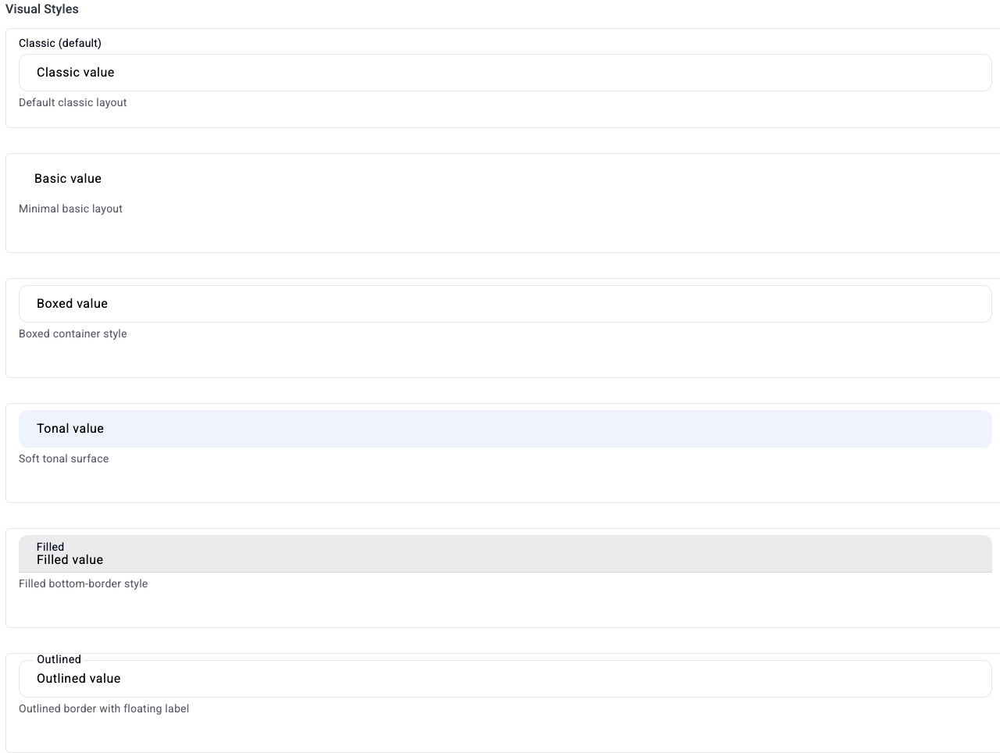
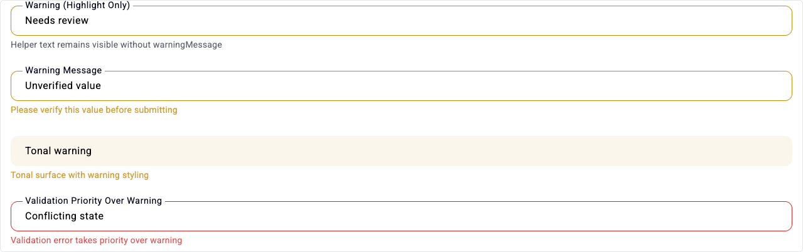
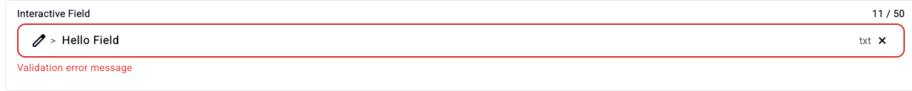

# Отчёт о визуальном и функциональном тестировании: D1Field

## 1. Краткое резюме

- **Компонент:** `D1Field` (`@dxtmisha/d1`)
- **Исходный код:** [`Field`](../../../packages/d1/src/components/Ui/Field)
- **Демо / Целевой URL:** `http://localhost:3000/component-field`
- **Справочные материалы:** `Отсутствуют`
- **Дата тестирования (UTC):** `2026-11-21T18:21:34Z`
- **Окружение:** `Headless Chrome (Puppeteer / CDP, Desktop 1440×900, Tablet 768×1024, Mobile 375×812 / 320×568)`
- **Покрытие тест-кейсов:** 12 / 12 (`100%`)
- **Итог:** **12 ✅, 0 ⚠️, 0 ❌** (`✅` пройдено, `⚠️` предупреждение, `❌` провалено) — компонент `D1Field` корректно отображает все 6 стилевых вариантов, размеры, палитры, тёмную тему, состояния (`focus`, `selected`, `readonly`, `disabled`, `forceShowMessage`, `loading`, `warning`, `warningMessage`, `tonal + warning`, приоритет `validation > warning`, `isSkeleton`), динамический расчёт отступов `FieldSize`, слоты (включая проброс `FieldControl` в `#leading`/`#trailing`), многоязычный текст, RTL и ARIA-атрибуты без единой ошибки JS или предупреждения Vue.

---

## 2. Базовая матрица

### 2.1 Визуальный рендеринг (`VIS`)

| ID | Сценарий | Статус | Фактический результат | Скриншот |
| :--- | :--- | :---: | :--- | :--- |
| `TC-VIS-001` | Базовый рендеринг вариантов `classic`, `basic`, `boxed`, `tonal`, `filled`, `outlined` | ✅ | Все 6 вариантов отрендерены с нужными классами (`zeroHeight: 0`): `classic` использует тег `DIV`, остальные — `LABEL`; наложений меток и границ нет. |  |
| `TC-VIS-002` | Размеры (`sm`, `md`, `lg`, `display`), ширина (`260px`, `block`), палитры и тёмная тема | ✅ | Высоты тел полей строго возрастают: `32`, `48`, `64`, `72` px; ширина `260px` = `260`, `block` = `1246` (100% родителя); палитры `emerald`/`violet` и `.d1-dark` (`rgb(248, 250, 252)`) применены. |  |
| `TC-VIS-003` | Иконки, стрелки навигации, загрузка и состояние `is-skeleton` | ✅ | Отрендерены `10` иконок в группе, активны `--cancel`, `--arrowCarousel`, `--arrowStepper`, спиннер загрузки и скелетон (`d1-skeleton__background`). |  |
| `TC-VIS-004` | Состояние предупреждения (`warning`, `warningMessage`, `tonal + warning`) и приоритет `validation > warning` | ✅ | Карточки предупреждения имеют `d1-field--warning` без `d1-field--validation` и `aria-invalid: null`, `warningVisible: true` для `Warning Message` (`demo-field-warning-msg`) и `Tonal Warning` (`d1-field--tonal`); при конфликте с `validationMessage` активен `d1-field--validation` (`aria-invalid="true"`), а предупреждение скрыто (`warningVisible: false`, `errorVisible: true`). |  |

### 2.2 Интерактивность и управление состоянием (`INT`)

| ID | Сценарий | Статус | Фактический результат | Скриншот |
| :--- | :--- | :---: | :--- | :--- |
| `TC-INT-001` | Реактивное переключение состояний (включая `Warning` -> `Validation`) и стилей в `Interactive & Multilingual` | ✅ | Включение `Warning` активировало `d1-field--warning` без `aria-invalid`; последующее переключение в `classic` + `focus` + `Validation` + `Counter Top` сняло `d1-field--warning`, активировало `d1-field--validation` (`aria-invalid="true"`), отобразило верхний счётчик (`11 / 50`) и применило расчёты `FieldSize` (`--d1-field-sys-left: 63px`, `--d1-field-sys-right: 72px`, `--d1-field-sys-title: 47px`, `d1-field--show`). |  |
| `TC-INT-002` | Ввод значения, очистка кнопкой `cancel` и возврат фокуса | ✅ | После клика по `[data-event-type="cancel"]` поле очищено (`""`), фокус возвращён на `<input>` (`isFocusedAfterCancel: true`), счётчик обновился до `0 / 50`. |  |
| `TC-INT-003` | Проекция слотов (`#label`, `#leading`/`#trailing` с `FieldControl`, `#prefix`, `#default`, `#caption`, `#suffix`) | ✅ | Все слоты отображаются чисто; `#leading` и `#trailing` получили `FieldControl.id === "demo-field-slots"`, совпадающий с `input.id`. |  |

### 2.3 Граничные случаи и крайние сценарии (`BND`)

| ID | Сценарий | Статус | Фактический результат | Скриншот |
| :--- | :--- | :---: | :--- | :--- |
| `TC-BND-001` | `disabled` vs `forceShowMessage`, `hasHtmlCode` и выравнивание | ✅ | При `disabled` класс `d1-field--validation` снят (`false`); при `forceShowMessage` восстановлен (`true`); HTML-подсказка рендерит `<strong>` (`1` элемент в `.d1-fieldMessage`). |  |
| `TC-BND-002` | Многоязычность (вьетнамский, кириллица, арабский, Emoji) и RTL (`dir="rtl"`) | ✅ | `direction: rtl`, ширина `1246 === scrollWidth: 1246`, кириллица, вьетнамский (`Học tiếng Việt`), арабский и `🚀` отображаются чисто без обрезаний и наложений. |  |

### 2.4 Адаптивность (`RSP`)

| ID | Сценарий | Статус | Фактический результат | Скриншот |
| :--- | :--- | :---: | :--- | :--- |
| `TC-RSP-001` | Проверка вьюпортов `1440×900`, `768×1024`, `375×812`, `320×568` | ✅ | На всех 4 разрешениях среди `38` экземпляров `.d1-field` зафиксировано `overflowing: 0`, а `docScrollWidth <= innerWidth` (`1425 <= 1440`, `753 <= 768`, `360 <= 375`, `305 <= 320`). |  |

### 2.5 Доступность (`A11Y`)

| ID | Сценарий | Статус | Фактический результат | Скриншот |
| :--- | :--- | :---: | :--- | :--- |
| `TC-A11Y-001` | Семантика `div`/`label[for]`, `aria-invalid` и `aria-describedby` (включая `warningId`) | ✅ | Все `classic` = `DIV`, все не-classic = `LABEL` с `for === input.id`; у `Warning Message` `aria-invalid: null` и `aria-describedby="ui-10080 demo-field-warning-msg"` (`warningIdsExist: true`); у ошибки валидации `aria-invalid="true"` и `validationIdsExist: true`. | — |

### 2.6 Логи и консоль (`LOG`)

| ID | Сценарий | Статус | Фактический результат | Скриншот |
| :--- | :--- | :---: | :--- | :--- |
| `TC-LOG-001` | Проверка консоли, исключений страницы и предупреждений Vue | ✅ | `vueWarnings: []`, `pageErrors: []`, `consoleErrors: []` — ноль ошибок и предупреждений на всех сценариях. | — |

---

## 3. AI-аудит и рекомендации

1. **Контракт предупреждений (`warning` / `warningMessage` / `validation > warning`):** Состояние предупреждения визуально контрастно в `outlined` и `tonal` вариантах, сохраняет `aria-describedby` на `warningId` без ложного `aria-invalid` и корректно уступает приоритет ошибке валидации как на уровне CSS-классов, так и на уровне `D1FieldMessage`.
2. **Соответствие слотов (`FieldSlots`) и `FieldLabelInclude`:** В ходе визуального аудита подтверждён проброс `FieldControl` (`id`) в слоты `#leading` и `#trailing`, а также скорректирован демо-стенд (`slots-field-box`) в соответствие с контрактом `FieldLabelInclude` (активация по `label` / `counterTop`) и набором слотов `FieldSlots`.
3. **Производительность и управление памятью:** Расчёт отступов `FieldSize` выполняется через `requestAnimationFrame` с полной остановкой `EventItem`, rAF и `stopWatch` в `onUnmounted`; консоль, рантайм и гидратация полностью чистые.
