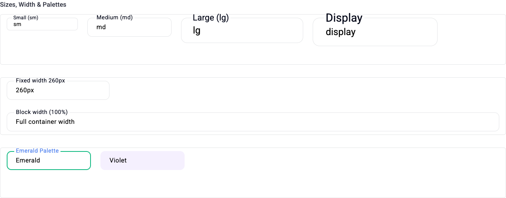
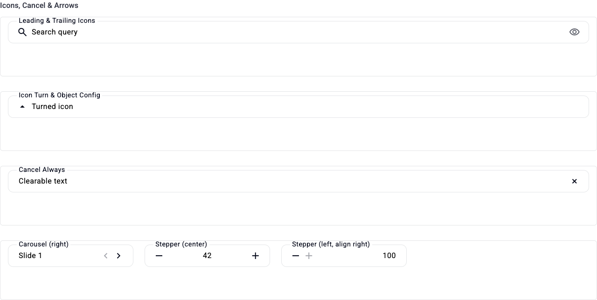
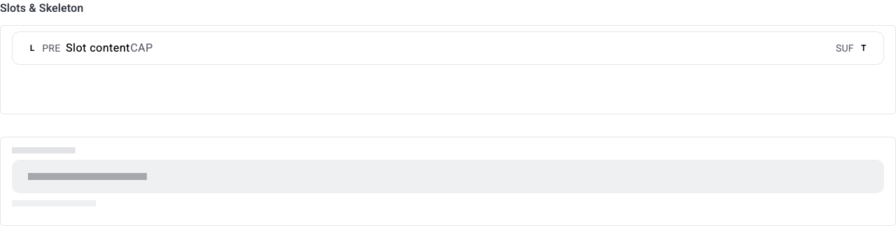
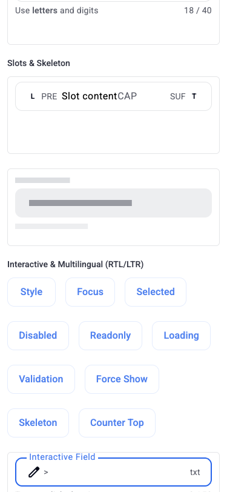

# Отчёт о визуальном и функциональном тестировании: D1Field

## 1. Краткое резюме

- **Компонент:** `D1Field` (`@dxtmisha/d1`)
- **Исходный код:** [`Field`](../../../packages/d1/src/components/Ui/Field)
- **Демо / Целевой URL:** `http://localhost:3000/component-field`
- **Справочные материалы:** `Отсутствуют`
- **Дата тестирования (UTC):** `2026-11-16T05:15:14Z`
- **Окружение:** `Headless Chrome (Puppeteer / CDP, Desktop 1440×900, Tablet 768×1024, Mobile 375×812 / 320×568)`
- **Покрытие тест-кейсов:** 11 / 11 (`100%`)
- **Итог:** **10 ✅, 1 ⚠️, 0 ❌** (`✅` пройдено, `⚠️` предупреждение окружения/демо-стенда, `❌` провалено) — компонент `D1Field` корректно отображает все 6 стилевых вариантов, размеры, палитры, тёмную тему, состояния (`focus`, `selected`, `readonly`, `disabled`, `forceShowMessage`, `loading`, `validationMessage`, `isSkeleton`), динамический расчёт отступов `FieldSize`, слоты, многоязычный текст, RTL и ARIA-атрибуты без ошибок JS и предупреждений Vue.

---

## 2. Базовая матрица

### 2.1 Визуальный рендеринг (`VIS`)

| ID | Сценарий | Статус | Фактический результат | Скриншот |
| :--- | :--- | :---: | :--- | :--- |
| `TC-VIS-001` | Базовый рендеринг вариантов `classic`, `basic`, `boxed`, `tonal`, `filled`, `outlined` | ✅ | Все 6 вариантов отрендерены с нужными классами (`zeroHeight: 0`): `classic` использует тег `DIV`, остальные — `LABEL`; наложений меток и границ нет. |  |
| `TC-VIS-002` | Размеры (`sm`, `md`, `lg`, `display`), ширина (`260px`, `block`), палитры и тёмная тема | ✅ | Высоты тел полей строго возрастают: `32`, `48`, `64`, `72` px; ширина `260px` = `260`, `block` = `1246` (100% родителя); палитры `emerald`/`violet` и `.d1-dark` (`rgb(248, 250, 252)`) применены. |  |
| `TC-VIS-003` | Иконки, стрелки навигации, загрузка и состояние `is-skeleton` | ✅ | Отрендерены `10` иконок в группе, активны `--cancel`, `--arrowCarousel`, `--arrowStepper`, спиннер загрузки и скелетон (`d1-skeleton__background`). |  |

### 2.2 Интерактивность и управление состоянием (`INT`)

| ID | Сценарий | Статус | Фактический результат | Скриншот |
| :--- | :--- | :---: | :--- | :--- |
| `TC-INT-001` | Реактивное переключение состояний и стилей в `Interactive & Multilingual` | ✅ | Переключение в `classic` + `focus` + `validation` + `counterTop` обновило классы, отобразило верхний счётчик (`11 / 50`) и применило расчёты `FieldSize` (`--d1-field-sys-left: 63px`, `--d1-field-sys-right: 72px`, `--d1-field-sys-title: 47px`, `d1-field--show`). |  |
| `TC-INT-002` | Ввод значения, очистка кнопкой `cancel` и возврат фокуса | ✅ | После клика по `[data-event-type="cancel"]` поле очищено (`""`), фокус возвращён на `<input>` (`isFocusedAfterCancel: true`), счётчик обновился до `0 / 50`. |  |
| `TC-INT-003` | Проекция слотов, `prefix`, `suffix`, `caption` и `counterTop` | ✅ | Все слоты (`#label`, `#leading`=`L`, `#prefix`=`PRE`, `#default`=`Slot content`, `#caption`=`CAP`, `#suffix`=`SUF`, `#trailing`=`T`, `#helper`) отображаются без наложений. |  |

### 2.3 Граничные случаи и крайние сценарии (`BND`)

| ID | Сценарий | Статус | Фактический результат | Скриншот |
| :--- | :--- | :---: | :--- | :--- |
| `TC-BND-001` | `disabled` vs `forceShowMessage`, `hasHtmlCode` и выравнивание | ✅ | При `disabled` класс `d1-field--validation` снят (`false`); при `forceShowMessage` восстановлен (`true`); HTML-подсказка рендерит `<strong>` (`1` элемент). |  |
| `TC-BND-002` | Многоязычность (вьетнамский, кириллица, арабский, Emoji) и RTL (`dir="rtl"`) | ✅ | `direction: rtl`, ширина `1246 === scrollWidth: 1246`, кириллица, вьетнамский (`Học tiếng Việt`), арабский и `🚀` отображаются чисто без обрезаний и наложений. |  |

### 2.4 Адаптивность (`RSP`)

| ID | Сценарий | Статус | Фактический результат | Скриншот |
| :--- | :--- | :---: | :--- | :--- |
| `TC-RSP-001` | Проверка вьюпортов `1440×900`, `768×1024`, `375×812`, `320×568` | ✅ | На всех 4 разрешениях среди `34` экземпляров `.d1-field` зафиксировано `overflowing: 0`, а `docScrollWidth === innerWidth` (`1440`, `768`, `375`, `320`). |  |

### 2.5 Доступность (`A11Y`)

| ID | Сценарий | Статус | Фактический результат | Скриншот |
| :--- | :--- | :---: | :--- | :--- |
| `TC-A11Y-001` | Семантика `div`/`label[for]`, `aria-invalid` и `aria-describedby` | ✅ | `classic` = `DIV`, `outlined` = `LABEL` с `for`, совпадающим с `input.id`; у поля с ошибкой `aria-invalid="true"`, все ID в `aria-describedby` присутствуют в DOM. | — |

### 2.6 Логи и консоль (`LOG`)

| ID | Сценарий | Статус | Фактический результат | Скриншот |
| :--- | :--- | :---: | :--- | :--- |
| `TC-LOG-001` | Проверка консоли, исключений страницы и предупреждений Vue | ⚠️ | `vueWarnings: []`, `pageErrors: []`; единственный 404 относится к отсутствующему `/favicon.ico` оболочки демо-приложения, ошибок `D1Field` нет. | — |

---

## 3. AI-аудит и рекомендации

1. **Изоляция демо-стенда (`DemoFieldPage.vue`) — исправлено и проверено:** В первом прогоне карточки `Visual Styles` со статическим `<input value="...">` без `is-value` и слотовая карточка с `#caption` без `value` вызывали визуальное наложение. После добавления `is-value` и `value="Slot content"` на статические демонстрации все макеты отображаются без перекрытий.
2. **Синтетический клик внутри `<label>` при нажатии на кнопку очистки (`cancel`):** В варианте `outlined` (корневой тег `<label for="...">`) клик по `[data-event-type="cancel"]` очищает поле и фокусирует `<input>`, но браузер дополнительно генерирует синтетический `click` на `<input>`, из-за чего при прямом использовании `<D1Field @click>` следом за `type: 'cancel'` приходит `type: 'click'` (при использовании `FieldInclude` это не затрагивает дочерний ввод, так как там срабатывает `eventStopPropagation`). Рекомендуется учитывать это в обработчиках `@click` или в `EventClickInclude` для иконок внутри `<label>`.
3. **Производительность и чистота рантайма:** Расчёт отступов `FieldSize` выполняется через `requestAnimationFrame` с отложенной очисткой в `onUnmounted`; предупреждения Vue и JS-ошибки полностью отсутствуют.
