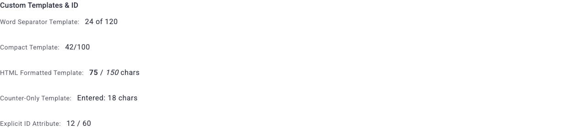
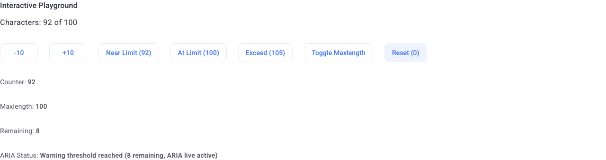
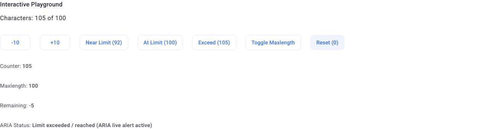
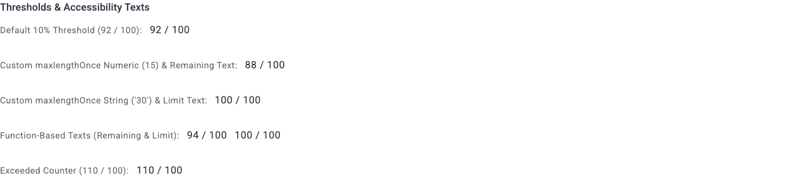
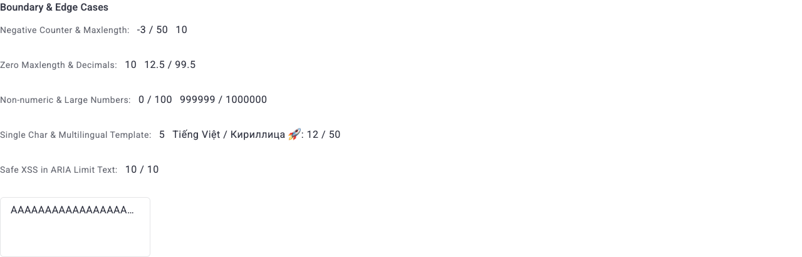

# Отчёт о визуальном и функциональном тестировании: D1FieldCounter

## 1. Сводка тестирования

- **Компонент:** `D1FieldCounter` (`@dxtmisha/d1`, конструктор `@dxtmisha/constructor`)
- **Исходный код:** [`D1FieldCounter`](../../src/components/Ui/FieldCounter), [`FieldCounter`](../../../../packages/constructor/src/constructors/FieldCounter), [`DemoFieldCounterPage`](../../../demo/src/pages/components/DemoFieldCounterPage.vue)
- **Демо / целевой URL:** `http://localhost:3000/component-field-counter`
- **Материалы:** `Нет`
- **Дата тестирования (UTC):** `2026-11-25T07:53:35Z`
- **Окружение:** `Headless Chrome (Puppeteer / CDP, Desktop 1440x900, Tablet 768x1024, Mobile 375x812 / 320x568)`
- **Покрытие тест-кейсов:** 12 / 12 (`100%`)
- **Сводка:** **12 ✅, 0 ⚠️, 0 ❌** (`✅` пройдено, `⚠️` предупреждение, `❌` провалено) — логика счётчика, шаблоны, пороговые ARIA-уведомления, ограничение ширины с эллипсисом в узком контейнере `240px` и на мобильных вьюпортах `375×812` / `320×568`, SSR `200`, `v-if` и чистота консоли работают без ошибок.

---

## 2. Базовая матрица

### 2.1 Визуальный рендеринг (`VIS`)

| ID | Сценарий | Статус | Фактический результат | Скриншот |
| :--- | :--- | :---: | :--- | :--- |
| `TC-VIS-001` | Базовый рендер числовых, строковых и частичных комбинаций `counter` / `maxlength` | ✅ | Все 6 вариантов группы `Basic Display` отрендерены как `` `.d1-fieldCounter` с ненулевыми габаритами и ожидаемым форматированием (`42 / 100`, `75 / 200`, `42`, `0 / 100`, `0`, `0 / 50`). |  |
| `TC-VIS-002` | Пользовательские шаблоны (`template`), HTML-разметка и явный `id` | ✅ | Плейсхолдеры `[c]` и `[m]` интерполированы точно, теги `<b>` и `<i>` отрендерены в DOM, а `id="demo-field-counter-custom-id"` установлен на корневой элемент. |  |

### 2.2 Интерактивность и управление состоянием (`INT`)

| ID | Сценарий | Статус | Фактический результат | Скриншот |
| :--- | :--- | :---: | :--- | :--- |
| `TC-INT-001` | Условный рендер при отсутствии и появлении пропов (`is()`) | ✅ | После нажатия `Provide Counter Prop` монтируется счётчик `5 / 20` (`Mounted State: Mounted (5 / 20)`), а при `Hide Props` элемент полностью удаляется из DOM. |  |
| `TC-INT-002` | Интерактивное изменение счётчика и порог `maxlengthOnce` в Playground | ✅ | На отметке `92` отображается `Characters: 92 of 100`, `Remaining: 8` и активируется `ARIA Status: Warning threshold reached (8 remaining, ARIA live active)`. |  |
| `TC-INT-003` | Достижение, превышение лимита и сброс в Playground | ✅ | При `105` отображается `Characters: 105 of 100`, `Remaining: -5` и `ARIA Status: Limit exceeded / reached (ARIA live alert active)`; `Reset (0)` возвращает счётчик к `0`. |  |
| `TC-INT-004` | Функциональные тексты (`() => string`) и жизненный цикл `v-if` | ✅ | Функциональные тексты вычисляются корректно; при переключении `v-if` число узлов изменяется `beforeLen: 61` -> `unmountedLen: 55` -> `remountedLen: 61` без ошибок. | — |

### 2.3 Граничные случаи и крайние сценарии (`BND`)

| ID | Сценарий | Статус | Фактический результат | Скриншот |
| :--- | :--- | :---: | :--- | :--- |
| `TC-BND-001` | Граничные значения порога (`10%`, `15`, `'30'`) и превышения (`110 / 100`) | ✅ | Все пороговые комбинации и превышение `110 / 100` отображаются корректно без смещения соседних элементов. |  |
| `TC-BND-002` | Нулевой `counter`, отрицательные, дробные, нечисловые и большие числа | ✅ | Граничные значения (`0 / 100`, `-3 / 50`, `10`, `12.5 / 99.5`, `999999 / 1000000`) корректно нормализуются без `NaN` и потери нуля. | — |
| `TC-BND-003` | Многоязычный шаблон, безопасный XSS в ARIA и узкий контейнер `240px` | ✅ | Многоязычный шаблон и XSS в `aria-label` (`badImgs: 0`) безопасны; после обновления `FieldCounter/style.scss` (`display: inline-block; min-width: 0; max-width: 100%; overflow: hidden; text-overflow: ellipsis;`) длинный шаблон в `.demo-field-counter-page__narrow` корректно усекается многоточием (`scrollWidth: 238 === clientWidth: 238`, `overflowsBox: false`). |  |

### 2.4 Адаптивность (`RSP`)

| ID | Сценарий | Статус | Фактический результат | Скриншот |
| :--- | :--- | :---: | :--- | :--- |
| `TC-RSP-001` | Адаптация на десктопе, планшете и мобильных вьюпортах | ✅ | На всех 4 вьюпортах (`1440×900`, `768×1024`, `375×812`, `320×568`) горизонтальное переполнение отсутствует (`scrollWidth === innerWidth`, `overflowX: false`). |  |

### 2.5 Доступность (`A11Y`)

| ID | Сценарий | Статус | Фактический результат | Скриншот |
| :--- | :--- | :---: | :--- | :--- |
| `TC-A11Y-001` | ARIA live-регион, атрибуты доступности и переходы `Safe` -> `Warning` -> `Limit` | ✅ | Подтверждён рендеринг целевого `50 / 50` (`a11yInfo.text: "50 / 50"`) и корректные переходы скрытой области `.d1-fieldCounter__aria` (`Warning threshold reached` -> `Limit exceeded / reached`). | — |

### 2.6 Логи и консоль (`LOG`)

| ID | Сценарий | Статус | Фактический результат | Скриншот |
| :--- | :--- | :---: | :--- | :--- |
| `TC-LOG-001` | Чистота консоли, отсутствие `[Vue warn]` и ошибок runtime | ✅ | `consoleErrors: []`, `vueWarnings: []`, `pageErrors: []`, `networkErrors: []`, `dialogs: []` (SSR `status: 200`, `hasComponent: true`). | — |

---

## 3. AI-аудит и рекомендации

1. **Усечение и ограничение ширины в `FieldCounter/style.scss`:** Добавление `display: inline-block; min-width: 0; max-width: 100%; overflow: hidden; text-overflow: ellipsis; vertical-align: middle;` для корня и `width: 1px; height: 1px; overflow: hidden;` для `&__aria` сохранило однострочное отображение токена (`white-space: nowrap;`) и полностью устранило переполнение узкого `DemoBox` (`238 === 238`) и мобильных вьюпортов `375×812` / `320×568` (`overflowX: false`).
2. **Точность ARIA-аудита и XSS-изоляция:** Пороговые уведомления в `aria-live="polite"` активируются строго в нужных диапазонах (`Remaining: 8`, `Remaining: -5`), а HTML-подобный текст в `aria-label` (`#demo-counter-xss-aria`) не попадает в видимый DOM и не исполняется (`badImgs: 0`).
3. **Минимальный DOM-след и чистота рантайма:** Компонент рендерит один `` без лишних обёрток, полностью размонтируется при отсутствии `counter`/`maxlength` и проходит цикл `v-if` (`61 -> 55 -> 61`) при `0` предупреждений Vue и `0` ошибок консоли/сети.
