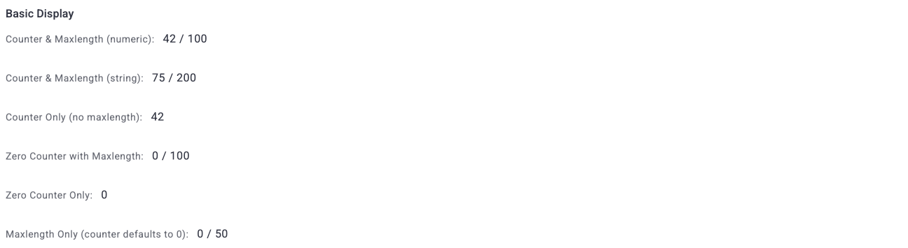
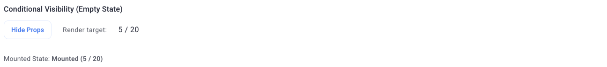
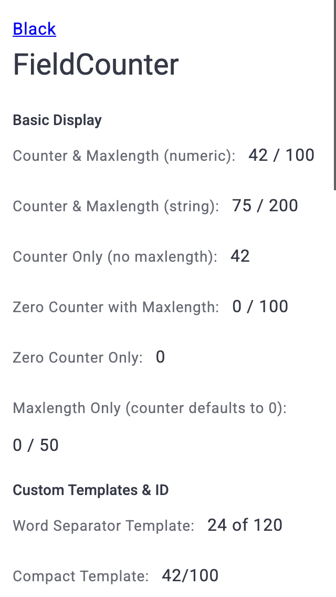

# Отчёт о визуальном и функциональном тестировании: D1FieldCounter

## 1. Итоговая сводка

- **Компонент:** `D1FieldCounter` (`@dxtmisha/d1`, конструктор `@dxtmisha/constructor`)
- **Исходный код:** [`D1FieldCounter`](../../src/components/Ui/FieldCounter), [`FieldCounter`](../../../../packages/constructor/src/constructors/FieldCounter)
- **URL демо-стенда:** `http://localhost:3000/component-field-counter`
- **Материалы:** `None`
- **Дата тестирования (UTC):** `2026-11-16T00:25:10Z`
- **Окружение:** `Headless Chrome (CDP, Desktop 1440x900, Tablet 768x1024, Mobile 375x812 / 320x568)`
- **Покрытие тест-кейсов:** 10 / 10 (`100%`)
- **Сводка:** **10 ✅, 0 ⚠️, 0 ❌** (`✅` пройдено, `⚠️` предупреждение, `❌` провалено) — компонент `D1FieldCounter` корректно отображает счётчик, шаблоны (включая HTML), пороговые ARIA-уведомления и условное монтирование без ошибок консоли, адаптивных переполнений и визуальных дефектов.

---

## 2. Базовая матрица

### 2.1 Визуальный рендер (`VIS`)

| ID | Сценарий | Статус | Фактический результат | Скриншот |
| :--- | :--- | :---: | :--- | :--- |
| `TC-VIS-001` | Базовый рендер числовых, строковых и нулевых пропов (`counter`, `maxlength`) | ✅ | Отрендерены 6 `` `.d1-fieldCounter` (`16px`, `rgba(2, 6, 23, 0.8)`): `42 / 100` (63.5×24), `75 / 200` (63.5×24), `42` (18.98×24), `0 / 100` (54.02×24), `0` (9.5×24), `0 / 50` (44.52×24). |  |
| `TC-VIS-002` | Пользовательские шаблоны (`template`), HTML-разметка и явный `id` | ✅ | Шаблоны интерполированы точно: `24 of 120`, `42/100`, `<b>75</b> / <i>150</i> chars` (наличие `<b>` и `<i>`), `Entered: 18 chars`; явный `id="demo-field-counter-custom-id"` установлен на корневом ``. |  |

### 2.2 Интерактивность и управление состоянием (`INT`)

| ID | Сценарий | Статус | Фактический результат | Скриншот |
| :--- | :--- | :---: | :--- | :--- |
| `TC-INT-001` | Условное монтирование при отсутствии/появлении пропов (`is()`) | ✅ | До клика `.d1-fieldCounter` отсутствует в DOM (`false`); после `Provide Counter Prop` монтируется `5 / 20`; после `Hide Props` снова размонтируется (`false`). |  |
| `TC-INT-002` | Обновление счётчика и активация порога `maxlengthOnce` в Interactive Playground | ✅ | Начальное значение `Characters: 40 of 100` (`hasAriaRegion: false`); после `+10` — `Characters: 50 of 100` (`hasAriaRegion: false`); после `Near Limit (92)` — `Characters: 92 of 100` и активен ARIA-текст `"Remaining 8 characters"`. |  |
| `TC-INT-003` | Достижение (`100`), превышение лимита (`105`) и сброс (`0`) | ✅ | При `At Limit (100)` и `Exceed (105)` отображаются `Characters: 100 of 100` / `Characters: 105 of 100` с `aria-label="Character limit exceeded"`; после `Reset (0)` текст сбрасывается до `Characters: 0 of 100` (`hasAriaRegion: false`). |  |

### 2.3 Граничные значения и краевые случаи (`BND`)

| ID | Сценарий | Статус | Фактический результат | Скриншот |
| :--- | :--- | :---: | :--- | :--- |
| `TC-BND-001` | Пороги (`10%`, `15`, `'30'`) и превышение лимита (`110 / 100`) | ✅ | `92 / 100` -> `"Remaining 8 characters"`, `88 / 100` -> `"Only 12 chars left"`, `100 / 100` -> `"Limit reached!"`, `110 / 100` (73×24) -> `"Maximum characters exceeded"` без визуального переполнения. |  |
| `TC-BND-002` | Нулевой `counter` и отсутствие `counter` при заданном `maxlength` | ✅ | Нулевые значения отображаются корректно (`0 / 100` 54.02×24, `0` 9.5×24, `0 / 50` 44.52×24) и не отбрасываются условием `is()`. | — |

### 2.4 Адаптивность (`RSP`)

| ID | Сценарий | Статус | Фактический результат | Скриншот |
| :--- | :--- | :---: | :--- | :--- |
| `TC-RSP-001` | Проверка макета на вьюпортах `1440x900`, `768x1024`, `375x812`, `320x568` | ✅ | На всех 4 разрешениях `scrollWidth === innerWidth` (`overflows: false`), все 16 экземпляров `.d1-fieldCounter` сохраняют читаемость и минимальную ширину `9.5px`. |  |

### 2.5 Доступность (`A11Y`)

| ID | Сценарий | Статус | Фактический результат | Скриншот |
| :--- | :--- | :---: | :--- | :--- |
| `TC-A11Y-001` | Проверка скрытого ARIA live-элемента `.d1-fieldCounter__aria` | ✅ | Отрендерен `
` (`position: absolute`, `width: 0`, `height: 0`) с дочерним ``. | — |

### 2.6 Логи и консоль (`LOG`)

| ID | Сценарий | Статус | Фактический результат | Скриншот |
| :--- | :--- | :---: | :--- | :--- |
| `TC-LOG-001` | Отсутствие ошибок консоли, сетевых ошибок и предупреждений Vue | ✅ | Зафиксировано: `consoleErrors: []`, `consoleWarnings: []`, `pageErrors: []`, `failedHttp: []`, `vueWarnings: []`. | — |

---

## 3. ИИ-аудит и рекомендации

1. **Архитектура ARIA live-области и изоляция макета:** Скрытый контейнер `
` монтируется только при входе счётчика в пороговую зону (`remaining <= maxOnce`) и имеет `position: absolute; width: 0; height: 0`, поэтому появление live-региона не вызывает сдвигов макета (`CLS = 0`). Поскольку анонс передаётся через `` внутри `aria-live="polite"`, скринридер получает актуальную строку целиком при каждом обновлении без дублирования текста.
2. **Производительность и лёгкость DOM:** Компонент рендерит минимальное число DOM-узлов (1 `` по умолчанию, +1 лёгкий `
` только рядом с лимитом) и полностью размонтируется при отсутствии `counter` и `maxlength`, что делает его практически бесплатным в составе крупных форм (`Field`).
3. **Чистота рантайма:** В ходе загрузки страницы и всех переходов Interactive Playground не зафиксировано ни одной ошибки консоли, сетевого 404 или предупреждения `[Vue warn]`.
