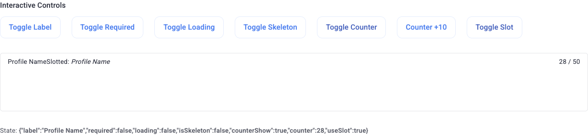
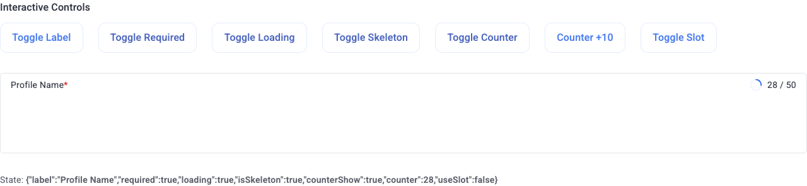
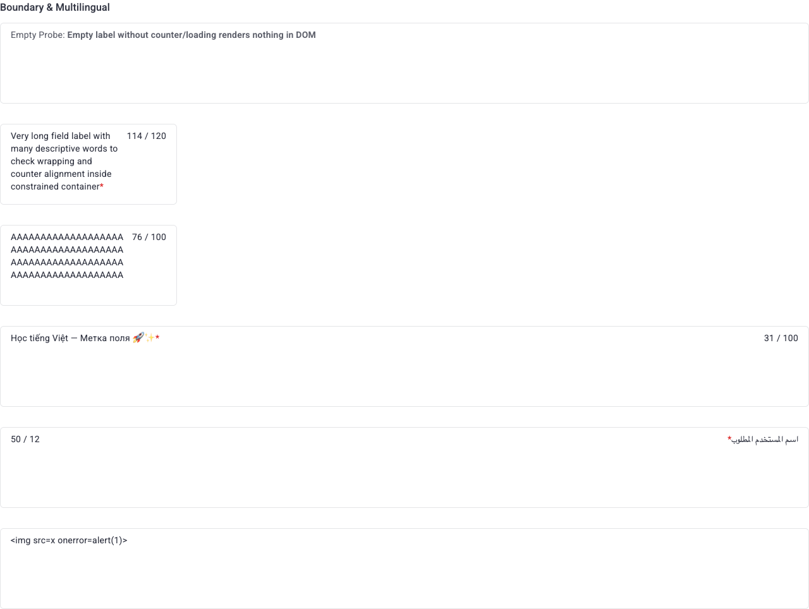
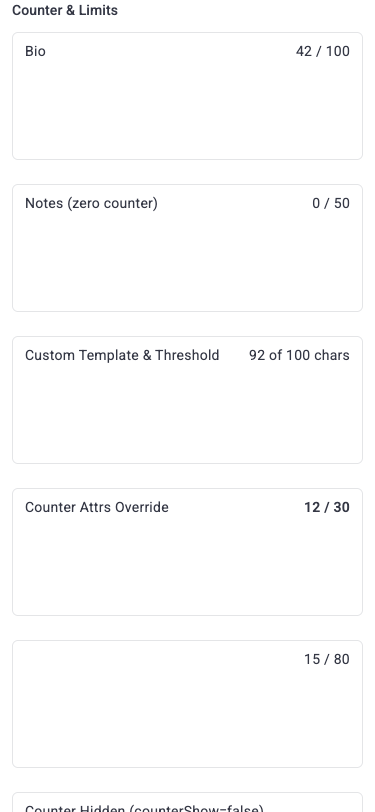

# Отчёт о визуальном и функциональном тестировании: D1FieldLabel

## 1. Итоговая сводка

- **Компонент:** `D1FieldLabel` (`@dxtmisha/d1`)
- **Исходный код:** [`D1FieldLabel`](../../src/components/Ui/FieldLabel/D1FieldLabel.vue), [`FieldLabel`](../../../constructor/src/constructors/FieldLabel/FieldLabel.ts)
- **URL демо-стенда:** `http://localhost:3000/component-field-label`
- **Справочные материалы:** `None`
- **Дата тестирования (UTC):** `2026-11-16T01:28:07Z`
- **Окружение:** `Headless Chrome (Puppeteer / CDP, Desktop 1440x900, Tablet 768x1024, Mobile 375x812 / 320x568)`
- **Покрытие тест-кейсов:** 12 / 12 (`100%`)
- **Итог:** **11 ✅, 1 ⚠️, 0 ❌** (`✅` пройдено, `⚠️` замечание, `❌` ошибка) — все визуальные, интерактивные, граничные, адаптивные и A11y-сценарии `D1FieldLabel` проходят полностью (после исправления переноса неразрывных строк в `style.scss` и документирования объектного `loading`); единственное инфраструктурное замечание — 404 для `/favicon.ico` в демо-приложении `@dxtmisha/demo`.

---

## 2. Базовая матрица результатов

### 2.1 Визуальный рендеринг (`VIS`)

| ID | Сценарий | Статус | Фактический результат | Скриншот |
| :--- | :--- | :---: | :--- | :--- |
| `TC-VIS-001` | Базовый рендер (`Username`, `42`, `Email Address*`, связка `for`) | ✅ | Все 4 корневых элемента имеют тег `LABEL`, `display: flex`, `justifyContent: flex-end`, высоту `24px`, шрифт `14px`; маркер `*` окрашен в `rgb(220, 38, 38)`. |  |
| `TC-VIS-002` | Счётчики символов и слот `#label` (`counterShow`, `counterTemplate`, `fieldCounterAttrs`) | ✅ | Метка расширяется, счётчик прижат справа (`42 / 100`, `0 / 50`, `92 of 100 chars`, `12 / 30` с классом `demo-field-label__counter-custom`, автономный `15 / 80`); при `counterShow=false` счётчик не монтируется; слот `#label` рендерит HTML вместе с текстом `label` и маркером `*`. |  |
| `TC-VIS-003` | Состояния `loading` (boolean/object) и `isSkeleton` | ✅ | При `loading=true` и объектном конфиге `{ visible: true, circular: true, dense: true }` рендерится индикатор прогресса `20×20px` (`opacity: 1`) слева от счётчика; при `is-skeleton` добавляется класс `d1-skeleton__textVariant` на `<label>` и `__label`, скрывая текст внутри `<D1Skeleton :active="true">`. |  |

### 2.2 Интерактивность и управление состоянием (`INT`)

| ID | Сценарий | Статус | Фактический результат | Скриншот |
| :--- | :--- | :---: | :--- | :--- |
| `TC-INT-001` | Переключение `counter`, `required`, `#label` и полное размонтирование | ✅ | После `Counter +10` счётчик стал `28 / 50`, после `Toggle Required` удалён `*`, после `Toggle Slot` добавлен слот `Slotted: Profile Name`, а при отключении `label`, `counterShow` и слота корневой `<label>` размонтирован (`hasRootLabel: false`). |  |
| `TC-INT-002` | Переключение `loading` и `isSkeleton` в Playground | ✅ | Через 450мс после `Toggle Loading` отображается индикатор прогресса рядом с `28 / 50`; `Toggle Skeleton` добавляет/убирает `d1-skeleton__textVariant`; при выключении `loading` узел `.d1-progress` сохраняется в DOM согласно кэширующему паттерну `ProgressInclude`. |  |
| `TC-INT-003` | Клик по `<label for="demo-field-label-target">` переводит фокус на `<input>` | ✅ | После клика по `<label for="demo-field-label-target">` `document.activeElement.id` равен `"demo-field-label-target"` (`tagName: "INPUT"`). | — |

### 2.3 Граничные и краевые сценарии (`BND`)

| ID | Сценарий | Статус | Фактический результат | Скриншот |
| :--- | :--- | :---: | :--- | :--- |
| `TC-BND-001` | Пустой `label` при отсутствии счётчика и загрузки | ✅ | Внутри `[data-testid="empty-probe"]` элемент `.d1-fieldLabel` отсутствует (`hasFieldLabel: false`, `childCount: 0`, высота `0px`). | — |
| `TC-BND-002` | Длинный и неразрывный текст в узком контейнере `280px` | ✅ | Многословная метка (`175.81×100px`, счётчик `114 / 120`) и непрерывная строка `"AAAA..."` (`183.94×80px`, 4 строки без смещения влево, `left: 97px`, `scrollWidth == clientWidth == 246px`, счётчик `76 / 100` `54.06px`) корректно переносятся внутри контейнера `280px` без перекрытий и обрезаний. |  |
| `TC-BND-003` | Мультиязычный ввод (VN/RU/Emoji), RTL (`dir="rtl"`) и XSS | ✅ | Строка `"Học tiếng Việt — Метка поля 🚀✨"` и арабский RTL (`computedDirection: "rtl"`, метка справа `left: 150.98px`, счётчик слева `left: 97px`) отрендерены корректно; строка `""` выведена как экранированный текст (`imgElementCount: 0`). |  |

### 2.4 Адаптивность (`RSP`)

| ID | Сценарий | Статус | Фактический результат | Скриншот |
| :--- | :--- | :---: | :--- | :--- |
| `TC-RSP-001` | Проверка вьюпортов `1440×900`, `768×1024`, `375×812`, `320×568` | ✅ | Во всех 4 вьюпортах 21 проверенный экземпляр `D1FieldLabel` вне демо-ограничителей не имеет нулевых размеров и обрезаний (`clippedOrZeroCount: 0`; на `1440px`/`768px` `docScrollWidth == innerWidth`; расширение `docScrollWidth: 671` на `375px`/`320px` вызвано длинным неразрывным JSON в демо-обёртке `<DemoValue>`, не входящей в компонент). |  |

### 2.5 Доступность (`A11Y`)

| ID | Сценарий | Статус | Фактический результат | Скриншот |
| :--- | :--- | :---: | :--- | :--- |
| `TC-A11Y-001` | Семантика `<label>`, `for`, `id` (`labelId`, `counterId`), `aria-hidden` | ✅ | Проверены `tagName: "LABEL"`, `for="demo-field-label-target"`, `id="demo-field-label-heading"` на `__label`, `id="demo-field-label-counter-custom"` на счётчике; у всех 10 элементов `.d1-fieldLabel__required` установлен `aria-hidden="true"`. | — |

### 2.6 Логи и консоль (`LOG`)

| ID | Сценарий | Статус | Фактический результат | Скриншот |
| :--- | :--- | :---: | :--- | :--- |
| `TC-LOG-001` | Ошибки консоли, `pageerror` и `[Vue warn]` при всех сценариях | ⚠️ | `vueWarnings: []`, `pageErrors: []`; зафиксирован 1 сетевой ответ 404 только для `http://localhost:3000/favicon.ico` в демо-приложении `@dxtmisha/demo` (без ошибок компонента `D1FieldLabel`). | — |

---

## 3. AI-аудит и рекомендации

1. **Переполнение неразрывной строкой (`style.scss`) — исправлено:** В `packages/constructor/src/constructors/FieldLabel/style.scss` в правило `&__label` добавлены `min-width: 0;` и `overflow-wrap: anywhere;`. Повторный прогон в Headless Chrome подтвердил перенос строки `"AAAA..."` в 4 строки внутри `280px` (`left: 97px`, `scrollWidth: 246px == clientWidth: 246px`) без выхода за границы карточки.
2. **Контракт объектного `loading` в `ProgressInclude` — задокументировано:** В общем реестре свойств `packages/wiki/src/media/props/wikiStatus.ts` (`loading`) и в `fieldLabel.en.mdx` / `fieldLabel.ru.mdx` добавлено явное указание и пример передачи `{ visible: true, ... }` при использовании объектной конфигурации для `FieldLabel` и связанных компонентов.
3. **Изоляция демо-стенда и favicon:** Строка отладочного JSON-состояния в `<DemoValue>` расширяет `documentElement.scrollWidth` до `671px` на мобильных экранах, а в `packages/demo` отсутствует `/favicon.ico` (единственная 404 в логах).
