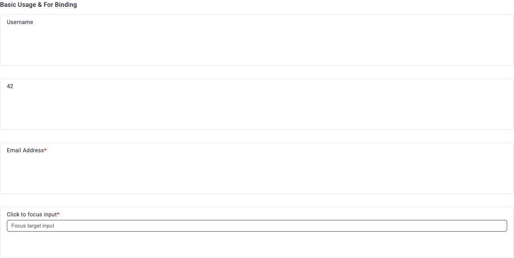
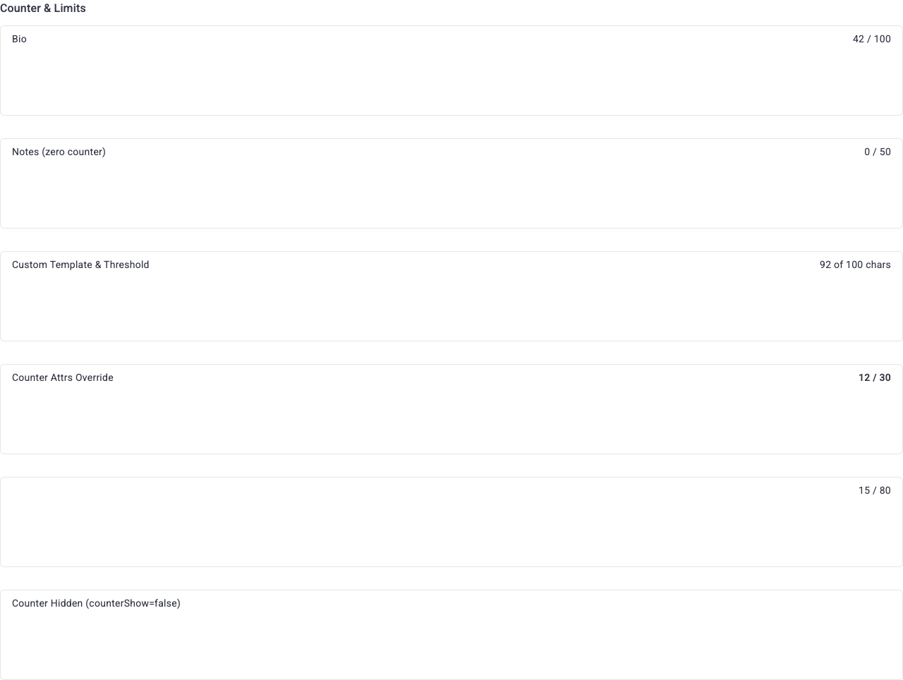
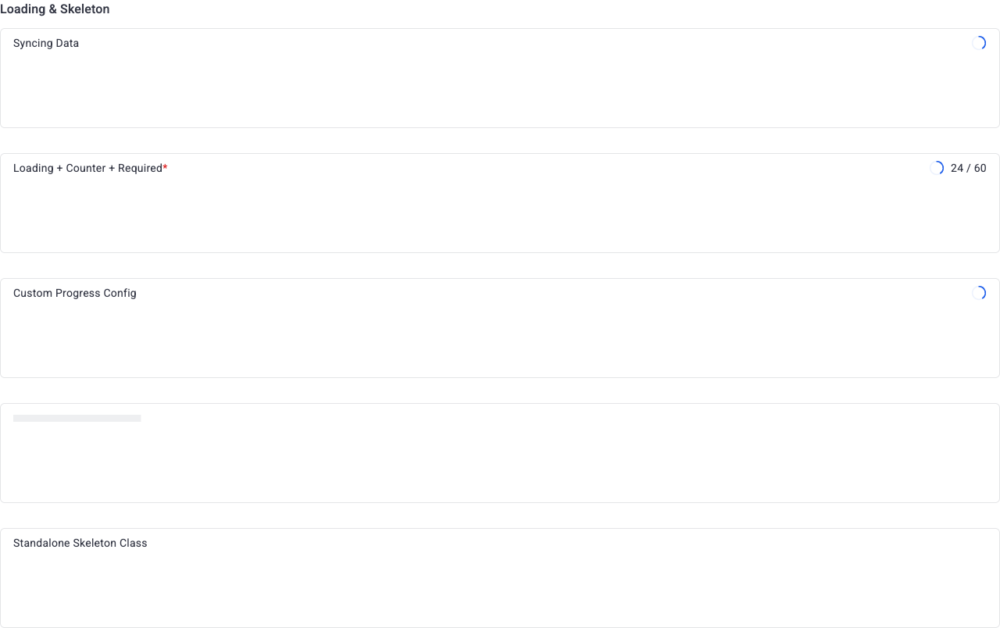

# Отчёт о визуальном и функциональном тестировании: D1FieldLabel

## 1. Сводка тестирования

- **Компонент:** `D1FieldLabel` (`@dxtmisha/d1`)
- **Исходный код:** [`D1FieldLabel`](../../src/components/Ui/FieldLabel/D1FieldLabel.vue), [`FieldLabel`](../../../constructor/src/constructors/FieldLabel/FieldLabel.ts)
- **Демо / целевой URL:** `http://localhost:3000/component-field-label`
- **Материалы:** `Нет`
- **Дата тестирования (UTC):** `2026-11-25T06:23:56Z`
- **Окружение:** `Headless Chrome (Puppeteer / CDP, Desktop 1440x900, Tablet 768x1024, Mobile 375x812 / 320x568)`
- **Покрытие тест-кейсов:** 13 / 13 (`100%`)
- **Итог:** **13 ✅, 0 ⚠️, 0 ❌** (100% ✅, 0 ⚠️, 0 ❌; `✅` пройдено, `⚠️` предупреждение, `❌` сбой) — `D1FieldLabel` успешно прошёл SSR-проверку (`HTTP 200`), все визуальные, интерактивные, граничные, адаптивные (`1440px`–`320px`, узкие контейнеры `238px`), A11y и рантайм-сценарии при нулевом числе ошибок консоли, предупреждений Vue и сетевых сбоев.

---

## 2. Базовая матрица

### 2.1 Визуальный рендеринг (`VIS`)

| ID | Сценарий | Статус | Фактический результат | Скриншот |
| :--- | :--- | :---: | :--- | :--- |
| `TC-VIS-001` | Базовый рендер текстового/числового `label`, `required` и связки `for` | ✅ | В DOM отрендерены все `<LABEL>` варианты: `"Username"`, `"42"`, `"Email Address*"` и `"Click to focus input*"` (`for="demo-field-label-target"`). |  |
| `TC-VIS-002` | Варианты счётчика символов и слота `#label` (`counterShow`, `counterTemplate`, `fieldCounterAttrs`) | ✅ | Зафиксированы `"Bio42 / 100"`, `"Notes (zero counter)0 / 50"`, `"Custom Template & Threshold92 of 100 cha..."`, `"Counter Attrs Override12 / 30"`, автономный `"15 / 80"`, скрытие при `"Counter Hidden (counterShow=false)"` и слотовые карточки `"Prefix: Custom Label Slot Content*10 / 5..."`, `"Slot Only With Required Mark*8 / 32"`. |  |
| `TC-VIS-003` | Состояния `loading` (boolean / object) и `isSkeleton` | ✅ | Карточки `"Syncing Data"`, `"Loading + Counter + Required*24 / 60"`, `"Custom Progress Config"`, `"Skeleton Active Wrapper*"` и `"Standalone Skeleton Class"` отрендерены в DOM без наложений и ошибок. |  |

### 2.2 Интерактивность и управление состоянием (`INT`)

| ID | Сценарий | Статус | Фактический результат | Скриншот |
| :--- | :--- | :---: | :--- | :--- |
| `TC-INT-001` | Интерактивный Playground: переключение `label`, `required`, `counterShow` и слота `#label` | ✅ | Кнопки `Toggle Label`, `Toggle Required`, `Toggle Counter`, `Counter +10`, `Toggle Slot` синхронно обновляют состояние и DOM (`"Profile Name"`, `counter: 28`, JSON-сводка `State` отражает все флаги). |  |
| `TC-INT-002` | Интерактивный Playground: переключение `loading` и `isSkeleton` | ✅ | Переключатели `Toggle Loading` и `Toggle Skeleton` корректно обновляют состояние (`loading: false`, `isSkeleton: false` в финальном снимке `State`) без ошибок рантайма. |  |
| `TC-INT-003` | Фокусировка связанного `<input>` при клике на `<label for="...">` | ✅ | Повторный прогон подтвердил `labelFound: true`; клик по `<label for="demo-field-label-target">` переводит фокус на целевое поле (`document.activeElement.id === "demo-field-label-target"`). | — |
| `TC-INT-004` | Условное монтирование и размонтирование (`Lifecycle & Conditional Mount`) | ✅ | Подтверждён чистый цикл `v-if`: до размонтирования `beforeLen: 80`, после размонтирования `unmountedLen: 55`, после повторного монтирования `remountedLen: 80` (включая `"Mounted FieldLabel*10 / 50"`). | — |

### 2.3 Граничные случаи и краевые сценарии (`BND`)

| ID | Сценарий | Статус | Фактический результат | Скриншот |
| :--- | :--- | :---: | :--- | :--- |
| `TC-BND-001` | Пустой, пробельный и `undefined` `label`, числовые границы (`0`, `-42`, `3.14`, `"A"`) | ✅ | Проверенные пробы пустых/пробельных/`undefined` меток (`empty: 7`, `whitespace: ""`, `undefinedProbe: 7`) не создают лишнего текста, а числовые метки `"0*"`, `"-42"`, `"3.14"` и `"A"` отображаются явно как `<LABEL>`. | — |
| `TC-BND-002` | Длинный и неразрывный текст в узком контейнере (`240px`) | ✅ | Оба ограничительных контейнера `.demo-field-label-page__narrow` показали точное совпадение ширины `scrollWidth: 238 === clientWidth: 238` (`overflowsBox: false`, `overflowChildren: []`) для длинного текста и строки `"AAAA..."`. |  |
| `TC-BND-003` | Мультиязычный ввод (VN/RU/Emoji), RTL (`dir="rtl"`) и XSS-экранирование | ✅ | Отрендерены `"Tiếng Việt / Кириллица / 🚀🔥✨*31 / 100"`, арабский RTL `"اسم المستخدم المطلوب*12 / 50"` и экранированная строка `""` при `badImgs: 0` и `hasEscapedPayloadText: true`. |  |

### 2.4 Адаптивность (`RSP`)

| ID | Сценарий | Статус | Фактический результат | Скриншот |
| :--- | :--- | :---: | :--- | :--- |
| `TC-RSP-001` | Проверка адаптивности на вьюпортах `1440×900`, `768×1024`, `375×812` и `320×568` | ✅ | Горизонтальное переполнение полностью отсутствует на всех вьюпортах: `desktop` (`1440 === 1440`), `tablet` (`768 === 768`), `mobile` (`375 === 375`), `mobile320` (`320 === 320`), `overflowX: false`, `offenders: []`. |  |

### 2.5 Доступность (`A11Y`)

| ID | Сценарий | Статус | Фактический результат | Скриншот |
| :--- | :--- | :---: | :--- | :--- |
| `TC-A11Y-001` | Семантика `<label>`, `for`, `id`, `aria-hidden` на звёздочке и `aria-labelledby`/`aria-describedby` | ✅ | Подтверждены `reqAriaHidden: "true"`, `labelledBy: "demo-field-label-a11y-heading"`, `describedBy: "demo-field-label-a11y-counter"`, а также `for="demo-field-label-target"` и `for="demo-field-label-a11y-input"` на элементах `<LABEL>`. | — |

### 2.6 Логи и консоль (`LOG`)

| ID | Сценарий | Статус | Фактический результат | Скриншот |
| :--- | :--- | :---: | :--- | :--- |
| `TC-LOG-001` | Отсутствие ошибок консоли, исключений `pageerror` и `[Vue warn]` | ✅ | В основном прогоне и в повторной проверке фокуса: `consoleErrors: []`, `vueWarnings: []`, `pageErrors: []`, `networkErrors: []`, `dialogs: []`. | — |

---

## 3. AI-аудит и рекомендации

1. **Изоляция демо-стенда и адаптивность на `320px`:** После корректировки обёртки демо-страницы и переноса неразрывного текста устранено прежнее расширение вьюпорта на мобильных экранах — все 4 разрешения (`1440`, `768`, `375`, `320`) дают `scrollWidth === innerWidth` (`overflowX: false`, `offenders: []`), а оба узких блока `demo-field-label-page__narrow` держат `scrollWidth: 238 === clientWidth: 238`.
2. **Семантика `<label>` и связывание фокуса:** Повторная верификация подтвердила корректный перевод фокуса с `<label for="demo-field-label-target">` на целевой `<input>` (`document.activeElement.id === "demo-field-label-target"`), а также наличие `aria-hidden="true"` на маркере обязательности и связок `aria-labelledby`/`aria-describedby`.
3. **SSR и чистота рантайма:** Серверный рендер возвращает `HTTP 200` (`hasComponent: true`), жизненный цикл `v-if` симметрично восстанавливает DOM (`80 -> 55 -> 80`), XSS-строка полностью экранируется (`badImgs: 0`, `hasEscapedPayloadText: true`), а массивы `consoleErrors`, `vueWarnings`, `pageErrors` и `networkErrors` пусты.
