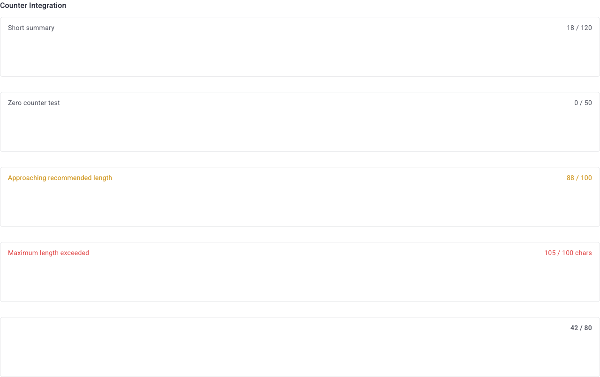
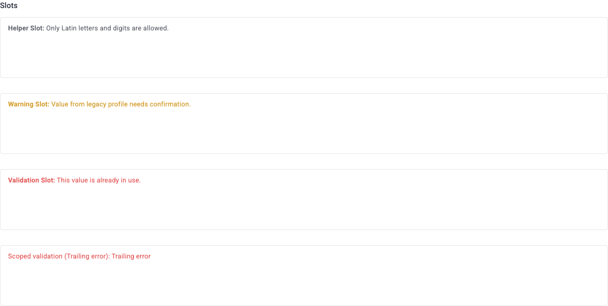
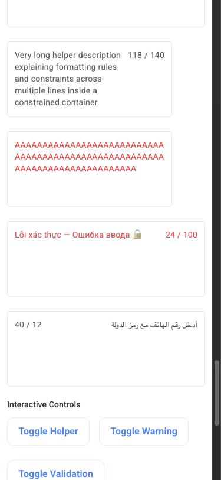

# Отчёт о визуальном и функциональном тестировании: D1FieldMessage

## 1. Краткое резюме

- **Компонент:** `D1FieldMessage` (`@dxtmisha/d1`)
- **Исходный код:** [`FieldMessage`](../../../packages/d1/src/components/Ui/FieldMessage)
- **Демо / Целевой URL:** `http://localhost:3000/component-field-message`
- **Справочные материалы:** `Отсутствуют`
- **Дата тестирования (UTC):** `2026-11-21T17:24:50Z`
- **Окружение:** `Headless Chrome (Puppeteer / CDP, Desktop 1440×900, Tablet 768×1024, Mobile 375×812 / 320×568)`
- **Покрытие тест-кейсов:** 11 / 11 (`100%`)
- **Итог:** **11 ✅, 0 ⚠️, 0 ❌** (`✅` пройдено, `⚠️` предупреждение, `❌` провалено) — компонент `D1FieldMessage` полностью соответствует контракту: подтверждён CSS-приоритет `--validation` > `--warning` > `info`, корректная окраска текста и `D1FieldCounter` в состоянии `--warning`, адаптация к светлой и тёмной темам, работа всех слотов (`#helper`, `#warning`, `#validation`), безопасный `hasHtmlCode`, RTL-выравнивание, ARIA-связи (`aria-describedby` со всеми тремя ID) и чистая консоль без ошибок и предупреждений.

---

## 2. Базовая матрица

### 2.1 Визуальный рендеринг (`VIS`)

| ID | Сценарий | Статус | Фактический результат | Скриншот |
| :--- | :--- | :---: | :--- | :--- |
| `TC-VIS-001` | Базовый рендеринг `helperMessage`, `warningMessage`, `validationMessage` и CSS-приоритета состояний | ✅ | `helper` — `rgba(2, 6, 23, 0.64)`; `warning` — `d1-fieldMessage--warning`, `rgba(202, 138, 4, 0.8)` (`__info: none`, `__warning: block`); `validation` — `d1-fieldMessage--validation`, `rgba(220, 38, 38, 0.8)`. При одновременном наличии всех трёх сообщений `__info` и `__warning` скрыты (`display: none`), отображается `__error` (`display: block`). |  |
| `TC-VIS-002` | Состояние `is-skeleton` и интеграция с `D1FieldCounter` (включая цвет в `--warning` и `--validation`) | ✅ | В карточке `warning + counter` и текст, и счётчик `88 / 100` окрашены в `rgba(202, 138, 4, 0.8)` (`overlap: false`, `textAlign: end`); в `validation + counter` — `rgba(220, 38, 38, 0.8)`. Оба скелетон-элемента имеют `d1-skeleton__textVariant`. |  |
| `TC-VIS-003` | Адаптация к тёмной теме (`Dark`, `.d1-dark`) | ✅ | Палитра корректно переключилась на тёмную тему: `helperColor = rgba(248, 250, 252, 0.64)`, `warningColor = rgba(254, 240, 138, 0.8)`, `errorColor = rgba(254, 202, 202, 0.8)` с высокой читаемостью. |  |

### 2.2 Интерактивность и управление состоянием (`INT`)

| ID | Сценарий | Статус | Фактический результат | Скриншот |
| :--- | :--- | :---: | :--- | :--- |
| `TC-INT-001` | Реактивное переключение всех пропсов и слотов в `Interactive Controls` | ✅ | Проверены переходы `Toggle Warning` (`d1-fieldMessage--warning`, счётчик окрашен в `rgba(202, 138, 4, 0.8)`), `Toggle Validation` (перекрытие `--warning` через CSS), `Toggle Disabled` (`exists: false`), `Toggle Force Show` (`exists: true`), `Counter +10` (`22 / 50`), `Toggle Skeleton` (`d1-skeleton__textVariant`) и `Toggle Slots` (`Slot Warning: ...`). |  |
| `TC-INT-002` | Проверка `disabled`, `forceShow` и режима `hasHtmlCode` | ✅ | При `disabled` без `forceShow` узел `.d1-fieldMessage` отсутствует в DOM (`disabledHiddenCount: 0`); при `forceShow` отображаются все 3 карточки (`helper`, `warning`, `validation`); при `hasHtmlCode=false` теги экранированы (`strong: false, img: false`), при `hasHtmlCode=true` рендерятся `strong` (включая `warningMessage`) и `b`. |  |
| `TC-INT-003` | Проекция именованных и scoped-слотов `#helper`, `#warning` и `#validation` | ✅ | Все 4 слотовые карточки отрендерены; в комбинированной карточке присутствуют и `.d1-fieldMessage__info` (`Scoped helper`), и `.d1-fieldMessage__warning` (`Scoped warning`), и `.d1-fieldMessage__error` (`Scoped validation`) с визуальным приоритетом ошибки. |  |

### 2.3 Граничные случаи и крайние сценарии (`BND`)

| ID | Сценарий | Статус | Фактический результат | Скриншот |
| :--- | :--- | :---: | :--- | :--- |
| `TC-BND-001` | Пустые/пробельные строки (включая `warningMessage`), `counter: 0` и длинный/неразрывный текст | ✅ | Пробельные/пустые строки не создают `.d1-fieldMessage` (`emptyProbeCount: 0`); при `counter: 0` выводится `0 / 50`; оба ограниченных контейнера `280px` (включая `AAAA...`) имеют `msgWidth: 246`, `msgScrollWidth: 246` без переполнения. |  |
| `TC-BND-002` | Многоязычность (кириллица, вьетнамский, Emoji), XSS-защита и RTL | ✅ | Unicode/Emoji отображаются корректно (`Học tiếng Việt — Подсказка поля 🚀`, `Lỗi xác thực — Ошибка ввода 🔒`); XSS экранирован; в `dir="rtl"` (`direction: rtl`) счётчик `12 / 40` выровнен по левому краю (`rtlCounterLeft: 97 === rtlMsgLeft: 97`). |  |

### 2.4 Адаптивность (`RSP`)

| ID | Сценарий | Статус | Фактический результат | Скриншот |
| :--- | :--- | :---: | :--- | :--- |
| `TC-RSP-001` | Проверка вьюпортов `1440×900`, `768×1024`, `375×812`, `320×568` | ✅ | На всех 4 разрешениях среди 29 экземпляров `.d1-fieldMessage` зафиксировано `overflowingComponents: 0`, а `docScrollWidth <= innerWidth` (`1440/1440`, `753/768`, `360/375`, `305/320`) без горизонтальной прокрутки страницы. |  |

### 2.5 Доступность (`A11Y`)

| ID | Сценарий | Статус | Фактический результат | Скриншот |
| :--- | :--- | :---: | :--- | :--- |
| `TC-A11Y-001` | Проверка `role="alert"`, уникальных ID и `aria-describedby` | ✅ | Все 10 узлов `.d1-fieldMessage__error` имеют `role="alert"`; все 9 узлов `.d1-fieldMessage__warning` не имеют `role="alert"`; `#demo-field-message-input` связан через `aria-describedby="demo-field-message-helper demo-field-message-warning demo-field-message-validation"` — все 3 ID присутствуют в DOM; `#demo-field-message-counter-id` найден. | — |

### 2.6 Логи и консоль (`LOG`)

| ID | Сценарий | Статус | Фактический результат | Скриншот |
| :--- | :--- | :---: | :--- | :--- |
| `TC-LOG-001` | Проверка консоли, исключений страницы и предупреждений Vue | ✅ | `consoleErrors: []`, `consoleWarnings: []`, `pageErrors: []`, `failedRequests: []` — нулевое количество ошибок, предупреждений Vue и неудачных сетевых запросов. | — |

---

## 3. AI-аудит и рекомендации

1. **Единый токен-контракт `--warning` и `--validation`:** После перевода `warning` в `FieldMessage/properties.json` на `{ "_type": "state", "_prop": false, "_subclass": true }` генератор `d1` формирует `&--warning` перед `&--validation` в `styleToken.scss`. Цвет предупреждения (`rgba(202, 138, 4, 0.8)` в светлой и `rgba(254, 240, 138, 0.8)` в тёмной теме) теперь единообразно применяется как к тексту предупреждения, так и к `D1FieldCounter`, и корректно перекрывается цветом ошибки при `--validation`.
2. **DOM-согласованность с `aria-describedby`:** Перенос приоритета отображения `warning` при активном `validation` полностью в CSS (`FieldMessage/style.scss`) сохраняет узел `.d1-fieldMessage__warning` в DOM, исключая висячие ссылки `warningId` в `aria-describedby` и упрощая логику `FieldMessageMessage.isWarning()`.
3. **Чистота рантайма и адаптивности:** Все 29 экземпляров на странице выдерживают сжатие до `320px` без переполнения (`overflowingComponents: 0`), консоль и сетевые запросы полностью чисты.
