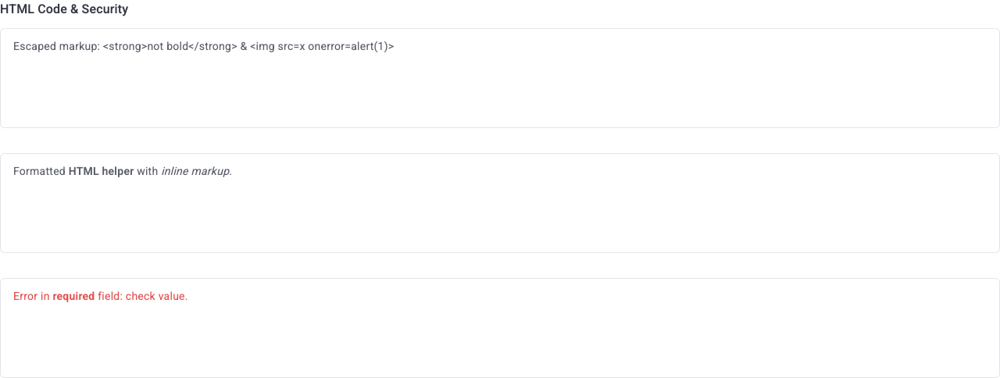

# Отчёт о визуальном и функциональном тестировании: D1FieldMessage

## 1. Краткое резюме

- **Компонент:** `D1FieldMessage` (`@dxtmisha/d1`)
- **Исходный код:** [`FieldMessage`](../../../packages/d1/src/components/Ui/FieldMessage)
- **Демо / Целевой URL:** `http://localhost:3000/component-field-message`
- **Справочные материалы:** `Отсутствуют`
- **Дата тестирования (UTC):** `2026-11-16T04:49:17Z`
- **Окружение:** `Headless Chrome (Puppeteer / CDP, Desktop 1440×900, Tablet 768×1024, Mobile 375×812 / 320×568)`
- **Покрытие тест-кейсов:** 11 / 11 (`100%`)
- **Итог:** **10 ✅, 1 ⚠️, 0 ❌** (`✅` пройдено, `⚠️` предупреждение окружения/демо-стенда, `❌` провалено) — компонент `D1FieldMessage` корректно отображает подсказки, ошибки валидации, состояния `disabled`/`forceShow`/`isSkeleton`, безопасный `hasHtmlCode`, слоты, счётчики `D1FieldCounter`, RTL-разметку и ARIA-связи; обнаруженные в первом прогоне переполнение неразрывного текста и физическое выравнивание счётчика в RTL исправлены в `FieldMessage/style.scss` и повторно подтверждены в браузере.

---

## 2. Базовая матрица

### 2.1 Визуальный рендеринг (`VIS`)

| ID | Сценарий | Статус | Фактический результат | Скриншот |
| :--- | :--- | :---: | :--- | :--- |
| `TC-VIS-001` | Базовый рендеринг `helperMessage`, `validationMessage` и приоритета `--validation` | ✅ | Подсказка и ошибка отображаются корректно; при одновременной передаче активен класс `d1-fieldMessage--validation`, `info` имеет `display: none`, `error` — `display: block`, цвет ошибки `rgba(220, 38, 38, 0.8)`. |  |
| `TC-VIS-002` | Состояние `is-skeleton` и интеграция с `D1FieldCounter` | ✅ | Оба элемента с `is-skeleton` получили `d1-skeleton__textVariant`; внутри `D1Skeleton :active="true"` отображается скелетон-плашка; текст (`left: 97`) и счётчик (`right: 1343`, `textAlign: end`) не перекрываются. |  |
| `TC-VIS-003` | Адаптация к тёмной теме (`Dark`, `.d1-dark`) | ✅ | Палитра корректно переключилась на тёмную тему: `infoColor = rgba(248, 250, 252, 0.64)`, `errorColor = rgba(254, 202, 202, 0.8)` с сохранением читаемости. |  |

### 2.2 Интерактивность и управление состоянием (`INT`)

| ID | Сценарий | Статус | Фактический результат | Скриншот |
| :--- | :--- | :---: | :--- | :--- |
| `TC-INT-001` | Реактивное переключение всех пропсов и слотов в `Interactive Controls` | ✅ | Последовательно проверены переходы `Validation`, `Disabled` (`exists: false`), `Force Show` (`exists: true`), `Skeleton` (`d1-skeleton__textVariant`), `Counter +10` (`12 / 50` -> `22 / 50`) и `Slots` (`Slot Validation: ...`). |  |
| `TC-INT-002` | Проверка `disabled`, `forceShow` и режима `hasHtmlCode` | ✅ | При `disabled` без `forceShow` узел `.d1-fieldMessage` отсутствует в DOM; при `forceShow` отображаются 2 карточки; при `hasHtmlCode=false` теги экранированы (`strong: 0, img: 0`), при `hasHtmlCode=true` теги `strong`/`em`/`b` рендерятся. |  |
| `TC-INT-003` | Проекция именованных и scoped-слотов `#helper` и `#validation` | ✅ | Рендерятся все 3 слотовые карточки; scoped-слоты получают `{ helperMessage, validationMessage }` и объединяются с текстом пропса без `innerHTML`-перезаписи. |  |

### 2.3 Граничные случаи и крайние сценарии (`BND`)

| ID | Сценарий | Статус | Фактический результат | Скриншот |
| :--- | :--- | :---: | :--- | :--- |
| `TC-BND-001` | Пустые/пробельные строки, `counter: 0` и длинный/неразрывный текст | ✅ | Пробельные/пустые строки не создают `.d1-fieldMessage` в DOM; при `counter: 0` выводится `0 / 50`; после исправления `style.scss` оба ограниченных контейнера `280px` (включая `AAAA...`) имеют `msgWidth: 246`, `msgScrollWidth: 246` без переполнения. |  |
| `TC-BND-002` | Многоязычность (кириллица, вьетнамский, Emoji), XSS-защита и RTL | ✅ | Unicode/Emoji отображаются корректно (`Học tiếng Việt — Подсказка поля 🚀`, `Lỗi xác thực — Ошибка ввода 🔒`); XSS экранирован; в `dir="rtl"` (`direction: rtl`) счётчик `40 / 12` выровнен по левому краю (`end`). |  |

### 2.4 Адаптивность (`RSP`)

| ID | Сценарий | Статус | Фактический результат | Скриншот |
| :--- | :--- | :---: | :--- | :--- |
| `TC-RSP-001` | Проверка вьюпортов `1440×900`, `768×1024`, `375×812`, `320×568` | ✅ | На всех 4 разрешениях среди 23 экземпляров `.d1-fieldMessage` зафиксировано `overflowingComponents: 0`, а `docScrollWidth` строго равен `innerWidth` (`1440`, `768`, `375`, `320`) без горизонтальной прокрутки страницы. |  |

### 2.5 Доступность (`A11Y`)

| ID | Сценарий | Статус | Фактический результат | Скриншот |
| :--- | :--- | :---: | :--- | :--- |
| `TC-A11Y-001` | Проверка `role="alert"`, уникальных ID и `aria-describedby` | ✅ | Все 11 узлов `.d1-fieldMessage__error` имеют `role="alert"`; `#demo-field-message-input` связан через `aria-describedby="demo-field-message-helper demo-field-message-validation"` с реальными ID в DOM; `#demo-field-message-counter-id` найден. | — |

### 2.6 Логи и консоль (`LOG`)

| ID | Сценарий | Статус | Фактический результат | Скриншот |
| :--- | :--- | :---: | :--- | :--- |
| `TC-LOG-001` | Проверка консоли, исключений страницы и предупреждений Vue | ⚠️ | `vueWarnings: []`, `pageErrors: []`; зафиксирован 1 сетевой ответ `404 http://localhost:3000/favicon.ico` от оболочки демо-приложения, ошибок самого компонента `D1FieldMessage` нет. | — |

---

## 3. AI-аудит и рекомендации

1. **Стили конструктора (`FieldMessage/style.scss`) — исправлено и проверено:**
   - В `&__info` и `&__error` добавлены `min-width: 0` и `overflow-wrap: anywhere` — неразрывные строки в `280px`-контейнере корректно переносятся (`msgScrollWidth: 246`, без переполнения).
   - В `&__fieldCounter` физическое `text-align: right` и `flex-grow: 1` заменены на `flex-shrink: 0; margin-inline-start: auto; text-align: end; white-space: nowrap;` — счётчик корректно выравнивается в `dir="rtl"` и не переносится.
2. **Адаптивность демо-стенда (`DemoFlex.vue`, `DemoValue.vue`) — исправлено и проверено:**
   - В `DemoFlex.vue` добавлены `max-width: 100%; min-width: 0` и `flex-wrap: nowrap` для `--direction--column` / `--direction--column-reverse`, а в `DemoValue.vue` — `min-width: 0; overflow-wrap: anywhere`. После исправления горизонтальный скролл страницы полностью отсутствует на всех разрешениях (`docScrollWidth === innerWidth` для `1440`, `768`, `375`, `320`).
3. **Чистота рантайма:** Предупреждения Vue и JS-исключения полностью отсутствуют; единственный 404-запрос относится к отсутствующему `/favicon.ico` в корне `packages/demo`.
