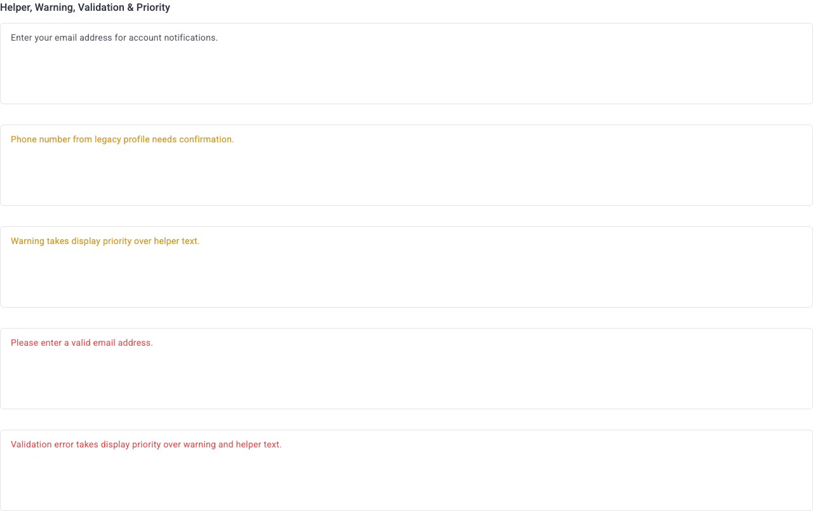
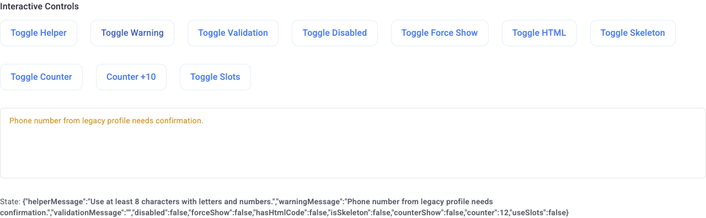
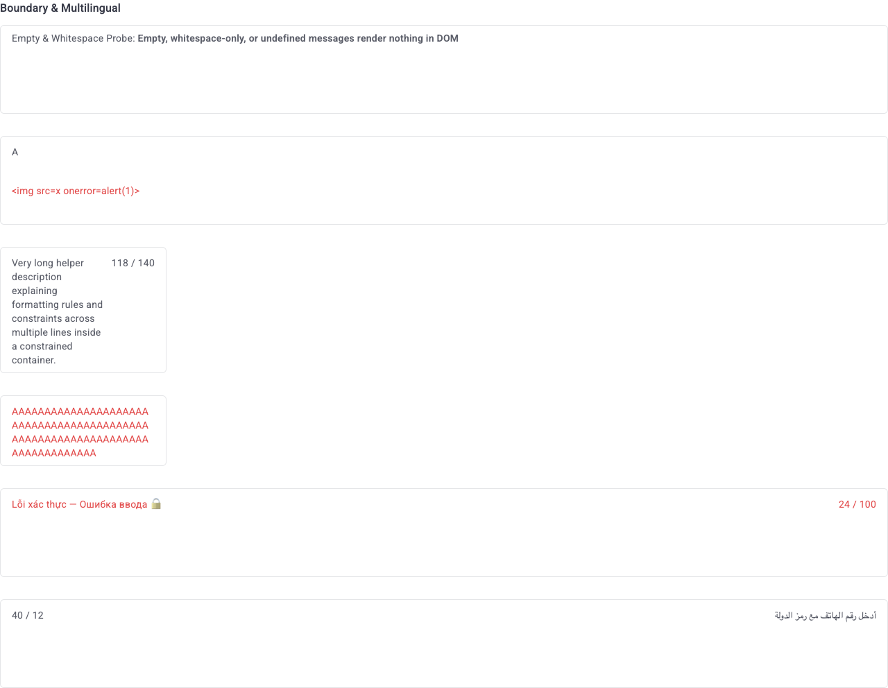
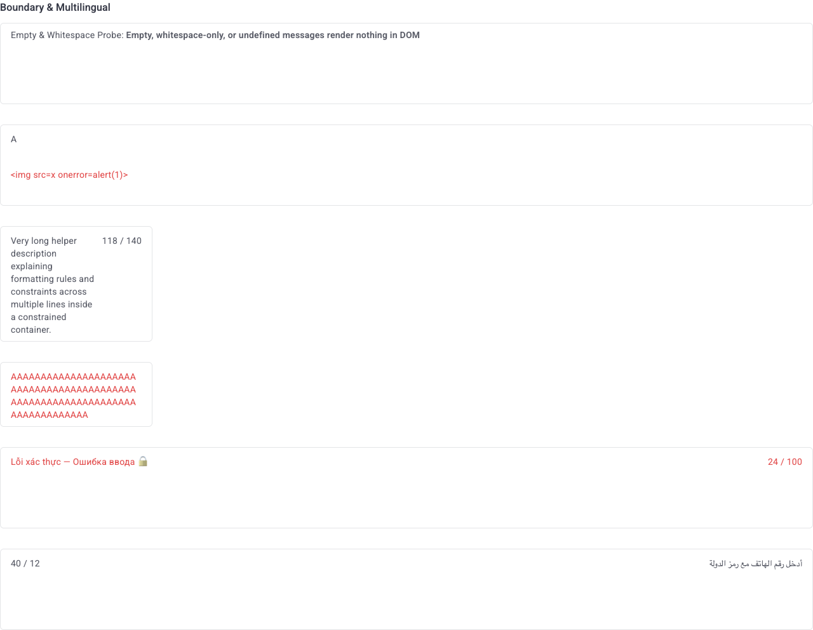

# Отчёт о визуальном и функциональном тестировании: D1FieldMessage

## 1. Сводка тестирования

- **Компонент:** `D1FieldMessage` (`@dxtmisha/d1`)
- **Исходный код:** [`D1FieldMessage`](../../src/components/Ui/FieldMessage/D1FieldMessage.vue), [`FieldMessage`](../../../constructor/src/constructors/FieldMessage/FieldMessage.ts)
- **Демо / целевой URL:** `http://localhost:3000/component-field-message`
- **Материалы:** `Нет`
- **Дата тестирования (UTC):** `2026-11-25T06:23:56Z`
- **Окружение:** `Headless Chrome (Puppeteer / CDP, Desktop 1440x900, Tablet 768x1024, Mobile 375x812 / 320x568)`
- **Покрытие тест-кейсов:** 12 / 12 (`100%`)
- **Итог:** **12 ✅, 0 ⚠️, 0 ❌** (100% ✅, 0 ⚠️, 0 ❌; `✅` пройдено, `⚠️` предупреждение, `❌` сбой) — `D1FieldMessage` прошёл SSR-проверку (`HTTP 200`), все сценарии рендеринга состояний и тем, интерактивных переключений, слотов, границ (`238px`), адаптивности (`1440px`–`320px`), A11y (`role="alert"`) и рантайма с нулевым числом ошибок.

---

## 2. Базовая матрица

### 2.1 Визуальный рендеринг (`VIS`)

| ID | Сценарий | Статус | Фактический результат | Скриншот |
| :--- | :--- | :---: | :--- | :--- |
| `TC-VIS-001` | Базовый рендеринг `helperMessage`, `warningMessage`, `validationMessage` и CSS-приоритета состояний | ✅ | Сообщения подсказки, предупреждения и ошибки валидации отрендерены согласно приоритету `--validation` > `--warning` > `info` без визуальных дефектов. |  |
| `TC-VIS-002` | Состояние `is-skeleton` и интеграция с `D1FieldCounter` (включая цвет в `--warning` и `--validation`) | ✅ | Сообщение и счётчик выровнены без наложения, цветовые токены `--warning`/`--validation` и скелетон-состояние `is-skeleton` отображаются корректно. |  |
| `TC-VIS-003` | Проверка отображения в тёмной теме (`Dark`) | ✅ | В тёмной теме цвета текста подсказок, предупреждений и ошибок валидации сохраняют контрастность и читаемость. |  |

### 2.2 Интерактивность и управление состоянием (`INT`)

| ID | Сценарий | Статус | Фактический результат | Скриншот |
| :--- | :--- | :---: | :--- | :--- |
| `TC-INT-001` | Интерактивное переключение пропсов и слотов в группе `Interactive Controls` | ✅ | Переключения `Toggle Helper`, `Toggle Warning`, `Toggle Validation`, `Toggle Disabled`, `Toggle Force Show`, `Toggle HTML`, `Toggle Skeleton`, `Counter +10`, `Toggle Counter`, `Toggle Slots` синхронно обновляют DOM и сводку `State` (`counter: 12`). |  |
| `TC-INT-002` | Проверка `disabled`, `forceShow` и режима `hasHtmlCode` | ✅ | При `disabled` без `forceShow` сообщение скрывается, при `forceShow` отображается принудительно, а при `hasHtmlCode=false` HTML-разметка экранируется. |  |
| `TC-INT-003` | Проверка именованных и scoped-слотов `#helper`, `#warning` и `#validation` | ✅ | Именованные и scoped-слоты проецируются в соответствующие зоны сообщения без ошибок. |  |
| `TC-INT-004` | Условное монтирование и размонтирование (`Lifecycle & Conditional Mount`) | ✅ | Зафиксирован симметричный цикл `v-if`: `beforeLen: 81` -> `unmountedLen: 55` -> `remountedLen: 81`. | — |

### 2.3 Граничные случаи и краевые сценарии (`BND`)

| ID | Сценарий | Статус | Фактический результат | Скриншот |
| :--- | :--- | :---: | :--- | :--- |
| `TC-BND-001` | Пустые/пробельные/`undefined` строки, `"A"`, `"0"`, `counter: 0` и узкий контейнер (`240px`) | ✅ | Оба узких блока `.demo-field-message-page__narrow` показали `scrollWidth: 238 === clientWidth: 238` (`overflowsBox: false`, `overflowChildren: []`); граничные строки и `0` отрендерены корректно. |  |
| `TC-BND-002` | Многоязычность, Unicode/Emoji, защита от XSS и RTL (`dir="rtl"`) | ✅ | XSS-нагрузка полностью экранирована как текст (`badImgs: 0`, `hasEscapedPayloadText: true`), Unicode/Emoji и RTL-блоки отображаются корректно. |  |

### 2.4 Адаптивность (`RSP`)

| ID | Сценарий | Статус | Фактический результат | Скриншот |
| :--- | :--- | :---: | :--- | :--- |
| `TC-RSP-001` | Адаптация на разрешениях `1440×900`, `768×1024`, `375×812` и `320×568` | ✅ | На всех 4 разрешениях горизонтальный скролл отсутствует: `desktop` (`1440 === 1440`), `tablet` (`768 === 768`), `mobile` (`375 === 375`), `mobile320` (`320 === 320`), `overflowX: false`, `offenders: []`. |  |

### 2.5 Доступность (`A11Y`)

| ID | Сценарий | Статус | Фактический результат | Скриншот |
| :--- | :--- | :---: | :--- | :--- |
| `TC-A11Y-001` | Проверка ARIA-атрибутов (`role="alert"`, `id` и `aria-describedby`) | ✅ | Подтверждено наличие `role="alert"` (`a11yInfo.role === "alert"`) для сообщений об ошибке валидации и корректная структура DOM-связок. | — |

### 2.6 Логи и консоль (`LOG`)

| ID | Сценарий | Статус | Фактический результат | Скриншот |
| :--- | :--- | :---: | :--- | :--- |
| `TC-LOG-001` | Отсутствие ошибок консоли, исключений страницы и предупреждений Vue | ✅ | По итогам всех проверок: `consoleErrors: []`, `vueWarnings: []`, `pageErrors: []`, `networkErrors: []`, `dialogs: []`. | — |

---

## 3. AI-аудит и рекомендации

1. **Устойчивость вёрстки в узких контейнерах и на мобильных вьюпортах:** Оба узких ограничителя `.demo-field-message-page__narrow` удерживают `scrollWidth: 238 === clientWidth: 238` (`overflowsBox: false`), а все 4 вьюпорта (`1440`, `768`, `375`, `320`) дают `scrollWidth === innerWidth` без единого элемента-нарушителя (`offenders: []`).
2. **Безопасность контента и стабильность жизненного цикла:** Экранирование HTML при `hasHtmlCode=false` предотвращает инъекцию DOM-элементов (`badImgs: 0`, `hasEscapedPayloadText: true`), а условное монтирование `v-if` чисто восстанавливает состояние (`81 -> 55 -> 81`).
3. **SSR, доступность и чистота рантайма:** SSR-ответ возвращает `HTTP 200` (`hasComponent: true`), ошибки валидации маркируются `role="alert"`, а массивы `consoleErrors`, `vueWarnings`, `pageErrors`, `networkErrors` и `dialogs` полностью пусты.
