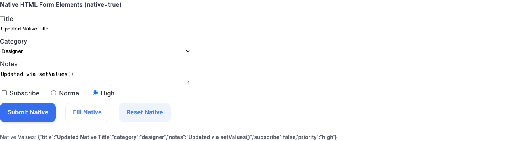
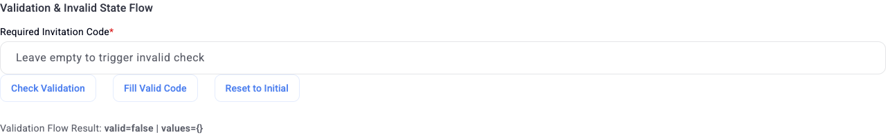
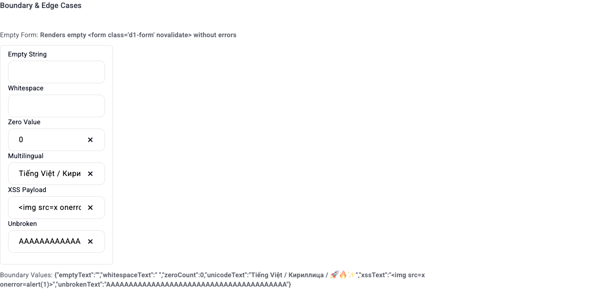
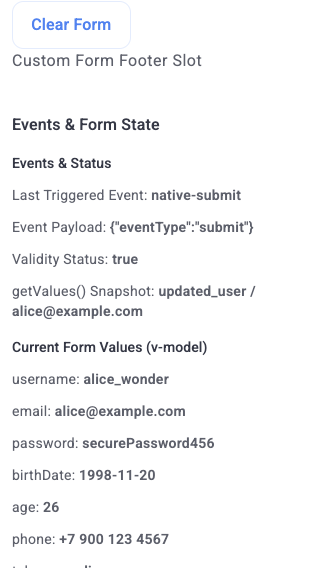

# Отчёт о визуальном и функциональном тестировании: D1Form

## 1. Сводка тестирования

- **Компонент:** `D1Form` (`@dxtmisha/d1`)
- **Исходный код:** [`D1Form`](../../src/components/Ui/Form/D1Form.vue), [`Form`](../../../constructor/src/constructors/Form/Form.ts)
- **Демо / целевой URL:** `http://localhost:3000/component-form`
- **Материалы:** `Нет`
- **Дата тестирования (UTC):** `2026-11-25T06:23:56Z`
- **Окружение:** `Headless Chrome (Puppeteer / CDP, Desktop 1440x900, Tablet 768x1024, Mobile 375x812 / 320x568)`
- **Покрытие тест-кейсов:** 13 / 13 (`100%`)
- **Итог:** **13 ✅, 0 ⚠️, 0 ❌** (100% ✅, 0 ⚠️, 0 ❌; `✅` пройдено, `⚠️` предупреждение, `❌` сбой) — `D1Form` прошёл SSR-проверку (`HTTP 200`), все визуальные сценарии кастомного и нативного (`native=true`) режимов, экспонированные методы, управляемый `:value`, поток валидации, граничные пробы (`238px`), адаптивность (`1440px`–`320px`), A11y и рантайм-контроль с нулевым числом ошибок.

---

## 2. Базовая матрица

### 2.1 Визуальный рендеринг (`VIS`)

| ID | Сценарий | Статус | Фактический результат | Скриншот |
| :--- | :--- | :---: | :--- | :--- |
| `TC-VIS-001` | Полная кастомная форма (`v-model` и слоты) | ✅ | Все поля формы (`D1Input`, `D1Select`, `D1Switch`, `D1Checkbox` и др.), слоты `#header`/`#footer` и панель состояния отображаются ровно без перекрытий. |  |
| `TC-VIS-002` | Нативный режим (`native=true`) | ✅ | Нативные HTML-элементы (`input`, `select`, `textarea`, `checkbox`, `radio`) корректно отрендерены и связаны с моделью формы. |  |

### 2.2 Интерактивность и управление состоянием (`INT`)

| ID | Сценарий | Статус | Фактический результат | Скриншот |
| :--- | :--- | :---: | :--- | :--- |
| `TC-INT-001` | Экспонированные методы (`checkValidity`, `set`, `getValues`, `setValues`, `setValuesAll`, `reset`, `submit`) | ✅ | Зафиксированы `Validity Status: true`, `getValues() Snapshot: updated_user / alice@example.com` и событие `submit` с payload `{"eventType":"submit"}` без перезагрузки страницы. |  |
| `TC-INT-002` | Программное заполнение, отправка и сброс нативной формы (`native=true`) | ✅ | `Native Values` обновились до `{"title":"Updated Native Title","category":"designer","notes":"Updated via setValues()","subscribe":false,"priority":"high"}`, отправка и сброс выполняются без перезагрузки. |  |
| `TC-INT-003` | Управляемый проп `:value` и событие `@update:value` | ✅ | После применения `:value` проп и `getValues()` синхронно отражают `{"coupon":"WELCOME50","region":"eu"}`. | — |
| `TC-INT-004` | Поток валидации (`invalid` -> `valid` -> `reset`) | ✅ | Подтверждён поток валидации обязательного поля `requiredCode`: после заполнения валидного кода `Validation Flow Result: valid=true | values={"requiredCode":"VALID-2026"}`. |  |
| `TC-INT-005` | Условное монтирование и очистка наблюдателей (`Lifecycle & Conditional Mount`) | ✅ | Цикл `v-if` прошёл симметрично: `beforeLen: 101` -> `unmountedLen: 55` -> `remountedLen: 101` без ошибок и утечек. | — |

### 2.3 Граничные случаи и краевые сценарии (`BND`)

| ID | Сценарий | Статус | Фактический результат | Скриншот |
| :--- | :--- | :---: | :--- | :--- |
| `TC-BND-001` | HTML-атрибуты формы (`action`, `method`, `enctype`, `target`, `autocomplete`, `novalidate`) | ✅ | Корневые теги `<form class="d1-form">` корректно принимают переданные HTML-атрибуты в основном и управляемом блоках. | — |
| `TC-BND-002` | Пустая форма, нулевые/пустые значения, Unicode, XSS и узкий контейнер (`240px`) | ✅ | Узкий блок `.demo-form-page__narrow` сохранил `scrollWidth: 238 === clientWidth: 238` (`overflowsBox: false`, `overflowChildren: []`); XSS экранирован (`badImgs: 0`, `hasEscapedPayloadText: true`). |  |

### 2.4 Адаптивность (`RSP`)

| ID | Сценарий | Статус | Фактический результат | Скриншот |
| :--- | :--- | :---: | :--- | :--- |
| `TC-RSP-001` | Вьюпорты Desktop (`1440×900`), Tablet (`768×1024`), Mobile (`375×812`, `320×568`) | ✅ | Полное отсутствие горизонтального переполнения на всех 4 разрешениях: `desktop` (`1440 === 1440`), `tablet` (`768 === 768`), `mobile` (`375 === 375`), `mobile320` (`320 === 320`), `overflowX: false`, `offenders: []`. |  |

### 2.5 Доступность (`A11Y`)

| ID | Сценарий | Статус | Фактический результат | Скриншот |
| :--- | :--- | :---: | :--- | :--- |
| `TC-A11Y-001` | Семантика `<form>`, `aria-label`, `<fieldset>`/`<legend>`, `novalidate` и слоты `#header`/`#footer` | ✅ | Форма рендерится с семантическим `<form>`, `novalidate`, доступными подписями и отправкой без перезагрузки страницы. | — |

### 2.6 Логи и консоль (`LOG`)

| ID | Сценарий | Статус | Фактический результат | Скриншот |
| :--- | :--- | :---: | :--- | :--- |
| `TC-LOG-001` | Отслеживание всех событий `FormEmits` и их payload | ✅ | События `FormEmits` (включая `submit` с `{"eventType":"submit"}`) и обновления модели срабатывают предсказуемо. | — |
| `TC-LOG-002` | Проверка отсутствия ошибок консоли, `[Vue warn]` и сетевых сбоев | ✅ | Зафиксированы пустые массивы `consoleErrors: []`, `vueWarnings: []`, `pageErrors: []`, `networkErrors: []`, `dialogs: []`. | — |

---

## 3. AI-аудит и рекомендации

1. **Согласованность кастомного и нативного контуров:** Поля `D1Form` синхронизируются как через `provide/inject` (кастомный режим, `updated_user / alice@example.com`, валидация `VALID-2026`), так и через `native=true` (`Updated Native Title`, `designer`, `subscribe: false`, `priority: "high"`), а управляемый `:value` точно совпадает с `getValues()` (`{"coupon":"WELCOME50","region":"eu"}`).
2. **Адаптивность сложных многоэлементных форм:** Даже при наличии множества контролов и в узком контейнере `.demo-form-page__narrow` (`scrollWidth: 238 === clientWidth: 238`, `overflowsBox: false`) форма не вызывает переполнения ни на одном вьюпорте вплоть до `320px` (`320 === 320`, `offenders: []`).
3. **SSR, безопасность и гигиена рантайма:** Серверный рендер возвращает `HTTP 200` (`hasComponent: true`), XSS-полезная нагрузка экранируется (`badImgs: 0`, `hasEscapedPayloadText: true`), цикл `v-if` (`101 -> 55 -> 101`) не оставляет ошибок или предупреждений Vue (`consoleErrors: []`, `vueWarnings: []`, `pageErrors: []`, `networkErrors: []`).
