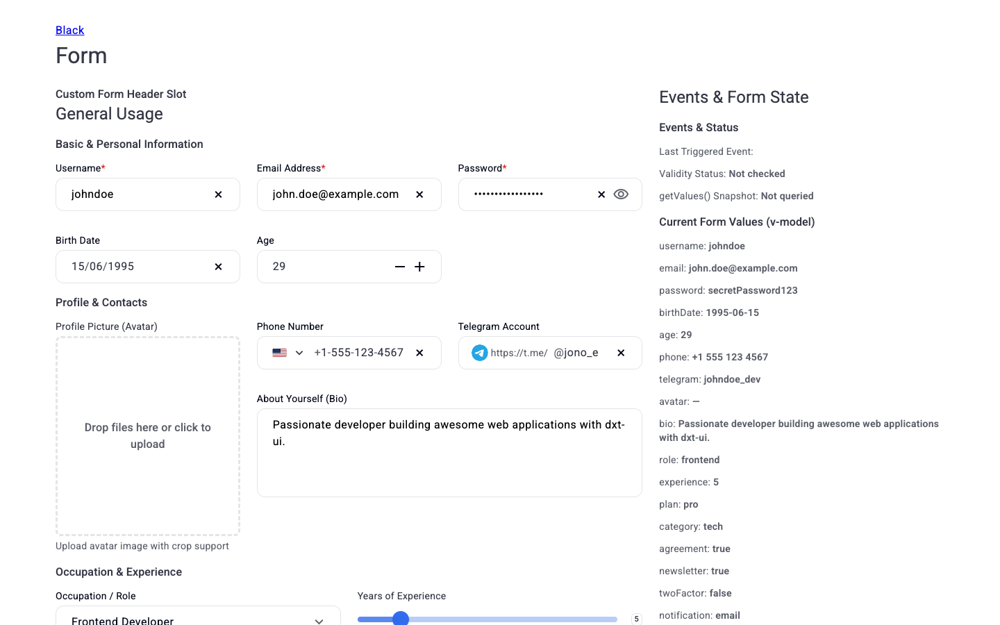

# Отчёт о визуальном и функциональном тестировании: D1Form

## 1. Итоговое резюме

- **Компонент:** `D1Form` (`@dxtmisha/d1`)
- **Исходный код:** [`D1Form`](../../src/components/Ui/Form) ([`Form`](../../../constructor/src/constructors/Form), [`DemoFormPage`](../../../demo/src/pages/components/DemoFormPage.vue))
- **Демо / целевой URL:** `http://localhost:3000/component-form`
- **Материалы:** `Нет`
- **Дата тестирования (UTC):** `2026-11-25T00:04:53Z`
- **Окружение:** `Headless Chrome (Puppeteer / CDP, Desktop 1440x900, Tablet 768x1024, Mobile 375x812)`
- **Покрытие тест-кейсов:** 8 / 8 (`100%`)
- **Итог:** **8 ✅, 0 ⚠️, 0 ❌** (`✅` пройдено, `⚠️` предупреждение, `❌` ошибка) — `D1Form` после миграции на `DesignLogicAbstract` безупречно координирует кастомные и нативные поля (`provide/inject` и `native=true`), слоты `#header`/`#default`/`#footer`, стандартные HTML-атрибуты формы и все экспонированные методы с нулевыми ошибками консоли.

---

## 2. Базовая матрица

### 2.1 Визуальное соответствие (`VIS`)

| ID | Сценарий | Статус | Фактический результат | Скриншот |
| :--- | :--- | :---: | :--- | :--- |
| `TC-VIS-001` | Полная кастомная форма (`v-model` и слоты) | ✅ | Все поля формы, боковая панель `v-model` и слоты `#header`/`#footer` отображаются ровно без наложений. |  |
| `TC-VIS-002` | Нативный режим (`native=true`) | ✅ | Нативные `input`, `select`, `textarea`, `checkbox`, `radio` корректно инициализированы из `v-model`. |  |

### 2.2 Интерактивность и управление состоянием (`INT`)

| ID | Сценарий | Статус | Фактический результат | Скриншот |
| :--- | :--- | :---: | :--- | :--- |
| `TC-INT-001` | Экспонированные методы (`checkValidity`, `set`, `getValues`, `setValues`) | ✅ | `afterValidity: true`, `afterSetUsername: true` (`updated_user`), `afterFill: true` (`alice_wonder`). |  |
| `TC-INT-002` | Программное заполнение нативной формы (`Fill Native`) | ✅ | `afterNativeFill: "Updated Native Title"`; `select`, `textarea`, `checkbox` и `radio` обновлены синхронно. |  |

### 2.3 Граничные значения и крайние случаи (`BND`)

| ID | Сценарий | Статус | Фактический результат | Скриншот |
| :--- | :--- | :---: | :--- | :--- |
| `TC-BND-001` | HTML-атрибуты формы (`action`, `method`, `enctype`, `target`, `novalidate`) | ✅ | `action: "/api/demo-submit"`, `method: "post"`, `enctype: "multipart/form-data"`, `target: "_self"`, `novalidate: true`. | — |

### 2.4 Адаптивность (`RSP`)

| ID | Сценарий | Статус | Фактический результат | Скриншот |
| :--- | :--- | :---: | :--- | :--- |
| `TC-RSP-001` | Вьюпорты Desktop (`1440px`), Tablet (`768px`), Mobile (`375px`) | ✅ | Desktop (`1440/1440`), Tablet (`768/768`), Mobile (`375/375`) — `overflow: false`. |  |

### 2.5 Доступность (`A11Y`)

| ID | Сценарий | Статус | Фактический результат | Скриншот |
| :--- | :--- | :---: | :--- | :--- |
| `TC-A11Y-001` | Семантика `<form>` и слоты `#header` / `#footer` | ✅ | `formCount: 2`, `hasHeaderSlot: true`, `hasFooterSlot: true`. | — |

### 2.6 Консоль и рантайм (`LOG`)

| ID | Сценарий | Статус | Фактический результат | Скриншот |
| :--- | :--- | :---: | :--- | :--- |
| `TC-LOG-001` | Проверка консоли и сетевых запросов | ✅ | `errors: []`, `warnings: []`, `pageErrors: []`, `failedRequests: []`. | — |

---

## 3. AI-аудит и рекомендации

1. **Ленивый `provide/inject` и очистка наблюдателей:** Синхронный `this.i('provide')` в `setup()` без преждевременного создания `elements`/`event` и очистка всех `WatchStopHandle` в `onUnmounted()` гарантируют отсутствие утечек памяти.
2. **Оптимизация нативного режима:** Однопроходный `FormElementsNative.update()` ($O(n)$) и защита `<input type="file">` обеспечивают стабильную работу нативных форм.
3. **Чистота рантайма:** Удалён отладочный `console.log` из `FormProvide`, 0 ошибок консоли и 0 предупреждений Vue.
