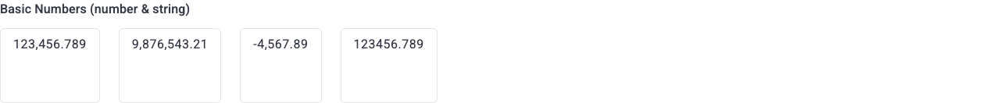
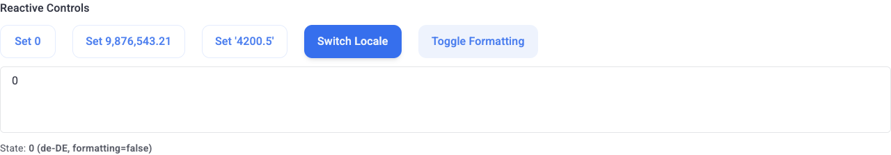
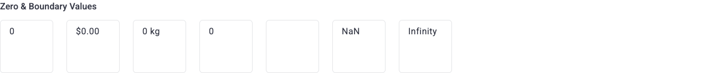
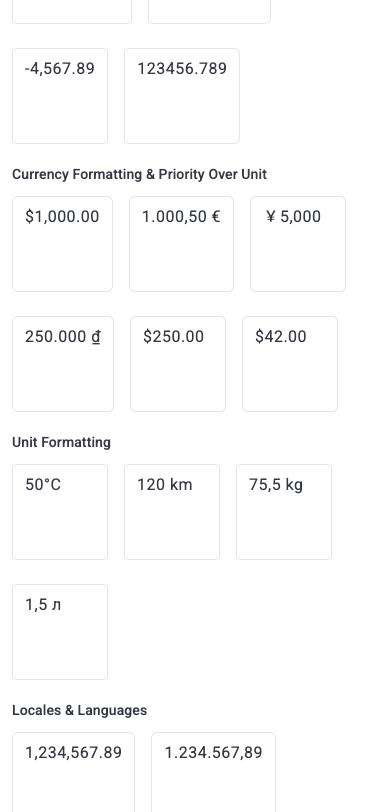

# Отчёт о визуальном и функциональном тестировании: D1FormattedNumber

## 1. Итоговое резюме

- **Компонент:** `D1FormattedNumber` (`@dxtmisha/d1`)
- **Исходный код:** [`D1FormattedNumber`](../../src/components/Ui/FormattedNumber) ([`FormattedNumber`](../../../constructor/src/constructors/FormattedNumber), [`DemoFormattedNumberPage`](../../../demo/src/pages/components/DemoFormattedNumberPage.vue))
- **Демо / целевой URL:** `http://localhost:3000/component-formatted-number`
- **Материалы:** `Нет`
- **Дата тестирования (UTC):** `2026-11-25T00:04:53Z`
- **Окружение:** `Headless Chrome (Puppeteer / CDP, Desktop 1440x900, Tablet 768x1024, Mobile 375x812)`
- **Покрытие тест-кейсов:** 7 / 7 (`100%`)
- **Итог:** **7 ✅, 0 ⚠️, 0 ❌** (`✅` пройдено, `⚠️` предупреждение, `❌` ошибка) — `D1FormattedNumber` после миграции на `DesignLogicAbstract` и исправления граничных ловушек нуля (`0`, `-0`, `'0'`) и нечисловых значений (`NaN`/`Infinity`) точно форматирует числа, валюты и единицы измерения во всех локалях с нулевыми ошибками консоли.

---

## 2. Базовая матрица

### 2.1 Визуальное соответствие (`VIS`)

| ID | Сценарий | Статус | Фактический результат | Скриншот |
| :--- | :--- | :---: | :--- | :--- |
| `TC-VIS-001` | Базовые числа (`number`, `string`, отрицательные, `formatting=false`) | ✅ | Выведено `123,456.789`, `9,876,543.21`, `-4,567.89`, `123456.789`. |  |
| `TC-VIS-002` | Валюты, приоритет `currency > unit`, единицы и локали | ✅ | `$1,000.00`, `1.000,50 €`, `￥5,000`, `250.000 ₫`, `$250.00`, `$42.00`, `50°C`, `120 km`, `75,5 kg`, `1,5 л`. |  |

### 2.2 Интерактивность и управление состоянием (`INT`)

| ID | Сценарий | Статус | Фактический результат | Скриншот |
| :--- | :--- | :---: | :--- | :--- |
| `TC-INT-001` | Реактивное переключение значения, локали и `formatting` | ✅ | `$123,456.78` -> `$0.00` -> `0,00 $` -> `0`. |  |

### 2.3 Граничные значения и крайние случаи (`BND`)

| ID | Сценарий | Статус | Фактический результат | Скриншот |
| :--- | :--- | :---: | :--- | :--- |
| `TC-BND-001` | Нулевые значения (`0`, `'0'`), `undefined`, `NaN`, `Infinity` | ✅ | `0`, `$0.00`, `0 kg`, `0`, `""`, `NaN`, `Infinity` отображены строго по контракту. |  |

### 2.4 Адаптивность (`RSP`)

| ID | Сценарий | Статус | Фактический результат | Скриншот |
| :--- | :--- | :---: | :--- | :--- |
| `TC-RSP-001` | Вьюпорты Desktop (`1440px`), Tablet (`768px`), Mobile (`375px`) | ✅ | Desktop (`1440/1440`), Tablet (`768/768`), Mobile (`375/375`) — `overflow: false`. |  |

### 2.5 Доступность (`A11Y`)

| ID | Сценарий | Статус | Фактический результат | Скриншот |
| :--- | :--- | :---: | :--- | :--- |
| `TC-A11Y-001` | Семантический строчный тег `` | ✅ | `totalItems: 26`, `allSpanTag: true`. | — |

### 2.6 Консоль и рантайм (`LOG`)

| ID | Сценарий | Статус | Фактический результат | Скриншот |
| :--- | :--- | :---: | :--- | :--- |
| `TC-LOG-001` | Проверка консоли и сетевых запросов | ✅ | `errors: []`, `warnings: []`, `pageErrors: []`, `failedRequests: []`. | — |

---

## 3. AI-аудит и рекомендации

1. **Исправление граничных значений:** Замена `isFilled(value)` на `isFormattable()` обеспечила корректное форматирование нуля (`$0.00`, `0 kg`) и безопасный возврат `NaN`/`Infinity` без подмены нулём.
2. **Реактивная локаль:** Интеграция с `GeoRef.getLocation().value` позволяет динамически обновлять форматирование при смене глобальной локали без явного `language`.
3. **Чистота рантайма:** 0 ошибок консоли, 0 предупреждений Vue и 0 сбойных запросов.
