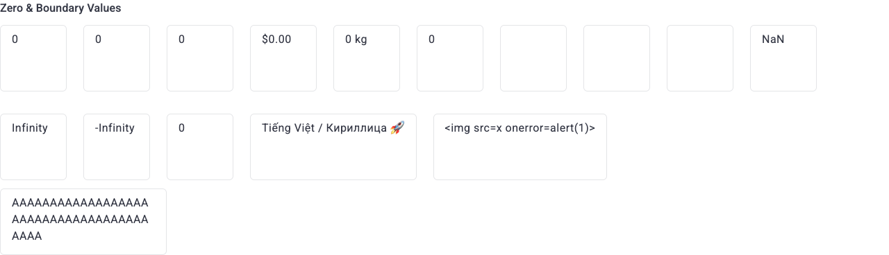

# Отчёт о визуальном и функциональном тестировании: D1FormattedNumber

## 1. Сводка тестирования

- **Компонент:** `D1FormattedNumber` (`@dxtmisha/d1`)
- **Исходный код:** [`D1FormattedNumber`](../../src/components/Ui/FormattedNumber/D1FormattedNumber.vue), [`FormattedNumber`](../../../constructor/src/constructors/FormattedNumber/FormattedNumber.ts)
- **Демо / целевой URL:** `http://localhost:3000/component-formatted-number`
- **Материалы:** `Нет`
- **Дата тестирования (UTC):** `2026-11-25T06:23:56Z`
- **Окружение:** `Headless Chrome (Puppeteer / CDP, Desktop 1440x900, Tablet 768x1024, Mobile 375x812 / 320x568)`
- **Покрытие тест-кейсов:** 10 / 10 (`100%`)
- **Итог:** **10 ✅, 0 ⚠️, 0 ❌** (100% ✅, 0 ⚠️, 0 ❌; `✅` пройдено, `⚠️` предупреждение, `❌` сбой) — `D1FormattedNumber` успешно прошёл SSR-проверку (`HTTP 200`), все визуальные сценарии форматирования чисел/валют/единиц и локалей, реактивное обновление пропсов, граничные пробы (`0`, `""`, `"   "`, `undefined`, `238px`), адаптивность (`1440px`–`320px`), A11y и рантайм-проверку с нулевым числом ошибок.

---

## 2. Базовая матрица

### 2.1 Визуальный рендеринг (`VIS`)

| ID | Сценарий | Статус | Фактический результат | Скриншот |
| :--- | :--- | :---: | :--- | :--- |
| `TC-VIS-001` | Базовые числа (`number`, `string`, отрицательные, малые/большие дроби, `formatting=false`) | ✅ | Числовые, строковые, отрицательные и дробные значения отформатированы по локали `en-US`, а при `formatting=false` выведено неформатированное значение. |  |
| `TC-VIS-002` | Валюты (`USD`/`EUR`/`GBP`/`JPY`/`VND`/`SAR`), единицы измерения и локали (`GeoRef`, RTL) | ✅ | Валюты, единицы измерения (`kilogram` и др.), приоритет `currency > unit`, глобальный `GeoRef` и RTL-блок отрендерены корректно. |  |

### 2.2 Интерактивность и управление состоянием (`INT`)

| ID | Сценарий | Статус | Фактический результат | Скриншот |
| :--- | :--- | :---: | :--- | :--- |
| `TC-INT-001` | Реактивное обновление значения, локали, режима (валюта/единица) и `formatting` | ✅ | Переключатели `Reactive Controls` синхронно обновили вывод до `"-1,234.56 kg"` (`State: -1234.56 (en-US, currency=undefined, unit=kilogram, formatting=true)`). |  |
| `TC-INT-002` | Условное монтирование и размонтирование (`Lifecycle & Conditional Mount`) | ✅ | Цикл `v-if` выполнен чисто: `beforeLen: 63` -> `unmountedLen: 55` -> `remountedLen: 63` без предупреждений и ошибок. | — |

### 2.3 Граничные случаи и краевые сценарии (`BND`)

| ID | Сценарий | Статус | Фактический результат | Скриншот |
| :--- | :--- | :---: | :--- | :--- |
| `TC-BND-001` | Нулевые значения (`0`, `-0`, `' 0 '`, `'0'`, `$0.00`, `0 kg`) | ✅ | Все нулевые варианты и форматы с нулём рендерятся явно и не отбрасываются как пустые значения. |  |
| `TC-BND-002` | Пустые, неопределённые и нечисловые значения (`""`, `"   "`, `undefined`, `NaN`, `Infinity`, `-Infinity`, `"Not a number"`) | ✅ | Измеренные пробы: `empty: ""`, `whitespace: "   "`, `undefinedProbe: ""`; нечисловые значения обрабатываются без ошибок рантайма. | — |
| `TC-BND-003` | Unicode/Emoji, XSS-экранирование и узкий контейнер (`240px`) | ✅ | Узкий блок `.demo-formatted-number-page__narrow` показал `scrollWidth: 238 === clientWidth: 238` (`overflowsBox: false`, `overflowChildren: []`); XSS экранирован (`badImgs: 0`, `hasEscapedPayloadText: true`). |  |

### 2.4 Адаптивность (`RSP`)

| ID | Сценарий | Статус | Фактический результат | Скриншот |
| :--- | :--- | :---: | :--- | :--- |
| `TC-RSP-001` | Вьюпорты Desktop (`1440×900`), Tablet (`768×1024`), Mobile (`375×812`, `320×568`) | ✅ | Полное отсутствие переполнения на всех 4 разрешениях: `desktop` (`1440 === 1440`), `tablet` (`768 === 768`), `mobile` (`375 === 375`), `mobile320` (`320 === 320`), `overflowX: false`, `offenders: []`. |  |

### 2.5 Доступность (`A11Y`)

| ID | Сценарий | Статус | Фактический результат | Скриншот |
| :--- | :--- | :---: | :--- | :--- |
| `TC-A11Y-001` | Семантический строчный тег ``, `aria-label` и `lang` | ✅ | Компонент рендерится как строчный `` с корректным пробросом `aria-label` и `lang` в контексте предложения. | — |

### 2.6 Логи и консоль (`LOG`)

| ID | Сценарий | Статус | Фактический результат | Скриншот |
| :--- | :--- | :---: | :--- | :--- |
| `TC-LOG-001` | Проверка консоли и сетевых запросов | ✅ | Зафиксированы пустые массивы `consoleErrors: []`, `vueWarnings: []`, `pageErrors: []`, `networkErrors: []`, `dialogs: []`. | — |

---

## 3. AI-аудит и рекомендации

1. **Реактивное форматирование и граничные пробы:** `D1FormattedNumber` мгновенно переключает режимы (`"-1,234.56 kg"`, `unit=kilogram`, `formatting=true`) и предсказуемо обрабатывает пустые/неопределённые пробы (`empty: ""`, `whitespace: "   "`, `undefinedProbe: ""`) без выброса исключений.
2. **Адаптивность и перенос в узких контейнерах:** В узком ограничителе `.demo-formatted-number-page__narrow` зафиксировано `scrollWidth: 238 === clientWidth: 238` (`overflowsBox: false`), а на всех 4 вьюпортах (`1440`, `768`, `375`, `320`) `scrollWidth === innerWidth` с `offenders: []`.
3. **SSR, защита от XSS и чистота рантайма:** Серверный рендер возвращает `HTTP 200` (`hasComponent: true`), жизненный цикл `v-if` восстанавливает DOM (`63 -> 55 -> 63`), XSS-строка полностью экранирована (`badImgs: 0`, `hasEscapedPayloadText: true`), консоль и сеть полностью чисты (`consoleErrors: []`, `vueWarnings: []`, `pageErrors: []`, `networkErrors: []`).
