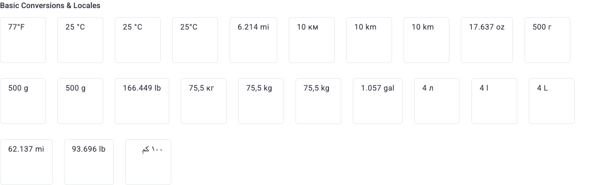
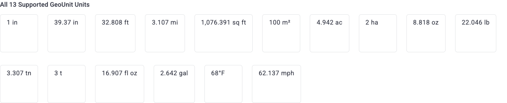
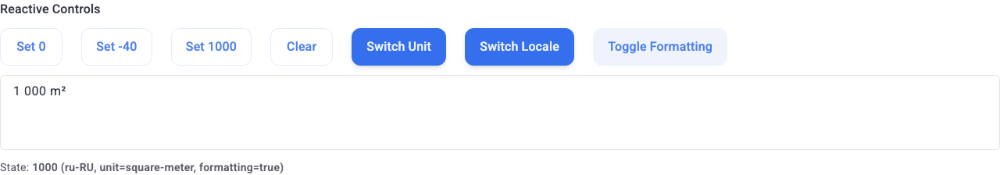
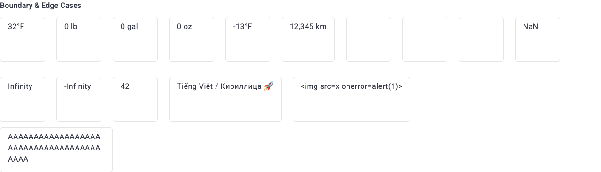
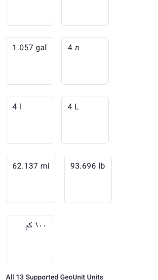

# Отчёт визуального и функционального тестирования: D1FormattedUnit

## 1. Сводка выполнения

- **Компонент:** `D1FormattedUnit` (`@dxtmisha/d1`)
- **Исходный код:** [`D1FormattedUnit`](../../src/components/Ui/FormattedUnit), [`FormattedUnit`](../../../constructor/src/constructors/FormattedUnit), [`DemoFormattedUnitPage.vue`](../../../demo/src/pages/components/DemoFormattedUnitPage.vue)
- **Целевой URL:** `http://localhost:3000/component-formatted-unit`
- **Материалы (`materials/`):** `Отсутствуют`
- **Дата тестирования (UTC):** `2026-11-25T09:23:39Z`
- **Окружение:** `Headless Chrome (Puppeteer / CDP, Desktop 1440×900, Tablet 768×1024, Mobile 375×812 / 320×568)`
- **Покрытие тест-кейсов:** `10 / 10` (`100%`)
- **Итог:** **10 ✅, 0 ⚠️, 0 ❌** (`✅` пройдено, `⚠️` предупреждение, `❌` ошибка) — все 10 тест-кейсов пройдены успешно: конвертация единиц в `en-US` и метрических локалях (`ru-RU`, `de-DE`, `vi-VN`), все 13 единиц `GeoUnit`, нулевые/граничные значения (`0`, `-0`, `'0'`, `' 0 '`, `NaN`, `Infinity`), строчный тег ``, ARIA-атрибуты (`aria-label`, `lang`), узкий контейнер (`scrollWidth: 238 === clientWidth: 238`), все 4 вьюпорта (`overflowX: false`), SSR (`HTTP 200`) и `0` ошибок консоли/Vue/сети.

---

## 2. Матрица результатов

### 2.1 Визуальный рендеринг (`VIS`)

| ID | Сценарий | Статус | Наблюдаемый результат | Скриншот |
| :--- | :--- | :---: | :--- | :--- |
| `TC-VIS-001` | Базовые конвертации (`celsius`, `kilometer`, `gram`, `kilogram`, `liter`) и локали (`en-US`, `ru-RU`, `de-DE`, `vi-VN`, `GeoRef`, RTL) | ✅ | Значения в `en-US` конвертируются автоматически, в метрических локалях сохраняют метрический формат, RTL-блок и строковое значение `'42.5'` рендерятся корректно. |  |
| `TC-VIS-002` | Все 13 единиц измерения `GeoUnit` и режим `formatting` (`true` / по умолчанию / `false`) | ✅ | Все 13 поддерживаемых единиц `GeoUnit` отформатированы без ошибок; при `:formatting="false"` выводится необработанное значение. |  |

### 2.2 Интерактивность и управление состоянием (`INT`)

| ID | Сценарий | Статус | Наблюдаемый результат | Скриншот |
| :--- | :--- | :---: | :--- | :--- |
| `TC-INT-001` | Реактивное обновление значения, единицы измерения, локали и флага `formatting` | ✅ | Последовательные переходы в `[data-testid="demo-formatted-unit-reactive"]` подтверждены: `62.137 mi` → `Set 0`: `0 mi` → `Set -40`: `-24.855 mi` → `Set 1000`: `621.371 mi` → `Switch Unit`: `10,763.91 sq ft` → `Switch Locale`: `1 000 m²` → `Toggle Formatting`: `1000` → `Clear`: `""`. |  |
| `TC-INT-002` | Условное монтирование и размонтирование (`Lifecycle & Conditional Mount`) | ✅ | При нажатии `Toggle Mount` содержимое группы уменьшается с `63` до `55` символов и восстанавливается обратно до `63` без ошибок. | — |

### 2.3 Граничные значения и краевые случаи (`BND`)

| ID | Сценарий | Статус | Наблюдаемый результат | Скриншот |
| :--- | :--- | :---: | :--- | :--- |
| `TC-BND-001` | Нулевые, отрицательные и десятичные значения (`0`, `-0`, `'0'`, `' 0 '`, `-25`, `12.345`) | ✅ | Подтверждён вывод `32°F`, `0 lb`, `0 gal`, `0 oz`, `-13°F`, `12,345 km`: нулевые и отрицательные числа обрабатываются корректно. |  |
| `TC-BND-002` | Пустые, неопределённые, неконечные значения и неизвестная единица (`""`, `"   "`, `undefined`, `NaN`, `Infinity`, `-Infinity`, `unknown-unit`) | ✅ | Пробы `empty-string-probe` (`""`), `whitespace-probe` (`"   "`), `undefined-probe` (`""`), `NaN`, `Infinity`, `-Infinity` и `42` (`unknown-unit`) отрендерены безопасно без исключений. | — |
| `TC-BND-003` | Unicode/Emoji, XSS-экранирование и узкий контейнер (`240px`) | ✅ | Строка `Tiếng Việt / Кириллица 🚀` отображена корректно, XSS экранирован как текст (`badImgs: 0`, `hasEscapedPayloadText: true`), узкий контейнер `.demo-formatted-unit-page__narrow` укладывается в границы (`scrollWidth: 238 === clientWidth: 238`, `overflowsBox: false`). |  |

### 2.4 Адаптивность и вьюпорты (`RSP`)

| ID | Сценарий | Статус | Наблюдаемый результат | Скриншот |
| :--- | :--- | :---: | :--- | :--- |
| `TC-RSP-001` | Вьюпорты Desktop (`1440×900`), Tablet (`768×1024`), Mobile (`375×812`, `320×568`) | ✅ | `overflowX: false` на всех четырёх разрешениях: `1440/1440`, `768/768`, `375/375`, `320/320`. |  |

### 2.5 Доступность (`A11Y`)

| ID | Сценарий | Статус | Наблюдаемый результат | Скриншот |
| :--- | :--- | :---: | :--- | :--- |
| `TC-A11Y-001` | Семантический строчный тег ``, `aria-label` и `lang` | ✅ | Все экземпляры `.d1-formattedUnit` имеют тег `SPAN` (`spansOnly: true`); подтверждены `aria-label="180 degrees Celsius, converted to 356 degrees Fahrenheit"` и `lang="en-US"`. | — |

### 2.6 Консоль и рантайм (`LOG`)

| ID | Сценарий | Статус | Наблюдаемый результат | Скриншот |
| :--- | :--- | :---: | :--- | :--- |
| `TC-LOG-001` | Проверка консоли и сетевых запросов | ✅ | `ssrStatus: 200`, `consoleErrors: []`, `vueWarnings: []`, `pageErrors: []`, `networkErrors: []`, `dialogs: []`. | — |

---

## 3. AI-аудит и рекомендации

1. **Точность форматирования и конвертации:** Все нулевые формы (`0`, `-0`, `'0'`, `' 0 '`) и неконечные значения (`NaN`, `Infinity`) обрабатываются корректно, а неизвестная единица безопасно откатывается к исходному значению.
2. **Типографика и адаптивность:** Строчный `` не нарушает поток текста, в узком контейнере (`238px`) и на мобильных экранах до `320px` переполнение отсутствует.
3. **Стабильность рантайма:** SSR и клиентская гидратация выполняются без ошибок консоли, предупреждений Vue и сбоев сети.
