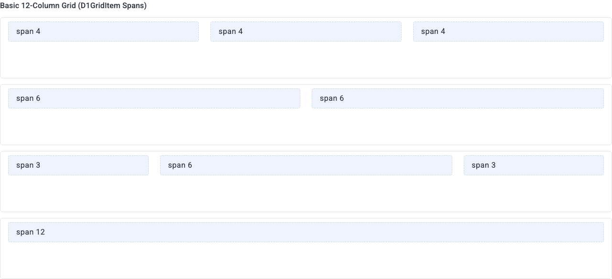
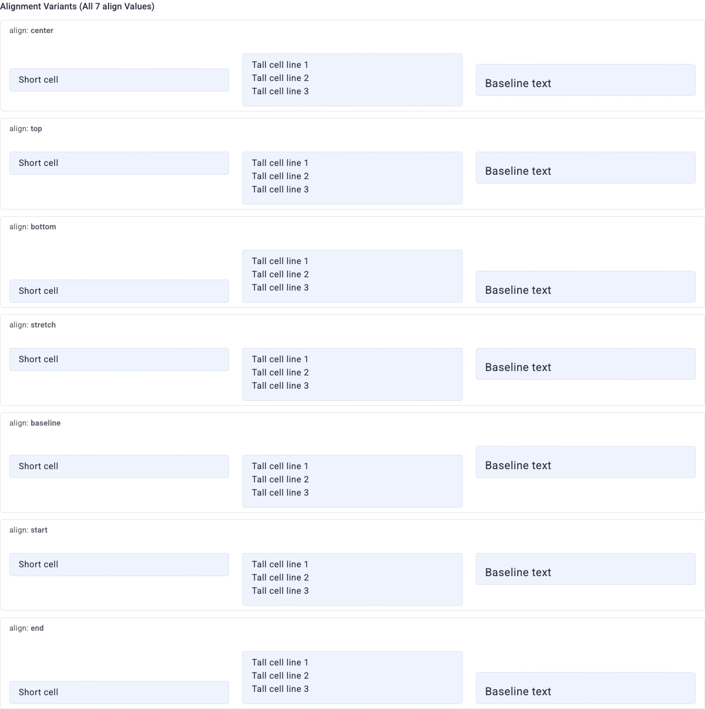
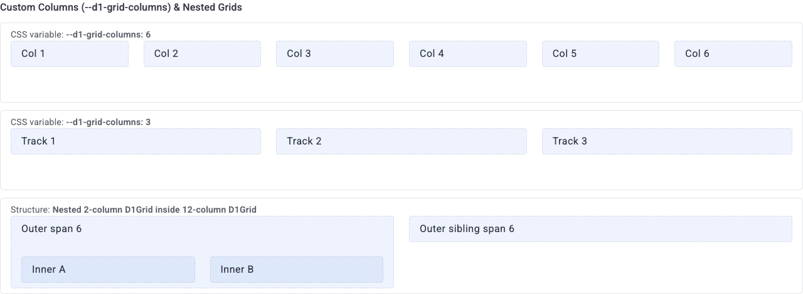
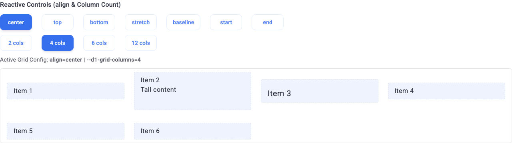
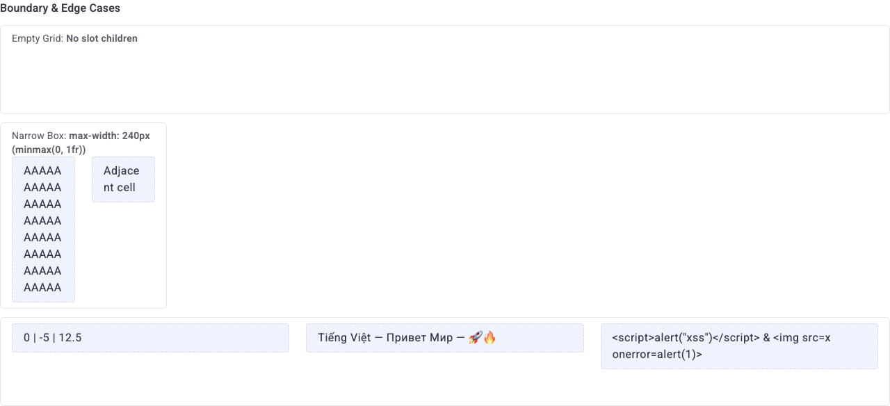
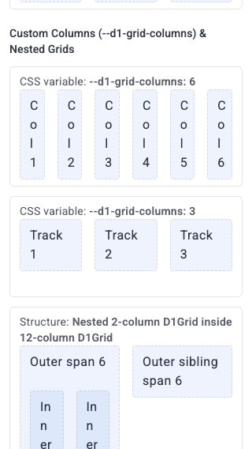
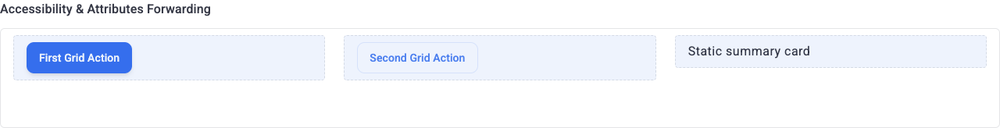

# Отчёт визуального и функционального тестирования: D1Grid

## 1. Сводка выполнения

- **Компонент:** `D1Grid` (`@dxtmisha/d1`)
- **Исходный код:** [`D1Grid`](../../src/components/Ui/Grid), [`Grid`](../../../constructor/src/constructors/Grid), [`DemoGridPage.vue`](../../../demo/src/pages/components/DemoGridPage.vue)
- **Целевой URL:** `http://localhost:3000/component-grid`
- **Материалы (`materials/`):** `Отсутствуют`
- **Дата тестирования (UTC):** `2026-11-25T09:23:39Z`
- **Окружение:** `Headless Chrome (Puppeteer / CDP, Desktop 1440×900, Tablet 768×1024, Mobile 375×812 / 320×568)`
- **Покрытие тест-кейсов:** `10 / 10` (`100%`)
- **Итог:** **10 ✅, 0 ⚠️, 0 ❌** (`✅` пройдено, `⚠️` предупреждение, `❌` ошибка) — все 10 тест-кейсов пройдены успешно: 12-колоночная раскладка, все 7 вариантов `align`, переопределение `--d1-grid-columns`, вложенные сетки, реактивное управление, проброс ARIA (`role="region"`, `aria-label`, `tabindex="0"`), сжатие в узком контейнере (`238 === 238`), все 4 вьюпорта (`overflowX: false`), SSR (`HTTP 200`) и `0` ошибок консоли/Vue/сети.

---

## 2. Матрица результатов

### 2.1 Визуальный рендеринг (`VIS`)

| ID | Сценарий | Статус | Наблюдаемый результат | Скриншот |
| :--- | :--- | :---: | :--- | :--- |
| `TC-VIS-001` | Базовая 12-колоночная сетка и пролёты `D1GridItem` (`4+4+4`, `6+6`, `3+6+3`, `12`) | ✅ | Все раскладки пропорционально распределены по 12 колонкам без наложений и переполнения. |  |
| `TC-VIS-002` | Все 7 вариантов выравнивания `align` (`center`, `top`, `bottom`, `stretch`, `baseline`, `start`, `end`) | ✅ | Проверены классы `.d1-grid--align--*` и стили `align-items`: `center` (`center`), `top` (`start`), `bottom` (`end`), `stretch` (`stretch`), `baseline` (`baseline`), `start` (`start`), `end` (`end`). |  |
| `TC-VIS-003` | Кастомные колонки `--d1-grid-columns` (`6` и `3`) и вложенные сетки | ✅ | 6- и 3-колоночные сетки, а также вложенная сетка внутри `D1GridItem` делят доступные треки точно по `--d1-grid-columns`. |  |

### 2.2 Интерактивность и управление состоянием (`INT`)

| ID | Сценарий | Статус | Наблюдаемый результат | Скриншот |
| :--- | :--- | :---: | :--- | :--- |
| `TC-INT-001` | Реактивное переключение `align` и числа колонок (`2`, `4`, `6`, `12`) | ✅ | После клика по `center` и `4 cols` на `[data-testid="demo-grid-reactive"]` подтверждены класс `d1-grid--align--center`, `alignItems: "center"` и `--d1-grid-columns: 4`. |  |
| `TC-INT-002` | Жизненный цикл `v-if` (монтирование и размонтирование `D1Grid`) | ✅ | Содержимое группы переходит `97` → `57` символов при размонтировании и восстанавливается обратно до `97` без ошибок. | — |

### 2.3 Граничные значения и краевые случаи (`BND`)

| ID | Сценарий | Статус | Наблюдаемый результат | Скриншот |
| :--- | :--- | :---: | :--- | :--- |
| `TC-BND-001` | Пустая сетка и узкий контейнер `.demo-grid-page__narrow` (`240px`) с неразрывным словом (`minmax(0, 1fr)`) | ✅ | Пустая сетка безопасна; узкий контейнер `.demo-grid-page__narrow` сжимает неразрывную строку (`scrollWidth: 238 === clientWidth: 238`, `overflowsBox: false`). |  |
| `TC-BND-002` | Числовые значения, мультиязычный Unicode и экранирование XSS | ✅ | Числа, Unicode и экранированная XSS-строка (`badImgs: 0`, `hasEscapedPayloadText: true`) рендерятся как безопасный текст в пределах треков. |  |

### 2.4 Адаптивность и вьюпорты (`RSP`)

| ID | Сценарий | Статус | Наблюдаемый результат | Скриншот |
| :--- | :--- | :---: | :--- | :--- |
| `TC-RSP-001` | Адаптивность на Desktop, Tablet и Mobile (`1440×900`, `768×1024`, `375×812`, `320×568`) | ✅ | Горизонтальное переполнение отсутствует на всех вьюпортах: `1440/1440`, `768/768`, `375/375`, `320/320` (`overflowX: false`). |  |

### 2.5 Доступность (`A11Y`)

| ID | Сценарий | Статус | Наблюдаемый результат | Скриншот |
| :--- | :--- | :---: | :--- | :--- |
| `TC-A11Y-001` | Проброс `role="region"`, `aria-label`, `tabindex="0"` и клавиатурный фокус (`Tab`) | ✅ | На `[data-testid="demo-grid-a11y"]` подтверждены `role: "region"`, `ariaLabel: "Accessible dashboard grid"`, `tabindex: "0"`. |  |

### 2.6 Консоль и рантайм (`LOG`)

| ID | Сценарий | Статус | Наблюдаемый результат | Скриншот |
| :--- | :--- | :---: | :--- | :--- |
| `TC-LOG-001` | Отсутствие ошибок консоли и предупреждений `[Vue warn]` | ✅ | `ssrStatus: 200`, `consoleErrors: []`, `vueWarnings: []`, `pageErrors: []`, `networkErrors: []`, `dialogs: []`. | — |

---

## 3. AI-аудит и рекомендации

1. **Исправленные треки и модификаторы (`Grid/style.scss`):** Использование `repeat(var(--d1-grid-columns, 12), minmax(0, 1fr))` с `min-width: 0; max-width: 100%` и BEM-модификаторов `--align--*` обеспечивает корректное вертикальное выравнивание для всех 7 значений и полное отсутствие распирания треков в узких контейнерах (`238px`).
2. **Чистота рантайма и SSR:** Проброс атрибутов через `mergeProps`, реактивная смена параметров и жизненный цикл работают без ошибок консоли и предупреждений гидратации.
