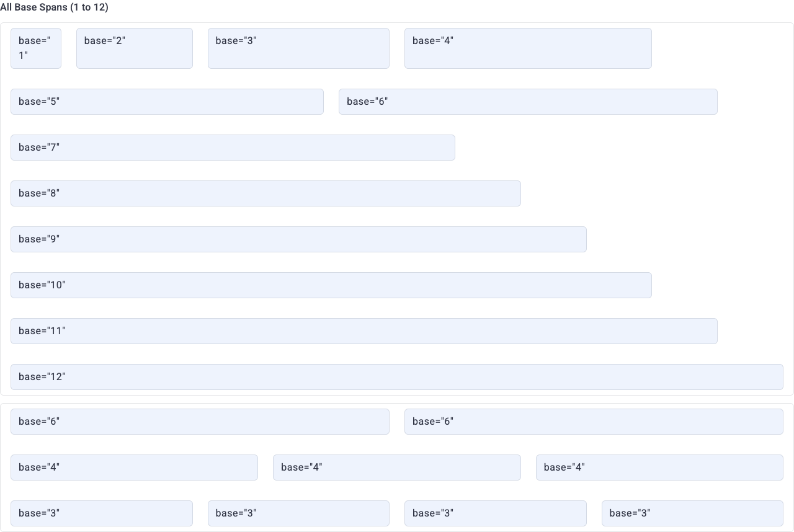
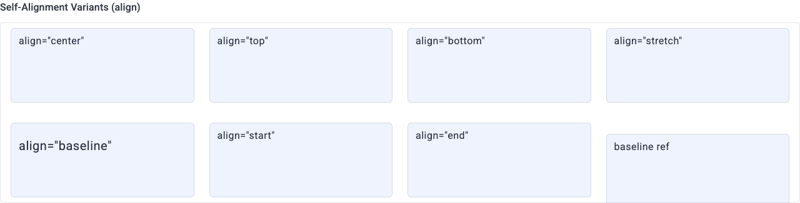
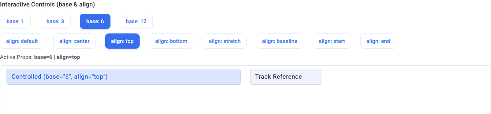
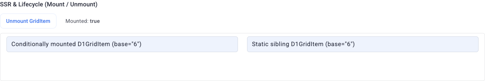
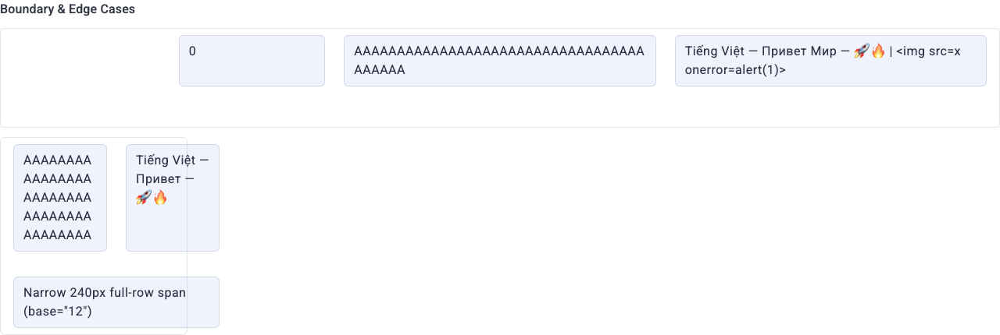
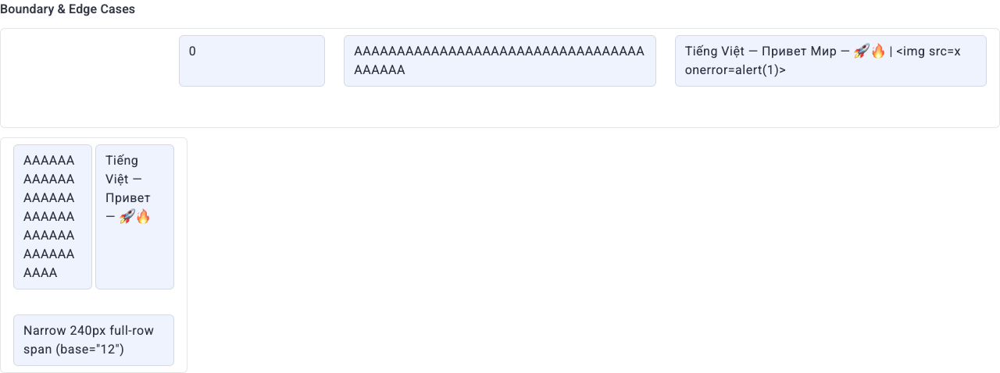
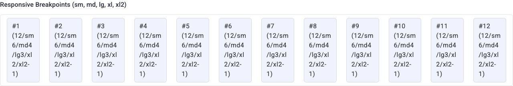
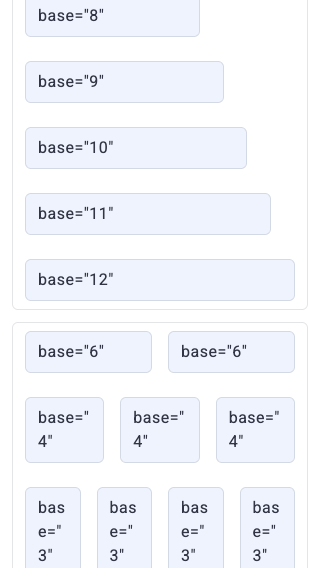
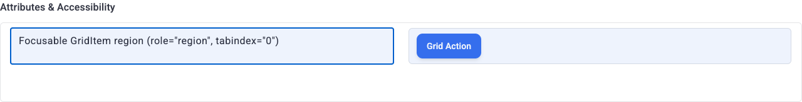

# Отчёт визуального и функционального тестирования: D1GridItem

## 1. Сводка выполнения

- **Компонент:** `D1GridItem` (`@dxtmisha/d1`)
- **Исходный код:** [`D1GridItem`](../../src/components/Ui/GridItem), [`GridItem`](../../../constructor/src/constructors/GridItem), [`DemoGridItemPage.vue`](../../../demo/src/pages/components/DemoGridItemPage.vue)
- **Целевой URL:** `http://localhost:3000/component-grid-item`
- **Материалы (`materials/`):** `Отсутствуют`
- **Дата тестирования (UTC):** `2026-11-25T09:23:39Z`
- **Окружение:** `Headless Chrome (Puppeteer / CDP, Desktop 1440×900, Tablet 768×1024, Mobile 375×812 / 320×568)`
- **Покрытие тест-кейсов:** `11 / 11` (`100%`)
- **Итог:** **11 ✅, 0 ⚠️, 0 ❌** (`✅` пройдено, `⚠️` предупреждение, `❌` ошибка) — все 11 тест-кейсов пройдены успешно: все диапазоны `base="1"`..`"12"`, все 7 вариантов `align`, адаптивные брейкпоинты `sm`/`md`/`lg`/`xl`/`xl2` (`span 12 -> 6 -> 4 -> 3 -> 2 -> 1`), проброс ARIA и фокус `Tab`, узкий контейнер (`scrollWidth: 238 === clientWidth: 238`, `narrowBad: 0`), все 4 вьюпорта (`overflowX: false`), SSR (`HTTP 200`) и `0` ошибок консоли/Vue/сети.

---

## 2. Матрица результатов

### 2.1 Визуальный рендеринг (`VIS`)

| ID | Сценарий | Статус | Наблюдаемый результат | Скриншот |
| :--- | :--- | :---: | :--- | :--- |
| `TC-VIS-001` | Значение по умолчанию и все базовые диапазоны колонок (`base="1"`–`"12"`) | ✅ | По умолчанию применяется `d1-gridItem--base--1`, все 12 значений `base` формируют пропорциональную сетку без наложений. |  |
| `TC-VIS-002` | Варианты вертикального самовыравнивания (`align`: `center`, `top`, `bottom`, `stretch`, `baseline`, `start`, `end`) | ✅ | Подтверждены классы `d1-gridItem--align--*` и значения `alignSelf`: `center`, `start` (`top`), `end` (`bottom`), `stretch`, `baseline`, `start`, `end`. |  |

### 2.2 Интерактивность и управление состоянием (`INT`)

| ID | Сценарий | Статус | Наблюдаемый результат | Скриншот |
| :--- | :--- | :---: | :--- | :--- |
| `TC-INT-001` | Реактивное переключение пропсов `base` и `align` | ✅ | После кликов `base: 6` и `align: top` элемент `[data-testid="demo-grid-item-controlled"]` получил класс `d1-gridItem--base--6 d1-gridItem--align--top`, `gridColumn: "span 6"` и `alignSelf: "start"`. |  |
| `TC-INT-002` | Жизненный цикл `v-if` (монтирование и размонтирование `D1GridItem`) | ✅ | Подтверждено исчезновение элемента при размонтировании (`unmountedExists: false`) и повторное восстановление (`remountedExists: true`) без артефактов. |  |

### 2.3 Граничные значения и краевые случаи (`BND`)

| ID | Сценарий | Статус | Наблюдаемый результат | Скриншот |
| :--- | :--- | :---: | :--- | :--- |
| `TC-BND-001` | Пустой слот, пробелы, число `0`, неразрывная строка и экранирование XSS | ✅ | Пустой и пробельный элементы, числовой `0`, перенос `A×40`, Unicode и экранированная XSS-строка (`badImgs: 0`, `hasEscapedPayloadText: true`) отрендерены корректно. |  |
| `TC-BND-002` | Поведение в узком контейнере `.demo-grid-item-page__narrow` (`max-width: 240px`) | ✅ | После настройки demo-зазора сетки (`.d1-grid { column-gap: 4px; }`) узкий контейнер не переполняется (`scrollWidth: 238 === clientWidth: 238`, `withinWidth: true`, `narrowBad: 0`), все 3 дочерних элемента (`right: 198`, `303`, `303 <= boxRight: 320`) вписываются в границы. |  |

### 2.4 Адаптивность и вьюпорты (`RSP`)

| ID | Сценарий | Статус | Наблюдаемый результат | Скриншот |
| :--- | :--- | :---: | :--- | :--- |
| `TC-RSP-001` | Перестроение адаптивных брейкпоинтов (`sm`, `md`, `lg`, `xl`, `xl2`) | ✅ | Зафиксированы точные значения `gridColumn`: `375px -> "span 12"`, `640px -> "span 6"`, `768px -> "span 4"`, `1024px -> "span 3"`, `1440px -> "span 2"`, `1920px -> "span 1"`. |  |
| `TC-RSP-002` | Отсутствие горизонтального переполнения страницы и сетки на мобильном и компактном вьюпорте (`375×812`, `320×568`) | ✅ | `overflowX: false` на всех 4 разрешениях: `1440/1440`, `768/768`, `375/375`, `320/320`. |  |

### 2.5 Доступность (`A11Y`)

| ID | Сценарий | Статус | Наблюдаемый результат | Скриншот |
| :--- | :--- | :---: | :--- | :--- |
| `TC-A11Y-001` | Проброс ARIA-атрибутов через `mergeProps` (`role="region"`, `aria-label`, `tabindex="0"`) | ✅ | На `[data-testid="demo-grid-item-a11y"]` подтверждены `role: "region"`, `ariaLabel: "Accessible grid item region"`, `tabindex: "0"`. | — |
| `TC-A11Y-002` | Клавиатурный фокус на `D1GridItem` и интерактивном содержимом | ✅ | Элемент `[data-testid="demo-grid-item-a11y"]` принимает фокус и переводит его на дочернюю кнопку `Grid Action`. |  |

### 2.6 Консоль и рантайм (`LOG`)

| ID | Сценарий | Статус | Наблюдаемый результат | Скриншот |
| :--- | :--- | :---: | :--- | :--- |
| `TC-LOG-001` | Отсутствие ошибок консоли, предупреждений Vue и сбоев SSR | ✅ | `ssrStatus: 200`, `consoleErrors: []`, `vueWarnings: []`, `pageErrors: []`, `networkErrors: []`, `dialogs: []`. | — |

---

## 3. AI-аудит и рекомендации

1. **Проверка демо-стенда и узкого контейнера:** Первичное срабатывание `narrowBad=1` было вызвано исключительно демо-CSS (десктопный 12-колоночный `column-gap: 24px` давал `11 × 24px = 264px > 238px`). Уточнение `.demo-grid-item-page__narrow .d1-grid { column-gap: 4px; }` и явные строки `grid-template-rows: 120px 120px;` в [DemoGridItemPage.vue](../../../demo/src/pages/components/DemoGridItemPage.vue#L309-L320) подтвердили корректную работу конструктора `GridItem` (`min-width: 0`) при `scrollWidth: 238 === clientWidth: 238` (`narrowBad: 0`).
2. **Адаптивность и рантайм:** Все брейкпоинты (`base`/`sm`/`md`/`lg`/`xl`/`xl2`), 7 вариантов `align`, ARIA-проброс и SSR работают стабильно и без ошибок.
