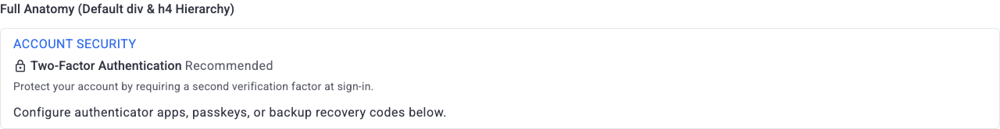
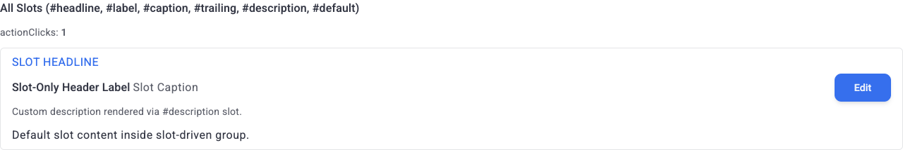
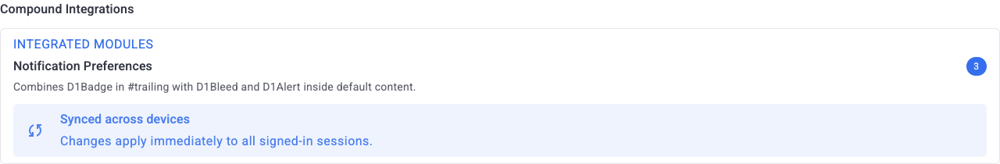
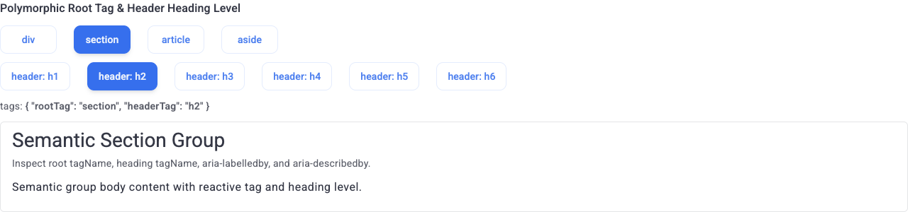
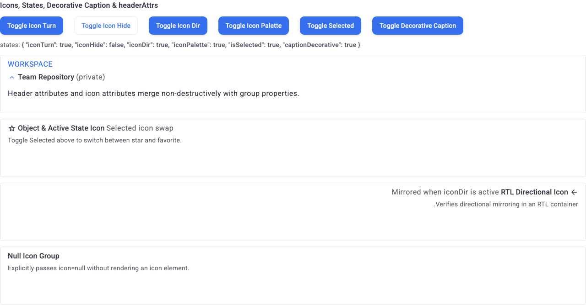
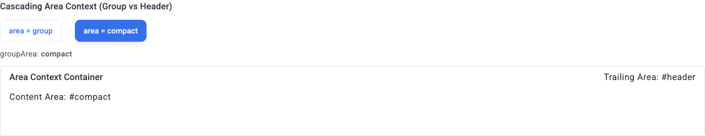
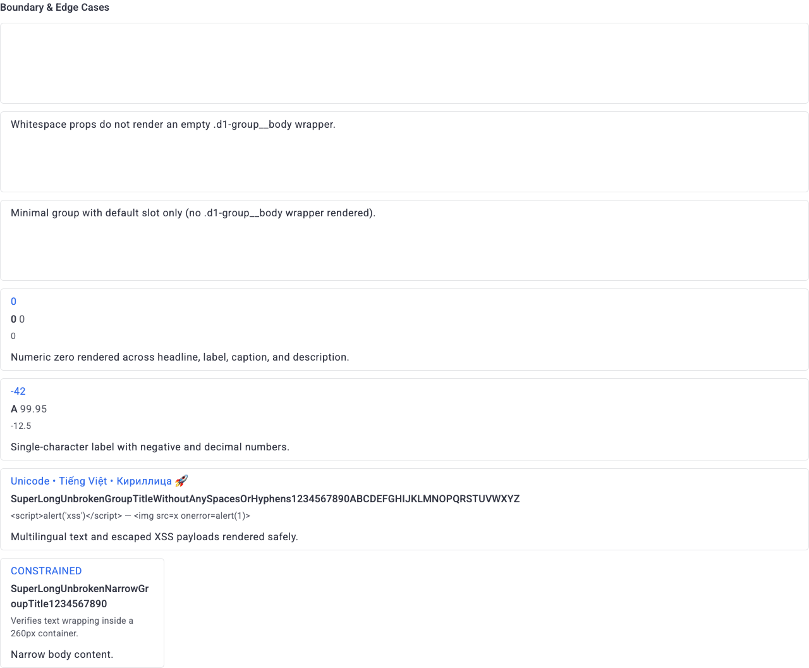
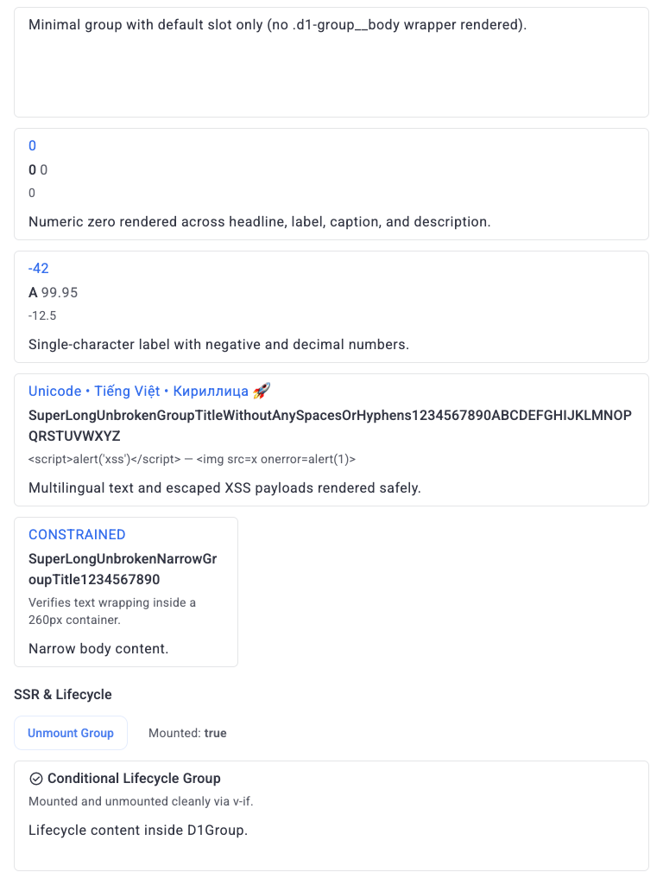
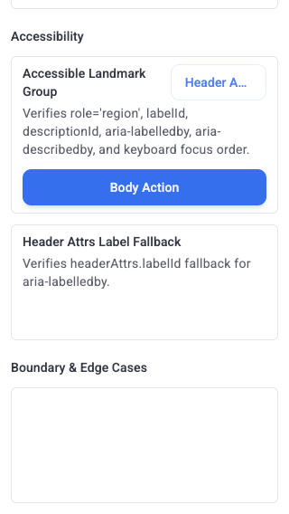

# Отчёт визуального и функционального тестирования: D1Group

## 1. Сводка выполнения

- **Компонент:** `D1Group` (`@dxtmisha/d1`)
- **Исходный код:** [`D1Group`](../../src/components/Ui/Group), [`Group`](../../../constructor/src/constructors/Group), [`Block`](../../../constructor/src/constructors/Block), [`DemoGroupPage.vue`](../../../demo/src/pages/components/DemoGroupPage.vue)
- **Целевой URL:** `http://localhost:3000/component-group`
- **Материалы (`materials/`):** `Отсутствуют`
- **Дата тестирования (UTC):** `2026-11-25T09:23:39Z`
- **Окружение:** `Headless Chrome (Puppeteer / CDP, Desktop 1440×900, Tablet 768×1024, Mobile 375×812 / 320×568)`
- **Покрытие тест-кейсов:** `14 / 14` (`100%`)
- **Итог:** **14 ✅, 0 ⚠️, 0 ❌** (`✅` пройдено, `⚠️` предупреждение, `❌` ошибка) — все 14 тест-кейсов пройдены успешно: теги по умолчанию (`DIV` и `H4`), все 6 слотов, полиморфное переключение `tag`/`tagHeader`, состояния иконки и `headerAttrs`, каскадный контекст `area` (`#header` / `#group` / `#compact`), `bodyOnlyHasBody: false`, нулевые/числовые значения, узкий контейнер (`258 === 258`), все 4 вьюпорта (`overflowX: false`), ARIA (`role="region"`, `aria-labelledby`, `aria-describedby`), SSR (`HTTP 200`) и `0` ошибок консоли/Vue/сети.

---

## 2. Матрица результатов

### 2.1 Визуальный рендеринг (`VIS`)

| ID | Сценарий | Статус | Наблюдаемый результат | Скриншот |
| :--- | :--- | :---: | :--- | :--- |
| `TC-VIS-001` | Полная анатомия группы (`headline`, `header`, `description`, `default`) и иерархия по умолчанию (`div` и `h4`) | ✅ | В `[data-testid="demo-group-full"]` подтверждены корневой тег `DIV` и заголовок `"Two-Factor Authentication"`, все зоны выровнены без наложений. |  |
| `TC-VIS-002` | Рендеринг слотовой группы без пропсов (`#headline`, `#label`, `#caption`, `#trailing`, `#description`, `#default`) | ✅ | Все 6 слотов отображаются корректно, кнопка `Edit` в `#trailing` реагирует на клик без ошибок. |  |
| `TC-VIS-003` | Составная интеграция с `D1Badge`, `D1Bleed` и `D1Alert` | ✅ | Вложенные компоненты в `#trailing` и основном слоте отображаются согласованно без перекрытий. |  |

### 2.2 Интерактивность и управление состоянием (`INT`)

| ID | Сценарий | Статус | Наблюдаемый результат | Скриншот |
| :--- | :--- | :---: | :--- | :--- |
| `TC-INT-001` | Реактивное переключение корневого `tag` и тега заголовка `tagHeader` | ✅ | После нажатия `section` и `header: h2` зафиксированы `rootTag: "SECTION"` и `headerTag: "H2"`. |  |
| `TC-INT-002` | Модификаторы иконки (`iconTurn`, `iconHide`, `iconDir`, `iconPalette`, `selected`), `captionDecorative`, объект/`null`, RTL, `iconAttrs` и `headerAttrs` | ✅ | Состояния `iconTurn` и `selected`, `iconAttrs` и `headerAttrs` применяются реактивно без визуальных сбоев. |  |
| `TC-INT-003` | Каскадный контекст `area` (`#header` в шапке и `#group`/`#compact` в теле) | ✅ | После переключения `area = compact` в `#trailing` сохраняется `#header`, а в теле активируется `#compact` (`Trailing Area: #headerContent Area: #compact`). |  |
| `TC-INT-004` | Условное монтирование и размонтирование (`v-if`) | ✅ | Текст группы меняется `152` → `40` символов при размонтировании и восстанавливается до `152` при повторном монтировании. | — |

### 2.3 Граничные значения и краевые случаи (`BND`)

| ID | Сценарий | Статус | Наблюдаемый результат | Скриншот |
| :--- | :--- | :---: | :--- | :--- |
| `TC-BND-001` | Отсутствие `.d1-group__body` при пустой/пробельной шапке и пустом `<D1Group/>` | ✅ | Подтверждены `bodyOnlyHasBody: false` и `wsHasBody: false`, пустой `<D1Group/>` не создаёт ошибок. |  |
| `TC-BND-002` | Поддержка числового `0`, отрицательных/дробных чисел и одиночных символов | ✅ | Нулевой блок отрендерил `"0000Numeric zero rendered across headline, label, caption, and description."`, все числовые/однобуквенные кейсы отображаются без потерь. | — |
| `TC-BND-003` | Длинные неразрывные строки, Unicode, экранирование XSS и узкий контейнер `.demo-group-page__narrow` (`260px`) | ✅ | XSS экранирован (`badImgs: 0`, `hasEscapedPayloadText: true`), узкий контейнер `.demo-group-page__narrow` не переполняется (`scrollWidth: 258 === clientWidth: 258`, `overflowsBox: false`). |  |

### 2.4 Адаптивность и вьюпорты (`RSP`)

| ID | Сценарий | Статус | Наблюдаемый результат | Скриншот |
| :--- | :--- | :---: | :--- | :--- |
| `TC-RSP-001` | Планшетный вьюпорт (`768×1024`) без переполнения | ✅ | `1440/1440` и `768/768`, `overflowX: false`. |  |
| `TC-RSP-002` | Мобильный экран (`375×812` и `320×568`) без горизонтального переполнения | ✅ | `375/375` и `320/320`, `overflowX: false`. |  |

### 2.5 Доступность (`A11Y`)

| ID | Сценарий | Статус | Наблюдаемый результат | Скриншот |
| :--- | :--- | :---: | :--- | :--- |
| `TC-A11Y-001` | Сквозная проверка `role="region"`, `labelId`, `descriptionId`, `aria-labelledby`, `aria-describedby` и порядка фокуса | ✅ | На `[data-testid="demo-group-a11y"]` подтверждены `role: "region"`, `labelledby: "demo-group-a11y-label"`, `describedby: "demo-group-a11y-desc"`, `hasLabelNode: true`, `hasDescNode: true`; на fallback-примере `a11yHdrLabelledby: "demo-group-header-attrs-id"`. | — |

### 2.6 Консоль и рантайм (`LOG`)

| ID | Сценарий | Статус | Наблюдаемый результат | Скриншот |
| :--- | :--- | :---: | :--- | :--- |
| `TC-LOG-001` | Чистота консоли браузера и отсутствие `[Vue warn]` | ✅ | `ssrStatus: 200`, `consoleErrors: []`, `vueWarnings: []`, `pageErrors: []`, `networkErrors: []`, `dialogs: []`. | — |

---

## 3. AI-аудит и рекомендации

1. **Наследование от `Block`:** `D1Group` корректно переопределяет значения по умолчанию (`div` для корня, `h4` для шапки, `area="group"`), сохраняя всю каскадную логику, ARIA-связывание и защиту от переполнения в узком контейнере (`258px`).
2. **Стабильность DOM и рантайма:** Условная обёртка `.d1-group__body` создаётся строго при наличии контента, а SSR и клиентские переключения выполняются с `0` ошибок и предупреждений.
