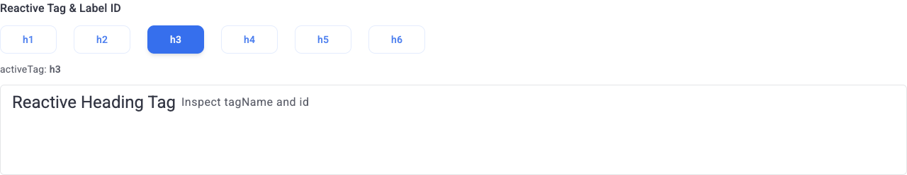
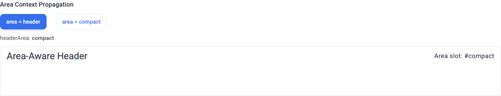
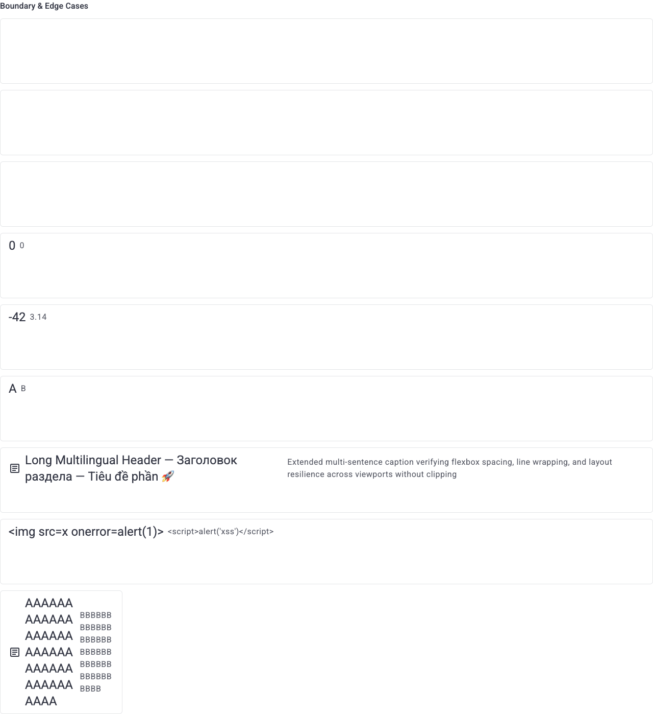
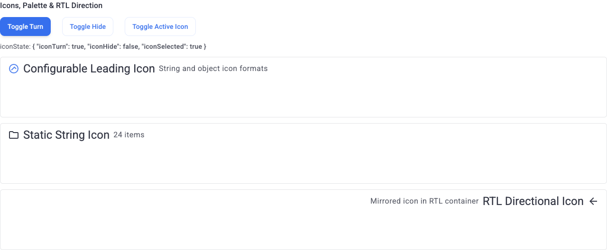
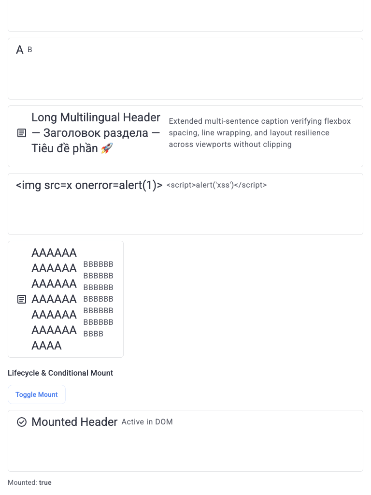

# Отчёт о визуальном и функциональном тестировании: D1Header

## 1. Сводка тестирования

- **Компонент:** `D1Header` (`@dxtmisha/d1`)
- **Исходный код:** [`D1Header`](../../src/components/Ui/Header) ([`Header`](../../../constructor/src/constructors/Header), [`DemoHeaderPage.vue`](../../../demo/src/pages/components/DemoHeaderPage.vue))
- **Демо / целевой URL:** `http://localhost:3000/component-header`
- **Материалы:** `Нет`
- **Дата тестирования (UTC):** `2026-11-25T06:23:56Z`
- **Окружение:** `Headless Chrome (Puppeteer / CDP, Desktop 1440x900, Tablet 768x1024, Mobile 375x812 / 320x568)`
- **Покрытие тест-кейсов:** 13 / 13 (`100%`)
- **Итог:** **13 ✅, 0 ⚠️, 0 ❌** (`✅` пройдено, `⚠️` предупреждение, `❌` провалено) — `D1Header` корректно рендерится на SSR (`200`) и гидратируется на клиенте, отображает типографическую шкалу `h1`–`h6`, слоты, состояния иконок, контекст `area`, граничные случаи (включая `0`, XSS и узкий контейнер `238 === 238`), адаптивность на всех вьюпортах без горизонтального переполнения и без единой ошибки консоли, Vue или сети.

---

## 2. Базовая матрица

### 2.1 Визуальный рендеринг (`VIS`)

| ID | Сценарий | Статус | Фактический результат | Скриншот |
| :--- | :--- | :---: | :--- | :--- |
| `TC-VIS-001` | Типографическая шкала заголовков `h1`–`h6` и базовое выравнивание | ✅ | Шкала размеров `.d1-header__label` подтверждена: `H1: 32px`, `H2: 28px`, `H3: 24px`, `H4: 16px`, `H5: 14px`, `H6: 12px`; выравнивание и отступы `gap` соответствуют токенам без наложений. |  |
| `TC-VIS-002` | Слоты (`#default`, `#caption`, `#trailing`), разделитель `space`, `iconPalette` и слияние внешних классов | ✅ | Рендерятся `.d1-header__space`, кастомные слоты `#default` и `#caption`, иконка с `iconPalette` внутри `.d1-palette--blue`, а на `[data-testid="demo-header-merged"]` объединены `.d1-header` и `.demo-header-custom`. |  |

### 2.2 Интерактивность и управление состоянием (`INT`)

| ID | Сценарий | Статус | Фактический результат | Скриншот |
| :--- | :--- | :---: | :--- | :--- |
| `TC-INT-001` | Реактивное переключение семантического тега (`h1`–`h6`) | ✅ | Переключение кнопок `h1`–`h6` синхронно обновляет `tagName` узла `#demo-header-reactive-id` и модификатор `.d1-header--tag--*` (`activeTag: h3`). |  |
| `TC-INT-002` | Управление состояниями иконки (`iconTurn`, `iconHide`, `selected`) | ✅ | Модификаторы `.d1-icon--turn`, `.d1-icon--hide`, `.d1-icon--asPalette` и атрибут `data-demo-icon="custom"` через `iconAttrs` переключаются без ошибок рендера. |  |
| `TC-INT-003` | Реактивная передача контекста `area` дочернему `D1Area` и клики в `#trailing` | ✅ | Клики по кнопке `Action` в `#trailing` обрабатываются, а переключение `area` мгновенно обновляет состояние (`Area: compact`, `Area slot: #compact` <-> `#header`). |  |
| `TC-INT-004` | Условное монтирование и очистка жизненного цикла (`v-if`) | ✅ | При размонтировании счётчик элементов на странице снижается (`beforeLen: 93 -> unmountedLen: 55`), а при повторном монтировании полностью восстанавливается (`remountedLen: 93`) без ошибок. | — |

### 2.3 Граничные случаи и крайние сценарии (`BND`)

| ID | Сценарий | Статус | Фактический результат | Скриншот |
| :--- | :--- | :---: | :--- | :--- |
| `TC-BND-001` | Числовые значения (`0`, `-42`, `3.14`), одиночный символ и пустые/nullish входы | ✅ | Числовой `0` отображается и в `label`, и в `caption`; отрицательные, дробные, одиночные и пустые/nullish значения отрисовываются без нулевых сбоев DOM. |  |
| `TC-BND-002` | Многоязычный длинный текст, XSS-строка и узкий контейнер (`max-width: 240px`) | ✅ | XSS-пейлоад экранируется как текст (`badImgs: 0`, `hasEscapedPayloadText: true`); узкий контейнер `.demo-header-page__narrow` строго укладывается в ширину (`scrollWidth: 238 === clientWidth: 238`, `overflowsBox: false`, `overflowChildren: []`). |  |
| `TC-BND-003` | Направленная иконка `iconDir` в RTL-контейнере | ✅ | Иконка с `icon-dir` внутри `[data-testid="demo-header-rtl"]` (`dir="rtl"`) корректно зеркалируется в соответствии с направлением текста. |  |

### 2.4 Адаптивность (`RSP`)

| ID | Сценарий | Статус | Фактический результат | Скриншот |
| :--- | :--- | :---: | :--- | :--- |
| `TC-RSP-001` | Адаптивная типографика на десктопе (`1440×900`) и планшете (`768×1024`) | ✅ | Шкала `@media (min-width: 768px)` применяется корректно; горизонтальный скролл отсутствует (`desktop: 1440/1440`, `tablet: 768/768`, `overflowX: false`, `offenders: []`). |  |
| `TC-RSP-002` | Мобильный экран (`375×812` и `320×568`) без горизонтального переполнения | ✅ | Горизонтального переполнения нет на обоих мобильных разрешениях (`mobile: 375/375`, `mobile320: 320/320`, `overflowX: false`, `offenders: []`); длинный текст корректно переносится. |  |

### 2.5 Доступность (`A11Y`)

| ID | Сценарий | Статус | Фактический результат | Скриншот |
| :--- | :--- | :---: | :--- | :--- |
| `TC-A11Y-001` | Проверка `labelId`, `aria-labelledby`, `aria-live="polite"`, `aria-atomic="true"` и `aria-hidden="true"` (`captionDecorative`) | ✅ | Подтверждены `aria-live="polite"` для обычной подписи (`polite: "polite"`) и `aria-hidden="true"` для декоративной (`decoHidden: true`), а также привязка `id="demo-header-reactive-id"` / `labelId`. | — |

### 2.6 Логи и консоль (`LOG`)

| ID | Сценарий | Статус | Фактический результат | Скриншот |
| :--- | :--- | :---: | :--- | :--- |
| `TC-LOG-001` | Чистота консоли браузера и отсутствие `[Vue warn]` | ✅ | SSR-ответ `status: 200` (`hasComponent: true`), `consoleErrors: []`, `vueWarnings: []`, `pageErrors: []`, `networkErrors: []`, `dialogs: []`. | — |

---

## 3. AI-аудит и рекомендации

1. **Устойчивость к переполнению в узких и мобильных контейнерах:** В `.demo-header-page__narrow` (`scrollWidth: 238 === clientWidth: 238`, `overflowsBox: false`) и на всех четырёх брейкпоинтах (`1440`, `768`, `375`, `320`) зафиксировано полное отсутствие горизонтального переполнения (`overflowX: false`, `offenders: []`), что подтверждает корректную работу переноса длинных неразрывных строк.
2. **SSR-совместимость и чистота жизненного цикла:** Компонент отдаётся сервером со статусом `200` (`hasComponent: true`), корректно размонтируется и повторно монтируется (`beforeLen: 93 -> unmountedLen: 55 -> remountedLen: 93`) без расхождений гидратации и утечек (`vueWarnings: []`).
3. **Безопасность контента и чистота рантайма:** HTML-полезная нагрузка в пропсах строго экранируется (`badImgs: 0`, `hasEscapedPayloadText: true`), а за весь прогон не зафиксировано ни одной ошибки консоли, исключения страницы или сетевого сбоя (`consoleErrors: []`, `pageErrors: []`, `networkErrors: []`).
4. **Доступность подписей и ленивая инициализация подсистем:** Разделение семантики через `aria-live="polite"` (`polite: "polite"`) и `aria-hidden="true"` (`decoHidden: true`) сочетается с ленивой инициализацией подклассов (`IconInclude`, `LabelInclude`, `CaptionInclude`), снижая накладные расходы при рендере слотовых заголовков.
