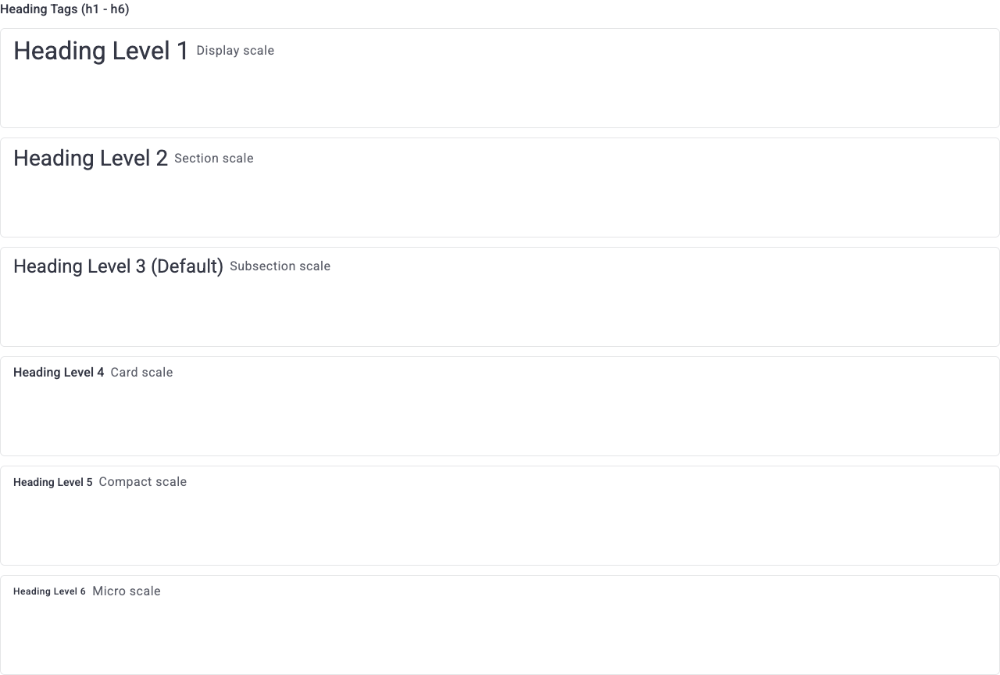
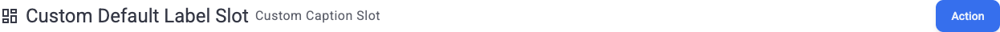
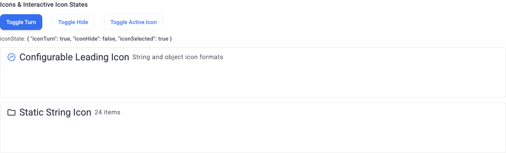
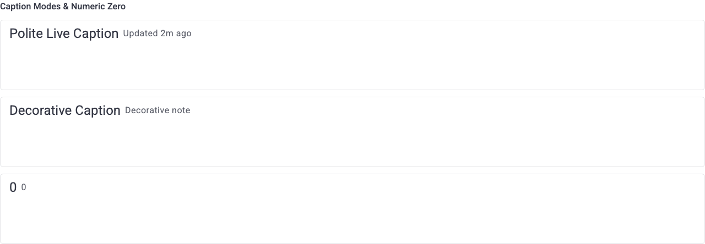
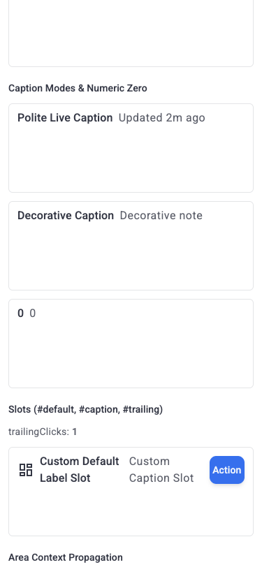

# Отчёт о визуальном и функциональном тестировании: D1Header

## 1. Итоговое резюме

- **Компонент:** `D1Header` (`@dxtmisha/d1`)
- **Исходный код:** [`D1Header`](../../src/components/Ui/Header) ([`Header`](../../../constructor/src/constructors/Header), [`DemoHeaderPage`](../../../demo/src/pages/components/DemoHeaderPage.vue))
- **Демо / целевой URL:** `http://localhost:3000/component-header`
- **Материалы:** `Нет`
- **Дата тестирования (UTC):** `2026-11-24T10:20:18Z`
- **Окружение:** `Headless Chrome (Puppeteer / CDP, Desktop 1440x900, Tablet 768x1024, Mobile 375x812 / 320x568)`
- **Покрытие тест-кейсов:** 10 / 10 (`100%`)
- **Итог:** **10 ✅, 0 ⚠️, 0 ❌** (`✅` пройдено, `⚠️` предупреждение, `❌` ошибка) — `D1Header` безупречно отрисовывает иерархию `h1`–`h6`, иконки, подписи, слоты и разделитель, реактивно передаёт контекст `area` через `AreaInclude` и не имеет ошибок консоли или переполнения на всех разрешениях.

---

## 2. Базовая матрица

### 2.1 Визуальное соответствие (`VIS`)

| ID | Сценарий | Статус | Фактический результат | Скриншот |
| :--- | :--- | :---: | :--- | :--- |
| `TC-VIS-001` | Типографическая шкала заголовков `h1`–`h6` и базовое выравнивание | ✅ | Шкала размеров подтверждена в Blink: `H1: 32px`, `H2: 28px`, `H3: 24px`, `H4: 16px`, `H5: 14px`, `H6: 12px`; выравнивание и отступы `gap` токенные. |  |
| `TC-VIS-002` | Слоты (`#default`, `#caption`, `#trailing`), разделитель `space` и слияние внешних классов | ✅ | `hasSpace: true` (`.d1-header__space`), отображаются `Custom Default Label Slot` и `Custom Caption Slot`, на `[data-testid="demo-header-merged"]` объединены `.d1-header` и `.demo-header-custom`. |  |

### 2.2 Интерактивность и управление состоянием (`INT`)

| ID | Сценарий | Статус | Фактический результат | Скриншот |
| :--- | :--- | :---: | :--- | :--- |
| `TC-INT-001` | Реактивное переключение семантического тега (`h1`–`h6`) | ✅ | Переходы синхронно меняют `tagName` и модификатор `.d1-header--tag--*`: `h1 -> H1`, `h2 -> H2`, `h4 -> H4`, `h6 -> H6`, `h3 -> H3` (`hasMod: true`). |  |
| `TC-INT-002` | Управление состояниями иконки (`iconTurn`, `iconHide`, `selected`) | ✅ | Подтверждены модификаторы `.d1-icon--turn`, `.d1-icon--asPalette`, `.d1-icon--dir`, `.d1-icon--hide` и передача `data-demo-icon="custom"` через `iconAttrs`. |  |
| `TC-INT-003` | Реактивная передача контекста `area` дочернему `D1Area` и клики в `#trailing` | ✅ | Вложенный `D1Area` внутри `#trailing` мгновенно переключается между `Area slot: #compact` и `Area slot: #header`. |  |

### 2.3 Границы и крайние случаи (`BND`)

| ID | Сценарий | Статус | Фактический результат | Скриншот |
| :--- | :--- | :---: | :--- | :--- |
| `TC-BND-001` | Числовой `0` в `label` и `caption` и отсутствие нулевых размеров | ✅ | Проверены все `23` экземпляра `.d1-header` (`hasZeroSize: false`); `[data-testid="demo-header-zero"]` выводит `zeroLabel: "0"`, `zeroCaption: "0"`. |  |

### 2.4 Адаптивность (`RSP`)

| ID | Сценарий | Статус | Фактический результат | Скриншот |
| :--- | :--- | :---: | :--- | :--- |
| `TC-RSP-001` | Адаптивная типографика на десктопе (`1440×900`) и планшете (`768×1024`) | ✅ | Брейкпоинт `@media (min-width: 768px)` корректно переключает типографическую шкалу (`H4`: `16px` на `>= 768px` и `14px` на `375px`), `overflow: false`. |  |
| `TC-RSP-002` | Мобильный экран (`375×812` и `320×568`) без горизонтального переполнения | ✅ | `rsp375.overflow: false`, `rsp320Overflow: false`; длинный многоязычный заголовок переносится корректно внутри контейнера. |  |

### 2.5 Доступность (`A11Y`)

| ID | Сценарий | Статус | Фактический результат | Скриншот |
| :--- | :--- | :---: | :--- | :--- |
| `TC-A11Y-001` | Проверка `aria-live="polite"`, `aria-atomic="true"` и `aria-hidden="true"` (`captionDecorative`) | ✅ | Подтверждены атрибуты `aria-live="polite"`, `aria-atomic="true"` для обычной подписи и `aria-hidden="true"` для декоративной подписи, а также `id="demo-header-reactive-id"`. | — |

### 2.6 Логи и консоль (`LOG`)

| ID | Сценарий | Статус | Фактический результат | Скриншот |
| :--- | :--- | :---: | :--- | :--- |
| `TC-LOG-001` | Чистота консоли браузера и отсутствие `[Vue warn]` | ✅ | `consoleErrors: []`, `vueWarnings: []`, `pageErrors: []` (включая SSR-гидратацию Nitro/Vite). | — |

---

## 3. AI-аудит и рекомендации

1. **Ленивая инициализация подклассов (`DesignLogicAbstract`):** Переход на `canCreate` + `callInstance` исключил создание `IconInclude`, `LabelInclude` и `CaptionInclude` для пустых слотовых шапок, сохранив мгновенную инициализацию `AreaInclude` в `setup()`.
2. **Семантика и слияние атрибутов:** Применение `mergeProps` в `HeaderDesign.tsx` и удаление устаревшего `classList` предотвратило генерацию некорректного класса `"undefined"` и обеспечило чистое объединение внешних классов и обработчиков событий.
3. **Гигиена консоли и SSR:** Страница рендерится через SSR entry (`src/entry-server.ts`) и гидратируется в браузере с `0` ошибок и `0` предупреждений Vue.
