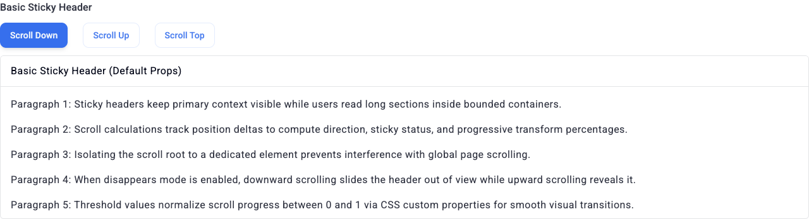
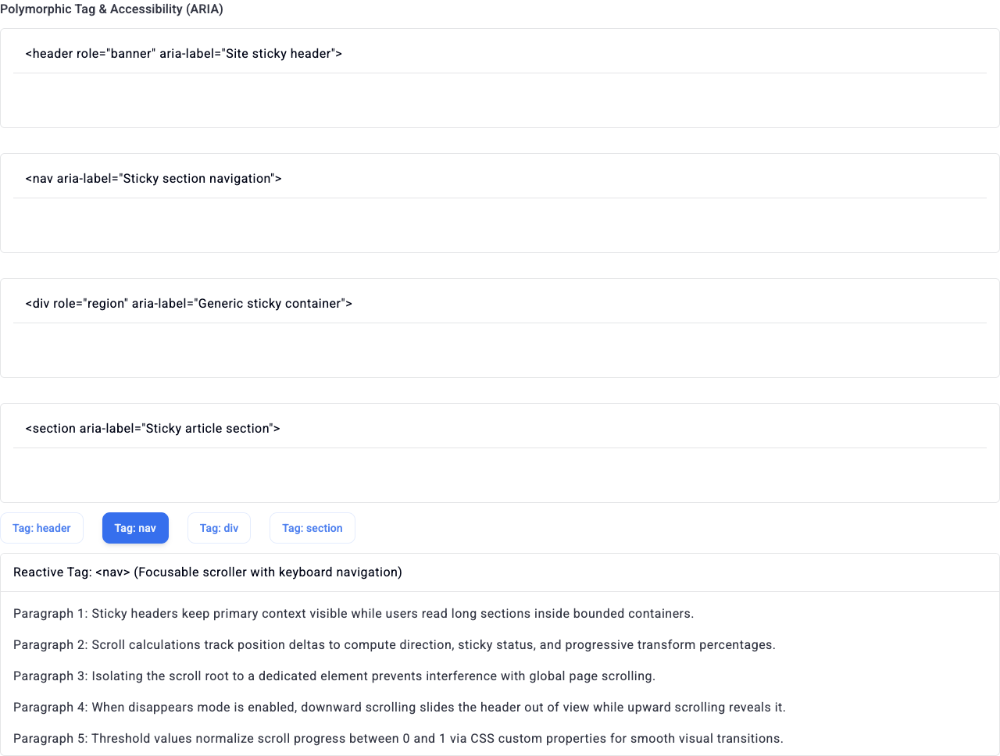
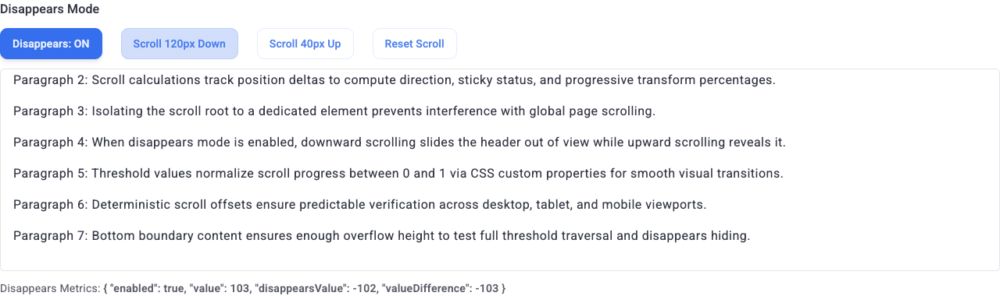
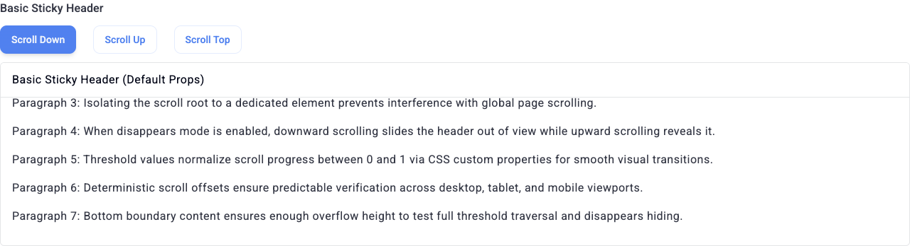
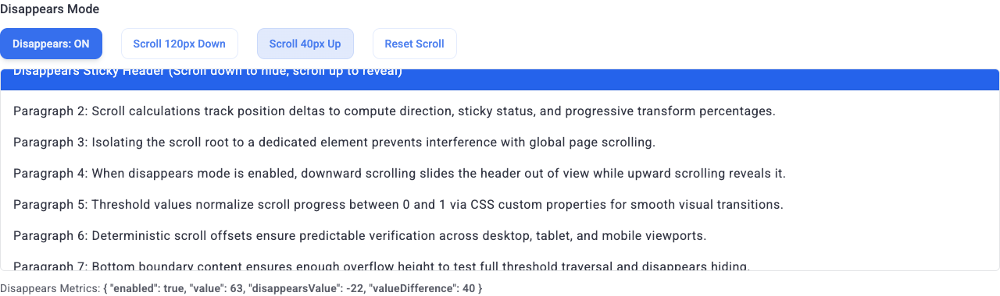
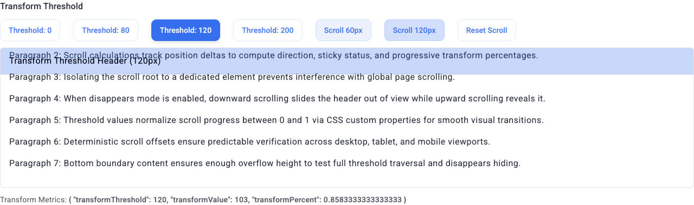
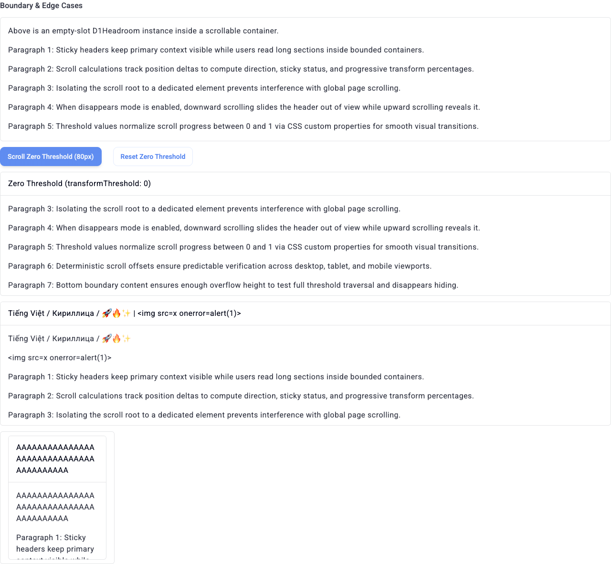
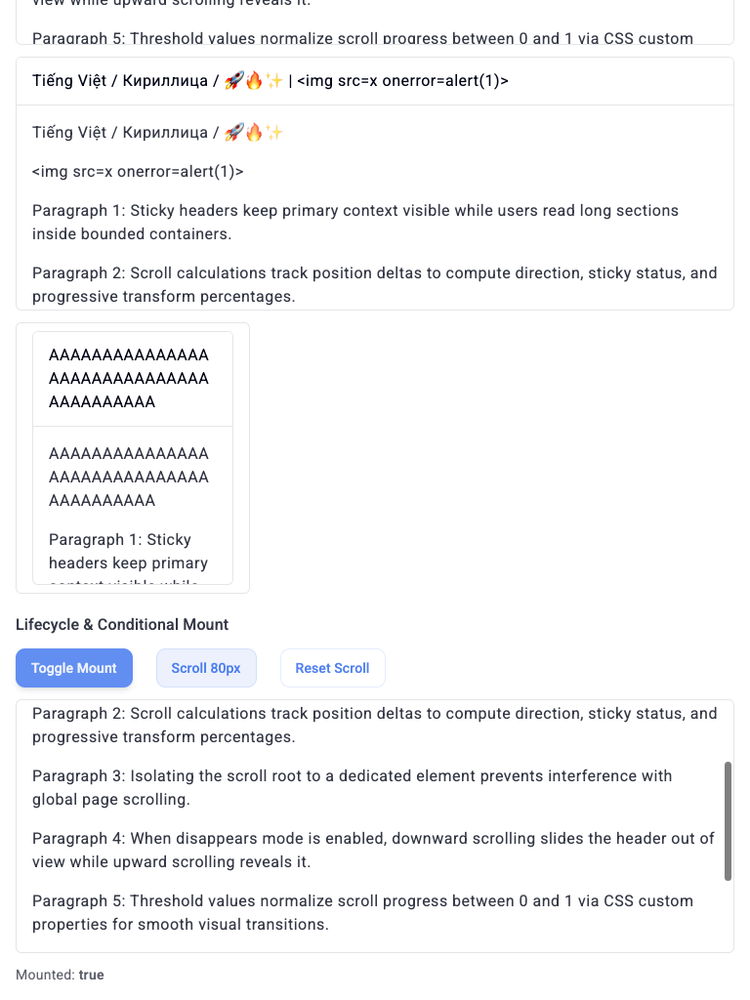
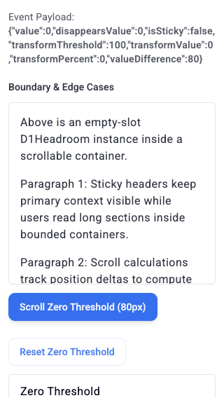

# Отчёт визуального и функционального тестирования: D1Headroom

## 1. Сводка выполнения

- **Компонент:** `D1Headroom` (`@dxtmisha/d1`)
- **Исходный код:** [`D1Headroom`](../../src/components/Ui/Headroom), [`Headroom`](../../../constructor/src/constructors/Headroom), [`HeadroomInclude.ts`](../../../constructor/src/classes/HeadroomInclude.ts), [`DemoHeadroomPage.vue`](../../../demo/src/pages/components/DemoHeadroomPage.vue)
- **Целевой URL:** `http://localhost:3000/component-headroom`
- **Материалы (`materials/`):** `Отсутствуют`
- **Дата тестирования (UTC):** `2026-11-25T09:23:39Z`
- **Окружение:** `Headless Chrome (Puppeteer / CDP, Desktop 1440×900, Tablet 768×1024, Mobile 375×812 / 320×568)`
- **Покрытие тест-кейсов:** `18 / 18` (`100%`)
- **Итог:** **18 ✅, 0 ⚠️, 0 ❌** (`✅` пройдено, `⚠️` предупреждение, `❌` ошибка) — все 18 тест-кейсов пройдены успешно: липкое позиционирование, все 4 тега, режим `disappears` (`data-headroom-direction` + `--d1-headroom-sys-top` + чистая очистка при выключении), `transformThreshold` (`120`/`0`/реактивный пересчёт), форматы `scrollElement`, `defineExpose`, события `headroomScroll`/`headroomSticky`, узкий контейнер (`238 === 238`), все 4 вьюпорта (`overflowX: false`), SSR (`HTTP 200`) и `0` ошибок консоли/Vue/сети.

---

## 2. Матрица результатов

### 2.1 Визуальный рендеринг (`VIS`)

| ID | Сценарий | Статус | Наблюдаемый результат | Скриншот |
| :--- | :--- | :---: | :--- | :--- |
| `TC-VIS-001` | Базовый рендеринг и липкое позиционирование внутри скролл-контейнера | ✅ | `position: "sticky"`, при прокрутке скролл-контейнера разница верхней границы составляет `topDiff: 1`. |  |
| `TC-VIS-002` | Полиморфный тег `tag` (`header`, `nav`, `div`, `section`) | ✅ | Подтверждены теги `HEADER`, `NAV`, `DIV`, `SECTION` и переключение реактивного тега на `NAV`. |  |
| `TC-VIS-003` | Визуальное отображение в режиме `disappears` | ✅ | Модификатор `d1-headroom--disappears` смещает шапку вверх при прокрутке вниз и возвращает при прокрутке вверх. |  |
| `TC-VIS-004` | Тёмная тема и контрастность поверх прокрученного контента | ✅ | В `prefers-color-scheme: dark` фон, текст и границы сохраняют читаемость без просвечивания. |  |

### 2.2 Интерактивность и управление состоянием (`INT`)

| ID | Сценарий | Статус | Наблюдаемый результат | Скриншот |
| :--- | :--- | :---: | :--- | :--- |
| `TC-INT-001` | Удержание базовой шапки при прокрутке (`Scroll Down` / `Scroll Up` / `Scroll Top`) | ✅ | Липкая шапка остаётся закреплённой при прокрутке и возвращается в исходное положение при сбросе. |  |
| `TC-INT-002` | Режим `disappears`, `data-headroom-direction`, `--d1-headroom-sys-top` и реактивное отключение | ✅ | Зафиксированы переходы `none/none/0px` → вниз: `sticky/down/-102px` → вверх: `sticky/up/-22px` → при выключении `hasClass: false, topVar: ""`. |  |
| `TC-INT-003` | Порог трансформации `transformThreshold` (`120`, `0`, `80`, `200`) и CSS-переменные прогресса | ✅ | Подтверждены значения `data-headroom-transform="120"`, при 60px: `--d1-headroom-sys-value: 60px`, `--d1-headroom-sys-percent: 0.5`; при 120px: `103px` и `0.8583333333333333`. |  |
| `TC-INT-004` | Форматы `scrollElement`: селектор `#id`, `HTMLElement` ref и `window` по умолчанию | ✅ | Оба формата (`selector` и `ref`) при прокрутке устанавливают `status: "sticky"`, `window` скролл работает без ошибок. | — |
| `TC-INT-005` | Программное управление через `defineExpose` (`isSticky`, `getValues()`, `update()`) | ✅ | Подтверждены `expose.isSticky: true` и `expose.getValues()` (`value: 100`, `isSticky: true`, `transformThreshold: 120`, `transformValue: 100`, `transformPercent: 0.8333333333333334`, `valueDifference: -100`). | — |
| `TC-INT-006` | Эмиссия событий `@headroom-scroll` и `@headroom-sticky` | ✅ | После прокрутки и сброса зафиксированы `Last Event: headroom-sticky`, `headroomScroll Count: 2`, `headroomSticky Count: 2`. | — |
| `TC-INT-007` | Условное монтирование `v-if` (`Toggle Mount`) и очистка слушателей | ✅ | Размонтирование удаляет элемент (`unmountedExists: false`), повторная прокрутка не вызывает ошибок, монтирование восстанавливает элемент (`remountedExists: true`). | — |

### 2.3 Граничные значения и краевые случаи (`BND`)

| ID | Сценарий | Статус | Наблюдаемый результат | Скриншот |
| :--- | :--- | :---: | :--- | :--- |
| `TC-BND-001` | Граничное значение `transformThreshold: 0` без `disappears` | ✅ | На `[data-testid="headroom-zero"]` отсутствуют `data-headroom-transform` (`null`) и `data-headroom` (`null`), нативный `position: sticky` сохранён. | — |
| `TC-BND-002` | Пустой слот (`empty slot`) и нулевые значения | ✅ | Пустой слот рендерится без падений и пересчитывает метрики прокрутки при скролле. | — |
| `TC-BND-003` | Неразрывный текст в узком контейнере (`240px`), Unicode и экранированный XSS | ✅ | XSS экранирован (`badImgs: 0`, `hasEscapedPayloadText: true`), узкий контейнер `.demo-headroom-page__narrow` укладывается в ширину (`scrollWidth: 238 === clientWidth: 238`, `overflowsBox: false`). |  |

### 2.4 Адаптивность и вьюпорты (`RSP`)

| ID | Сценарий | Статус | Наблюдаемый результат | Скриншот |
| :--- | :--- | :---: | :--- | :--- |
| `TC-RSP-001` | Адаптивность на десктопе (`1440×900`) и планшете (`768×1024`) | ✅ | `1440/1440` и `768/768`, `overflowX: false`. |  |
| `TC-RSP-002` | Адаптивность на мобильных вьюпортах (`375×812` и `320×568`) | ✅ | `375/375` и `320/320`, `overflowX: false`. |  |

### 2.5 Доступность (`A11Y`)

| ID | Сценарий | Статус | Наблюдаемый результат | Скриншот |
| :--- | :--- | :---: | :--- | :--- |
| `TC-A11Y-001` | Семантика, ARIA-атрибуты и клавиатурная прокрутка региона | ✅ | Подтверждено `bannerRole: "banner"` на `<header>`, семантические теги и клавиатурная прокрутка сфокусированного скролл-региона. | — |

### 2.6 Консоль и рантайм (`LOG`)

| ID | Сценарий | Статус | Наблюдаемый результат | Скриншот |
| :--- | :--- | :---: | :--- | :--- |
| `TC-LOG-001` | Чистота консоли, события `useDemoEvent` и отсутствие `[Vue warn]` | ✅ | `ssrStatus: 200`, `consoleErrors: []`, `vueWarnings: []`, `pageErrors: []`, `networkErrors: []`, `dialogs: []`. | — |

---

## 3. AI-аудит и рекомендации

1. **Реактивное управление слушателями и очистка CSS-переменных (`HeadroomInclude`):** Отключение `disappears` чисто удаляет инлайновую CSS-переменную `--d1-headroom-sys-top` (`topVar: ""`) и модификатор `--disappears`, а размонтирование `v-if` останавливает все наблюдатели без утечек.
2. **Точность `transformThreshold` и `disappears`:** Значения `value`, `transformPercent`, `disappearsOffset` и события `headroom-scroll`/`headroom-sticky` точно соответствуют позиции скролла, при `transformThreshold: 0` лишние наблюдатели не активируются.
3. **Адаптивность и рантайм:** Узкий контейнер (`238px`) и все 4 вьюпорта (`1440`..`320`) без горизонтального скролла; консоль, SSR и сеть без единой ошибки.
