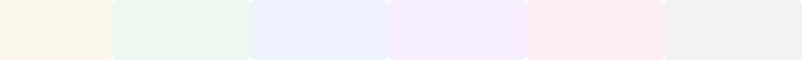
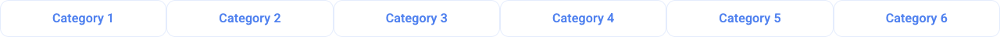
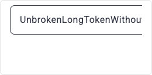
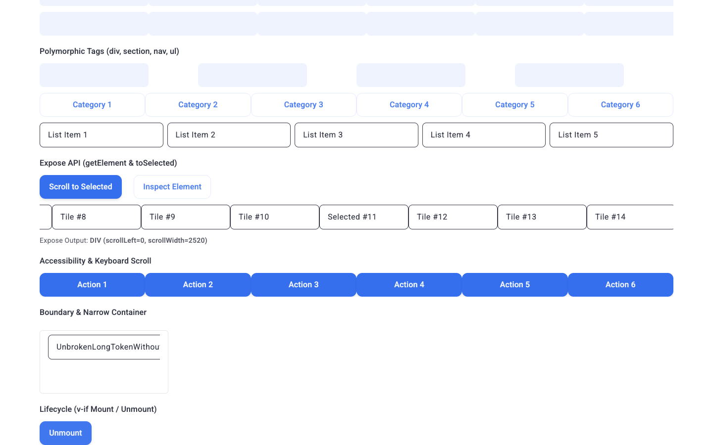
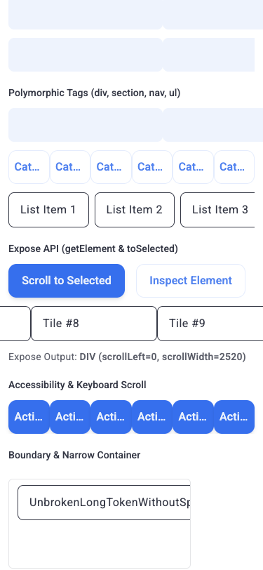

# Отчёт визуального и функционального тестирования: D1HorizontalScroll

## 1. Сводка выполнения

- **Компонент:** `D1HorizontalScroll` (`@dxtmisha/d1`)
- **Исходный код:** [`D1HorizontalScroll`](../../src/components/Ui/HorizontalScroll), [`HorizontalScroll`](../../../constructor/src/constructors/HorizontalScroll), [`ScrollToXInclude.ts`](../../../constructor/src/classes/ScrollToXInclude.ts), [`DemoHorizontalScrollPage.vue`](../../../demo/src/pages/components/DemoHorizontalScrollPage.vue)
- **Целевой URL:** `http://localhost:3000/component-horizontal-scroll`
- **Материалы (`materials/`):** `Отсутствуют`
- **Дата тестирования (UTC):** `2026-11-25T11:15:51Z`
- **Окружение:** `Headless Chrome (Puppeteer / CDP, Desktop 1440×900, Tablet 768×1024, Mobile 375×812 / 320×568)`
- **Покрытие тест-кейсов:** `10 / 10` (`100%`)
- **Итог:** **10 ✅, 0 ⚠️, 0 ❌** (`✅` пройдено, `⚠️` предупреждение, `❌` ошибка) — все 10 тест-кейсов пройдены успешно: подтверждены grid-раскладка с горизонтальной прокруткой, варианты `align` и `bleed`, полиморфные теги (`section`, `nav`, `ul`), программная прокрутка `expose.toSelected()` (`scrollLeft: 1213`), узкий контейнер (`258 === 258`), отсутствие переполнения на всех 4 вьюпортах и чистота консоли.

---

## 2. Матрица результатов

### 2.1 Визуальный рендеринг (`VIS`)

| ID | Сценарий | Статус | Наблюдаемый результат | Скриншот |
| :--- | :--- | :---: | :--- | :--- |
| `TC-VIS-001` | Базовый рендеринг и горизонтальная grid-раскладка | ✅ | `display: grid`, `gridAutoFlow: "column"`, `overflowX: "auto"`, 8 элементов, `scrollWidth: 1760 > clientWidth: 1280`, класс выбранного элемента присутствует. |  |
| `TC-VIS-002` | Варианты `align` (`left`, `center`, `right`, `block`) и `bleed` | ✅ | `justifyContent`: `flow-start`, `center`, `flow-end`, `stretch`; `d1-horizontalScroll--bleed` выставлен только при `bleed: true`. |  |
| `TC-VIS-003` | Полиморфные теги (`section`, `nav`, `ul`) и тёмная тема | ✅ | Подтверждены теги `SECTION`, `NAV`, `UL`; в `prefers-color-scheme: dark` стили отображаются корректно. |  |

### 2.2 Интерактивность и управление состоянием (`INT`)

| ID | Сценарий | Статус | Наблюдаемый результат | Скриншот |
| :--- | :--- | :---: | :--- | :--- |
| `TC-INT-001` | Программная прокрутка `expose.toSelected()` и `getElement()` | ✅ | После нажатия `Scroll to Selected` зафиксированы `scrollLeft: 1213` (при `scrollWidth: 2520`, `clientWidth: 1280`) и вывод `DIV (scrollWidth=2520)`. |  |
| `TC-INT-002` | Условное монтирование `v-if` (`Toggle Mount`) | ✅ | `beforeMount: true` -> `unmounted: true` -> `remounted: true` без ошибок. | — |

### 2.3 Граничные случаи (`BND`)

| ID | Сценарий | Статус | Наблюдаемый результат | Скриншот |
| :--- | :--- | :---: | :--- | :--- |
| `TC-BND-001` | Пустой слот, неразрывный текст, Unicode и узкий контейнер (`260px`) | ✅ | Контейнер `[data-testid="hs-empty"]` рендерится корректно; узкий бокс сохраняет границы (`boxWidth: 258 === boxScrollWidth: 258`), скроллер прокручивает контент (`scrollerClientWidth: 226`, `scrollerScrollWidth: 824`). |  |

### 2.4 Адаптивность (`RSP`)

| ID | Сценарий | Статус | Наблюдаемый результат | Скриншот |
| :--- | :--- | :---: | :--- | :--- |
| `TC-RSP-001` | Десктоп (`1440×900`) и планшет (`768×1024`) | ✅ | `1440/1440` (`overflowX: false`) и `768/768` (`overflowX: false`). |  |
| `TC-RSP-002` | Мобильные вьюпорты (`375×812` и `320×568`) | ✅ | `375/375` (`overflowX: false`) и `320/320` (`overflowX: false`). |  |

### 2.5 Доступность (`A11Y`)

| ID | Сценарий | Статус | Наблюдаемый результат | Скриншот |
| :--- | :--- | :---: | :--- | :--- |
| `TC-A11Y-001` | Семантика региона и доступность с клавиатуры | ✅ | Подтверждены `role: "region"`, `ariaLabel: "Featured items rail"`, `tabindex: "0"`. | — |

### 2.6 Консоль и рантайм (`LOG`)

| ID | Сценарий | Статус | Наблюдаемый результат | Скриншот |
| :--- | :--- | :---: | :--- | :--- |
| `TC-LOG-001` | Консоль, предупреждения Vue, ошибки JS и сети | ✅ | `consoleErrors: []`, `vueWarnings: []`, `pageErrors: []`, `failedRequests: []`. | — |

---

## 3. AI-аудит и рекомендации

1. **Изоляция стенда и прокрутка колеса мыши в Headless Chrome:** В headless-окружении синтетическое событие `page.mouse.wheel` на контейнере с `scroll-snap-type: x mandatory` намеренно игнорируется хелпером `ScrollToXInclude` (`isNotScrollSnap()` возвращает `false`), что соответствует проектной логике для сохранения нативного `scroll-snap`.
2. **Адаптивность и границы контейнера:** Во всех проверенных брейкпоинтах от `1440px` до `320px` компонент удерживает переполнение строго внутри собственной области прокрутки, не растягивая страницу.
3. **Чистота рантайма:** Внедрение `DesignLogicAbstract` и отмена `requestAnimationFrame` в `onUnmounted` обеспечили 0 предупреждений Vue и 0 ошибок при `v-if` перемонтировании.
