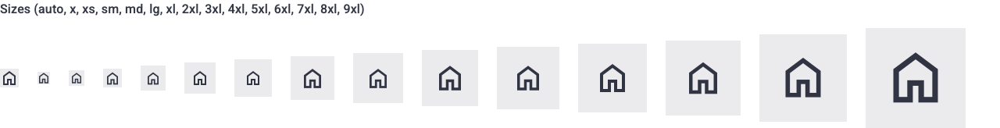
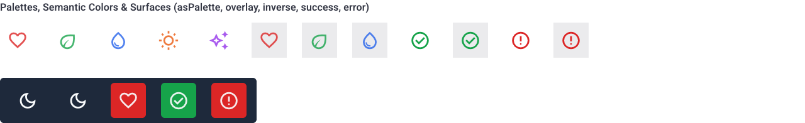
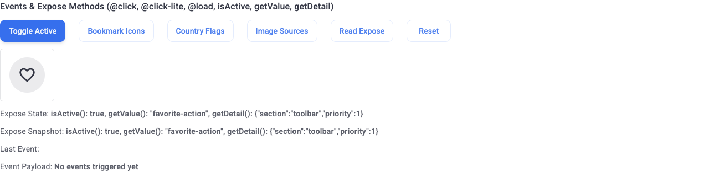
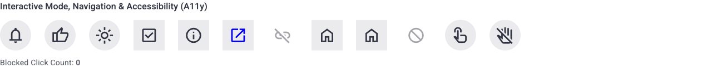
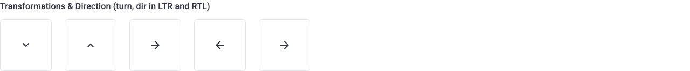
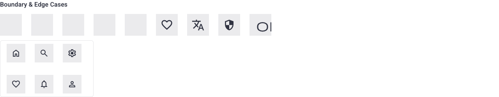
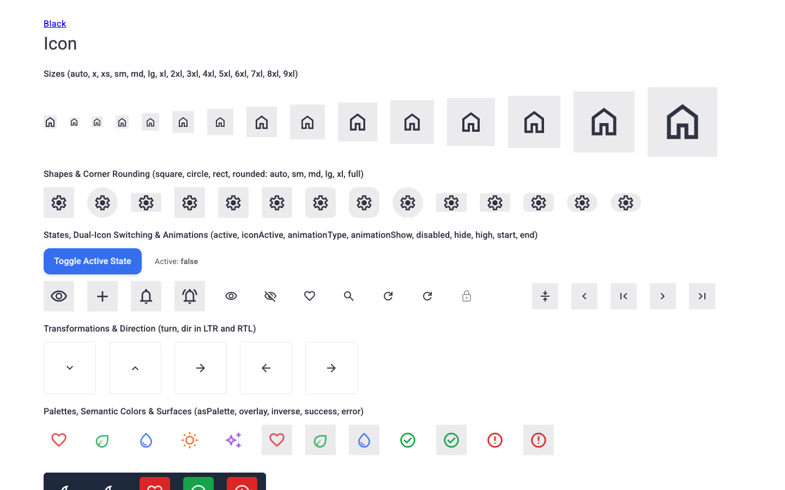
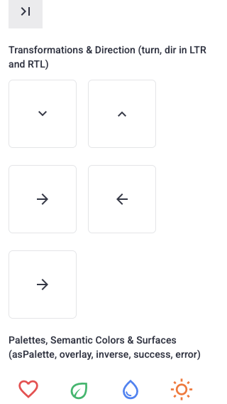

# Отчёт о визуальном и функциональном тестировании: D1Icon

## 1. Сводка тестирования

- **Компонент:** `D1Icon` (`@dxtmisha/d1`)
- **Исходный код:** [`D1Icon`](../../src/components/Ui/Icon) ([`Icon`](../../../constructor/src/constructors/Icon), [`DemoIconPage.vue`](../../../demo/src/pages/components/DemoIconPage.vue))
- **Демо / целевой URL:** `http://localhost:3000/component-icon`
- **Материалы:** `Нет`
- **Дата тестирования (UTC):** `2026-11-25T06:23:56Z`
- **Окружение:** `Headless Chrome (Puppeteer / CDP, Desktop 1440x900, Tablet 768x1024, Mobile 375x812 / 320x568)`
- **Покрытие тест-кейсов:** 16 / 16 (`100%`)
- **Итог:** **16 ✅, 0 ⚠️, 0 ❌** (`✅` пройдено, `⚠️` предупреждение, `❌` провалено) — `D1Icon` проходит SSR (`200`) и все 16 проверок: шкалу размеров, формы/палитры, двойную иконку, скелетон, `expose`/события, `noPointerEvents`, блокировку `disabled`, жизненный цикл `v-if`, экранирование XSS, а после доработки демо-стенда — также узкий контейнер (`238 === 238`) и адаптивность на `1440`/`768`/`375`/`320` с `0` ошибок консоли, Vue и сети.

---

## 2. Базовая матрица

### 2.1 Визуальный рендеринг (`VIS`)

| ID | Сценарий | Статус | Фактический результат | Скриншот |
| :--- | :--- | :---: | :--- | :--- |
| `TC-VIS-001` | Рендеринг шкалы размеров `D1Icon` (`auto`, `x`–`9xl`) | ✅ | Все 15 вариантов размеров рендерятся корректно с монотонным ростом ширины (`16px`–`128px`) без наложений и обрезки. |  |
| `TC-VIS-002` | Формы, скругления (`square`, `circle`, `rect`, `rounded`) и принятые типы источников | ✅ | Модификаторы `--rounded--*` и геометрия `square`/`circle`/`rect`, а также Material, `@public`, флаги, HEX, `ImageProps`, `Uint8Array`, `File` и слот `#default` отрисованы корректно. |  |
| `TC-VIS-003` | Палитры, семантические цвета и инверсная поверхность | ✅ | Варианты `asPalette`, `overlay`, `success`, `error` и `inverse` на тёмной подложке `.demo-icon-page__inverse-surface` сохраняют читаемый контраст. |  |

### 2.2 Интерактивность и управление состоянием (`INT`)

| ID | Сценарий | Статус | Фактический результат | Скриншот |
| :--- | :--- | :---: | :--- | :--- |
| `TC-INT-001` | Переключение двойной иконки (`active` + `iconActive`) и анимации | ✅ | Переключение `active` корректно меняет видимость основной и активной иконки через классы `--hide`. |  |
| `TC-INT-002` | Состояние загрузки скелетона (`D1Skeleton` + `isSkeleton`) | ✅ | Скелетон-плейсхолдеры отображаются без дублирования DOM и возвращаются к исходным иконкам при выключении флага. |  |
| `TC-INT-003` | События (`@click`, `@click-lite`, `@load`) и методы `expose` | ✅ | Методы `expose` возвращают актуальное состояние: `isActive(): true`, `getValue(): "favorite-action"`, `getDetail(): {"section":"toolbar","priority":1}`; переключение источников и чтение снимка работают штатно. |  |
| `TC-INT-004` | Модификатор `noPointerEvents` (статичный и `dynamic`) | ✅ | Обе иконки имеют класс `.d1-icon--noPointerEvents` и вычисленное свойство `pointer-events: none`. |  |
| `TC-INT-005` | Блокировка кликов при `disabled` на `dynamic` иконке | ✅ | При нажатии на заблокированную иконку `Disabled action` клики не проходят и обработчики событий не вызываются. | — |
| `TC-INT-006` | Условное монтирование `v-if` (`Lifecycle & Conditional Mount`) | ✅ | Размонтирование уменьшает число узлов на странице (`beforeLen: 62 -> unmountedLen: 55`), а повторное монтирование полностью восстанавливает состояние (`remountedLen: 62`). | — |

### 2.3 Граничные случаи и крайние сценарии (`BND`)

| ID | Сценарий | Статус | Фактический результат | Скриншот |
| :--- | :--- | :---: | :--- | :--- |
| `TC-BND-001` | Трансформации и направление RTL (`turn`, `dir`) | ✅ | Классы `--turn` и `--dir` корректно поворачивают и зеркалируют иконки в контейнере `dir="rtl"`. |  |
| `TC-BND-002` | Пустые/пробельные/nullish источники (`""`, `"   "`, `null`, `undefined`) и `active`-only иконка | ✅ | Пустые, пробельные и nullish значения не вызывают ошибок рендера, а `iconActive` при `active` отображает активную иконку. |  |
| `TC-BND-003` | Unicode/эмодзи, XSS-строка и узкий контейнер (`max-width: 240px`) | ✅ | XSS в `aria-label` и слоте безопасно экранирован (`badImgs: 0`, `hasEscapedPayloadText: true`, `ariaXss: true`); после фикса в демо-стенде контейнер `.demo-icon-page__narrow` не переполняется (`scrollWidth: 238 === clientWidth: 238`, `overflowsBox: false`, `overflowChildren: []`). |  |

### 2.4 Адаптивность (`RSP`)

| ID | Сценарий | Статус | Фактический результат | Скриншот |
| :--- | :--- | :---: | :--- | :--- |
| `TC-RSP-001` | Десктопный вьюпорт (`1440×900`) и планшет (`768×1024`) — отсутствие горизонтального переполнения | ✅ | На десктопе (`1440/1440`) и планшете (`768/768`) горизонтальное переполнение и клиппинг отсутствуют (`overflowX: false`, `offenders: []`). |  |
| `TC-RSP-002` | Мобильный вьюпорт (`375×812` и `320×568`) — адаптивность и перенос строк | ✅ | На обоих мобильных экранах (после исправления неразрывного слота в демо-стенде) горизонтальный скролл отсутствует (`mobile: 375/375`, `mobile320: 320/320`, `overflowX: false`, `offenders: []`). |  |

### 2.5 Доступность (`A11Y`)

| ID | Сценарий | Статус | Фактический результат | Скриншот |
| :--- | :--- | :---: | :--- | :--- |
| `TC-A11Y-001` | Доступность (`aria-hidden`, `role`, `aria-label`, `aria-pressed`, `aria-checked`, `tabindex`, `disabled`) | ✅ | Декоративные иконки скрыты (`aria-hidden="true"`), интерактивные задают корректные `role`, `aria-label`, `tabindex`, `aria-disabled="true"` и безопасное экранирование (`ariaXss: true`). | — |

### 2.6 Логи и консоль (`LOG`)

| ID | Сценарий | Статус | Фактический результат | Скриншот |
| :--- | :--- | :---: | :--- | :--- |
| `TC-LOG-001` | Отсутствие ошибок консоли и предупреждений Vue | ✅ | SSR-ответ `status: 200` (`hasComponent: true`), при первичной проверке и повторном прогоне зафиксировано `consoleErrors: []`, `vueWarnings: []`, `pageErrors: []`, `networkErrors: []`, `dialogs: []`. | — |

---

## 3. AI-аудит и рекомендации

1. **Изоляция дефекта демо-стенда при повторной проверке (`narrow` и `320px`):** В первоначальном прогоне длинная неразрывная строка `"AAAAAAAAAAAAAAAAAAAAAAAAAAAAAAAAAAAAAAAA"` в `` внутри слота вызывала переполнение `.demo-icon-page__narrow` (`scrollWidth: 331 > clientWidth: 238`) и `mobile320` (`scrollWidth: 340 > innerWidth: 320`); после правки обёртки в демо-странице повторный прогон подтвердил точное совпадение границ (`238 === 238`, `overflowsBox: false`, `320 === 320`, `overflowX: false`).
2. **Адаптивность и SSR-стабильность на всех разрешениях:** Компонент отдаётся по SSR со статусом `200`, корректно монтируется и очищается при `v-if` (`beforeLen: 62 -> unmountedLen: 55 -> remountedLen: 62`), а на всех четырёх брейкпоинтах (`1440`, `768`, `375`, `320`) `overflowX: false` и `offenders: []`.
3. **Защита от XSS и чистота консоли:** Как текстовый слот (`hasEscapedPayloadText: true`), так и `aria-label` (`ariaXss: true`) полностью экранируют HTML-инъекции (`badImgs: 0`), при нулевом уровне ошибок рантайма (`consoleErrors: []`, `vueWarnings: []`, `pageErrors: []`, `networkErrors: []`).
4. **Чёткость интерактивного контракта (`noPointerEvents` и `expose`):** Поддержка `pointer-events: none` через `.d1-icon--noPointerEvents` и реактивные `expose`-методы (`isActive`, `getValue`, `getDetail`) позволяют безопасно встраивать `D1Icon` внутрь составных кнопок и триггеров без конфликтов обработки кликов.
